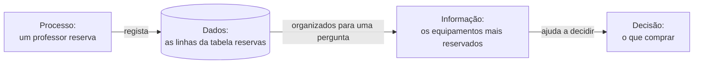
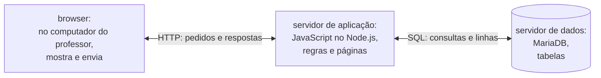
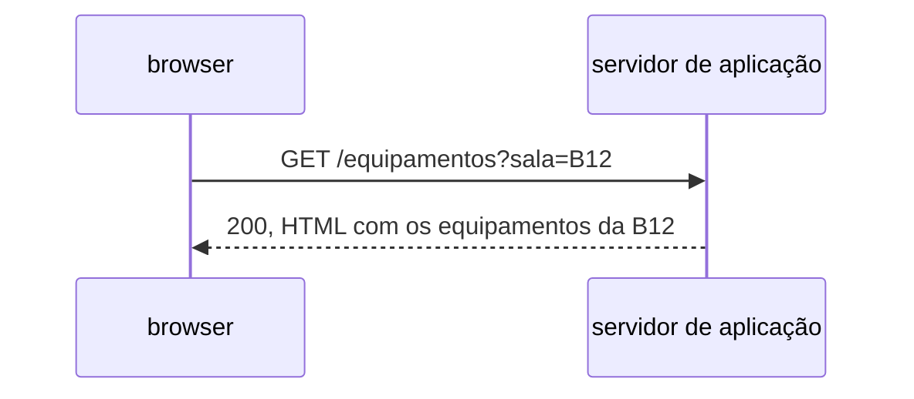
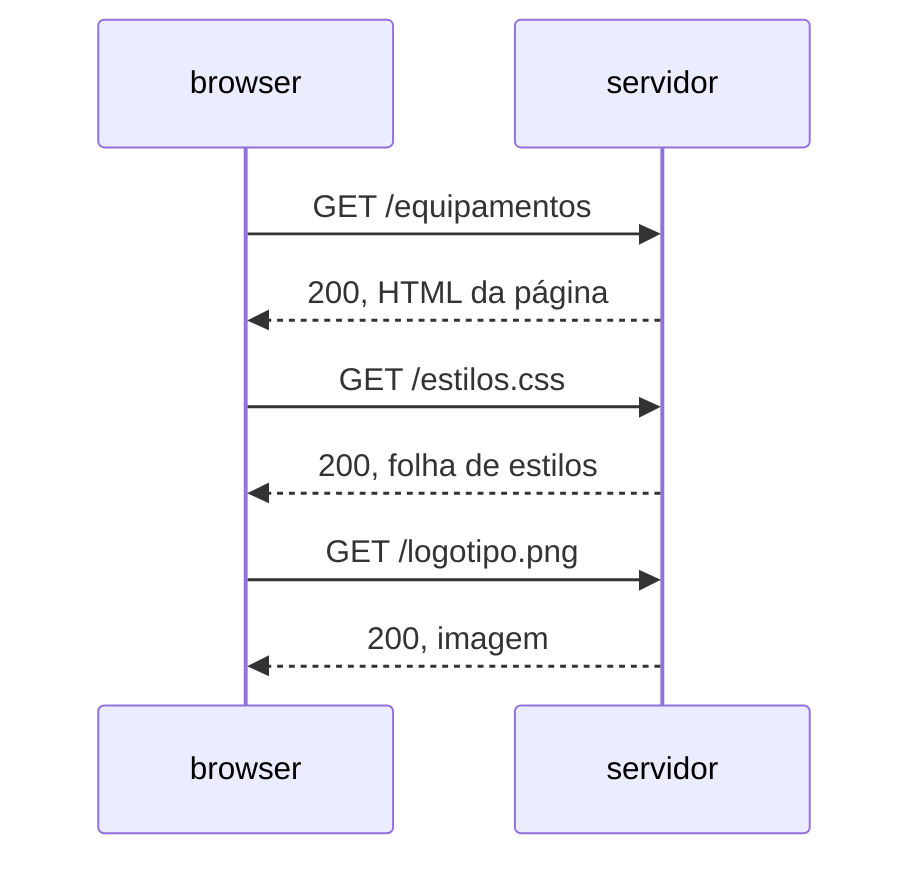
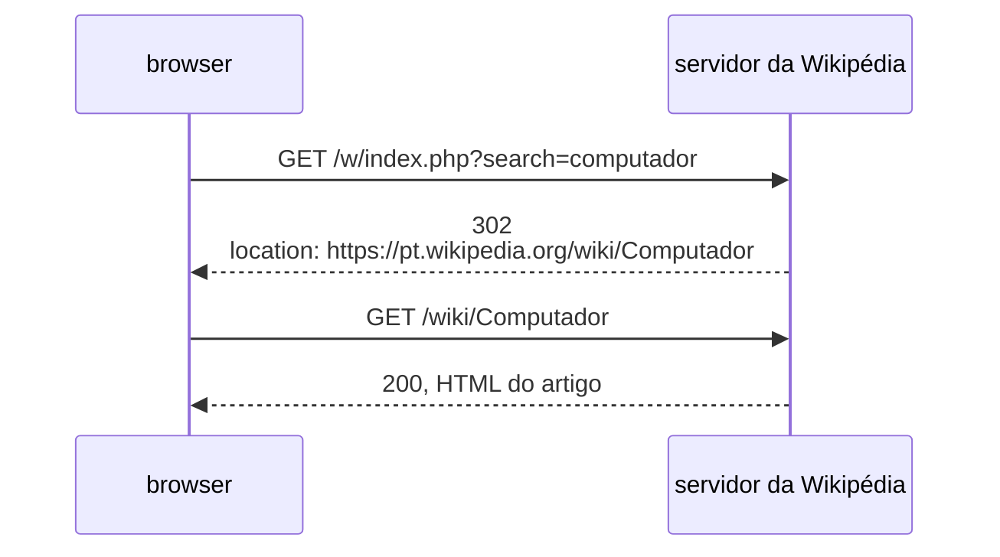
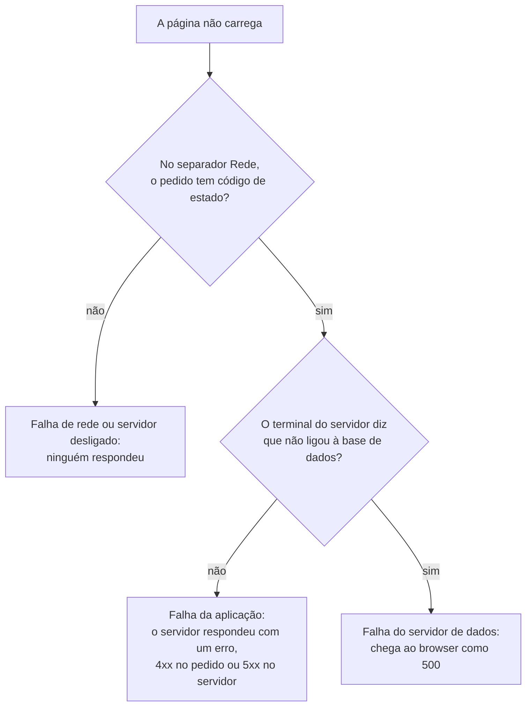
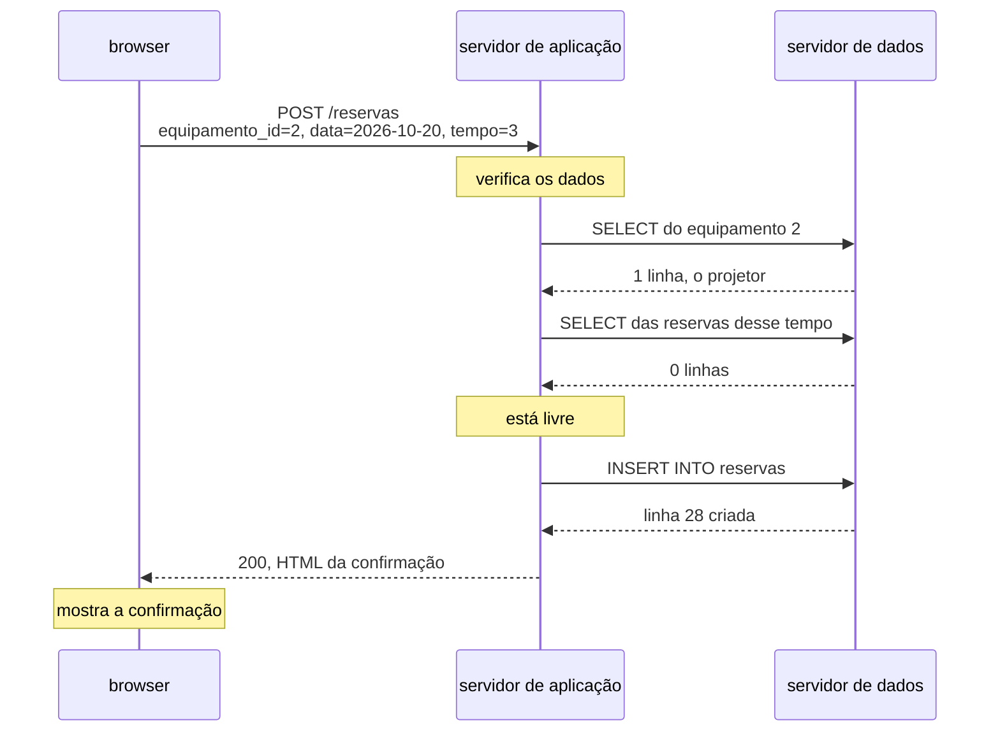

# Do pedido à resposta

Neste guia vês como a reserva de equipamentos de uma escola produz dados e informação, e que três programas trabalham numa aplicação web. Vês também como o browser e o servidor conversam em HTTP e como descobrir onde a conversa falhou quando uma página não abre. Não escreves nenhum servidor: segues uma reserva do clique até à base de dados.

Usa as tabelas e o SQL que aprendeste com o MariaDB, como o `SELECT`, o `JOIN` e o `GROUP BY`, e os formulários de HTML do 11.º ano. Rever: [Formulários HTML: anatomia de um formulário moderno](https://github.com/NunoMACastro/edu-docs-2ig-js-guias-2526/blob/8cf6ade3cf3d4508ea0fb4fbc5b2bedb29869a8f/HTML%20e%20CSS/05-formularios-html.md#1-anatomia-de-um-formulário-moderno). Para praticar: [laboratório](laboratorios/01-do-pedido-a-resposta-laboratorio.md) e [ficha de exercícios](exercicios/01-do-pedido-a-resposta-exercicios.md).

## Neste guia

1. [Parte 1: Um sistema de informação começa numa organização](#parte-1-um-sistema-de-informação-começa-numa-organização)
2. [Parte 2: Três programas, três papéis](#parte-2-três-programas-três-papéis)
3. [Parte 3: A conversa entre o browser e o servidor](#parte-3-a-conversa-entre-o-browser-e-o-servidor)
4. [Parte 4: O endereço, o método e o código de estado](#parte-4-o-endereço-o-método-e-o-código-de-estado)
5. [Exemplo guiado: uma reserva do princípio ao fim](#exemplo-guiado-uma-reserva-do-princípio-ao-fim)

## Parte 1: Um sistema de informação começa numa organização

Numa escola há equipamentos que ficam guardados numa sala, mas que qualquer professor pode levar para uma aula, como computadores portáteis, projetores e monitores. Quem precisa de um tem de o reservar. Durante anos, isto fez-se numa folha afixada na sala dos professores, onde cada professor escrevia o nome, o equipamento, o dia e o tempo letivo.

A folha funciona enquanto há poucos equipamentos e pouca gente. Depois, dois professores escrevem o mesmo projetor para o mesmo tempo, porque um não viu a linha do outro. Ninguém sabe dizer, sem contar à mão, que equipamentos são os mais reservados, e a escola não sabe o que comprar a seguir. E a folha só se consulta na sala dos professores.

Uma aplicação web resolve estes problemas. Qualquer professor faz a reserva a partir de qualquer computador, e a aplicação recusa uma reserva de um equipamento que já está ocupado nesse tempo. A direção pode perguntar, a qualquer momento, que equipamentos foram mais reservados no período. Esta aplicação de reservas é o exemplo de todo o guia.

### Um processo deixa dados registados

A escola é uma organização: pessoas com papéis diferentes que trabalham para o mesmo fim. Há professores que reservam equipamentos, um funcionário que os entrega e recebe, e uma direção que decide as compras.

Um **processo** é uma sequência de passos que a organização repete para chegar a um fim. A reserva de um equipamento é um processo. O professor escolhe o equipamento e o tempo, alguém verifica se está livre, e a reserva fica registada. No dia, o professor levanta o equipamento e, no fim, devolve-o. Cada passo tem alguém que o faz, e muitos deixam alguma coisa registada.

Os **dados** são os factos que ficam registados nos passos do processo, um a um: o equipamento 2, o dia 20 de outubro, o quinto tempo, o estado "confirmada". Na aplicação de reservas, ficam em duas tabelas.

A tabela `equipamentos`:

| id | nome | sala |
| ---: | --- | --- |
| 1 | Portátil | B12 |
| 2 | Projetor | A03 |
| 3 | Impressora | Secretaria |
| 4 | Monitor | B12 |

A tabela `reservas`:

| id | equipamento_id | data | tempo | estado |
| ---: | ---: | --- | ---: | --- |
| 25 | 1 | 2026-10-20 | 2 | confirmada |
| 26 | 2 | 2026-10-20 | 5 | confirmada |
| 27 | 2 | 2026-10-21 | 3 | cancelada |

A coluna `sala` diz onde o equipamento fica guardado, e a coluna `tempo` é o número do tempo letivo no dia.

Como no diagnóstico, o `equipamento_id` de cada reserva é uma chave estrangeira para a tabela de equipamentos: a reserva 26 é do equipamento 2, o projetor. A linha 26 nasceu no passo em que a reserva ficou registada.

### A informação responde a uma pergunta

Um dado sozinho diz pouco. "Projetor, 20 de outubro, quinto tempo" é um facto registado, mas não diz a que pergunta de alguém responde.

A **informação** é o resultado de organizar dados para responder a uma pergunta de alguém. "O projetor está livre no terceiro tempo de amanhã?" é uma pergunta de um professor, e a resposta é informação. "Que equipamentos foram mais reservados neste período?" é uma pergunta da direção, e a resposta é informação que ajuda a decidir uma compra. Os mesmos dados, organizados de formas diferentes, respondem a perguntas diferentes.

O que decide se um registo é um dado ou informação é o uso que se lhe dá. A linha 26, guardada na tabela, é um dado. Quando um professor pergunta "o projetor está ocupado no quinto tempo de 20 de outubro?", a mesma linha é a resposta, e serve-lhe de informação. Por isso, para dizeres se um registo é dado ou informação, diz qual é a pergunta e como os dados lhe respondem.

Um **sistema de informação** é o conjunto de pessoas, processos, dados e tecnologia que recolhe os dados quando o processo acontece e os transforma em informação quando alguém precisa dela.



O processo regista dados, os dados organizam-se para responder a uma pergunta, e a resposta ajuda alguém a decidir. A aplicação web é a parte tecnológica do sistema, mas não é o sistema inteiro. Se os professores continuarem a usar a folha, a aplicação não tem dados, e não há informação nenhuma para tirar dela.

Isto muda a forma de desenhar a tua aplicação. Antes de desenhares tabelas ou páginas, pergunta de que informação a organização precisa, e depois que passos do processo produzem os dados para a obter. Uma tabela que ninguém preenche, ou uma pergunta para a qual não se guardou o dado necessário, são erros de sistema de informação, e nenhum código os corrige.

## Parte 2: Três programas, três papéis

### O servidor de aplicação fica entre o browser e os dados

Quando um professor faz uma reserva, trabalham três programas, e cada um faz o que os outros não podem fazer.

O browser, como o Chrome, o Edge ou o Firefox, corre no computador do professor. Sabe pedir páginas, mostrá-las e enviar o que o professor escreve num formulário. Não sabe nada sobre reservas: não conhece as regras da escola nem vê a base de dados.

O **servidor de aplicação** é um programa que corre noutro computador, ou no mesmo, à espera de pedidos. É nele que vivem as regras do sistema. Recebe o pedido do browser, verifica as regras, como "este equipamento existe?" e "já está reservado nesse tempo?", e pede à base de dados aquilo de que precisa. Depois constrói a resposta, a página HTML que o browser vai mostrar. Neste módulo, o servidor de aplicação é um programa em JavaScript que corre no Node.js, o programa que corre JavaScript fora do browser. É esse servidor que vais escrever.

O **servidor de dados** é o sistema de gestão de base de dados, aqui o MariaDB, o mesmo com que aprendeste SQL. Guarda as tabelas e responde a consultas SQL. Não sabe o que é uma página web nem fala com o browser: recebe SQL do servidor de aplicação e devolve linhas.



São duas conversas, e não uma. O browser conversa com o servidor de aplicação em HTTP, a língua dos pedidos e das respostas da web. O servidor de aplicação conversa com o servidor de dados em SQL. Entre o browser e o servidor de dados não há seta, porque nunca conversam.

Os três programas podem estar em três computadores diferentes, e numa escola ou numa empresa é frequente. Nas aulas, enquanto desenvolves, vão estar muitas vezes os três no teu computador. Os papéis não mudam: continuam a ser três programas, cada um à espera do seu tipo de conversa.

Para confirmar que o desenho ficou claro, pega numa ação e pergunta onde corre:

| Ação | Onde corre |
| --- | --- |
| Mostrar a lista de equipamentos com cores e tipos de letra | browser |
| Decidir se o projetor está livre no terceiro tempo | servidor de aplicação, com uma consulta ao servidor de dados |
| Procurar as reservas do projetor para esse dia | servidor de dados, a executar o SQL |
| Construir o HTML da página de confirmação | servidor de aplicação |
| Guardar a nova linha na tabela de reservas | servidor de dados |
| Avisar que o campo do dia está vazio, antes de enviar | browser, só como ajuda; o servidor volta a verificar |

### O browser não fala com a base de dados

Parece mais simples o browser perguntar diretamente ao MariaDB. Não se faz, por duas razões, e as duas são de segurança.

A primeira é a palavra-passe. Para falar com o MariaDB, um programa precisa de um utilizador e de uma palavra-passe da base de dados. Tudo o que o browser recebe, quem o usa pode ler: basta abrir as ferramentas de programador, um painel do browser que mostra tudo o que chegou. Uma palavra-passe que chegue ao browser deixou de ser secreta. Por isso, a palavra-passe da base de dados fica só no servidor de aplicação, e nunca vai numa página, num ficheiro que o browser descarregue nem num repositório público.

A segunda são as regras. Se o browser pudesse escrever na tabela de reservas, quem quisesse escrevia lá o que lhe apetecesse. Podia reservar um equipamento que não existe, ou um projetor já ocupado. As regras têm de ser verificadas num sítio que quem usa o browser não controla, e esse sítio é o servidor. O browser pode ajudar, por exemplo a avisar que falta preencher um campo, mas essa ajuda é só conforto. Qualquer pessoa pode enviar um pedido sem passar pelo formulário, e por isso quem decide é sempre o servidor.

Há ainda uma consequência prática. Se o MariaDB passar para outro computador, só o servidor de aplicação tem de saber o endereço novo. O browser não muda nada, porque nunca falou com o MariaDB.

## Parte 3: A conversa entre o browser e o servidor

### O browser pede e o servidor responde

Pensa no balcão da reprografia da escola. O funcionário está do lado de dentro, à espera. Tu chegas e pedes "vinte cópias desta ficha". Ele faz o trabalho e entrega-te as cópias, ou diz-te que a máquina está avariada. O funcionário não vai à tua sala perguntar se precisas de cópias, e se fores lá três vezes, são três pedidos e três respostas.

Entre o browser e o servidor de aplicação, os papéis são sempre os mesmos. O browser é o **cliente**: é ele que começa a conversa, com um pedido. O servidor está à espera, recebe o pedido e devolve uma resposta. O servidor nunca fala primeiro, e se ninguém lhe pedir nada, não manda nada a ninguém. A regra é esta: um pedido, uma resposta. Cada vez que clicas numa ligação, escreves um endereço ou envias um formulário, o browser faz um pedido e espera pela resposta.

Para se perceberem, o browser e o servidor precisam de uma língua comum, com regras sobre o que se diz e por que ordem. Essa língua chama-se **HTTP** (HyperText Transfer Protocol, protocolo de transferência de hipertexto). Um protocolo é um conjunto de regras para uma conversa. Quando o endereço começa por `https`, a conversa é a mesma, mas vai cifrada pelo caminho, para que ninguém a meio do caminho a consiga ler ou alterar.

### Um pedido e uma resposta têm partes

Quando uma página não abre, tens de saber onde procurar. Um pedido e uma resposta HTTP têm sempre as mesmas partes, e é por elas que se procura:

| Parte | Onde aparece | O que diz |
| --- | --- | --- |
| Método | no pedido | O que o cliente quer fazer: `GET` para ver alguma coisa, `POST` para enviar dados que mudam alguma coisa |
| Endereço | no pedido | O que o cliente quer: a página dos equipamentos, a reserva 26 |
| Cabeçalhos | no pedido e na resposta | Linhas que descrevem a mensagem, como o servidor a que se destina ou o tipo do conteúdo |
| Corpo | às vezes no pedido, quase sempre na resposta | O conteúdo propriamente dito: os campos de um formulário, o HTML de uma página, os bytes de uma imagem |
| Código de estado | na resposta | Um número de três algarismos que diz como correu: `200` quer dizer que correu bem, `404` que o que se pediu não existe |

É assim que fica, por escrito, o pedido que o browser faz quando um professor abre a lista de equipamentos da sala B12:

```text
GET /equipamentos?sala=B12 HTTP/1.1
Host: localhost:3000
Accept: text/html
```

A primeira linha tem o método, o endereço dentro do servidor e a versão do protocolo. As outras são cabeçalhos: `Host` diz a que servidor se destina, e `Accept` diz que o browser prefere receber HTML. Este pedido `GET` não leva corpo, e por isso termina aqui.

E esta é a resposta, encurtada:

```text
HTTP/1.1 200 OK
Content-Type: text/html; charset=utf-8

<!doctype html>
<html lang="pt">
  <head><title>Equipamentos da sala B12</title></head>
  <body>
    <h1>Equipamentos da sala B12</h1>
    <ul>
      <li>Portátil</li>
      <li>Monitor</li>
    </ul>
  </body>
</html>
```

A primeira linha tem a versão e o código de estado, `200`, seguido de uma palavra que o explica. A linha `Content-Type` diz ao browser que o corpo é HTML, e é por isso que o browser o desenha como página em vez de o mostrar como texto. Depois de uma linha em branco começa o corpo, o HTML que o browser lê para desenhar a página que o professor vê.

Não tens de decorar este formato. Tens de saber que partes existem e para que serve cada uma. Nas ferramentas do browser, estas partes aparecem arrumadas numa lista, e alguns sites escrevem os nomes dos cabeçalhos em minúsculas, como `content-type`.

### O diagrama de um pedido mostra a conversa no tempo

Descrever uma conversa por palavras fica comprido depressa. Um diagrama mostra-a de uma vez: quem fala, com quem e por que ordem. Este é o diagrama do pedido da lista da B12:



Cada programa tem uma coluna, com o nome no topo, e o tempo corre de cima para baixo. Cada seta é uma mensagem, com o que leva escrito por cima. Nos pedidos escreve-se o método e o endereço, e nas respostas o código de estado e o que vem no corpo ou no cabeçalho que interessa. Aqui, os pedidos têm a seta cheia e as respostas a seta tracejada, para se distinguirem à primeira vista.

Este diagrama mostra só a conversa entre o browser e o servidor de aplicação.

### O servidor constrói a página para cada pedido

O HTML da resposta da B12 não estava guardado num ficheiro com a lista da sala. O servidor perguntou à base de dados que equipamentos estavam na B12, recebeu duas linhas e escreveu um `<li>` para cada uma. Se amanhã chegar um projetor à B12, o mesmo pedido recebe outro HTML, sem ninguém mexer em nenhum ficheiro.

A uma página que o servidor constrói no momento do pedido, a partir dos dados desse momento, chama-se **página dinâmica**.

### O separador Rede mostra cada pedido e cada resposta

A conversa entre o browser e o servidor não aparece na página: só se vê o resultado. Para veres os pedidos e as respostas, abres as **ferramentas de programador**, um painel que todos os browsers de computador trazem para quem faz páginas. Abrem-se com a tecla F12 ou com Ctrl+Shift+I, no Windows, e com Cmd+Option+I, no Mac.

Nas ferramentas há vários separadores. O separador Rede (em inglês, Network) lista os pedidos que o browser faz, um por linha, pela ordem em que os fez. Cada linha mostra o código de estado e o tipo da resposta. Quando clicas num pedido, vês as partes da mensagem. Em Cabeçalhos (em inglês, Headers) estão o endereço, o método, o código de estado e os cabeçalhos do pedido e da resposta. Em Resposta (Response) está o corpo da resposta.

O separador Rede só regista os pedidos feitos depois de estar aberto. Por isso, abre-o primeiro e só depois carrega a página.

### Uma página são muitos pedidos

Quando abres uma página, o browser não faz um pedido, faz vários. O primeiro pede o HTML. O browser lê o HTML e encontra lá referências a outros ficheiros: uma folha de estilos (`<link rel="stylesheet" href="estilos.css">`), imagens (``) ou código JavaScript (`<script src="menu.js">`). Para cada um, faz um pedido novo, e cada pedido tem a sua resposta e o seu código de estado.



O HTML vem sempre primeiro, porque o browser só sabe que outros ficheiros tem de pedir depois de o ler. É também por isso que às vezes a página aparece sem cores ou sem imagens: o HTML chegou, mas um dos pedidos seguintes falhou.

Numa página de um jornal online, é normal haver mais de cem pedidos. Muitos vão a outros servidores, porque o HTML pode mandar o browser buscar ficheiros a outros sítios.

### O servidor não se lembra de ti

Imagina que uma professora abre a página do projetor e, a seguir, envia o formulário da reserva. São dois pedidos, e o servidor não sabe, só pelo HTTP, que vieram da mesma pessoa. Recebe um pedido, responde e esquece.

Diz-se que o HTTP é **sem estado**: cada pedido é independente dos anteriores. Por isso, cada pedido tem de levar tudo aquilo de que o servidor precisa para responder, como o endereço completo e os dados do formulário. No caso da professora, o formulário da reserva envia outra vez qual é o equipamento, apesar de a página anterior já ser a do projetor.

<details>
<summary>Para ires mais longe: como é que um site se lembra de ti</summary>

Os sites que se lembram de quem os usa, como uma loja online que guarda o carrinho, juntam ao HTTP os cookies. Um cookie é um pequeno texto que o servidor pede ao browser para guardar, e que o browser envia de volta em cada pedido seguinte a esse servidor. É assim que o servidor reconhece que dois pedidos vêm do mesmo browser.

</details>

## Parte 4: O endereço, o método e o código de estado

### Cada parte do endereço responde a uma pergunta

O endereço que escreves na barra do browser chama-se **URL** (Uniform Resource Locator, localizador uniforme de recursos). Tem partes, e cada parte responde a uma pergunta diferente. Este é o endereço completo do pedido da lista da B12:

```text
http://localhost:3000/equipamentos?sala=B12
```

| Parte | Neste endereço | Responde a |
| --- | --- | --- |
| Protocolo | `http` | Que língua se fala: `http`, ou `https` se a conversa for cifrada |
| Computador | `localhost` | A que computador se envia o pedido |
| Porta | `3000` | A que programa, dentro desse computador |
| Caminho | `/equipamentos` | O que se pede a esse programa |
| Parâmetros de pesquisa | `?sala=B12` | Pormenores do pedido, como um filtro |

`localhost` é um nome especial que quer dizer "este computador". Quando o servidor corre no teu computador, é por `localhost` que o browser lhe chega.

Um computador pode ter vários programas à espera de pedidos ao mesmo tempo. Cada um escuta numa **porta**, um número que o distingue dos outros, e o endereço diz a que porta vai o pedido. Por isso, `http://localhost:3000/equipamentos` e `http://localhost:3001/equipamentos` chegam a dois programas diferentes, no mesmo computador.

A porta nem sempre aparece no endereço. Quando não aparece, o browser usa a porta habitual do protocolo: 80 para `http` e 443 para `https`. Por isso escreves `https://pt.wikipedia.org` sem porta nenhuma, e o browser vai à porta 443. Os servidores que vais escrever escutam numa porta como a 3000, que tem de aparecer no endereço.

O caminho identifica o que se pede: a lista dos equipamentos, a página de um equipamento, as reservas. Os parâmetros de pesquisa (em inglês, query string) começam no ponto de interrogação. Cada parâmetro é um nome e um valor, ligados por `=`, e quando há mais do que um separam-se com `&`, como em `?sala=B12&ordem=nome`. Servem para afinar o pedido sem mudar o que se pede: continuas a pedir a lista de equipamentos, mas só os da B12. Quando pesquisas numa loja online, o que escreveste aparece na barra de endereço, depois de um `?`.

<details>
<summary>Para ires mais longe: os espaços e os acentos num endereço</summary>

Alguns caracteres não podem ir tal como estão num endereço, como os espaços e as letras com acento. O browser troca-os por códigos. Se pesquisares "projetor de vídeo" na caixa de pesquisa de um site, o endereço que segue no pedido leva `projetor+de+v%C3%ADdeo`. O `+` está no lugar de cada espaço, e `%C3%AD` é o `í`. Na barra, o browser pode mostrar o `í`, mas vês os códigos quando copias o endereço ou no separador Rede. Não precisas de saber estes códigos, só de os reconhecer quando os vires.

</details>

### GET serve para ver e POST para mudar

Dos métodos do HTTP, interessam aqui dois.

`GET` pede para ver alguma coisa. Abrir uma página, seguir uma ligação, escrever um endereço na barra: tudo isto são pedidos `GET`. Um pedido `GET` não deve mudar nada no servidor. Podes repeti-lo cem vezes, e o resultado no servidor é o mesmo, porque continuas só a ver.

`POST` envia dados para o servidor fazer alguma coisa com eles, e normalmente essa coisa muda os dados guardados: criar uma reserva, cancelar uma reserva, registar uma devolução. Os dados vão no corpo do pedido, e não no endereço.

Esta divisão tem consequências práticas, porque o browser, os motores de pesquisa e outros programas partem do princípio de que um `GET` é seguro de repetir. Um browser pode voltar a pedir uma página quando carregas em "recuar", e um motor de pesquisa segue todas as ligações que encontra. Imagina que confirmar uma reserva era um `GET` a `/reservas/confirmar?equipamento=2&data=2026-10-20&tempo=3`. Bastava alguém seguir essa ligação, ou o browser voltar a carregá-la, para criar uma reserva que ninguém quis fazer. Por isso, tudo o que muda dados vai por `POST`.

### Uma rota junta um método e um caminho

No servidor de aplicação há código à espera de cada pedido que a aplicação aceita. O código que responde a `GET /equipamentos` não é o mesmo que responde a `GET /reservas`. A esse par, um método e um caminho, juntamente com o código que o trata, chama-se **rota**.

O método conta tanto como o caminho. `GET /reservas` e `POST /reservas` têm o mesmo caminho, mas são duas rotas: a primeira mostra as reservas, e a segunda cria uma reserva nova. Os parâmetros de pesquisa não fazem parte da rota. `GET /equipamentos?sala=B12` e `GET /equipamentos?sala=A03` chegam à mesma rota, `GET /equipamentos`, e é o código dela que lê o parâmetro para escolher os equipamentos.

### O código de estado diz como correu o pedido

Uma página bem desenhada não quer dizer que o pedido correu bem. Para isso, olha-se para o código de estado. Todas as respostas trazem um, e o primeiro algarismo diz a família. As famílias são só cinco:

| Família | Quer dizer | Exemplos que vais encontrar |
| --- | --- | --- |
| 1xx | Resposta intermédia, antes da final | Raramente os vês |
| 2xx | Correu bem | `200 OK`: aqui está o que pediste |
| 3xx | Vai a outro sítio | `302 Found`: o que pediste está noutro endereço, e o browser vai lá sozinho |
| 4xx | O problema está no pedido | `404 Not Found`: não existe nada neste endereço |
| 5xx | O problema está no servidor | `500 Internal Server Error`: o servidor falhou ao tratar um pedido que até estava certo |

A distinção entre 4xx e 5xx é a mais útil para quem programa. Um 4xx diz que o cliente pediu mal, como um endereço que não existe ou dados inválidos. Um 5xx diz que o servidor falhou, por um erro no código ou uma base de dados que não respondeu. Quando uma página tua der erro, o código de estado diz-te logo de que lado procurar.

Uma resposta `404` também tem corpo. Quando abres um artigo da Wikipédia que não existe, vês uma página bem desenhada a dizer que o artigo não existe, e essa página veio com o código 404. O código de estado é para o browser e para os programas, e o corpo é para a pessoa que lê.

### Um redirecionamento são dois pedidos

Se escreveres na barra o endereço `https://pt.wikipedia.org/w/index.php?search=computador`, que é uma pesquisa, aparece o artigo Computador, e a barra passa a mostrar o endereço do artigo. Escreveste um só endereço, mas houve dois pedidos.

O primeiro pedido, o da pesquisa, recebeu o código 302 e um cabeçalho `location`, com o endereço do artigo. O browser leu esse cabeçalho e fez sozinho um segundo pedido `GET` a esse endereço, que recebeu 200 e o HTML do artigo. A uma resposta 3xx que manda o browser pedir outro endereço chama-se **redirecionamento**.



Os dois pedidos saem do browser. O servidor escolhe o destino e escreve-o no `location`, mas não envia o artigo por iniciativa própria: é o browser que o pede.

### Sem código de estado, não houve resposta

Quando uma página não carrega, a primeira pergunta é em que parte da conversa falhou. Há três respostas possíveis, e o código de estado ajuda a separá-las:



São duas perguntas, por esta ordem: se o pedido teve código de estado e, se teve, se o terminal do servidor fala da base de dados. As respostas separam as três falhas: de rede ou servidor desligado, da aplicação e do servidor de dados.

Sem código de estado, o pedido não chegou a nenhum computador, ou chegou a um onde nenhum programa escuta naquela porta. Não houve resposta. O browser mostra uma página de erro dele, e não do servidor, com uma mensagem como "Não é possível aceder a este site". O Chrome e o Edge mostram também um código, como `ERR_CONNECTION_REFUSED`, que quer dizer ligação recusada. As causas possíveis são a rede ter caído, o endereço ou a porta estarem errados, ou o servidor não estar ligado. Confirma se outros sites abrem, se o servidor está a correr e se a porta do endereço é a porta onde ele escuta.

Com um código de estado 4xx ou 5xx, o pedido chegou e o servidor respondeu, e por isso está vivo. Um 404 diz que não há rota para aquele caminho, ou que o que se pediu não existe. Um 500 diz que o código do servidor falhou ao tratar o pedido. O servidor costuma deixar uma mensagem no terminal onde está a correr, e é aí que se procura a causa.

Uma falha do servidor de dados chega disfarçada, porque o browser só fala com o servidor de aplicação. O servidor de aplicação tentou fazer uma consulta, não conseguiu e respondeu 500. Para a reconhecer, lê a mensagem no terminal do servidor de aplicação, que costuma dizer que não conseguiu ligar-se à base de dados.

## Exemplo guiado: uma reserva do princípio ao fim

Este exemplo junta tudo o que viste. Segue uma operação, uma professora a reservar o projetor para uma aula, e regista cada pedido, o que o servidor faz e o que responde. As operações de qualquer aplicação web, incluindo a tua, fazem o mesmo caminho, do clique no browser até à base de dados e de volta. Não precisas de saber escrever nenhuma destas partes: precisas de perceber a ordem e quem faz cada coisa.

### Passo 1: o que a professora quer

A professora de Português quer o projetor no terceiro tempo de 20 de outubro. Em termos do processo, ela escolhe o equipamento e o tempo, a aplicação verifica se está livre e, se estiver, a reserva fica registada. No fim, a professora deve ver uma confirmação.

Antes de olhar para pedidos, escreve-se o que se espera. Se o projetor estiver livre, a reserva fica guardada com o estado "confirmada" e a professora vê a confirmação. Se não estiver, nada fica guardado e a professora vê porquê. Com o resultado esperado escrito antes, sabes depois se o que aconteceu está certo.

### Passo 2: ver a lista de equipamentos

A professora escreve o endereço da aplicação e abre a lista de equipamentos.

1. O browser faz `GET /equipamentos`.
2. A rota que trata `GET /equipamentos` pede ao servidor de dados a lista:

   ```sql
   SELECT id, nome, sala
   FROM equipamentos
   ORDER BY nome;
   ```

3. O MariaDB devolve as quatro linhas da tabela pela ordem dos nomes: Impressora, Monitor, Portátil e Projetor. É o `ORDER BY nome` que as ordena pelo nome, e não pelo `id`.
4. O servidor constrói o HTML da página, com uma linha por equipamento e uma ligação para cada um, e responde `200` com esse HTML.
5. O browser desenha a página. A seguir pede a folha de estilos e o logótipo da escola, em pedidos separados.

### Passo 3: abrir o projetor

A professora clica no projetor. A ligação aponta para `/equipamentos/2`, porque o projetor tem o `id` 2.

1. O browser faz `GET /equipamentos/2`.
2. O servidor percebe, pelo caminho, que se pede o equipamento 2, e pergunta por ele:

   ```sql
   SELECT id, nome, sala
   FROM equipamentos
   WHERE id = 2;
   ```

3. O MariaDB devolve uma só linha, a do projetor, na sala A03, porque o `WHERE id = 2` só deixa passar a linha com o `id` 2.
4. O servidor responde `200` com a página do projetor, que inclui um formulário de reserva com dois campos, o dia e o tempo, e um botão "Reservar". O formulário envia também o número do equipamento, sem o mostrar.

A mesma rota trata os caminhos de todos os equipamentos, e o número no fim diz qual se pede. Se a professora tivesse escrito `/equipamentos/9` à mão, a consulta não devolvia nenhuma linha, e o servidor respondia `404` com uma página a dizer que esse equipamento não existe.

### Passo 4: enviar a reserva

A professora escolhe o dia 20 de outubro e o terceiro tempo, e carrega em "Reservar". Agora vai mudar-se alguma coisa no sistema, e por isso o pedido é um `POST`, com os dados no corpo:

```text
POST /reservas HTTP/1.1
Host: localhost:3000
Content-Type: application/x-www-form-urlencoded

equipamento_id=2&data=2026-10-20&tempo=3
```

O corpo tem os campos do formulário no mesmo formato dos parâmetros de pesquisa: nome, `=`, valor, separados por `&`. O cabeçalho `Content-Type` diz ao servidor em que formato vem o corpo. O `equipamento_id` vai no corpo porque o servidor não se lembra de que a professora acabou de ver o projetor.

### Passo 5: o servidor verifica as regras

Antes de guardar o que quer que seja, o servidor verifica. Há três perguntas, e todas são feitas no servidor:

1. Os dados fazem sentido? O tempo é um número entre 1 e o último tempo do dia? A data é uma data válida e não está no passado?
2. O equipamento existe? Uma consulta como a do passo 3 responde.
3. O equipamento está livre nesse dia e nesse tempo?

   Antes de leres a consulta, prevê: alguma das reservas do projetor, a 26 ou a 27, o ocupa no terceiro tempo de 20 de outubro?

   ```sql
   SELECT id
   FROM reservas
   WHERE equipamento_id = 2
     AND data = '2026-10-20'
     AND tempo = 3
     AND estado = 'confirmada';
   ```

   A consulta não devolve nenhuma linha, e por isso ninguém tem o projetor nesse tempo. As duas reservas do projetor que já estão na tabela não contam. A 26 é do mesmo dia, mas do quinto tempo, e não ocupa o terceiro. A 27 é do terceiro tempo, mas de outro dia, e além disso está cancelada.

### Passo 6: guardar e responder

O projetor está livre, por isso o servidor guarda a reserva:

```sql
INSERT INTO reservas (equipamento_id, data, tempo, estado)
VALUES (2, '2026-10-20', 3, 'confirmada');
```

O MariaDB cria uma linha nova, com o `id` seguinte, o 28. O servidor responde `200` com uma página de confirmação: "Reserva 28: Projetor, 20 de outubro, terceiro tempo". O browser mostra-a, e a professora sabe que a reserva ficou feita.

Neste exemplo, os valores aparecem escritos no meio das consultas, para as leres com facilidade. No código do servidor, os valores que chegam de um pedido nunca se colam ao texto do SQL, porque quem envia o pedido podia escrever lá SQL seu.

### Passo 7: e se o projetor estivesse ocupado

Se a consulta do passo 5 tivesse devolvido uma linha, o servidor não guardava nada. Respondia com a página do projetor outra vez, com o formulário preenchido e uma mensagem: "O projetor já está reservado no terceiro tempo de 20 de outubro." A professora podia escolher outro tempo sem voltar a escrever tudo.

Esta verificação impede a segunda reserva, porque o segundo pedido encontra a primeira. Era o problema principal da folha da sala dos professores.

<details>
<summary>Para ires mais longe: dois pedidos ao mesmo tempo</summary>

Imagina dois pedidos para o projetor no terceiro tempo, a chegar exatamente ao mesmo tempo. Os dois podem fazer a consulta do passo 5 antes de qualquer um guardar a reserva. Os dois encontram o projetor livre, e os dois guardam. Este caso resolve-se com a ajuda da própria base de dados, e não só com esta consulta.

</details>

### Passo 8: o diagrama do pedido

O pedido do passo 4 até à resposta do passo 6 desenha-se assim:



As setas entre o browser e o servidor de aplicação são HTTP, e as setas entre o servidor de aplicação e o servidor de dados são SQL. As notas, nas caixas, dizem o que um programa faz sozinho, sem mandar mensagem a ninguém. O browser só aparece no princípio e no fim: tudo o que está no meio aconteceu sem ele ver.

### Passo 9: da reserva à informação

A reserva 28 é um registo guardado. Responde à professora, que quer saber se a sua reserva ficou confirmada. E junta-se às outras: daqui a umas semanas, a direção quer saber que equipamentos foram mais reservados, para decidir o que comprar. A pergunta responde-se com uma consulta do género das do diagnóstico:

```sql
SELECT e.nome, COUNT(*) AS total
FROM reservas AS r
JOIN equipamentos AS e ON e.id = r.equipamento_id
WHERE r.estado = 'confirmada'
GROUP BY e.nome
ORDER BY total DESC;
```

Com as linhas da tabela mais a reserva 28, o resultado é:

| nome | total |
| --- | ---: |
| Projetor | 2 |
| Portátil | 1 |

O Projetor tem as reservas 26 e 28, e o Portátil tem a 25. A 27 não conta, porque o `WHERE` deixa de fora as canceladas. Este quadro é informação: responde a uma pergunta de alguém da organização e ajuda a tomar uma decisão. Só existe porque cada reserva ficou registada com o equipamento certo e o estado certo.

## Erros frequentes

### Desenhar uma seta do browser para a base de dados

Num diagrama aparece uma seta do browser direta ao MariaDB, ou, numa resposta, a frase "o browser vai buscar os dados à base de dados". Acontece sobretudo a quem fez pedidos com `fetch` no React, onde o pedido parte do browser e parece ir direto aos dados. Para corrigir, escreve em cada seta a língua da conversa, HTTP ou SQL, e pergunta quem tem a palavra-passe. O browser pede ao servidor de aplicação, e é este que pede à base de dados.

### Achar que a página já estava feita

Numa explicação aparece "o servidor devolve o ficheiro da página". Acontece porque as páginas que fizeste nas aulas de HTML eram ficheiros, e um site de ficheiros fixos funciona assim. Numa página dinâmica, o servidor constrói o HTML no momento, a partir dos dados, e o mesmo endereço pode dar HTML diferente de um minuto para o outro.

### Achar que o POST é mais seguro do que o GET

Como os dados de um `POST` não aparecem no endereço, parece que vão escondidos. Não vão: o `POST` não cifra nada, e o corpo do pedido vê-se nas ferramentas de programador. O que protege a conversa pelo caminho é o `https`. O que separa o `GET` do `POST` é mudar ou não mudar dados.

## Palavras novas deste guia

- Processo: sequência de passos que uma organização repete para chegar a um fim.
- Dados: factos registados nos passos de um processo.
- Informação: dados organizados para responder a uma pergunta de alguém.
- Sistema de informação: pessoas, processos, dados e tecnologia que recolhem dados e os transformam em informação.
- Servidor de aplicação: programa que recebe os pedidos, verifica as regras e constrói as respostas.
- Servidor de dados: programa que guarda as tabelas e responde a consultas SQL.
- Cliente: programa que começa a conversa, com um pedido.
- HTTP: regras da conversa de pedidos e respostas entre o browser e o servidor.
- HTTPS: o HTTP com a conversa cifrada pelo caminho.
- Método: parte do pedido que diz o que o cliente quer fazer, como `GET` ou `POST`.
- Cabeçalho: linha que descreve um pedido ou uma resposta, como o tipo do conteúdo.
- Corpo: conteúdo de um pedido ou de uma resposta, como os campos de um formulário ou o HTML de uma página.
- Código de estado: número de três algarismos que diz como correu o pedido.
- Página dinâmica: página que o servidor constrói no momento do pedido, a partir dos dados.
- Ferramentas de programador: painel do browser que mostra, entre outras coisas, os pedidos e as respostas, no separador Rede.
- Sem estado: cada pedido HTTP é independente dos anteriores, e o servidor não sabe, só pelo HTTP, quem fez os pedidos anteriores.
- URL: o endereço que identifica o que se pede e a que computador.
- Porta: número que distingue os programas à escuta no mesmo computador.
- Caminho: parte do endereço que diz o que se pede ao servidor.
- Parâmetro de pesquisa: nome e valor depois do `?`, que afina o pedido.
- Rota: um método e um caminho que o servidor reconhece, com o código que trata esse pedido.
- Redirecionamento: resposta 3xx que manda o browser pedir outro endereço, escrito no cabeçalho `location`.

## O que vem a seguir

No tema seguinte, Primeiro servidor, escreves um servidor em Node.js com o Express e vês do lado dele a conversa que este guia descreveu do lado do browser.

## Para saber mais

- [An overview of HTTP](https://developer.mozilla.org/en-US/docs/Web/HTTP/Guides/Overview), na MDN, em inglês: o pedido, a resposta e as suas partes, com mais pormenor.
- [HTTP response status codes](https://developer.mozilla.org/en-US/docs/Web/HTTP/Reference/Status), na MDN, em inglês: a lista dos códigos de estado, com o que quer dizer cada um.


