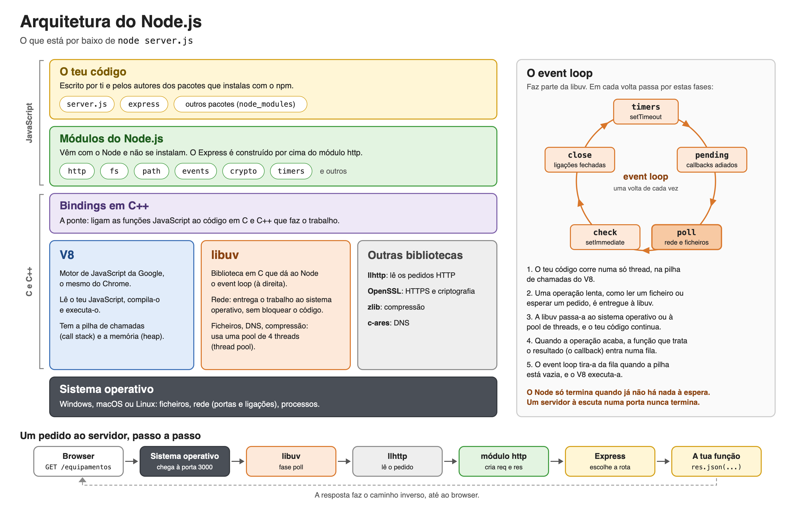
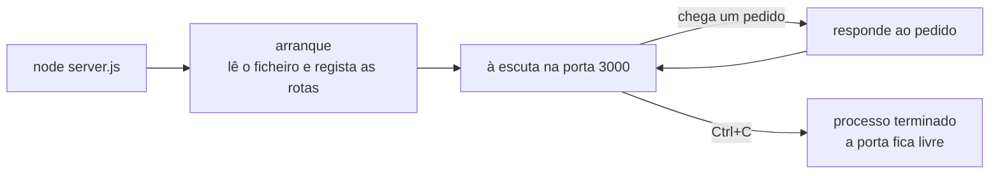
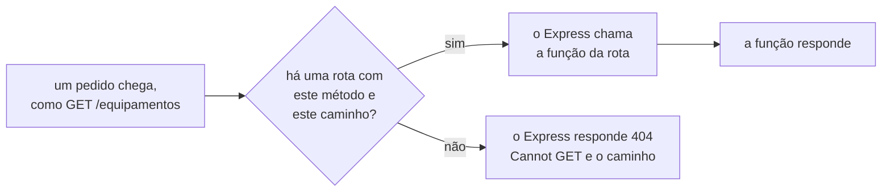

# Primeiro servidor

Neste guia passas para o outro lado da conversa do tema 01: escreves o programa que espera pelos pedidos e lhes responde. Vês o que é o Node.js, preparas a pasta de um servidor com o npm e constróis um servidor Express com duas rotas, o catálogo de equipamentos da escola. Aprendes também a ler as mensagens de erro de um servidor que não arranca.

Usa a porta e as rotas do tema 01 e, do 11.º ano, as funções passadas a outras e o `let` e o `const`, dentro e fora de funções. Rever: [Cada parte do endereço responde a uma pergunta](01-do-pedido-a-resposta.md#cada-parte-do-endereço-responde-a-uma-pergunta), [Uma rota junta um método e um caminho](01-do-pedido-a-resposta.md#uma-rota-junta-um-método-e-um-caminho), [Funções de Callback](https://github.com/NunoMACastro/edu-docs-2ig-js-guias-2526/blob/8cf6ade3cf3d4508ea0fb4fbc5b2bedb29869a8f/JavaScript/10-Funcoes.md#8-funções-de-callback), [Três formas de criar variáveis](https://github.com/NunoMACastro/edu-docs-2ig-js-guias-2526/blob/8cf6ade3cf3d4508ea0fb4fbc5b2bedb29869a8f/JavaScript/01-Variaveis-Tipos.md#1-três-formas-de-criar-variáveis-e-qual-escolher) e [Escopos e shadowing](https://github.com/NunoMACastro/edu-docs-2ig-js-guias-2526/blob/8cf6ade3cf3d4508ea0fb4fbc5b2bedb29869a8f/JavaScript/01-Variaveis-Tipos.md#2-escopos-e-shadowing). Para praticar: [laboratório](laboratorios/02-primeiro-servidor-laboratorio.md) e [ficha de exercícios](exercicios/02-primeiro-servidor-exercicios.md).

## Neste guia

1. [O Node.js corre JavaScript fora do browser](#o-nodejs-corre-javascript-fora-do-browser)
2. [O teu código corre por cima do Node e do sistema operativo](#o-teu-código-corre-por-cima-do-node-e-do-sistema-operativo)
3. [Um servidor é um processo que fica à escuta até o parares](#um-servidor-é-um-processo-que-fica-à-escuta-até-o-parares)
4. [O npm e o ficheiro package.json](#o-npm-e-o-ficheiro-packagejson)
5. [Instalar o Express cria a pasta node_modules](#instalar-o-express-cria-a-pasta-node_modules)
6. [O "type": "module" deixa o Node aceitar o import](#o-type-module-deixa-o-node-aceitar-o-import)
7. [O Express liga cada rota a uma função](#o-express-liga-cada-rota-a-uma-função)
8. [A resposta leva texto, com res.send, ou dados, com res.json](#a-resposta-leva-texto-com-ressend-ou-dados-com-resjson)
9. [O arranque corre uma vez, e a função de uma rota a cada pedido](#o-arranque-corre-uma-vez-e-a-função-de-uma-rota-a-cada-pedido)
10. [Uma mensagem de erro lê-se pelo tipo e pela linha](#uma-mensagem-de-erro-lê-se-pelo-tipo-e-pela-linha)
11. [Exemplo guiado: o catálogo de equipamentos](#exemplo-guiado-o-catálogo-de-equipamentos)

## O Node.js corre JavaScript fora do browser

Até agora, quase todo o JavaScript que escreveste correu dentro do browser, numa página. Um servidor não pode ser assim: corre num computador sem página nenhuma aberta, à espera de pedidos que chegam pela rede.

O **Node.js** é um programa que executa JavaScript fora do browser, diretamente no sistema operativo. A linguagem é a mesma: as variáveis, as funções, os arrays e os objetos escrevem-se da mesma maneira. O que muda é o que está à volta.

| | No browser | No Node.js |
| --- | --- | --- |
| Para que serve o JavaScript | Mexer na página que o utilizador vê | Escrever programas que correm no computador, como um servidor |
| O que há à volta | O `document`, o `window`, os cliques | Os ficheiros do disco, a rede e as portas |
| Onde aparece o `console.log` | Na consola das ferramentas de programador | No terminal onde o programa corre |

Um programa em Node é um ficheiro de texto com JavaScript, como este `ola.js`:

```js
// ola.js: um programa que escreve duas linhas e termina.
const escola = "EPMS";
console.log(`Olá, ${escola}!`);
console.log("Este JavaScript está a correr no Node, e não num browser.");
```

Corre-se no terminal, na pasta onde está o ficheiro, com o comando `node` seguido do nome do ficheiro:

```bash
node ola.js
```

O terminal mostra:

```text
Olá, EPMS!
Este JavaScript está a correr no Node, e não num browser.
```

Depois de escrever as duas linhas, o programa termina: fez o que tinha a fazer, de cima para baixo, e o terminal fica livre para o comando seguinte. Um servidor, como vais ver, não termina.

Para saberes que versão do Node tens, escreve `node --version`. A versão da disciplina é a 24.

## O teu código corre por cima do Node e do sistema operativo

Quando escreves `node server.js`, o teu ficheiro não fala sozinho com a rede. Por baixo dele há várias camadas. Conhecê-las ajuda a ler as mensagens de erro. Uma linha que começa por `node:internal/` vem dos módulos do próprio Node, e uma com o nome do teu ficheiro vem do teu código.



A imagem lê-se de cima para baixo. O V8, a libuv e as outras bibliotecas estão lado a lado, na mesma camada:

| Camada | O que faz |
| --- | --- |
| O teu código | O `server.js` e o código de outras pessoas que o teu servidor usa, como o Express. Tudo JavaScript |
| Os módulos do Node.js | Vêm com o Node e não se instalam. O `http` recebe os pedidos e envia as respostas, e o Express é construído por cima dele |
| Os bindings em C++ (ligações) | A ponte entre as funções JavaScript do Node e o código em C e C++ que faz o trabalho |
| O **V8** | O motor que lê o teu JavaScript e o executa, o mesmo do Chrome |
| A **libuv** | A biblioteca que espera pela rede e pelos ficheiros, sem parar o teu código |
| As outras bibliotecas | Trabalhos à parte, como ler os pedidos HTTP, com o llhttp, e cifrar o HTTPS, com o OpenSSL |
| O sistema operativo | O Windows, o macOS ou o Linux, que têm as portas, as ligações de rede e os ficheiros |

A faixa de baixo segue um pedido `GET /equipamentos`. O pedido chega à porta 3000 do sistema operativo, a libuv dá por ele e o llhttp lê-o. O módulo `http` prepara dois objetos, um com o pedido e outro para a resposta. O Express escolhe a rota e chama a tua função, que responde, e a resposta faz o caminho inverso até ao browser. Das sete caixas desta faixa, só escreves a última.

<details>
<summary>Para ires mais longe: o event loop, à direita da imagem</summary>

O teu código corre numa só linha de execução (a thread da imagem): faz uma coisa de cada vez. Quando tem de esperar por uma coisa lenta, como um pedido que ainda não chegou, não fica parado. Entrega essa espera à libuv e continua. Quando a espera acaba, a função que trata o resultado entra numa fila, e o event loop (ciclo de eventos) tira-a de lá quando o V8 está livre. É assim que um servidor Node atende muitos pedidos, apesar de o teu código fazer uma coisa de cada vez. As fases do círculo são a ordem pela qual o event loop percorre as filas, em cada volta.

</details>

## Um servidor é um processo que fica à escuta até o parares

O `ola.js` corre e termina. Um servidor não pode terminar, porque tem de estar ligado quando chegar um pedido, e não sabe quando é que isso vai acontecer.

A um programa que está a correr chama-se **processo**. No tema 01, um processo era uma sequência de passos de uma organização; aqui, a mesma palavra tem o sentido que lhe dá o sistema operativo. Quando escreves `node server.js`, o Node lê o ficheiro, prepara as rotas, pede ao sistema operativo uma porta para escutar e fica à espera. O terminal deixa de aceitar comandos, porque está ocupado com o servidor. Não é um erro: o Node só termina quando já não há nada à espera, e um servidor à escuta está sempre à espera. É o que dizem as duas últimas frases da caixa do event loop, na imagem.

Para parares o servidor, carrega em Ctrl+C no terminal onde ele está a correr. No Mac também é Ctrl, e não Cmd. O processo termina, a porta fica livre, e um pedido do browser passa a dar "ligação recusada", sem código de estado, como em [Sem código de estado, não houve resposta](01-do-pedido-a-resposta.md#sem-código-de-estado-não-houve-resposta).



O diagrama mostra a vida do processo. Depois do arranque, o servidor fica à escuta, e volta lá depois de cada resposta. Só sai desse ciclo quando carregas em Ctrl+C.

Daqui saem três regras práticas.

Só um processo de cada vez pode escutar numa porta. Se ligares o servidor num terminal e o voltares a ligar noutro, o segundo não consegue a porta e não arranca. O primeiro continua a responder.

O Node lê o ficheiro uma vez, no arranque. Se mudares o `server.js` com o servidor ligado, ele continua a correr o código que leu. Para veres a mudança, paras o servidor com Ctrl+C e voltas a ligá-lo.

O que está na memória do processo perde-se quando ele termina. Os equipamentos do exemplo deste guia estão num array: se o servidor acrescentasse um equipamento, ele desapareceria ao parar o servidor. É por isso que os dados de uma aplicação ficam num servidor de dados, que os guarda no disco.

<details>
<summary>Para ires mais longe: o node --watch reinicia o servidor sozinho</summary>

Com `node --watch server.js`, o Node fica atento ao ficheiro e reinicia o servidor sempre que o guardas. No terminal aparece a linha `Restarting 'server.js'` e, a seguir, a mensagem do arranque. É cómodo, mas faz por ti o Ctrl+C e o `node server.js`, e convém primeiro perceber porque é que eles fazem falta.

</details>

## O npm e o ficheiro package.json

O Express não vem com o Node. É um **pacote**: código JavaScript escrito por outras pessoas e publicado num catálogo na internet, de onde qualquer projeto o pode descarregar. O programa que descarrega e organiza os pacotes chama-se **npm** (Node Package Manager, gestor de pacotes do Node) e vem instalado com o Node.

Os dois comandos fazem coisas diferentes. O `npm` prepara a pasta e trata dos pacotes de que o programa precisa. O `node` corre o programa.

Cada servidor vive na sua pasta, com um ficheiro `package.json`. Este ficheiro descreve o projeto: o nome, a versão, os pacotes de que precisa e algumas regras de funcionamento. Cria-se, dentro da pasta, com:

```bash
npm init -y
```

O `-y` responde "sim" a todas as perguntas que o npm faria e aceita os valores por omissão. Numa pasta chamada `catalogo-de-equipamentos`, o ficheiro criado fica assim:

```json
{
  "name": "catalogo-de-equipamentos",
  "version": "1.0.0",
  "description": "",
  "main": "index.js",
  "scripts": {
    "test": "echo \"Error: no test specified\" && exit 1"
  },
  "keywords": [],
  "author": "",
  "license": "ISC",
  "type": "commonjs"
}
```

O nome vem da pasta. Para este servidor, dos outros campos só interessa o último, `"type"`, que vais mudar.

## Instalar o Express cria a pasta node_modules

Com o `package.json` criado, o Express instala-se com:

```bash
npm install express
```

O npm vai buscar o Express à internet e escreve no fim uma linha como `added 65 packages`. São dezenas de pacotes para pedir um, porque o Express usa outros pacotes, que usam outros, e o npm traz todos. O número exato muda um pouco de uma versão do Express para outra.

Um pacote de que o projeto precisa para funcionar é uma **dependência** dele. O Express é a dependência deste servidor, e o comando deixa três coisas novas na pasta:

| O que aparece | Para que serve | Vai para as entregas e para o Git? |
| --- | --- | --- |
| A pasta `node_modules` | Tem o código de todos os pacotes instalados. É aqui que o Node os procura | Não. Recria-se com `npm install` |
| A secção `dependencies`, no `package.json` | Diz que o projeto precisa do Express: `"express": "^5.3.0"` | Sim, com o resto do `package.json` |
| O ficheiro `package-lock.json` | Guarda a versão exata de cada pacote instalado, para outra pessoa instalar as mesmas | Sim |

O `^` em `"^5.3.0"` quer dizer "a 5.3.0 ou uma mais recente, desde que continue a ser 5". Uma versão 6 poderia mudar coisas de que o código depende, e por isso não é aceite.

Na pasta `node_modules` não se mexe: é código dos pacotes, e não teu. Para a recriar, noutro computador ou depois de a apagares, basta `npm install`, sem mais nada. O comando lê o `package.json` e o `package-lock.json` e instala exatamente o que lá está.

## O "type": "module" deixa o Node aceitar o import

A primeira linha de código do servidor vai buscar o Express:

```js
import express from "express";
```

Lê-se assim: vai buscar o que o pacote `express` exporta por omissão, o que um `import` sem chavetas apanha, e chama-lhe `express` neste ficheiro. Quando o texto entre aspas é só um nome, como `"express"`, o Node procura um pacote com esse nome na pasta `node_modules`. Quando começa por `./`, como `"./dados.js"`, procura um ficheiro teu, a partir da pasta do ficheiro que faz o `import`. Por isso, o `import` de um pacote só funciona depois do `npm install`.

Com o `package.json` como o `npm init -y` o deixa, esta linha não corre. O Node recusa-a com:

```text
SyntaxError: Cannot use import statement outside a module
```

Por cima desta linha, o Node mostra a linha do `import` e, antes dela, um aviso que já diz a correção: `Make sure to set "type": "module"`.

O problema é que o Node tem dois sistemas de módulos, por razões históricas. O mais antigo chama-se **CommonJS** e usa `require` em vez de `import`:

```js fragment
const express = require("express");
```

O mais recente é o que usaste no 11.º ano, com `import` e `export`, e é também o do browser. Chama-se módulos ES, de ECMAScript, o nome oficial do JavaScript. Os dois sistemas fazem o mesmo, mas não se misturam no mesmo ficheiro. Rever: [Exportar e importar](https://github.com/NunoMACastro/edu-docs-2ig-js-guias-2526/blob/8cf6ade3cf3d4508ea0fb4fbc5b2bedb29869a8f/JavaScript/13-Modulos-ES.md#2-exportar-e-importar).

O campo `"type"` do `package.json` diz ao Node que sistema usam os ficheiros da pasta. Com `"type": "commonjs"`, que é o que o `npm init -y` escreve, o Node lê o `server.js` como CommonJS e não aceita o `import`. Por isso, depois do `npm init -y`, muda-se uma palavra no `package.json`, na linha do `"type"`:

```json
{
  "type": "module"
}
```

No ficheiro, não se apaga o resto: muda-se só `"commonjs"` para `"module"`, sem mexer nas aspas nem na pontuação. O comando `npm pkg set type=module` faz a mesma troca, sem abrires o ficheiro. Nos servidores desta disciplina, o `package.json` tem sempre `"type": "module"`, e os ficheiros usam sempre `import`.

<details>
<summary>Para ires mais longe: quando o package.json não tem o campo "type"</summary>

Se o campo `"type"` não existir, o Node 24 tenta adivinhar. Vê o `import`, corre o ficheiro como módulo ES e pode escrever um aviso a pedir que acrescentes `"type": "module"` ao `package.json`. Funciona, mas o aviso aparece em cada arranque, e as versões mais antigas do Node não adivinham. Com o campo escrito, o Node não tem de adivinhar.

</details>

## O Express liga cada rota a uma função

Com o módulo `http` do Node já se pode escrever um servidor, mas dá muito trabalho repetitivo. Para cada pedido, terias de olhar para o método e para o caminho e decidir, com uma série de `if`, que código corre. Terias também de escrever à mão os cabeçalhos da resposta. O **Express** é um pacote que faz esse trabalho por ti: escreves só que rotas o servidor conhece e o que responde a cada uma.

Um servidor Express tem quatro peças:

| Peça | O que faz |
| --- | --- |
| `const app = express();` | Cria a aplicação. Por costume chama-se `app`, e é ela que guarda as rotas |
| `app.get(caminho, função)` | Regista uma rota: quando chegar um pedido `GET` a este caminho, o Express chama esta função |
| A função da rota, `(req, res) => { ... }` | Recebe dois objetos. O `req` (de request, pedido) tem o que veio no pedido. O `res` (de response, resposta) tem os métodos para responder |
| `app.listen(porta, função)` | Liga o servidor: pede a porta ao sistema operativo e, quando a consegue ou quando falha, chama a função |

A rota da lista de equipamentos, no exemplo guiado, junta as duas peças do meio:

```js fragment
app.get("/equipamentos", (req, res) => {
  res.json(equipamentos);
});
```

Quando chega um pedido `GET /equipamentos`, o Express chama a função, e ela responde com o array `equipamentos`. A função recebe sempre os dois objetos pela mesma ordem, primeiro o pedido e depois a resposta. Esta não usa o `req`, mas tem de o declarar para chegar ao `res`, que vem em segundo.



O diagrama mostra o que o Express faz a cada pedido. Procura, entre as rotas registadas, a que tem o mesmo método e o mesmo caminho, e chama a função dela. Se não encontra nenhuma, responde ele próprio com 404, sem escreveres nada para isso.

<details>
<summary>Para ires mais longe: porque é que este servidor não usa await</summary>

Talvez já tenhas visto servidores com `async` e `await` nas funções das rotas. Servem para esperar por uma operação demorada, como uma consulta à base de dados, sem parar o servidor enquanto ela não acaba. Neste servidor, nenhuma rota espera por nada: os equipamentos estão num array na memória, e a resposta é imediata. O `await` só faz falta quando a rota tem de esperar por uma resposta, como a de uma base de dados.

</details>

## A resposta leva texto, com res.send, ou dados, com res.json

Dentro da função da rota, o `res` tem os métodos que constroem a resposta. Este servidor usa dois. Cada um escolhe por ti o código de estado e o tipo de conteúdo da resposta, o cabeçalho `Content-Type` que viste no tema 01.

| O que acontece no servidor | O que o Express envia | Código | Tipo de conteúdo |
| --- | --- | --- | --- |
| A função chama `res.send("Olá! O servidor está a funcionar.")` | O texto, tal como está | 200 | `text/html` |
| A função chama `res.json(equipamentos)` | O array, convertido em texto JSON | 200 | `application/json` |
| Nenhuma rota corresponde ao pedido | Uma pequena página com `Cannot GET` e o caminho | 404 | `text/html` |

Com um texto, o `res.send` parte do princípio de que é HTML, e o browser mostra-o como página. O `res.json` diz ao browser, com o tipo `application/json`, que o corpo são dados, e não uma página. Nas ferramentas de programador, a seguir ao tipo aparece `charset=utf-8`, que diz como estão escritos os acentos.

## O arranque corre uma vez, e a função de uma rota a cada pedido

Imagina que acrescentas um `console.log` dentro da função da rota da lista:

```js fragment
app.get("/equipamentos", (req, res) => {
  console.log("Alguém pediu a lista de equipamentos");
  res.json(equipamentos);
});
```

Prevê: a frase aparece quando ligas o servidor? E quantas vezes aparece, se pedires a lista duas vezes e a página inicial uma vez?

Não aparece quando ligas o servidor. Aparece duas vezes, no terminal, uma por cada pedido à lista. A razão é que o mesmo ficheiro corre em dois momentos diferentes.

O **arranque** é o momento em que o Node lê o ficheiro de cima para baixo, uma só vez, e liga o servidor. Depois, o servidor fica à escuta, e cada pedido faz correr só a função da rota que lhe corresponde. A tabela segue um servidor com as duas rotas, a de `/` e a de `/equipamentos`, com o `console.log` a mais, desde o `node server.js` até quatro pedidos:

| Ordem | O que corre | Momento |
| --- | --- | --- |
| 1 | O `import` vai buscar o Express | arranque |
| 2 | `express()` cria a aplicação, e as constantes com a porta e com os equipamentos ficam com os seus valores | arranque |
| 3 | Os dois `app.get` registam as rotas de `/` e de `/equipamentos`, sem correr as funções | arranque |
| 4 | O `app.listen` pede a porta e, quando a tem, a função dele escreve `Servidor a correr em http://localhost:3000` | arranque |
| 5 | Pedido `GET /equipamentos`: o Express chama a função da rota, que escreve a frase no terminal e responde com a lista | pedido |
| 6 | Pedido `GET /`: o Express chama a função da outra rota, que responde com o texto. A frase não aparece | pedido |
| 7 | Pedido `GET /equipamentos`, outra vez: a função corre outra vez, e a frase aparece pela segunda vez | pedido |
| 8 | Pedido `GET /nao-existe`: nenhuma função tua corre, e o Express responde 404 | pedido |

Um `app.get` não responde a nada: guarda uma regra para mais tarde. A função que lhe passas só corre quando chega um pedido a esse caminho, uma vez por cada pedido. Se ninguém pedir, nunca corre.

Saber em que momento corre uma linha ajuda a perceber os erros. Um erro numa linha do arranque impede o servidor de ligar. Um erro dentro da função de uma rota só aparece quando alguém pede essa rota. Por exemplo, com `res.sendd` em vez de `res.send` na rota de `/`, o servidor arranca sem problemas, e a lista responde. Só o pedido a `/` falha: o terminal mostra `TypeError: res.sendd is not a function`, e o browser recebe uma resposta 500, com uma página que mostra o mesmo erro. O servidor continua a correr, e a outra rota continua a responder.

## Uma mensagem de erro lê-se pelo tipo e pela linha

Quando o servidor não arranca, o terminal enche-se de linhas em inglês, e quase todas são o caminho que o erro fez por dentro do Node. Para ti contam duas. Este é o início da mensagem de quem escreveu `app.gett` em vez de `app.get` na linha 23 do `server.js`:

```text
file:///.../catalogo-de-equipamentos/server.js:23
app.gett("/equipamentos", (req, res) => {
    ^

TypeError: app.gett is not a function
    at file:///.../catalogo-de-equipamentos/server.js:23:5
```

Por baixo vêm mais linhas começadas por `at` e, no fim, a versão do Node. Lê-se assim:

| Procura | Neste erro | O que te diz |
| --- | --- | --- |
| A linha que começa pelo tipo do erro, como `SyntaxError`, `TypeError` ou `Error` | `TypeError: app.gett is not a function` | O que aconteceu: tentaste chamar uma coisa que não é uma função, porque `app.gett` não existe |
| Acima dela, o nome de um ficheiro com o número da linha | `server.js:23`, com a linha copiada e um `^` por baixo da parte que falhou | Onde aconteceu. Se o ficheiro começar por `node:internal/`, a linha é do próprio Node, e não tua: a pista está na linha do tipo do erro, como o nome do pacote ou do ficheiro que faltou |
| As linhas que começam por `at` | `at file:///...` | O percurso por dentro do Node. Quase sempre podes ignorá-las |

As mensagens do Node estão sempre em inglês. As que aparecem mais vezes num primeiro servidor estão nos [Erros frequentes](#erros-frequentes), no fim do guia, cada uma com a causa e a correção.

## Exemplo guiado: o catálogo de equipamentos

A aplicação de reservas do tema 01 começa por um catálogo: a lista dos equipamentos que se podem reservar. Antes de haver base de dados, os equipamentos ficam num array, dentro do próprio servidor. O servidor tem duas rotas:

- `GET /` responde com um texto curto, só para se ver que o servidor está vivo;
- `GET /equipamentos` responde com a lista dos equipamentos, em JSON.

O resultado esperado, escrito antes de testar: `http://localhost:3000/` mostra o texto, `http://localhost:3000/equipamentos` mostra os quatro equipamentos, e qualquer outro caminho dá 404.

### Passo 1: a pasta e o package.json

Os comandos criam a pasta e entram nela, criam o `package.json` e instalam o Express:

```bash
mkdir catalogo-de-equipamentos
cd catalogo-de-equipamentos
npm init -y
npm install express
```

No `package.json`, muda o `"commonjs"` para `"module"`. A pasta fica com o `package.json`, o `package-lock.json` e a pasta `node_modules`. Falta o ficheiro do servidor.

### Passo 2: o servidor mais pequeno que arranca

O servidor começa sem rotas, só com a aplicação e o `listen`. Na mesma pasta, cria o ficheiro `server.js` com esta primeira versão:

```js
// server.js: o primeiro servidor do catálogo de equipamentos da escola.
// Fica à escuta na porta 3000 e responde a dois pedidos GET.
import express from "express";

const app = express();
const PORTA = 3000;

// Liga o servidor: a partir daqui fica à escuta na porta 3000.
// Se não conseguir (por exemplo, porque a porta já está ocupada),
// o Express chama esta função com o erro.
app.listen(PORTA, (erro) => {
  if (erro) {
    console.error(`Não foi possível ligar o servidor: ${erro.message}`);
    return;
  }
  console.log(`Servidor a correr em http://localhost:${PORTA}`);
});
```

A constante `PORTA` guarda o número da porta, que aparece duas vezes: com ela, mudar de porta é mudar uma linha. O `if (erro)` faz falta porque, no Express 5, a função do `listen` é chamada nos dois casos, quando conseguiu a porta e quando falhou. Sem o `if`, com a porta ocupada, o terminal escrevia "Servidor a correr em http://localhost:3000", que seria mentira, e o processo terminava logo a seguir.

Liga o servidor:

```bash
node server.js
```

O terminal mostra `Servidor a correr em http://localhost:3000` e fica ocupado. Prevê: o servidor ainda não tem rotas. O que recebe o browser em `http://localhost:3000/`?

Recebe `Cannot GET /`, com o código 404. O servidor está ligado e respondeu, mas não tem nenhuma rota para `/`, e por isso foi o Express a responder. Para o servidor com Ctrl+C.

### Passo 3: a primeira rota

Entre a linha do `PORTA` e o comentário do `listen`, acrescenta a rota de `/`:

```js fragment
// Rota 1: um pedido GET a / recebe um texto.
app.get("/", (req, res) => {
  res.send("Olá! O servidor está a funcionar.");
});
```

Volta a ligar o servidor, porque o Node só lê o ficheiro no arranque. Agora, `http://localhost:3000/` mostra `Olá! O servidor está a funcionar.`, com o código 200: o Express encontrou a rota e chamou a função, e o `res.send` enviou o texto como HTML.

### Passo 4: os equipamentos e a segunda rota

Os dados entram antes das rotas. A seguir à linha do `PORTA`, acrescenta o array:

```js fragment
// Os equipamentos ficam num array, em memória: existem enquanto o servidor
// estiver ligado. Mais à frente passam para uma base de dados.
const equipamentos = [
  { id: 1, nome: "Portátil", sala: "B12" },
  { id: 2, nome: "Projetor", sala: "A03" },
  { id: 3, nome: "Impressora", sala: "Secretaria" },
  { id: 4, nome: "Monitor", sala: "B12" },
];
```

Cada equipamento é um objeto com o `id`, o `nome` e a `sala`, como na tabela dos equipamentos do tema 01. Aqui não há tabela nem SQL: o array vive na memória do processo.

Depois da rota 1, antes do comentário do `listen`, acrescenta a rota da lista:

```js fragment
// Rota 2: um pedido GET a /equipamentos recebe a lista em JSON.
app.get("/equipamentos", (req, res) => {
  res.json(equipamentos);
});
```

Para o servidor com Ctrl+C e volta a ligá-lo. `http://localhost:3000/equipamentos` mostra os quatro equipamentos, com o código 200. O Chrome e o Firefox costumam mostrar o JSON arrumado, às vezes com uma opção para ver o texto em bruto. O conteúdo é este:

```json
[
  { "id": 1, "nome": "Portátil", "sala": "B12" },
  { "id": 2, "nome": "Projetor", "sala": "A03" },
  { "id": 3, "nome": "Impressora", "sala": "Secretaria" },
  { "id": 4, "nome": "Monitor", "sala": "B12" }
]
```

### Passo 5: o ficheiro completo

O `server.js` completo fica assim. Confere o teu:

```js
// server.js: o primeiro servidor do catálogo de equipamentos da escola.
// Fica à escuta na porta 3000 e responde a dois pedidos GET.
import express from "express";

const app = express();
const PORTA = 3000;

// Os equipamentos ficam num array, em memória: existem enquanto o servidor
// estiver ligado. Mais à frente passam para uma base de dados.
const equipamentos = [
  { id: 1, nome: "Portátil", sala: "B12" },
  { id: 2, nome: "Projetor", sala: "A03" },
  { id: 3, nome: "Impressora", sala: "Secretaria" },
  { id: 4, nome: "Monitor", sala: "B12" },
];

// Rota 1: um pedido GET a / recebe um texto.
app.get("/", (req, res) => {
  res.send("Olá! O servidor está a funcionar.");
});

// Rota 2: um pedido GET a /equipamentos recebe a lista em JSON.
app.get("/equipamentos", (req, res) => {
  res.json(equipamentos);
});

// Liga o servidor: a partir daqui fica à escuta na porta 3000.
// Se não conseguir (por exemplo, porque a porta já está ocupada),
// o Express chama esta função com o erro.
app.listen(PORTA, (erro) => {
  if (erro) {
    console.error(`Não foi possível ligar o servidor: ${erro.message}`);
    return;
  }
  console.log(`Servidor a correr em http://localhost:${PORTA}`);
});
```

O ficheiro lê-se pela ordem em que corre no arranque: a preparação e os dados no topo, as duas rotas no meio e o `listen` no fim. O mesmo código, com o `package.json` e o `package-lock.json`, está na pasta de exemplos: [catalogo-de-equipamentos](../exemplos/aplicacoes-em-browser/catalogo-de-equipamentos/README.md).

### Passo 6: observar no browser

Com o servidor ligado e as ferramentas de programador abertas no separador Rede, como no laboratório do tema 01, abre os três endereços:

| Endereço | O que o browser mostra | Código | Tipo de conteúdo |
| --- | --- | --- | --- |
| `http://localhost:3000/` | Olá! O servidor está a funcionar. | 200 | `text/html` |
| `http://localhost:3000/equipamentos` | Os quatro equipamentos, em JSON | 200 | `application/json` |
| `http://localhost:3000/nao-existe` | Cannot GET /nao-existe | 404 | `text/html` |

### Passo 7: parar e voltar a ligar

No terminal, carrega em Ctrl+C, e o terminal volta a aceitar comandos. No browser, recarrega `http://localhost:3000/`: aparece a página de "ligação recusada" do browser, sem código de estado, porque nenhum processo escuta na porta 3000. Liga o servidor outra vez com `node server.js` e recarrega: volta a responder.

### Passo 8: o que corre onde

O desenho do tema 01 continua a valer, agora com as linhas do teu ficheiro:

| O quê | Onde corre ou onde fica |
| --- | --- |
| O ficheiro `server.js`, todo ele | No processo do Node, no computador do servidor. O browser nunca o recebe |
| O array `equipamentos` | Na memória desse processo. Perde-se quando o servidor para |
| Uma mensagem escrita com `console.log` | No terminal onde o servidor está a correr |
| O texto de `res.send` e os dados de `res.json` | No corpo da resposta, que o browser mostra |
| O pedido a `/equipamentos` | Sai do browser, quando escreves o endereço |

## Erros frequentes

### O pacote que não se encontra

```text
Error [ERR_MODULE_NOT_FOUND]: Cannot find package 'express' imported from .../server.js
```

O Node procurou o Express na pasta `node_modules` e não o encontrou. Olha para o nome entre aspas. Se estiver mal escrito, como `'expres'`, o erro está no `import`. Se estiver bem escrito, o problema é a instalação: não correste `npm install express` nesta pasta, ou correste-o noutra. Corre o `npm install` na pasta do servidor, a que tem o `package.json`. Confirma com `ls`, ou `dir` no Windows, que a pasta `node_modules` está ao lado do `server.js`.

### O ficheiro que não se encontra

```text
Error: Cannot find module '.../server.js'
```

Aparece antes de correr qualquer linha do teu código. O Node procurou o `server.js` na pasta onde estás no terminal, e ele não está lá. Confirma a pasta com `pwd`, no Mac, no Linux e na PowerShell do Windows, ou com `cd` sem mais nada, na linha de comandos clássica do Windows. Depois, muda para a pasta do projeto com `cd`.

### A porta ocupada

```text
Não foi possível ligar o servidor: listen EADDRINUSE: address already in use :::3000
```

Esta mensagem é a do teu próprio `app.listen`, escrita pelo `console.error` do `if (erro)`. `EADDRINUSE` quer dizer que o endereço já está em uso: outro processo escuta na porta 3000. Quase sempre é o teu servidor, ligado noutro terminal, ou num terminal do editor que já não estás a ver. Para esse processo com Ctrl+C, no terminal dele. Se não o encontrares, muda a constante `PORTA` para outro número, como 3001, e muda também o endereço no browser.

### Procurar o console.log no browser

Escreves um `console.log` no servidor e procuras a frase na consola das ferramentas de programador, onde ela não aparece. A consola do browser só mostra o que escreve o JavaScript da página. O `console.log` do servidor escreve no terminal onde o servidor está a correr, e é lá que a frase está.

### Confundir node e npm

`npm server.js` responde `Unknown command: "server.js"`, e `node install express` responde `Error: Cannot find module`, seguido de um caminho que acaba em `install`. Os dois comandos estão trocados.

### O programa termina logo, sem mensagem nenhuma

O terminal volta a ficar livre, e não aparece `Servidor a correr`. Falta o `app.listen`, ou ele nunca é chamado. Sem o `listen`, o ficheiro corre de cima para baixo e termina, como o `ola.js`.

### No browser, "ligação recusada"

O browser mostra uma página de erro dele, sem código de estado. O servidor não está a correr, ou a porta do endereço não é a do servidor. Vê primeiro o terminal: está lá `Servidor a correr`, e o terminal está ocupado? Se o servidor está ligado e escreveste `https` em vez de `http`, o browser mostra outra página de erro, sobre a ligação segura, porque o teu servidor só fala `http`.

### Esperar que o browser corra o server.js

Arrastar o `server.js` para o browser mostra o código como texto, e o duplo clique abre-o noutro programa. Nenhum dos dois liga o servidor. O browser não corre o servidor: fala com ele por um endereço como `http://localhost:3000/`, depois de o servidor estar ligado no terminal.

### Copiar um exemplo com require para um ficheiro com import

```text
ReferenceError: require is not defined in ES module scope, you can use import instead
```

Muitos exemplos da internet usam `require`. Num projeto com `"type": "module"`, o Node recusa-o com esta mensagem. Converte o exemplo para `import` antes de o usares: `const express = require("express");` passa a `import express from "express";`.

## Palavras novas deste guia

- Node.js: o programa que executa JavaScript fora do browser, diretamente no sistema operativo.
- V8: o motor que lê e executa o JavaScript, no Node e no Chrome.
- libuv: a biblioteca do Node que espera pela rede e pelos ficheiros sem parar o teu código.
- Processo: um programa que está a correr; no tema 01, a mesma palavra queria dizer uma sequência de passos de uma organização.
- Pacote: código JavaScript escrito por outras pessoas, que se instala num projeto, como o Express.
- npm: o programa que descarrega e organiza os pacotes de um projeto Node.
- `package.json`: o ficheiro que descreve o projeto, com o nome, os pacotes de que precisa e regras como o `"type"`.
- Dependência: um pacote de que o projeto precisa para funcionar.
- `node_modules`: a pasta onde ficam os pacotes instalados; recria-se com `npm install`.
- `package-lock.json`: o ficheiro com a versão exata de cada pacote instalado.
- CommonJS: o sistema de módulos mais antigo do Node, que usa `require`.
- Express: o pacote que liga cada rota a uma função e constrói as respostas HTTP.
- `req`: o objeto com o que veio no pedido, que o Express passa à função da rota.
- `res`: o objeto com os métodos que a função da rota usa para responder, como `res.send` e `res.json`.
- Arranque: o momento em que o Node lê o ficheiro de cima para baixo, uma só vez, e liga o servidor.

## O que vem a seguir

No tema 03, HTTP, rotas e middleware, o servidor usa o `req` para ler o endereço, escolhe o código de estado e ganha o middleware.

## Para saber mais

- [Hello world do Express](https://expressjs.com/en/starter/hello-world.html), em inglês: o servidor mais pequeno que se escreve com o Express, com `import` ou com `require`.
- [Versões semânticas no npm](https://docs.npmjs.com/about-semantic-versioning), em inglês: o que querem dizer os três números de uma versão e o `^` à frente dela.
- [Como o Node.js decide o sistema de módulos](https://nodejs.org/docs/latest-v24.x/api/packages.html#determining-module-system), em inglês: as regras do campo `"type"` e das extensões `.mjs` e `.cjs`.


