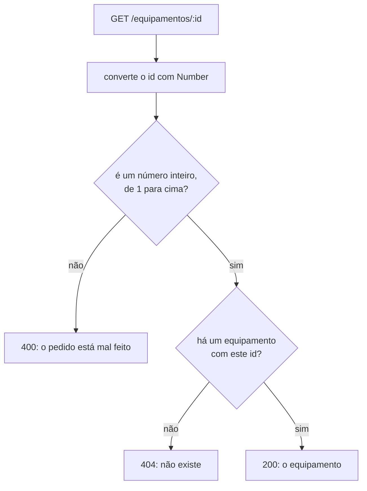
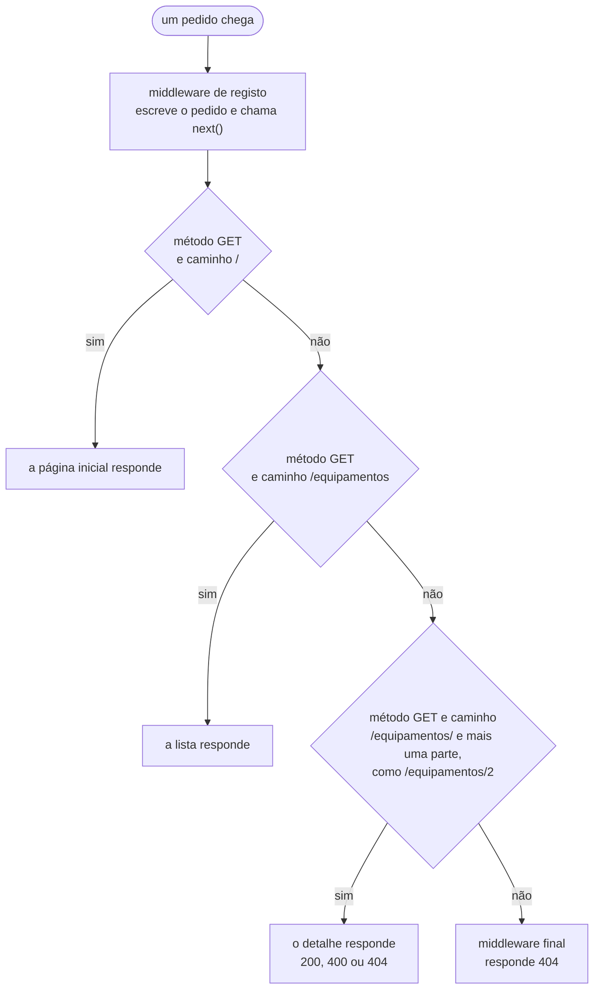

# HTTP, rotas e middleware

Neste guia, o catálogo de equipamentos do tema 02 passa a responder ao que lhe pedem: o equipamento 2, ou só os equipamentos da sala B12. Vês por onde um pedido traz esses dados e como o servidor escolhe o código de estado quando o pedido está mal feito ou pede o que não existe. Vês também o middleware, as funções por onde os pedidos passam no Express.

Usa as partes do endereço e os códigos de estado do tema 01, as rotas do tema 02 e, do 11.º ano, o `filter` e o `find`. Rever: [Cada parte do endereço responde a uma pergunta](01-do-pedido-a-resposta.md#cada-parte-do-endereço-responde-a-uma-pergunta), [O código de estado diz como correu o pedido](01-do-pedido-a-resposta.md#o-código-de-estado-diz-como-correu-o-pedido) e [O Express liga cada rota a uma função](02-primeiro-servidor.md#o-express-liga-cada-rota-a-uma-função). Do 11.º ano: [`filter` - selecionar](https://github.com/NunoMACastro/edu-docs-2ig-js-guias-2526/blob/8cf6ade3cf3d4508ea0fb4fbc5b2bedb29869a8f/JavaScript/11-Arrays-HighOrder.md#2-filter---selecionar) e [`find` e `findIndex` - primeiro que passa](https://github.com/NunoMACastro/edu-docs-2ig-js-guias-2526/blob/8cf6ade3cf3d4508ea0fb4fbc5b2bedb29869a8f/JavaScript/11-Arrays-HighOrder.md#4-find-e-findindex---primeiro-que-passa). Para praticar: [laboratório](laboratorios/03-http-rotas-e-middleware-laboratorio-papelaria.md) e [ficha de exercícios](exercicios/03-http-rotas-e-middleware-exercicios.md).

## Neste guia

1. [Parte 1: Os dados que um pedido traz](#parte-1-os-dados-que-um-pedido-traz)
2. [Parte 2: O código de estado que a rota escolhe](#parte-2-o-código-de-estado-que-a-rota-escolhe)
3. [Parte 3: O middleware e a fila do Express](#parte-3-o-middleware-e-a-fila-do-express)
4. [Parte 4: Ver e descrever o que o servidor faz](#parte-4-ver-e-descrever-o-que-o-servidor-faz)
5. [Exemplo guiado: o catálogo cresce](#exemplo-guiado-o-catálogo-cresce)

## Parte 1: Os dados que um pedido traz

O servidor do tema 02 responde sempre o mesmo ao mesmo endereço: `/equipamentos` dá a lista toda. Para responder ao que lhe pedem, precisa de dados no pedido. Um pedido pode trazê-los em três sítios, e cada um serve para uma coisa diferente.

### No caminho: parâmetros de rota

A professora quer ver só o projetor, que tem o `id` 2. O endereço natural é `/equipamentos/2`, em que o `2` faz parte do caminho e diz que equipamento se pede. Com as rotas do tema 02, era preciso uma rota para cada equipamento, `/equipamentos/1`, `/equipamentos/2` e assim por diante, e mais uma sempre que chegasse um equipamento novo.

O Express deixa escrever uma só rota, com uma parte do caminho que muda de pedido para pedido. Essa parte escreve-se com dois pontos antes do nome:

```js fragment
app.get("/equipamentos/:id", (req, res) => {
  const id = Number(req.params.id);
  // ...
});
```

O `:id` quer dizer "aqui vem um valor, e chama-lhe `id`". O Express compara o caminho do pedido com o da rota, parte a parte, e guarda o que estava no lugar do `:id` em `req.params.id`. Num pedido a `/equipamentos/2`, o `req.params.id` é `"2"`.

Ao que um endereço identifica, como um equipamento, uma reserva ou a lista dos equipamentos, chama-se **recurso**. O valor que vem numa posição do caminho e diz qual é o recurso chama-se **parâmetro de rota**.

Esta rota responde a `/equipamentos/2`, a `/equipamentos/99` e também a `/equipamentos/abc`, porque o Express não sabe que o `id` devia ser um número. Verificá-lo é trabalho da rota.

### Depois do ponto de interrogação: parâmetros de pesquisa

Os parâmetros de pesquisa, como o `?sala=B12`, já os conheces do tema 01, e sabes que não fazem parte da rota: `/equipamentos` e `/equipamentos?sala=B12` chegam à mesma rota. Rever: [Uma rota junta um método e um caminho](01-do-pedido-a-resposta.md#uma-rota-junta-um-método-e-um-caminho).

No servidor, o Express guarda cada parâmetro de pesquisa em `req.query`, pelo nome:

```js fragment
const sala = req.query.sala; // "B12", ou undefined se não vier nenhum ?sala=
```

Os parâmetros de pesquisa servem para filtrar, ordenar ou escolher uma opção, e são quase sempre opcionais.

<details>
<summary>Para ires mais longe: porque é que a rota não escreve no req.query</summary>

A rota guarda o valor numa variável sua, `sala`, e trabalha com ela. No Express 5, o da disciplina, o `req.query` volta a ser lido do endereço sempre que o usas. Se escreveres `req.query.sala = "A03"`, a linha seguinte volta a ler `"B12"`, e a mudança perde-se sem aviso. Se escreveres `req.query = { sala: "A03" }`, a rota falha com um `TypeError`, e o browser recebe um 500. Muitos exemplos da internet são do Express 4, em que isto funcionava.

</details>

### No corpo do pedido

O terceiro sítio já o viste no exemplo guiado do tema 01. Quando a professora envia o formulário da reserva, os dados vão no corpo do pedido, depois dos cabeçalhos, e não aparecem no endereço. Rever: [Passo 4: enviar a reserva](01-do-pedido-a-resposta.md#passo-4-enviar-a-reserva).

O corpo serve para os dados de uma operação que cria ou muda alguma coisa, como os campos de uma reserva. Neste tema, nenhum pedido ao catálogo traz corpo, e o servidor não o lê. A tabela junta os três sítios:

| Sítio | Exemplo | No servidor | Serve para |
| --- | --- | --- | --- |
| Caminho | `/equipamentos/2` | `req.params.id` | Dizer qual é o recurso |
| Pesquisa | `/equipamentos?sala=B12` | `req.query.sala` | Filtrar, ordenar, escolher uma opção |
| Corpo | `equipamento_id=2&data=2026-10-20&tempo=3`, num `POST` | não se lê neste tema | Os dados de uma operação que cria ou muda alguma coisa |

### O formulário escolhe o sítio dos campos pelo method

Um formulário HTML pode enviar os seus campos pelo endereço ou pelo corpo. Quem escolhe é o atributo `method` do `<form>`:

| Formulário | Para onde vão os campos | O pedido |
| --- | --- | --- |
| `<form method="get" action="/equipamentos">`, com o campo `sala` | Para os parâmetros de pesquisa, no endereço | `GET /equipamentos?sala=B12` |
| `<form method="post" action="/reservas">`, com os campos da reserva | Para o corpo do pedido | `POST /reservas`, com os campos no corpo |

O `action` dá o caminho do pedido. O `name` de cada campo passa a ser o nome do parâmetro, ou do campo no corpo. Um formulário sem `method` envia por `GET`.

Por isso, "os dados de um formulário vão no corpo" só é verdade num formulário com `method="post"`. Uma pesquisa, que não muda nada no servidor, é um formulário `GET`, e o resultado fica com um endereço que se pode guardar ou enviar a alguém.

### Tudo chega como texto

Num pedido a `/equipamentos/2`, o `req.params.id` é `"2"`, entre aspas, e não o número 2. O pedido HTTP é texto, e o Express entrega-te texto. Os parâmetros de pesquisa também: em `?sala=B12`, o `req.query.sala` é o texto `"B12"`.

Para a sala não há problema, porque as salas do array também são texto. Para o `id`, há: os `id` do array são números, e `"2" === 2` é `false`. Uma procura como `equipamentos.find((equipamento) => equipamento.id === req.params.id)` nunca encontra nada, nem o equipamento que existe.

A regra é a do `prompt` do 11.º ano, que também devolvia sempre texto. Antes de comparar com um número, converte-se com `Number(...)`. Rever: [Truthy/falsy e coerção](https://github.com/NunoMACastro/edu-docs-2ig-js-guias-2526/blob/8cf6ade3cf3d4508ea0fb4fbc5b2bedb29869a8f/JavaScript/01-Variaveis-Tipos.md#4-truthyfalsy-e-coerção-quando-js-faz-magia).

| O que chega | `Number(...)` dá |
| --- | --- |
| `"2"` | `2` |
| `"abc"` | `NaN`, que quer dizer "não é um número" |
| `"2.5"` | `2.5` |
| `"0"` | `0` |

A conversão não diz se o valor serve como `id`. `NaN`, `2.5` e `0` saem dela sem erro, mas nenhum é o `id` de um equipamento.

<details>
<summary>Para ires mais longe: quando a pesquisa chega como lista</summary>

Num endereço como `/equipamentos?sala=B12&sala=A03`, o nome `sala` aparece duas vezes. O Express não escolhe um dos valores: entrega uma lista, `["B12", "A03"]`. Uma lista nunca é igual ao texto da sala de um equipamento, e por isso o filtro do catálogo responde `[]`, com 200.

</details>

## Parte 2: O código de estado que a rota escolhe

Uma rota de detalhe que só converte o `id` e procura o equipamento responde 404 a `/equipamentos/9` e também a `/equipamentos/abc`, com a mensagem `Não existe o equipamento abc`. A resposta não é falsa, mas esconde o problema: `abc` nunca podia ser o número de um equipamento. Nesta parte, a rota passa a escolher o código que diz o que correu mal.

### A rota escolhe o código com res.status

Até agora, o código de estado foi sempre o Express a escolhê-lo: 200 quando a rota responde com `res.send` ou `res.json`, e 404 quando não há rota para o pedido. Rever: [A resposta leva texto, com res.send, ou dados, com res.json](02-primeiro-servidor.md#a-resposta-leva-texto-com-ressend-ou-dados-com-resjson).

Para dar outro código, a rota escreve `res.status(...)` antes do `json`:

```js fragment
res.status(404).json({ erro: `Não existe o equipamento ${id}` });
```

O `res.status(404)` não envia nada: só marca o código da resposta. Quem envia é o `json` a seguir, com a mensagem.

As mensagens de erro da rota de detalhe vão em JSON, numa chave `erro`, porque as outras respostas dela também são JSON. Quem recebe a resposta sabe sempre onde procurar a mensagem.

### Os três códigos deste tema

Três códigos chegam para as rotas deste tema:

- 200 (OK): o pedido correu bem, e a resposta tem o que se pediu.
- **400** (Bad Request, pedido mal feito): o pedido não faz sentido, e o servidor recusa-se a tratá-lo. É o caso de um identificador que não é um número, ou de um zero, quando os números começam no 1.
- 404 (Not Found): o pedido faz sentido, mas o que se pediu não existe, como o equipamento 9, quando só há quatro.

`abc` nunca pode ser o número de um equipamento, e por isso `/equipamentos/abc` é um pedido mal feito, 400. O 9 podia ser o número de um equipamento, só que não existe, e por isso `/equipamentos/9` é 404. Daí a ordem da rota de detalhe: primeiro verifica se o pedido faz sentido, e só depois procura.



O diagrama mostra as duas perguntas da rota de detalhe, por esta ordem. Um pedido só chega à segunda pergunta se passar a primeira.

A esta verificação, feita antes de usar os dados do pedido, chama-se **validação**. Na rota de detalhe, é este `if`:

```js fragment
  if (!Number.isInteger(id) || id < 1) {
    res.status(400).json({ erro: "O identificador tem de ser um número inteiro positivo" });
    return;
  }
```

O `Number.isInteger(id)` só dá `true` para um número inteiro, e dá `false` para `NaN` e para `2.5`. O `!` inverte o resultado, e o `||` quer dizer "ou", como no 11.º ano. A condição apanha um `id` que não é inteiro, ou que é menor do que 1, e a rota responde 400.

A validação faz-se no servidor, mesmo que nenhuma página do catálogo tenha uma ligação para `/equipamentos/abc`. Qualquer pessoa pode escrever o endereço à mão, e o servidor não sabe de onde veio o pedido.

Prevê: um filtro por uma sala sem equipamentos, `/equipamentos?sala=Z99`, deve dar 404?

Não. A lista existe, só está vazia. A resposta é 200, com `[]`. Um filtro que não encontra nada não é um recurso que não existe.

Falta o 500, que viste no tema 02 com o `res.sendd`. Esse não o escolhes: é o Express que o põe quando o código da rota falha.

### Responder uma vez, e sair

Cada pedido tem uma resposta, e uma só. No `if` da validação, depois do `res.status(400).json(...)`, a função tem de acabar, e é para isso que serve o `return`.

Sem o `return`, a função continua. Procura o equipamento, não o encontra e chega ao `res.status(404).json(...)`, que tenta responder outra vez ao mesmo pedido. O browser já recebeu o 400 e fica com ele. O terminal mostra um erro, que começa assim:

```text
Error [ERR_HTTP_HEADERS_SENT]: Cannot set headers after they are sent to the client
```

Quer dizer "não é possível definir os cabeçalhos depois de terem sido enviados ao cliente", ou seja, já houve resposta. Nas linhas `at` por baixo, a que tem o nome do teu `server.js` aponta para a segunda resposta. Rever: [Uma mensagem de erro lê-se pelo tipo e pela linha](02-primeiro-servidor.md#uma-mensagem-de-erro-lê-se-pelo-tipo-e-pela-linha). O servidor continua a correr. Quando vires esta mensagem, procura uma resposta de erro sem `return` a seguir.

## Parte 3: O middleware e a fila do Express

### Um middleware é uma função por onde passam os pedidos

Imagina que queres ver no terminal cada pedido que chega ao servidor, com o método e o endereço. Podias escrever um `console.log` em cada rota, mas repetias a mesma linha em todas. E os pedidos a que nenhuma rota responde, como um endereço mal escrito, nunca apareciam.

Um **middleware** é uma função por onde o pedido passa no Express, antes das rotas ou depois delas. Recebe o `req` e o `res`, como as rotas, e um terceiro parâmetro, `next`, uma função que quer dizer "passa ao seguinte". Regista-se com `app.use`:

```js fragment
app.use((req, res, next) => {
  console.log(`${req.method} ${req.url}`);
  next();
});
```

Este é o middleware de registo. Escreve no terminal o método e o endereço do pedido, como `GET /equipamentos?sala=B12`, e chama `next()`, para o pedido seguir caminho. O `req.url` é o endereço sem o computador e a porta, ou seja, o caminho e os parâmetros de pesquisa. Como o `app.use` não recebeu nenhum caminho, este middleware corre em todos os pedidos.

Como o `app.get`, o `app.use` só guarda a função no arranque, sem a correr. O Express chama-a depois, uma vez por cada pedido que chega. Rever: [O arranque corre uma vez, e a função de uma rota a cada pedido](02-primeiro-servidor.md#o-arranque-corre-uma-vez-e-a-função-de-uma-rota-a-cada-pedido).

### O middleware final

Um middleware também pode responder. Sem nada no fim do ficheiro, um pedido a que nenhuma rota responde recebe a resposta do Express, uma pequena página com `Cannot GET` e o caminho. O último `app.use` do ficheiro, sem caminho e sem `next`, troca-a por uma resposta tua:

```js fragment
app.use((req, res) => {
  res.status(404).send("Página não encontrada.");
});
```

Chama-se **middleware final**. Fica depois de todas as rotas, logo antes do `app.listen`, e só lhe chegam os pedidos a que nenhuma rota respondeu, de qualquer método e para qualquer caminho. Responde a todos com 404. Não tem o parâmetro `next` porque responde sempre, e nunca passa o pedido a ninguém.

### Uma fila, pela ordem do ficheiro

O Express guarda os middlewares e as rotas pela ordem em que aparecem no ficheiro, e cada pedido percorre essa fila de cima para baixo. A função que está na vez faz uma de duas coisas. Ou responde, e o pedido acaba ali, ou chama `next()`, e o pedido passa à seguinte. Uma rota é uma paragem da fila que só trata os pedidos com o seu método e o seu caminho. Os outros pedidos, o Express passa-os à seguinte.

Com os dois middlewares e as três rotas do catálogo, a fila é esta:



O diagrama segue um pedido pela fila. Todos passam pelo middleware de registo. Depois, cada rota olha para o método e para o caminho, e só responde se forem os seus. Ao middleware final só chega o pedido a que nenhuma rota respondeu, como `GET /nao-existe`.

Daqui saem as três regras do middleware:

1. Um middleware que não responde tem de chamar `next()`. Se não o chamar, o pedido fica parado. O browser fica à espera, com o indicador de carregamento a rodar, e a resposta não chega. O terminal mostra a linha do registo e mais nada, sem mensagem de erro, o que torna este engano difícil de encontrar.
2. Um middleware que tem de ver os pedidos, ou de lhes preparar alguma coisa, fica antes das rotas. O de registo só vê os pedidos que lhe chegam, e um pedido a que uma rota respondeu acaba nela. Com o registo entre as rotas e o middleware final, o terminal só mostra os pedidos que nenhuma rota tratou, como o de um endereço que não existe. O mesmo vale para um middleware que prepare dados para as rotas, como um que leia o corpo de um pedido.
3. Um middleware que responde a tudo fica depois de tudo. O middleware final responde a qualquer pedido que lhe chegue. Se estiver antes das rotas, responde 404 a todos os pedidos, e as rotas nunca chegam a correr.

### O caminho fixo vem antes do caminho com parâmetro

A mesma fila decide entre duas rotas que servem o mesmo pedido. O Express fica com a primeira que encaixa, mesmo que mais abaixo haja outra que encaixe melhor.

Imagina que acrescentas ao catálogo a rota `GET /equipamentos/salas`, com a lista das salas, e que a escreves abaixo da rota de detalhe. Prevê: o que recebe um pedido a `/equipamentos/salas`?

Recebe 400, com a mensagem do identificador. O pedido chega primeiro à rota de detalhe e encaixa nela, porque o `:id` aceita qualquer valor naquela posição. O Express põe o texto `"salas"` em `req.params.id` e chama a função do detalhe. `Number("salas")` dá `NaN`, e a validação responde 400. A rota das salas nunca corre, e o terminal não mostra erro nenhum. Para o Express, correu tudo bem, porque uma rota respondeu.

A regra das rotas é esta: quando um caminho fixo e um caminho com parâmetro podem servir o mesmo pedido, o fixo vem primeiro. `/equipamentos/salas` fica acima de `/equipamentos/:id`.

Nem todas as rotas parecidas entram em conflito. `GET /equipamentos` não encaixa em `/equipamentos/:id`, porque tem uma parte a menos. Uma rota com o mesmo caminho e outro método também não, porque o método faz parte da rota: um `app.get` nunca responde a um `POST`.

## Parte 4: Ver e descrever o que o servidor faz

### O separador Rede mostra os dados que o pedido levou

No separador Rede das ferramentas de programador, que usaste no tema 01, cada pedido ao teu servidor mostra também os dados que levou. Rever: [O separador Rede mostra cada pedido e cada resposta](01-do-pedido-a-resposta.md#o-separador-rede-mostra-cada-pedido-e-cada-resposta). Clica no pedido e procura o separador "Payload" (no Chrome em português, "Carga"; no Firefox, "Pedido"):

- num pedido com parâmetros de pesquisa, aparece "Query String Parameters" (parâmetros de pesquisa), com cada nome e o seu valor;
- num pedido só com um parâmetro de rota, não há parâmetros para mostrar, e o separador pode nem aparecer. O valor faz parte do caminho, e vê-se em "Headers" ("Cabeçalhos"), no "Request URL" (endereço do pedido).

Em "Headers", o "Status Code" mostra o código que a tua rota escolheu. Num pedido a `/equipamentos?sala=B12`, o "Status Code" é 200, e o Payload mostra o parâmetro `sala` com o valor `B12`.

Quando um pedido não faz o que esperavas, a primeira pergunta é esta: os dados chegaram ao servidor, com o nome que a rota espera? Se a pesquisa devolver a lista toda, o Payload mostra se o parâmetro se chamava mesmo `sala`.

### A tabela de contratos HTTP

Imagina que um colega vai fazer uma página que usa o teu catálogo. Precisa de saber que pedidos o servidor aceita, com que dados, e o que pode receber de volta, incluindo os erros. Não devia ter de ler o teu código para isso.

Um **contrato HTTP** é essa descrição: uma tabela com uma linha por pedido que o servidor aceita. Cada linha diz o método, o caminho, o que o pedido traz e as respostas que pode ter. Chama-se contrato porque é uma promessa: quem fizer este pedido, assim, recebe uma destas respostas. O do catálogo completo é este:

| Método | Caminho | Entrada | Respostas |
| --- | --- | --- | --- |
| `GET` | `/` | nenhuma | 200, página HTML com a pesquisa |
| `GET` | `/equipamentos` | pesquisa: `sala`, opcional | 200, lista em JSON, vazia se não houver nenhum |
| `GET` | `/equipamentos/:id` | caminho: `id`, inteiro positivo | 200, o equipamento; 400 se o `id` não for válido; 404 se não existir |
| qualquer | qualquer outro | nenhuma | 404, `Página não encontrada.` |

Uma linha só com a resposta que corre bem está incompleta: "`GET /equipamentos/:id`, devolve o equipamento" esquece o 400 e o 404. E cada linha verifica-se no browser, com o separador Rede aberto, com um pedido por cada resposta possível.

## Exemplo guiado: o catálogo cresce

O catálogo do tema 02 tem duas rotas: `GET /`, com um texto, e `GET /equipamentos`, com a lista. Neste exemplo, ganha primeiro a rota de detalhe e o filtro por sala, e depois a validação do 400. Seguem-se o middleware de registo, uma página inicial com uma pesquisa e, por fim, o middleware final.

O resultado esperado, escrito antes de testar:

- `/equipamentos/2` responde 200 com o projetor, `/equipamentos/abc` responde 400 e `/equipamentos/9` responde 404;
- `/equipamentos?sala=B12` responde com o portátil e o monitor, e `?sala=Z99` responde 200 com uma lista vazia;
- a pesquisa da página inicial, com `B12` escrito no campo, leva o browser a `/equipamentos?sala=B12`;
- cada pedido aparece escrito no terminal;
- um endereço que não existe responde 404 com `Página não encontrada.`.

O ponto de partida é o `server.js` do tema 02, o do exemplo [catalogo-de-equipamentos](../exemplos/aplicacoes-em-browser/catalogo-de-equipamentos/README.md). Depois de cada passo, para o servidor com Ctrl+C e volta a ligá-lo com `node server.js`.

### Passo 1: a rota de detalhe e o filtro

No `server.js`, troca a rota de `/equipamentos` por esta, que lê a pesquisa:

```js fragment
// Rota 2: GET /equipamentos recebe a lista em JSON.
// Com ?sala=B12 no fim do endereço, recebe só os equipamentos dessa sala.
app.get("/equipamentos", (req, res) => {
  const sala = req.query.sala;
  if (sala) {
    const daSala = equipamentos.filter((equipamento) => equipamento.sala === sala);
    res.json(daSala);
    return;
  }
  res.json(equipamentos);
});
```

Sem `?sala=`, o `req.query.sala` é `undefined`, o `if` não entra, e a resposta é a lista toda. Com `?sala=B12`, o `filter` cria uma lista nova, só com os equipamentos dessa sala, e o `return` acaba a função, para não responder também com a lista toda. Um `?sala=` sem valor também dá a lista toda, porque o texto vazio, como o `undefined`, não entra no `if`.

Logo a seguir, acrescenta a rota de detalhe:

```js fragment
// Rota 3: GET /equipamentos/2 recebe só o equipamento com o id 2.
// O :id é um parâmetro de rota: o Express guarda o valor em req.params.id.
app.get("/equipamentos/:id", (req, res) => {
  const id = Number(req.params.id); // chega como texto, "2", e passa a número
  const equipamento = equipamentos.find((equipamento) => equipamento.id === id);
  if (!equipamento) {
    res.status(404).json({ erro: `Não existe o equipamento ${req.params.id}` });
    return;
  }
  res.json(equipamento);
});
```

A rota converte o `id`, procura o equipamento e, se não o encontra, responde 404. O `find` devolve `undefined` quando nenhum equipamento serve, e o `!equipamento` apanha esse caso.

Com esta versão, os pedidos dão:

| Pedido | Código | Resposta |
| --- | --- | --- |
| `GET /equipamentos?sala=B12` | 200 | o portátil e o monitor |
| `GET /equipamentos?sala=Z99` | 200 | `[]` |
| `GET /equipamentos/2` | 200 | `{"id":2,"nome":"Projetor","sala":"A03"}` |
| `GET /equipamentos/9` | 404 | `{"erro":"Não existe o equipamento 9"}` |

Prevê: e `/equipamentos/abc`, que código recebe?

Recebe 404, com `{"erro":"Não existe o equipamento abc"}`. `Number("abc")` dá `NaN`, o `find` não encontra nenhum equipamento com esse `id`, e a rota responde como responde ao 9. É isto que o passo 2 corrige. Esta versão está no exemplo [catalogo-com-detalhe-e-filtro](../exemplos/aplicacoes-em-browser/catalogo-com-detalhe-e-filtro/README.md).

### Passo 2: o 400 antes do 404

Troca a rota de detalhe por esta versão, com a validação antes da procura:

```js fragment
// Um equipamento: GET /equipamentos/2. O :id é um parâmetro de rota.
app.get("/equipamentos/:id", (req, res) => {
  const id = Number(req.params.id); // chega como texto, "2", e passa a número
  if (!Number.isInteger(id) || id < 1) {
    res.status(400).json({ erro: "O identificador tem de ser um número inteiro positivo" });
    return;
  }
  const equipamento = equipamentos.find((equipamento) => equipamento.id === id);
  if (!equipamento) {
    res.status(404).json({ erro: `Não existe o equipamento ${id}` });
    return;
  }
  res.json(equipamento);
});
```

O que é novo é o `if` da validação. Rever: [Os três códigos deste tema](#os-três-códigos-deste-tema). A tabela segue cinco pedidos pela rota:

| Pedido | `id` depois do `Number` | `Number.isInteger(id)` | `id < 1` | Resposta |
| --- | --- | --- | --- | --- |
| `/equipamentos/2` | `2` | `true` | `false` | 200, o projetor |
| `/equipamentos/abc` | `NaN` | `false` | não se calcula | 400 |
| `/equipamentos/2.5` | `2.5` | `false` | não se calcula | 400 |
| `/equipamentos/0` | `0` | `true` | `true` | 400 |
| `/equipamentos/9` | `9` | `true` | `false` | 404, depois do `find` |

Quando a primeira metade do `||`, o `!Number.isInteger(id)`, já é verdadeira, o JavaScript não calcula a segunda, porque a condição já está decidida. É por isso que o `id < 1` não se calcula para `abc` nem para `2.5`.

A mensagem do 404 passa a usar o `id` convertido, que depois da validação é sempre um número inteiro.

### Passo 3: o middleware de registo

Logo a seguir aos dados, antes de todas as rotas, acrescenta o middleware de registo:

```js fragment
// Middleware de registo: escreve no terminal cada pedido que chega,
// e passa-o à frente. Está antes das rotas, para ver todos os pedidos.
app.use((req, res, next) => {
  console.log(`${req.method} ${req.url}`);
  next();
});
```

A partir daqui, cada pedido deixa uma linha no terminal, por baixo de `Servidor a correr em http://localhost:3000`, como `GET /equipamentos/2`.

Se fizeres os pedidos no browser, aparecem também linhas `GET /favicon.ico`, um endereço que não escreveste. É o browser a pedir sozinho o ícone que mostra no separador, ao lado do título da página. O catálogo não tem ícone, e o pedido acaba com 404. Não é um erro do teu código: mostra que um pedido que o browser faz por iniciativa própria também passa pela fila.

### Passo 4: a página inicial, com uma pesquisa por GET

A rota de `/` deixa de responder com uma frase e passa a responder com uma pequena página HTML, com um formulário de pesquisa. Troca-a por esta:

```js fragment
// Página inicial, com um formulário de pesquisa que envia por GET.
app.get("/", (req, res) => {
  res.send(`<!doctype html>
<html lang="pt">
  <head><meta charset="utf-8"><title>Catálogo de equipamentos</title></head>
  <body>
    <h1>Catálogo de equipamentos</h1>
    <form method="get" action="/equipamentos">
      <label>Sala <input name="sala"></label>
      <button type="submit">Pesquisar</button>
    </form>
  </body>
</html>`);
});
```

O HTML vai dentro de um texto com crases, que pode ter várias linhas, e o `res.send` envia-o como página. Escrever HTML assim é desconfortável e fácil de errar, mas funciona.

Quando escreves `B12` e carregas em "Pesquisar", o browser faz `GET /equipamentos?sala=B12`, e responde a rota da lista do passo 1. Rever: [Formulários HTML: anatomia de um formulário moderno](https://github.com/NunoMACastro/edu-docs-2ig-js-guias-2526/blob/8cf6ade3cf3d4508ea0fb4fbc5b2bedb29869a8f/HTML%20e%20CSS/05-formularios-html.md#1-anatomia-de-um-formulário-moderno).

### Passo 5: o middleware final

Depois de todas as rotas, e antes do `app.listen`, acrescenta o middleware final:

```js fragment
// Middleware final: só chega aqui um pedido a que nenhuma rota respondeu.
app.use((req, res) => {
  res.status(404).send("Página não encontrada.");
});
```

O `Cannot GET` do Express deixa de aparecer. O pedido `GET /favicon.ico` também acaba aqui.

### Passo 6: o ficheiro completo

O `server.js` completo fica assim. Confere o teu: o código deve ser igual, e só os comentários podem ser diferentes.

```js
// server.js: o catálogo de equipamentos da escola, agora com middleware.
// Mostra os dados que um pedido traz no caminho e na pesquisa, os códigos
// que as rotas escolhem (200, 400 e 404) e os dois middlewares, um antes
// das rotas e outro depois.
import express from "express";

const app = express();
const PORTA = 3000;

// Os dados ficam em memória: existem enquanto o servidor estiver ligado.
const equipamentos = [
  { id: 1, nome: "Portátil", sala: "B12" },
  { id: 2, nome: "Projetor", sala: "A03" },
  { id: 3, nome: "Impressora", sala: "Secretaria" },
  { id: 4, nome: "Monitor", sala: "B12" },
];

// Middleware de registo: escreve no terminal cada pedido que chega,
// e passa-o à frente. Está antes das rotas, para ver todos os pedidos.
app.use((req, res, next) => {
  console.log(`${req.method} ${req.url}`);
  next();
});

// Página inicial, com um formulário de pesquisa que envia por GET.
app.get("/", (req, res) => {
  res.send(`<!doctype html>
<html lang="pt">
  <head><meta charset="utf-8"><title>Catálogo de equipamentos</title></head>
  <body>
    <h1>Catálogo de equipamentos</h1>
    <form method="get" action="/equipamentos">
      <label>Sala <input name="sala"></label>
      <button type="submit">Pesquisar</button>
    </form>
  </body>
</html>`);
});

// Lista de equipamentos. Com ?sala=B12, só os dessa sala.
app.get("/equipamentos", (req, res) => {
  const sala = req.query.sala;
  if (sala) {
    const daSala = equipamentos.filter((equipamento) => equipamento.sala === sala);
    res.json(daSala);
    return;
  }
  res.json(equipamentos);
});

// Um equipamento: GET /equipamentos/2. O :id é um parâmetro de rota.
app.get("/equipamentos/:id", (req, res) => {
  const id = Number(req.params.id); // chega como texto, "2", e passa a número
  if (!Number.isInteger(id) || id < 1) {
    res.status(400).json({ erro: "O identificador tem de ser um número inteiro positivo" });
    return;
  }
  const equipamento = equipamentos.find((equipamento) => equipamento.id === id);
  if (!equipamento) {
    res.status(404).json({ erro: `Não existe o equipamento ${id}` });
    return;
  }
  res.json(equipamento);
});

// Middleware final: só chega aqui um pedido a que nenhuma rota respondeu.
app.use((req, res) => {
  res.status(404).send("Página não encontrada.");
});

app.listen(PORTA, (erro) => {
  if (erro) {
    console.error(`Não foi possível ligar o servidor: ${erro.message}`);
    return;
  }
  console.log(`Servidor a correr em http://localhost:${PORTA}`);
});
```

O ficheiro lê-se pela ordem da fila: os dados, o middleware de registo, as três rotas, o middleware final e, no fim, o `listen`, que põe o servidor à escuta. Um pedido percorre os blocos do meio de cima para baixo, até um deles responder. O mesmo código, com o `package.json` e o `package-lock.json`, está no exemplo [catalogo-com-middleware](../exemplos/aplicacoes-em-browser/catalogo-com-middleware/README.md).

### Passo 7: os pedidos, um a um

Com o servidor ligado, cada pedido dá:

| Pedido | Quem responde | Código | Resposta |
| --- | --- | --- | --- |
| `GET /equipamentos/2` | a rota de detalhe | 200 | `{"id":2,"nome":"Projetor","sala":"A03"}` |
| `GET /equipamentos/abc` | a rota de detalhe, na validação | 400 | `{"erro":"O identificador tem de ser um número inteiro positivo"}` |
| `GET /equipamentos/9` | a rota de detalhe, depois do `find` | 404 | `{"erro":"Não existe o equipamento 9"}` |
| `GET /equipamentos?sala=B12` | a rota da lista | 200 | o portátil e o monitor |
| `GET /equipamentos?sala=Z99` | a rota da lista | 200 | `[]` |
| `GET /nao-existe` | o middleware final | 404 | `Página não encontrada.` |

Em todos, o middleware de registo escreveu primeiro uma linha no terminal, com o método e o endereço, tal como estão na primeira coluna. Se os pedidos vierem do browser, aparecem também as linhas `GET /favicon.ico` do passo 3.

## Erros frequentes

### A rota de detalhe responde 400 a um equipamento que existe

`/equipamentos/2` responde com a mensagem do identificador, como se o 2 não fosse um número. Falta o `Number(...)` na primeira linha da rota: o `id` ficou com o texto `"2"`, e `Number.isInteger("2")` é `false`. Sem a validação, como na versão do passo 1, o sintoma é outro, um 404, porque `"2" === 2` também é `false`. Converte primeiro, e só depois valida e procura.

### O filtro devolve a lista toda

O nome do parâmetro no endereço não é o que a rota lê, como em `?Sala=B12`, com maiúscula, ou num formulário com `name="Sala"`. O `req.query.sala` fica `undefined`, e a rota responde com a lista toda. Confirma o nome no Payload do separador Rede.

### O filtro devolve uma lista vazia para uma sala que existe

`?sala=b12` responde `[]`, com 200. As maiúsculas contam numa comparação com `===`, e `"b12" === "B12"` é `false`. Escreve a sala como está nos dados, `B12`.

## Palavras novas deste guia

- Recurso: o que um endereço identifica, como um equipamento, uma reserva ou a lista dos equipamentos.
- Parâmetro de rota: o valor numa posição do caminho que diz qual é o recurso, como o `2` em `/equipamentos/2`; lê-se em `req.params`.
- `400` (Bad Request): o código de estado de um pedido mal feito, que não faz sentido tratar.
- Validação: a verificação, no servidor, de que os dados do pedido servem, antes de os usar.
- Middleware: uma função por onde o pedido passa no Express, que lhe responde ou o passa à seguinte.
- `next()`: a chamada que passa o pedido à função seguinte da fila.
- Middleware final: o último middleware do ficheiro, depois das rotas, que responde 404 aos pedidos a que nenhuma rota respondeu.
- Contrato HTTP: a tabela com os pedidos que um servidor aceita, o que cada um traz e as respostas que pode ter.

## O que vem a seguir

No tema 04, EJS e reutilização no servidor, o catálogo passa a gerar as páginas HTML a partir de modelos, em vez de as escrever em textos com crases.

## Para saber mais

- [Encaminhamento no Express](https://expressjs.com/en/guide/routing.html), em inglês: as rotas com parâmetros, como `/equipamentos/:id`, e o `req.params`.
- [Escrever middleware para o Express](https://expressjs.com/en/guide/writing-middleware.html), em inglês: o `next()` e a ordem dos middlewares, com outros exemplos.
- [400 Bad Request](https://developer.mozilla.org/en-US/docs/Web/HTTP/Reference/Status/400), na MDN, em inglês: quando um servidor responde 400.


