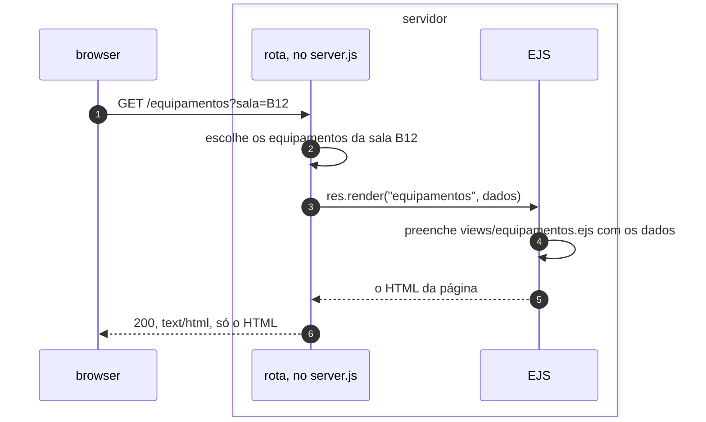
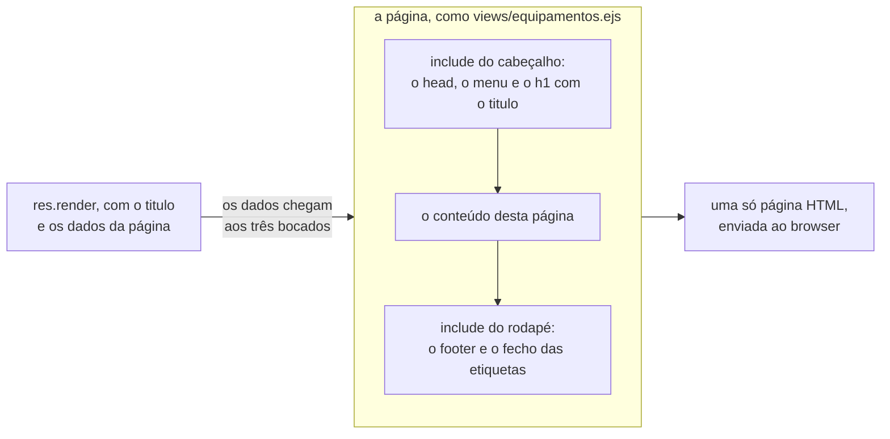
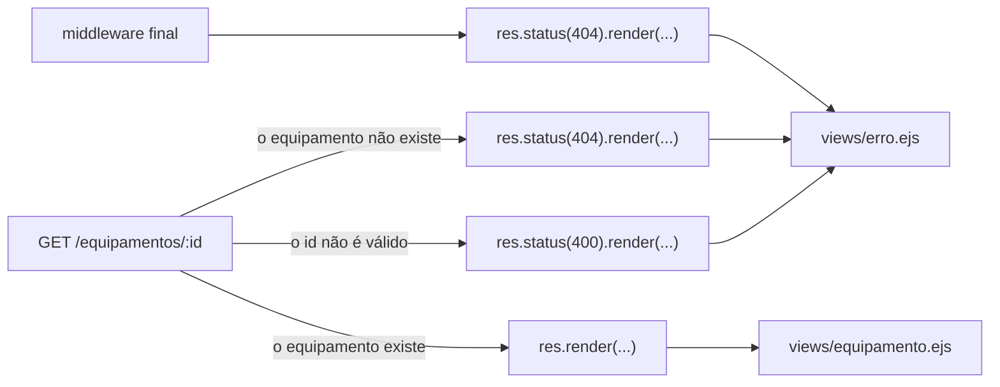

# EJS e reutilização no servidor

Neste guia, o catálogo de equipamentos do tema 03 passa a responder com páginas, em vez de JSON: a lista, a página de cada equipamento e as páginas de erro. O servidor constrói cada página a partir de um modelo, um ficheiro de HTML com marcas onde entram os dados. Todas as páginas partilham o mesmo cabeçalho e o mesmo rodapé. Vês também porque é que um valor que vem do pedido nunca pode entrar na página como HTML.

Usa os códigos de estado e o `return` do tema 03, a instalação de pacotes do tema 02 e, do 11.º ano, o `for...of`. Rever: [Os três códigos deste tema](03-http-rotas-e-middleware.md#os-três-códigos-deste-tema), [Responder uma vez, e sair](03-http-rotas-e-middleware.md#responder-uma-vez-e-sair), [Instalar o Express cria a pasta node_modules](02-primeiro-servidor.md#instalar-o-express-cria-a-pasta-node_modules) e [`for...of` para percorrer valores](https://github.com/NunoMACastro/edu-docs-2ig-js-guias-2526/blob/8cf6ade3cf3d4508ea0fb4fbc5b2bedb29869a8f/JavaScript/06-Ciclos.md#3-forof-para-percorrer-valores). Para praticar: [ficha de exercícios](exercicios/04-ejs-e-reutilizacao-no-servidor-exercicios.md) e [ficha do cinema da escola](exercicios/04-ejs-e-reutilizacao-no-servidor-exercicios-cinema.md).

## Neste guia

1. [Um modelo de página, preenchido no servidor](#um-modelo-de-página-preenchido-no-servidor)
2. [O browser recebe só o HTML](#o-browser-recebe-só-o-html)
3. [O Express procura os modelos na pasta views](#o-express-procura-os-modelos-na-pasta-views)
4. [O res.render responde com uma página](#o-resrender-responde-com-uma-página)
5. [As marcas do EJS](#as-marcas-do-ejs)
6. [Ciclos e condições dentro do modelo](#ciclos-e-condições-dentro-do-modelo)
7. [A rota escolhe os dados, e o modelo mostra-os](#a-rota-escolhe-os-dados-e-o-modelo-mostra-os)
8. [Partes partilhadas: o cabeçalho e o rodapé](#partes-partilhadas-o-cabeçalho-e-o-rodapé)
9. [Um erro também se responde com uma página](#um-erro-também-se-responde-com-uma-página)
10. [Escaping: o que vem de fora nunca vira HTML](#escaping-o-que-vem-de-fora-nunca-vira-html)
11. [Exemplo guiado: o catálogo passa a ter páginas](#exemplo-guiado-o-catálogo-passa-a-ter-páginas)

## Um modelo de página, preenchido no servidor

No tema 03, a página inicial do catálogo ficou escrita assim, dentro da rota, num texto com crases:

```js fragment
app.get("/", (req, res) => {
  res.send(`<!doctype html>
<html lang="pt">
  <head><meta charset="utf-8"><title>Catálogo de equipamentos</title></head>
  <body>
    <h1>Catálogo de equipamentos</h1>
    <form method="get" action="/equipamentos">
      <label>Sala <input name="sala"></label>
      <button type="submit">Pesquisar</button>
    </form>
  </body>
</html>`);
});
```

Funciona, mas o editor não te ajuda. Para o JavaScript, tudo o que está entre as crases é só um texto: não há cores no HTML, nem aviso de uma etiqueta (em inglês, tag) mal fechada. Uma crase escrita no meio do HTML acaba o texto antes do tempo, e o resto passa a ser código sem sentido. E o catálogo vai ter várias páginas com dados, todas com o mesmo início e o mesmo fim.

A solução é tirar o HTML do código. Cada página passa a ter um ficheiro seu, um **modelo**: um ficheiro de HTML com marcas nos sítios onde entram os dados. É como um impresso da secretaria da escola, com o texto fixo já escrito e espaços em branco para o nome, o número e o ano. Para cada pedido, a secretaria preenche os espaços e entrega a folha pronta.

No servidor passa-se o mesmo. A rota escolhe os dados e entrega-os ao EJS, com o nome do modelo. O EJS (de Embedded JavaScript, JavaScript embutido) é o pacote que preenche o modelo e devolve o HTML final, que o servidor envia ao browser. A esta operação chama-se **renderizar** o modelo: construir a página a partir do modelo e dos dados. Em Express, faz-se com `res.render`.

O diagrama segue o pedido da lista dos equipamentos da sala B12:



Tudo o que está dentro da caixa do servidor acontece antes de a resposta sair. O EJS lê o modelo, um ficheiro da pasta `views`, junta-lhe os dados que a rota escolheu e devolve o HTML. No fim, o browser recebe só esse HTML, com o código 200 e o tipo `text/html`.

## O browser recebe só o HTML

Um modelo tem JavaScript lá dentro, como um `for` que escreve um `<li>` por cada equipamento. Esse JavaScript nunca chega ao browser: já correu no servidor, quando o EJS preencheu o modelo, antes de a resposta sair. O browser não recebe o ficheiro `.ejs`, nem as marcas, nem os dados soltos. Recebe o HTML que daí resultou, e mostra-o como mostraria uma página escrita à mão. É a página dinâmica do tema 01, que o servidor constrói no momento do pedido. Rever: [O servidor constrói a página para cada pedido](01-do-pedido-a-resposta.md#o-servidor-constrói-a-página-para-cada-pedido).

Para veres o que o browser recebeu, abres o **código-fonte da página**. Com a página aberta, carrega em Ctrl+U (no Mac, Cmd+Option+U), ou carrega com o botão direito e escolhe a opção de ver o código-fonte. O browser mostra o HTML exatamente como o recebeu, e lá não há nenhuma marca do EJS.

Daqui vem uma consequência. O modelo usa os dados que a rota lhe passou, mas não sabe nada do que se passa no browser. Não sabe em que botão o utilizador carregou, nem pode reagir a um clique. Neste catálogo, para a lista mudar, o browser tem de fazer um pedido novo, e o servidor constrói outra página.

<details>
<summary>Para ires mais longe: o React constrói a página no browser</summary>

Em Linguagens de Programação, a API envia só os dados, em JSON. Com o React, que conheces do 11.º ano, é o browser que constrói a página com esses dados. No React também se diz renderizar, mas aí quem constrói a página é o browser. As duas formas juntam dados e HTML, mas em sítios diferentes. Uma página feita com EJS também pode trazer JavaScript seu, numa etiqueta `<script>`, que corre no browser e muda o que lá está. Esse código é outro, e não tem nada a ver com o JavaScript das marcas, que corre só no servidor.

</details>

## O Express procura os modelos na pasta views

O EJS é um pacote do npm, como o Express, e instala-se da mesma maneira, dentro da pasta do projeto:

```bash
npm install ejs@7.0.1
```

O `@7.0.1` escolhe a versão, a mesma dos exemplos da disciplina. O `package.json` ganha a linha `"ejs"` nas dependências, ao lado do `"express"`, e a pasta `node_modules` ganha a pasta do EJS.

O `server.js` não tem nenhum `import` do EJS: é o Express que o vai buscar quando uma rota pede uma página. Para isso, tem de saber que os modelos são do EJS. Diz-se com uma linha, logo a seguir a criar a aplicação:

```js fragment
// O motor de modelos: o res.render vai procurar os ficheiros .ejs
// na pasta views.
app.set("view engine", "ejs");
```

O `app.set` muda uma definição da aplicação. A definição `"view engine"` (em português, motor de modelos) diz que pacote preenche os modelos, e com ela o Express passa a procurar ficheiros `.ejs`. Procura-os numa pasta chamada `views`, o nome que o Express dá à pasta dos modelos, ao lado do `server.js`:

```text
catalogo/
├── package.json
├── server.js
└── views/
    └── equipamentos.ejs
```

Sem o `app.set`, a primeira rota que pede uma página falha com `Error: No default engine was specified and no extension was provided.`, porque o Express não sabe que tipo de ficheiro procurar. O browser recebe uma página de erro com o código 500, e o servidor continua ligado.

O Express procura a pasta `views` na pasta onde o terminal está quando escreves `node server.js`. Por isso, arranca sempre o servidor dentro da pasta do projeto. Se escreveres `node catalogo/server.js` a partir da pasta de cima, o Express procura lá uma pasta `views` que não existe.

O Express volta a ler o modelo a cada pedido. Depois de mudares um ficheiro `.ejs`, basta recarregar a página no browser, sem reiniciar o servidor. Uma mudança no `server.js` continua a precisar de reinício.

## O res.render responde com uma página

Até aqui, as rotas do catálogo respondiam com `res.json` ou com `res.send`. Para responder com uma página feita a partir de um modelo, a rota usa `res.render`:

```js fragment
res.render("equipamentos", { titulo: "Equipamentos", equipamentos: lista });
```

O primeiro argumento é o nome do modelo, sem a extensão e sem a pasta: `"equipamentos"` quer dizer `views/equipamentos.ejs`. O segundo é um objeto com os dados de que a página precisa. Cada propriedade deste objeto passa a ser uma variável dentro do modelo, com o mesmo nome. Dentro de `equipamentos.ejs` há uma variável `titulo`, com o texto `"Equipamentos"`, e uma variável `equipamentos`, com o array que estava em `lista`.

O modelo só conhece o que a rota lhe passa. Um nome que não está no objeto dá erro, como mostra o erro [ReferenceError: ... sala is not defined](#referenceerror--sala-is-not-defined).

O `res.render` é uma resposta, como o `res.json`, e as regras do tema 03 continuam. Um pedido tem uma só resposta. O código escolhe-se com `res.status` antes, como em `res.status(404).render(...)`, e depois de uma resposta de erro vem o `return`. O tipo da resposta passa a ser `text/html`, porque o que sai é uma página.

## As marcas do EJS

Um modelo é HTML com marcas. Uma **marca** é o sítio do modelo onde entra JavaScript. Começa por `<%` e acaba em `%>`, e o carácter logo a seguir ao `<%` diz o que a marca faz. Para já, chegam três:

| Marca | O que faz | O que chega ao browser |
| --- | --- | --- |
| `<%= valor %>` | Escreve o valor na página, como texto | O valor |
| `<% código %>` | Corre código JavaScript, sem escrever nada | Nada da marca |
| `<%# comentário %>` | Um comentário para quem lê o modelo | Nada |

A marca que mais vais escrever é a `<%= %>`. Com os dados `{ titulo: "Equipamentos" }`, esta linha do modelo:

```ejs
<h1><%= titulo %></h1>
```

chega ao browser assim:

```html
<h1>Equipamentos</h1>
```

Entre `<%=` e `%>` pode estar qualquer expressão de JavaScript que dê um valor: uma variável, uma propriedade, como `equipamento.nome`, ou o tamanho de uma lista, como `equipamentos.length`. Na página fica o resultado.

A marca `<% %>`, sem nada a seguir ao `%`, corre código e não escreve nada. Serve para os ciclos e as condições.

Prevê: com os mesmos dados, o que chega ao browser com `<h1><% titulo %></h1>`?

Chega `<h1></h1>`, um título vazio, e não há erro nenhum. O código correu, calculou o título e não o escreveu, porque a marca não escreve. Falta o `=`.

A marca `<%# %>` é um comentário. Um comentário de HTML (`<!-- ... -->`) vai na página, e qualquer pessoa o lê no código-fonte. Um comentário de EJS fica no servidor. É o sítio certo para explicar o modelo a quem o vai ler a seguir, como os comentários num ficheiro JavaScript.

## Ciclos e condições dentro do modelo

Para mostrar os equipamentos numa lista HTML, num texto com crases, era preciso construir o texto peça a peça. O `map` transforma cada equipamento num `<li>`, e o `join` cola esses textos:

```js fragment
const itens = equipamentos.map((equipamento) => `<li>${equipamento.nome}, na sala ${equipamento.sala}</li>`).join("");
res.send(`<!doctype html><html lang="pt"><head><meta charset="utf-8"><title>Equipamentos</title></head><body><h1>Equipamentos</h1><ul>${itens}</ul></body></html>`);
```

Lê-se mal, escreve-se mal e corrige-se pior. Num modelo, a lista escreve-se com o `for...of`, partido em duas marcas `<% %>`. Uma abre o ciclo, com a chaveta de abertura, e a outra fecha-o, com a chaveta de fecho. O HTML que fica entre as duas repete-se a cada volta:

```ejs
<ul>
  <% for (const equipamento of equipamentos) { %>
    <li><%= equipamento.nome %>, na sala <%= equipamento.sala %></li>
  <% } %>
</ul>
```

Com os quatro equipamentos do catálogo na variável `equipamentos`, o ciclo dá quatro voltas:

| Volta | `equipamento` | O que se junta à página |
| --- | --- | --- |
| 1 | `{ id: 1, nome: "Portátil", sala: "B12" }` | `<li>Portátil, na sala B12</li>` |
| 2 | `{ id: 2, nome: "Projetor", sala: "A03" }` | `<li>Projetor, na sala A03</li>` |
| 3 | `{ id: 3, nome: "Impressora", sala: "Secretaria" }` | `<li>Impressora, na sala Secretaria</li>` |
| 4 | `{ id: 4, nome: "Monitor", sala: "B12" }` | `<li>Monitor, na sala B12</li>` |

Cada linha que só tinha uma marca `<% %>` fica em branco. Sem essas linhas, o browser recebe:

```html
<ul>
    <li>Portátil, na sala B12</li>
    <li>Projetor, na sala A03</li>
    <li>Impressora, na sala Secretaria</li>
    <li>Monitor, na sala B12</li>
</ul>
```

Lê o modelo como se fosse JavaScript com bocados de HTML pelo meio. O `for` abre a chaveta na primeira marca, o `<li>` é o corpo do ciclo, e a chaveta fecha na segunda marca. A chaveta de fecho, `<% } %>`, é a que mais se esquece. Sem ela, o EJS nem chega a construir a página, e a mensagem de erro é estranha: é a do erro [SyntaxError: Unexpected token 'catch'](#syntaxerror-unexpected-token-catch--while-compiling-ejs).

As condições escrevem-se da mesma maneira, com o `if` e o `else` partidos em marcas. No lugar dos `...` fica o ciclo de cima:

```ejs
<% if (equipamentos.length === 0) { %>
  <p>Não há equipamentos nesta sala.</p>
<% } else { %>
  <ul>
    ...
  </ul>
<% } %>
```

Só um dos dois blocos de HTML chega ao browser: o parágrafo, se a lista estiver vazia, ou a lista, se tiver equipamentos. O outro nem aparece no código-fonte. Uma pesquisa por uma sala sem equipamentos não é um erro, como viste no tema 03: é uma lista vazia, com o código 200. Mas um `<ul>` sem nada dentro, numa página, é um espaço em branco. A condição troca esse espaço por uma frase que diz o que se passou.

## A rota escolhe os dados, e o modelo mostra-os

Com o `for` e o `if` no modelo, também se podia fazer lá o filtro da sala. O ciclo percorria os quatro equipamentos, e um `if` só escrevia os da sala pedida. Funciona, mas mistura duas tarefas diferentes no mesmo ficheiro.

A divisão é esta. A rota decide que dados a página mostra: é na rota que se lê a sala do pedido, se filtram os equipamentos e se escolhe o código de estado. O modelo decide como os mostra: em lista, com que texto, com que frase quando não há nada. Assim, se a pesquisa mudar, mexes na rota, e se o aspeto da página mudar, mexes no modelo.

O `if` da secção anterior não decide nada sobre os dados. Só escolhe entre duas formas de mostrar o que já lá está. Um modelo que filtra, procura ou verifica dados está a fazer o trabalho da rota, e fica difícil de ler.

## Partes partilhadas: o cabeçalho e o rodapé

O catálogo vai ter uma página inicial, uma lista, uma página para cada equipamento e uma página de erro. As quatro começam com o mesmo `<!doctype html>`, o mesmo `<head>`, o menu de navegação e o título, e acabam com o mesmo rodapé e o fecho das etiquetas. Se repetires esse HTML em quatro ficheiros, para mudar o menu tens de o mudar em quatro sítios, e basta esquecer um para as páginas deixarem de ser iguais.

A solução é pôr esse HTML num ficheiro à parte e incluí-lo em todas as páginas. Um bocado de modelo que vive num ficheiro próprio, para ser incluído por outros modelos, chama-se **partial** (em inglês, parte). No catálogo há dois, numa pasta `views/partials`, para não se misturarem com as páginas:

```text
views/
├── equipamentos.ejs
├── equipamento.ejs
├── erro.ejs
├── inicio.ejs
└── partials/
    ├── cabecalho.ejs
    └── rodape.ejs
```

O cabeçalho tem tudo o que vem antes do conteúdo da página: o início do documento, o `<head>`, o menu e o título visível. Abre o `<html>` e o `<body>`, e deixa-os abertos:

```ejs
<%# O início de todas as páginas do catálogo. Usa o titulo da página
    que o inclui. %>
<!doctype html>
<html lang="pt">
  <head>
    <meta charset="utf-8">
    <title><%= titulo %> | Catálogo de equipamentos</title>
  </head>
  <body>
    <nav>
      <a href="/">Início</a> |
      <a href="/equipamentos">Todos os equipamentos</a>
    </nav>
    <h1><%= titulo %></h1>
```

O rodapé tem o que vem depois, e fecha as etiquetas que o cabeçalho deixou abertas:

```ejs
<%# O fim de todas as páginas do catálogo. %>
    <footer>
      <p>Catálogo de equipamentos da escola. Página gerada no servidor.</p>
    </footer>
  </body>
</html>
```

Cada página inclui os dois, com a função `include` do EJS, e entre eles fica só o que é dela:

```ejs
<%- include("partials/cabecalho") %>
    <p>O conteúdo desta página.</p>
<%- include("partials/rodape") %>
```

O `include` usa uma marca nova, `<%-`, com um hífen, que escreve o valor tal como está. É disso que o `include` precisa: o HTML do partial tem de chegar ao browser como HTML. Com `<%=`, o EJS escrevia esse HTML como texto, e o browser mostrava o código do cabeçalho, de `<!doctype html>` ao `<h1>`, escrito no topo da página.

O caminho do `include` é relativo ao ficheiro que inclui. As páginas estão em `views`, por isso o cabeçalho é `"partials/cabecalho"`, sem a extensão. E o partial vê os mesmos dados da página que o inclui:



O diagrama mostra uma página feita de três bocados, de três ficheiros. Os dados do `res.render` chegam à página e aos dois partials que ela inclui, e o browser recebe uma só página. É assim que o cabeçalho pode escrever `<%= titulo %>`: cada rota passa um `titulo` diferente no `res.render`, e o mesmo cabeçalho escreve, em cada página, o título dessa página. Por isso, todas as rotas que mostram uma página com o cabeçalho têm de passar o `titulo`.

O cabeçalho abre etiquetas que só o rodapé fecha. Por isso, todas as páginas incluem os dois, sempre pela mesma ordem, e nenhuma fecha o `<body>` ou o `<html>` por conta própria. Em troca, uma mudança no menu, no `<head>` ou no rodapé faz-se uma vez e aparece em todas as páginas.

## Um erro também se responde com uma página

No tema 03, a rota de detalhe responde aos erros com JSON, e o middleware final com um texto solto. Num catálogo feito de páginas, quem abre `/equipamentos/abc` no browser recebe chavetas e aspas. Um erro também deve ser uma página, com o mesmo cabeçalho, uma mensagem e uma ligação para voltar.

Uma só página serve para todos os erros, `views/erro.ejs`, porque de um erro para outro só mudam o título e a mensagem. A rota passa-os no `res.render` e escolhe o código com `res.status`, como no tema 03:

```js fragment
res.status(404).render("erro", {
  titulo: "Equipamento não encontrado",
  mensagem: `Não existe o equipamento ${id}.`,
});
```

O código de estado não aparece no modelo. Quem o escolhe é quem chama o `res.render`, a rota ou o middleware final, e o modelo só escreve a página. A mesma página serve três respostas:



O diagrama mostra a rota de detalhe e o middleware final. As três respostas de erro usam o mesmo `erro.ejs`, cada uma com o seu código e a sua mensagem. Depois de cada resposta de erro, a rota acaba com o `return`, como sempre.

<details>
<summary>Para ires mais longe: a página de erro do próprio Express</summary>

As páginas de erro do catálogo dizem o que correu mal numa frase, para quem usa o catálogo. Quando o teu código falha, o Express responde 500 com uma página dele, como a do `No default engine`. Essa página mostra o erro e os caminhos dos ficheiros, com os números das linhas. Ajuda-te enquanto programas, mas não foi feita para quem usa o catálogo.

</details>

## Escaping: o que vem de fora nunca vira HTML

A página da lista pode mostrar a sala pesquisada, com esta linha do modelo:

```ejs
<p>Pesquisa pela sala <strong><%= sala %></strong>.</p>
```

A sala vem do pedido, do `?sala=`, e quem escreve o endereço pode lá escrever o que quiser. Imagina este pedido:

```text
/equipamentos?sala=<i>B12</i>
```

O browser troca os `<` e `>` do endereço por códigos, `%3C` e `%3E`, porque não podem ir num endereço tal como estão. O Express desfaz esses códigos, e o `req.query.sala` fica com o texto `<i>B12</i>`.

Com `<%= sala %>`, a página mostra exatamente o que o utilizador escreveu, com as etiquetas à vista e sem itálico nenhum: "Pesquisa pela sala `<i>B12</i>`." O `<%=` trocou os carateres que têm significado em HTML por sequências como `&lt;`, que o browser mostra como texto e não interpreta. A esta troca chama-se **escaping**:

| Carácter | Escrito como |
| --- | --- |
| `<` | `&lt;` |
| `>` | `&gt;` |
| `&` | `&amp;` |
| `"` | `&#34;` |
| `'` | `&#39;` |

Com `<%- sala %>`, o EJS escrevia o valor tal como está:

| No modelo | O browser recebe | O que se vê |
| --- | --- | --- |
| `<%= sala %>` | `&lt;i&gt;B12&lt;/i&gt;` | O texto `<i>B12</i>`, sem itálico |
| `<%- sala %>` | `<i>B12</i>` | B12 em itálico, porque o browser leu uma etiqueta |

Com o `<%-`, o problema não é o itálico. Quem consegue meter um `<i>` na tua página consegue meter um `<script>`, e o browser executa-o como se fizesse parte da página. Basta enviar a alguém um endereço com um script na sala. Quem o abrir corre esse script no teu site, e o script pode ler o que está na página, mudá-lo ou enviar dados para outro sítio. A este ataque chama-se **injeção de código na página**, ou XSS (do inglês cross-site scripting).

A regra que sai daqui: todos os valores entram na página com `<%=`. Os que vêm do pedido, porque qualquer pessoa os pode escrever. Os outros também, porque amanhã podem vir de um formulário ou de uma base de dados onde alguém escreveu um `<`. O `<%-` fica só para o `include` dos partials, cujo HTML foi escrito por ti.

O escaping do `<%=` protege os dois sítios onde os valores deste tema aparecem. Um é o conteúdo de uma etiqueta, como `<p><%= mensagem %></p>`. O outro é o valor de um atributo entre aspas, como `href="/equipamentos/<%= equipamento.id %>"`. Os atributos escrevem-se sempre entre aspas: como o `<%=` troca as aspas do valor por `&#34;`, o valor não consegue fechar o atributo e sair dele. Há um sítio onde o `<%=` não chega para proteger: dentro de uma etiqueta `<script>`. Neste tema não precisas de pôr valores dentro de scripts, e não deves.

## Exemplo guiado: o catálogo passa a ter páginas

O exemplo transforma o catálogo com middleware do tema 03 num catálogo com páginas. Primeiro fazes uma página só, a lista, com a pesquisa. Depois acrescentas a página de cada equipamento, o cabeçalho e o rodapé partilhados e, por fim, as páginas de erro. Em cada passo, o servidor continua a funcionar e podes abrir as páginas no browser.

O ponto de partida é o `server.js` do fim do tema 03, o do exemplo [catalogo-com-middleware](../exemplos/aplicacoes-em-browser/catalogo-com-middleware/README.md). O resultado final está pronto a correr no exemplo [catalogo-com-ejs](../exemplos/aplicacoes-em-browser/catalogo-com-ejs/README.md). Depois de cada mudança no `server.js`, para o servidor com Ctrl+C e volta a ligá-lo com `node server.js`.

### Passo 1: instalar e preparar

Na pasta do catálogo, instala o EJS com `npm install ejs@7.0.1`. No `server.js`, logo a seguir ao `const PORTA = 3000;`, acrescenta a linha do motor de modelos:

```js fragment
// O motor de modelos: o res.render vai procurar os ficheiros .ejs
// na pasta views.
app.set("view engine", "ejs");
```

Ao lado do `server.js`, cria a pasta `views`, por agora vazia. Nada muda nas respostas: o EJS só trabalha quando uma rota chamar o `res.render`.

### Passo 2: a primeira página, a lista

A rota da lista respondia com `res.json`, e tinha duas respostas, uma com o filtro e outra sem ele. Uma página não muda com o filtro: muda só a lista que ela mostra. Por isso, a rota passa a escolher primeiro a lista, numa variável, e a responder uma só vez, no fim. Troca a rota de `/equipamentos` por esta:

```js fragment
// Lista de equipamentos. Com ?sala=B12, só os dessa sala.
app.get("/equipamentos", (req, res) => {
  const sala = req.query.sala;
  let lista = equipamentos;
  if (sala) {
    lista = equipamentos.filter((equipamento) => equipamento.sala === sala);
  }
  res.render("equipamentos", { titulo: "Equipamentos", equipamentos: lista });
});
```

A `lista` começa com todos os equipamentos, e só muda se o pedido trouxer uma sala. É declarada com `let`, e não com `const`, porque o `if` lhe pode dar outro valor. No fim, o `res.render` pede o modelo `equipamentos` com dois dados: o título da página e a lista a mostrar, que dentro do modelo se chama `equipamentos`.

O modelo, em `views/equipamentos.ejs`, é por agora uma página completa:

```ejs
<%# A lista de equipamentos. Recebe o titulo e os equipamentos a mostrar. %>
<!doctype html>
<html lang="pt">
  <head>
    <meta charset="utf-8">
    <title><%= titulo %> | Catálogo de equipamentos</title>
  </head>
  <body>
    <h1><%= titulo %></h1>
    <ul>
      <% for (const equipamento of equipamentos) { %>
        <li><%= equipamento.nome %>, na sala <%= equipamento.sala %></li>
      <% } %>
    </ul>
  </body>
</html>
```

`/equipamentos` mostra agora uma página com o título "Equipamentos" e os quatro equipamentos numa lista, e `/equipamentos?sala=B12` a mesma página só com o portátil e o monitor. A pesquisa da página inicial continua a funcionar, e leva agora a uma página, e não a JSON.

Com `/equipamentos?sala=Z99`, a página mostra só o título: a lista está vazia, e um `<ul>` vazio não se vê. O passo seguinte resolve isso.

### Passo 3: a pesquisa e a lista vazia

A página passa a dizer que sala foi pesquisada, quando houve pesquisa, e a explicar a lista vazia. Para isso, o modelo precisa de saber a sala. Na rota, o `res.render` passa-a também:

```js fragment
res.render("equipamentos", { titulo: "Equipamentos", equipamentos: lista, sala: sala });
```

Quando não há pesquisa, `req.query.sala` é `undefined`, e é isso que o modelo recebe na variável `sala`. Não faz mal: o que importa é que a propriedade `sala` exista no objeto, mesmo sem valor. Se a rota não a passasse, o modelo daria erro ao usar `sala`.

No modelo, o `<ul>` dá lugar a duas condições:

```ejs
<% if (sala) { %>
  <p>Pesquisa pela sala <strong><%= sala %></strong>.</p>
<% } %>
<% if (equipamentos.length === 0) { %>
  <p>Não há equipamentos nesta sala.</p>
<% } else { %>
  <ul>
    <% for (const equipamento of equipamentos) { %>
      <li><%= equipamento.nome %>, na sala <%= equipamento.sala %></li>
    <% } %>
  </ul>
<% } %>
```

A primeira condição mostra a sala pesquisada, só quando há uma. A segunda escolhe entre a frase e a lista. `/equipamentos?sala=Z99` mostra agora "Pesquisa pela sala Z99." e "Não há equipamentos nesta sala.", com o código 200. A sala vem do pedido, e por isso entra com `<%=`.

### Passo 4: a página de um equipamento

A rota de detalhe mantém as duas verificações do tema 03. Só muda a última linha, a resposta de sucesso, que passa a ser uma página:

```js fragment
res.render("equipamento", { titulo: equipamento.nome, equipamento: equipamento });
```

O título da página é o nome do equipamento. O modelo, em `views/equipamento.ejs`, também é por agora uma página completa:

```ejs
<%# A página de um equipamento. Recebe o titulo e o equipamento. %>
<!doctype html>
<html lang="pt">
  <head>
    <meta charset="utf-8">
    <title><%= titulo %> | Catálogo de equipamentos</title>
  </head>
  <body>
    <h1><%= titulo %></h1>
    <p>Número: <%= equipamento.id %></p>
    <p>Sala: <a href="/equipamentos?sala=<%= equipamento.sala %>"><%= equipamento.sala %></a></p>
    <p><a href="/equipamentos">Voltar à lista</a></p>
  </body>
</html>
```

A sala é uma ligação para a pesquisa dessa sala. O valor entra duas vezes, no `href` e no texto da ligação, e as duas com `<%=`. Para se chegar a esta página sem escrever o endereço, a lista passa a ter ligações. No modelo da lista, o `<li>` fica assim:

```ejs
<li><a href="/equipamentos/<%= equipamento.id %>"><%= equipamento.nome %></a>, na sala <%= equipamento.sala %></li>
```

`/equipamentos/3` mostra a impressora, com a ligação para a sala Secretaria. Os erros desta rota, `/equipamentos/abc` e `/equipamentos/9`, continuam por agora a responder com JSON.

### Passo 5: o cabeçalho e o rodapé em partials

As duas páginas repetem o mesmo início e o mesmo fim, e a página inicial ainda está num texto com crases. Cria os dois partials da secção [Partes partilhadas: o cabeçalho e o rodapé](#partes-partilhadas-o-cabeçalho-e-o-rodapé), em `views/partials/cabecalho.ejs` e `views/partials/rodape.ejs`.

Em `equipamentos.ejs`, tudo o que vinha antes das condições passa a ser o `include` do cabeçalho, e tudo o que vinha depois passa a ser o `include` do rodapé. O `<h1>` sai da página, porque o cabeçalho já o escreve. A lista fica assim:

```ejs
<%# A lista de equipamentos. Recebe o titulo, os equipamentos a mostrar
    e a sala pesquisada, que fica vazia quando não houve pesquisa. %>
<%- include("partials/cabecalho") %>
    <% if (sala) { %>
      <p>Pesquisa pela sala <strong><%= sala %></strong>.</p>
    <% } %>
    <% if (equipamentos.length === 0) { %>
      <p>Não há equipamentos nesta sala.</p>
    <% } else { %>
      <ul>
        <% for (const equipamento of equipamentos) { %>
          <li><a href="/equipamentos/<%= equipamento.id %>"><%= equipamento.nome %></a>, na sala <%= equipamento.sala %></li>
        <% } %>
      </ul>
    <% } %>
<%- include("partials/rodape") %>
```

A página de um equipamento muda da mesma maneira:

```ejs
<%# A página de um equipamento. Recebe o titulo e o equipamento. %>
<%- include("partials/cabecalho") %>
    <p>Número: <%= equipamento.id %></p>
    <p>Sala: <a href="/equipamentos?sala=<%= equipamento.sala %>"><%= equipamento.sala %></a></p>
    <p><a href="/equipamentos">Voltar à lista</a></p>
<%- include("partials/rodape") %>
```

As duas páginas ficam só com o que é delas, e ganham, sem mais trabalho, o menu do cabeçalho e o rodapé.

A página inicial passa a ser um modelo, `views/inicio.ejs`:

```ejs
<%# A página inicial, com a pesquisa por sala. O formulário envia por GET,
    e o campo sala vai no endereço: /equipamentos?sala=B12. %>
<%- include("partials/cabecalho") %>
    <p>Pesquisa os equipamentos de uma sala.</p>
    <form method="get" action="/equipamentos">
      <label>Sala <input name="sala"></label>
      <button type="submit">Pesquisar</button>
    </form>
<%- include("partials/rodape") %>
```

E a rota `/` deixa de ter HTML:

```js fragment
// Página inicial, com a pesquisa por sala.
app.get("/", (req, res) => {
  res.render("inicio", { titulo: "Início" });
});
```

Se uma rota não passar o `titulo`, a página dá `titulo is not defined`, com o código 500.

### Passo 6: as páginas de erro

A rota de detalhe ainda responde 400 e 404 com JSON, e o middleware final com um texto solto. Cria a página de erro, `views/erro.ejs`:

```ejs
<%# A página de erro, para o 400 e para o 404. Recebe o titulo e a
    mensagem; o código de estado é a rota que o escolhe. %>
<%- include("partials/cabecalho") %>
    <p><%= mensagem %></p>
    <p><a href="/">Voltar ao início</a></p>
<%- include("partials/rodape") %>
```

Na rota de detalhe, as duas respostas de erro passam a usar esta página. A do 400 fica assim:

```js fragment
res.status(400).render("erro", {
  titulo: "Pedido inválido",
  mensagem: "O identificador tem de ser um número inteiro positivo.",
});
```

E a do 404 assim:

```js fragment
res.status(404).render("erro", {
  titulo: "Equipamento não encontrado",
  mensagem: `Não existe o equipamento ${id}.`,
});
```

Cada uma das duas respostas continua seguida do seu `return`.

O middleware final passa a usar a mesma página. Rever: [O middleware final](03-http-rotas-e-middleware.md#o-middleware-final).

```js fragment
// Middleware final: só chega aqui um pedido a que nenhuma rota respondeu.
app.use((req, res) => {
  res.status(404).render("erro", {
    titulo: "Página não encontrada",
    mensagem: "Este endereço não existe no catálogo.",
  });
});
```

### Passo 7: o servidor completo

O `server.js` completo fica assim. Confere o teu, linha a linha: tirando os comentários, nada deve ser diferente.

```js
// server.js: o catálogo de equipamentos da escola, agora com páginas EJS.
// As rotas escolhem os dados e o código de estado; as páginas são construídas
// a partir dos modelos da pasta views, que partilham o cabeçalho e o rodapé
// da pasta views/partials. O browser recebe só o HTML que daí resulta.
import express from "express";

const app = express();
const PORTA = 3000;

// O motor de modelos: o res.render vai procurar os ficheiros .ejs
// na pasta views.
app.set("view engine", "ejs");

// Os dados ficam em memória: existem enquanto o servidor estiver ligado.
const equipamentos = [
  { id: 1, nome: "Portátil", sala: "B12" },
  { id: 2, nome: "Projetor", sala: "A03" },
  { id: 3, nome: "Impressora", sala: "Secretaria" },
  { id: 4, nome: "Monitor", sala: "B12" },
];

// Middleware de registo: escreve no terminal cada pedido que chega,
// e passa-o à frente. Está antes das rotas, para ver todos os pedidos.
app.use((req, res, next) => {
  console.log(`${req.method} ${req.url}`);
  next();
});

// Página inicial, com a pesquisa por sala.
app.get("/", (req, res) => {
  res.render("inicio", { titulo: "Início" });
});

// Lista de equipamentos. Com ?sala=B12, só os dessa sala.
app.get("/equipamentos", (req, res) => {
  const sala = req.query.sala;
  let lista = equipamentos;
  if (sala) {
    lista = equipamentos.filter((equipamento) => equipamento.sala === sala);
  }
  res.render("equipamentos", { titulo: "Equipamentos", equipamentos: lista, sala: sala });
});

// Um equipamento: GET /equipamentos/2. O :id é um parâmetro de rota.
app.get("/equipamentos/:id", (req, res) => {
  const id = Number(req.params.id); // chega como texto, "2", e passa a número
  if (!Number.isInteger(id) || id < 1) {
    res.status(400).render("erro", {
      titulo: "Pedido inválido",
      mensagem: "O identificador tem de ser um número inteiro positivo.",
    });
    return;
  }
  const equipamento = equipamentos.find((equipamento) => equipamento.id === id);
  if (!equipamento) {
    res.status(404).render("erro", {
      titulo: "Equipamento não encontrado",
      mensagem: `Não existe o equipamento ${id}.`,
    });
    return;
  }
  res.render("equipamento", { titulo: equipamento.nome, equipamento: equipamento });
});

// Middleware final: só chega aqui um pedido a que nenhuma rota respondeu.
app.use((req, res) => {
  res.status(404).render("erro", {
    titulo: "Página não encontrada",
    mensagem: "Este endereço não existe no catálogo.",
  });
});

app.listen(PORTA, (erro) => {
  if (erro) {
    console.error(`Não foi possível ligar o servidor: ${erro.message}`);
    return;
  }
  console.log(`Servidor a correr em http://localhost:${PORTA}`);
});
```

O ficheiro lê-se pela mesma ordem do tema 03: os dados, o middleware de registo, as três rotas, o middleware final e o `listen`. As rotas já não têm HTML nenhum. Cada uma faz o que fazia no tema 03 (lê o pedido, verifica, procura e escolhe o código) e acaba a pedir uma página com os dados certos. Os modelos são os dos passos 5 e 6.

### Passo 8: os resultados

| Pedido | Código | O que a página mostra |
| --- | --- | --- |
| `/` | 200 | "Início", com a pesquisa por sala |
| `/equipamentos` | 200 | "Equipamentos", com os quatro, cada um com ligação para a sua página |
| `/equipamentos?sala=B12` | 200 | "Pesquisa pela sala B12.", com o portátil e o monitor |
| `/equipamentos?sala=Z99` | 200 | "Pesquisa pela sala Z99." e "Não há equipamentos nesta sala." |
| `/equipamentos/2` | 200 | "Projetor", com o número 2 e a ligação para a sala A03 |
| `/equipamentos/abc` | 400 | "Pedido inválido", com a mensagem do identificador |
| `/equipamentos/0` | 400 | "Pedido inválido", com a mesma mensagem |
| `/equipamentos/9` | 404 | "Equipamento não encontrado", com "Não existe o equipamento 9." |
| `/nao-existe` | 404 | "Página não encontrada" |

Todas as páginas têm o menu no topo e o rodapé no fim, e todas chegam com o tipo `text/html`. Os códigos são os do tema 03: mudou a forma da resposta, e não a decisão de qual é o código.

### Passo 9: o que o browser recebe

Abre `/equipamentos?sala=B12` e o código-fonte da página. O browser recebeu isto:

```html


<!doctype html>
<html lang="pt">
  <head>
    <meta charset="utf-8">
    <title>Equipamentos | Catálogo de equipamentos</title>
  </head>
  <body>
    <nav>
      <a href="/">Início</a> |
      <a href="/equipamentos">Todos os equipamentos</a>
    </nav>
    <h1>Equipamentos</h1>


      <p>Pesquisa pela sala <strong>B12</strong>.</p>


      <ul>

          <li><a href="/equipamentos/1">Portátil</a>, na sala B12</li>

          <li><a href="/equipamentos/4">Monitor</a>, na sala B12</li>

      </ul>


    <footer>
      <p>Catálogo de equipamentos da escola. Página gerada no servidor.</p>
    </footer>
  </body>
</html>
```

Compara-o com o modelo da lista, `views/equipamentos.ejs`:

- não há nenhuma marca `<%`, porque todas foram trocadas pelo que produziram;
- não há `for` nem `if`: em vez do ciclo, há dois `<li>`, um para o portátil e outro para o monitor, escritos um a um;
- a frase "Não há equipamentos nesta sala." não aparece, porque o ramo que correu foi o `else`;
- os comentários `<%# %>` do modelo e do cabeçalho não estão lá;
- onde estavam as marcas que não escrevem nada, ficaram linhas em branco, porque o EJS tira a marca e deixa o resto da linha;
- o `<head>`, o menu e o rodapé estão lá, embora o modelo da lista não os tenha: vieram dos partials.

No separador Rede, que usaste no tema 01, clica no pedido `equipamentos?sala=B12`. Confirma o código, 200, e, nos cabeçalhos da resposta, o `Content-Type: text/html; charset=utf-8`. No tema 03, a lista respondia com `application/json`. É este cabeçalho que diz ao browser se deve desenhar o que recebeu como página ou mostrá-lo como dados.

## Erros frequentes

### Error: Cannot find module 'ejs'

O `app.set` está lá, mas o pacote não foi instalado nesta pasta. Corre `npm install ejs@7.0.1` dentro da pasta do projeto e confirma a linha no `package.json`. O servidor arranca sem erro, porque o Express só vai buscar o EJS quando a primeira página é pedida. O erro aparece nesse pedido, com o código 500.

### Error: Failed to lookup view "equipamentoo" in views directory

O Express não encontrou o ficheiro do modelo. A mensagem diz o nome que procurou e a pasta onde procurou. Há três causas possíveis. O nome no `res.render` pode ser diferente do nome do ficheiro (aqui, tem um `o` a mais). O ficheiro pode estar fora da pasta `views`. Ou o terminal não estava na pasta do projeto quando arrancaste o servidor, e a pasta `views` que ele procura não é a tua.

### ReferenceError: ... sala is not defined

O modelo usa uma variável que a rota não lhe passou. A mensagem mostra o caminho do modelo, o número da linha e as linhas à volta, com `>>` na linha do problema. Acrescenta a propriedade ao objeto do `res.render`, com o nome que o modelo usa, mesmo que o valor possa ser `undefined`. Se a variável é usada num partial, como o `titulo` no cabeçalho, todas as páginas que o incluem têm de a passar.

### Onde devia estar um valor, não aparece nada

Não há erro, mas falta um valor na página. Uma causa é uma marca sem o `=`, como `<% titulo %>`, que corre o código e não escreve nada. Rever: [As marcas do EJS](#as-marcas-do-ejs). A outra é o nome de uma propriedade mal escrito, como `equipamento.nomee`. O JavaScript dá `undefined` para uma propriedade que não existe, e o EJS escreve `undefined` como vazio. Compara o nome no modelo com o nome no array, letra a letra.

### SyntaxError: Unexpected token 'catch' ... while compiling ejs

O EJS não conseguiu transformar o modelo num programa, porque o JavaScript das marcas está incompleto. Quase sempre é uma chaveta: um `<% for (...) { %>` ou um `<% if (...) { %>` sem o `<% } %>` que o fecha. A palavra `catch` não está no teu modelo. É do código que o EJS junta à volta dele, e é só lá que a chaveta em falta se nota. Conta as chavetas que abrem e as que fecham. As linhas seguintes da mensagem, sobre o EJS-Lint e o `async: true`, não se aplicam a este caso.

### A página de erro certa, com o código errado, e o servidor em baixo

Pedes `/equipamentos/abc`, a página diz "Pedido inválido", e o separador Rede mostra o código 404, em vez de 400. No terminal aparece `Cannot set headers after they are sent to the client`, e o servidor vai abaixo: o terminal volta à linha de comandos, e o browser já não consegue ligar ao endereço. Se usas o `node --watch`, a última linha do terminal é `Failed running 'server.js'. Waiting for file changes before restarting...`, e o servidor só volta quando guardares um ficheiro.

A causa é a falta do `return` depois do `res.status(400).render(...)`. Com o `res.json` do tema 03, o browser recebia o 400 e o servidor continuava ligado. Com o `res.render`, a página não sai logo, e acontece isto, por ordem:

1. O `res.status(400).render(...)` marca o código 400 e pede a página de erro, que o Express só envia um instante depois, quando a função da rota já acabou.
2. Sem o `return`, a função continua: não encontra o equipamento e chega ao `res.status(404).render(...)`, que troca o código para 404.
3. A função acaba, e sai a primeira página, a do "Pedido inválido", já com o código 404.
4. A segunda página fica pronta, mas a resposta já foi enviada. O erro acontece fora da rota, onde o Express já não o apanha, e o servidor vai abaixo.

Depois de cada resposta de erro, o `return`, como sempre.

## Palavras novas deste guia

- Modelo: um ficheiro de HTML com marcas nos sítios onde entram os dados, que o servidor preenche a cada pedido.
- Renderizar: construir a página a partir de um modelo e dos dados; em Express, com `res.render`.
- Código-fonte da página: o HTML tal como o browser o recebeu, que se abre com Ctrl+U.
- Marca: o sítio de um modelo onde entra JavaScript, entre `<%` e `%>`, como `<%= titulo %>`.
- Partial: um bocado de modelo num ficheiro próprio, como o cabeçalho, que outras páginas incluem com o `include`.
- Escaping: a troca dos carateres especiais do HTML por sequências como `&lt;`, para um valor aparecer como texto e não ser lido como HTML.
- Injeção de código na página (XSS): o ataque em que alguém mete HTML ou JavaScript numa página, através de um valor que lá entra sem escaping.

## O que vem a seguir

No tema 05, Formulários e validação, o catálogo ganha um formulário de reserva, que o servidor verifica antes de aceitar.

## Para saber mais

- [Usar motores de modelos com o Express](https://expressjs.com/en/guide/using-template-engines.html), em inglês: o `app.set("view engine", ...)`, a pasta `views` e o `res.render`.
- [EJS](https://ejs.co/), em inglês: a documentação das marcas e do `include`, com exemplos.
- [Cross-site scripting (XSS)](https://developer.mozilla.org/en-US/docs/Web/Security/Attacks/XSS), na MDN, em inglês: o ataque que o escaping evita, com outros exemplos.


