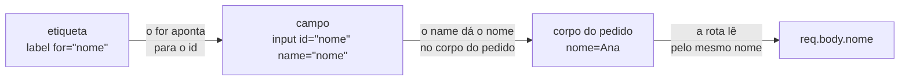
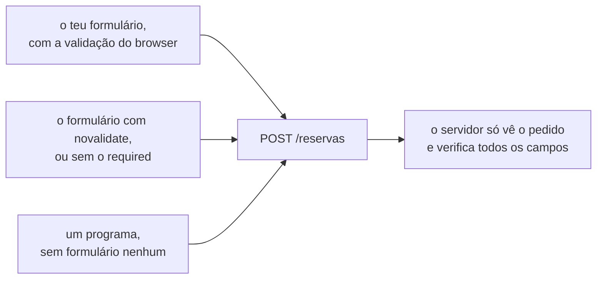
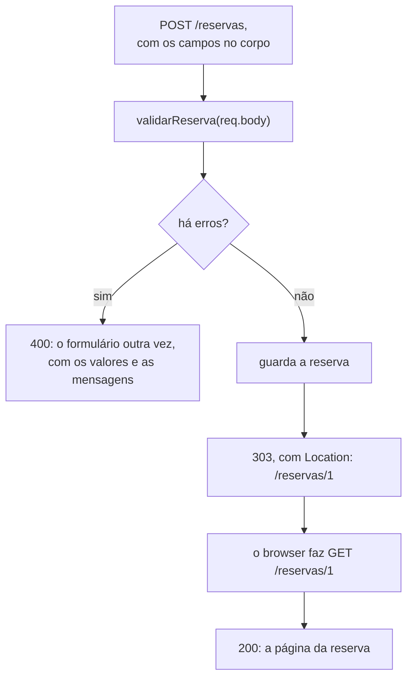
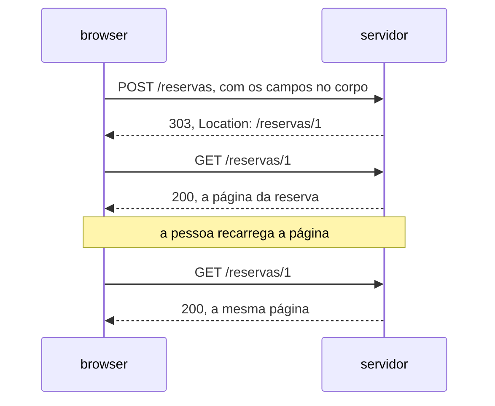

# Formulários e validação

Neste guia, o catálogo de equipamentos do tema 04 ganha um formulário de reserva. Escolhes um equipamento, um dia e um tempo letivo, escreves o teu nome e carregas em "Reservar". Vês porque é que este formulário envia por `POST`, como o servidor lê e verifica cada campo, e o que responde quando há erros e quando corre bem.

Usa a fila do Express do tema 03, o escaping do tema 04 e os formulários de HTML do 11.º ano. Rever: [Uma fila, pela ordem do ficheiro](03-http-rotas-e-middleware.md#uma-fila-pela-ordem-do-ficheiro), [Escaping: o que vem de fora nunca vira HTML](04-ejs-e-reutilizacao-no-servidor.md#escaping-o-que-vem-de-fora-nunca-vira-html) e [Anatomia de um formulário moderno](https://github.com/NunoMACastro/edu-docs-2ig-js-guias-2526/blob/8cf6ade3cf3d4508ea0fb4fbc5b2bedb29869a8f/HTML%20e%20CSS/05-formularios-html.md#1-anatomia-de-um-formulário-moderno). Para praticar: [laboratório](laboratorios/05-formularios-e-validacao-laboratorio.md) e [ficha de exercícios](exercicios/05-formularios-e-validacao-exercicios.md).

## Neste guia

1. [Parte 1: Os campos do formulário vão no corpo do pedido](#parte-1-os-campos-do-formulário-vão-no-corpo-do-pedido)
2. [Parte 2: O servidor verifica cada campo](#parte-2-o-servidor-verifica-cada-campo)
3. [Parte 3: O que o servidor responde ao formulário](#parte-3-o-que-o-servidor-responde-ao-formulário)
4. [Exemplo guiado: as reservas do catálogo](#exemplo-guiado-as-reservas-do-catálogo)

## Parte 1: Os campos do formulário vão no corpo do pedido

Até aqui, o catálogo só mostra dados: a lista dos equipamentos, um equipamento, a pesquisa por sala. Nesta parte, ganha um formulário que muda alguma coisa no servidor, e o servidor passa a ler o que esse formulário envia.

### Um formulário que muda alguma coisa

A pesquisa por sala envia por `GET`, e o campo vai no endereço: `/equipamentos?sala=B12`. Está certo, porque a pesquisa só pede para ver: não muda nada no servidor, e pode repetir-se as vezes que se quiser.

Uma reserva é outra coisa. Fazê-la muda o servidor, porque passa a haver mais uma reserva, e fazê-la duas vezes faz duas reservas. Imagina que o formulário de reserva enviava por `GET`. O browser ia a um endereço como `/reservas?equipamento_id=2&data=2026-10-20&tempo=3&nome=Ana`, e esse endereço ficava no histórico. Cada visita a esse endereço fazia mais uma reserva. E há muitas maneiras de lá voltar: o browser sugere-o quando começas a escrever na barra, alguém guarda-o nos favoritos ou envia-o numa mensagem. Além disso, o teu nome ficava à vista no endereço.

A regra é esta: `GET` para ver, `POST` para mudar. O formulário de reserva tem `method="post"`, e o browser põe os campos no corpo do pedido. O endereço fica só `/reservas`. Rever: [GET serve para ver e POST para mudar](01-do-pedido-a-resposta.md#get-serve-para-ver-e-post-para-mudar) e [O formulário escolhe o sítio dos campos pelo method](03-http-rotas-e-middleware.md#o-formulário-escolhe-o-sítio-dos-campos-pelo-method).

| | Pesquisa por sala | Reserva |
| --- | --- | --- |
| Muda alguma coisa no servidor? | Não | Sim, cria uma reserva |
| `method` do formulário | `get` | `post` |
| Onde vão os campos | No endereço: `/equipamentos?sala=B12` | No corpo do pedido |
| O que fica no histórico e nos favoritos | O endereço com a pesquisa | Só `/reservas`, sem os campos |
| Repetir o pedido | Mostra outra vez a mesma lista | Cria outra reserva |

O pedido que o browser envia quando carregas em "Reservar" tem este aspeto:

```text
POST /reservas HTTP/1.1
Content-Type: application/x-www-form-urlencoded

equipamento_id=2&data=2026-10-20&tempo=3&nome=Ana
```

É o pedido do exemplo guiado do tema 01, agora com o nome de quem reserva. Rever: [Passo 4: enviar a reserva](01-do-pedido-a-resposta.md#passo-4-enviar-a-reserva). Depois da linha em branco vem o corpo, com os campos no mesmo formato dos parâmetros de pesquisa: o nome do campo, um `=` e o valor, separados por `&`. Os espaços e os acentos vão em códigos, como num endereço: o nome "Ana Rita" vai como `Ana+Rita`. A este formato chama-se **urlencoded** (codificado como num endereço), e o cabeçalho `Content-Type` di-lo ao servidor.

### O formulário em HTML

O formulário de reserva tem quatro campos: o equipamento, escolhido de uma lista; o dia; o tempo letivo, de 1 a 9; e o nome de quem reserva. A lista dos equipamentos vem do servidor, num ciclo do EJS, como as listas do tema 04:

```ejs
<form method="post" action="/reservas">
  <p>
    <label for="equipamento_id">Equipamento</label>
    <select id="equipamento_id" name="equipamento_id" required>
      <option value="">Escolhe um equipamento</option>
      <% for (const equipamento of equipamentos) { %>
        <option value="<%= equipamento.id %>"><%= equipamento.nome %>, sala <%= equipamento.sala %></option>
      <% } %>
    </select>
  </p>
  <p>
    <label for="data">Dia</label>
    <input id="data" name="data" type="date" required>
  </p>
  <p>
    <label for="tempo">Tempo letivo, de 1 a 9</label>
    <input id="tempo" name="tempo" type="number" min="1" max="9" required>
  </p>
  <p>
    <label for="nome">O teu nome</label>
    <input id="nome" name="nome" maxlength="40" required>
  </p>
  <button type="submit">Reservar</button>
</form>
```

Lê-o de fora para dentro. O `<form>` diz para onde e como vão os dados: o `action="/reservas"` é o caminho do pedido, e o `method="post"` é o método. Dentro, cada `<p>` junta uma etiqueta e um campo, e o botão `type="submit"` envia o formulário.

Há três atributos que se confundem com facilidade, porque neste formulário têm os três o mesmo valor. Dois são do campo, e um é da etiqueta:

- o `name` é o nome com que o valor segue no corpo do pedido, e é o nome que o servidor lê. Um campo sem `name` não é enviado;
- o `id` identifica o campo dentro da página;
- o `for` da etiqueta (`<label>`) aponta para o `id` do campo.



O diagrama mostra as duas ligações de um campo. O `for` e o `id` ligam a etiqueta ao campo, dentro da página. O `name` liga o campo ao servidor: o valor escrito segue no corpo com esse nome, e a rota lê-o com o mesmo nome.

A ligação da etiqueta ao campo serve quem usa um leitor de ecrã, um programa que lê a página em voz alta a quem não vê bem. Quando a pessoa chega ao campo, ouve o texto da etiqueta; sem a ligação, ouve só "campo de texto". E serve toda a gente, porque carregar na etiqueta põe o cursor no campo, o que dá jeito sobretudo no telemóvel. É a primeira regra de um formulário acessível, que toda a gente consegue usar.

Na lista do equipamento, cada opção tem um valor e um texto. A pessoa lê o texto, mas é o valor que segue no corpo: escolher "Projetor, sala A03" envia `equipamento_id=2`. A primeira opção tem o valor vazio, para a lista não começar com um equipamento escolhido sem a pessoa dar por isso.

Os outros atributos são a validação do browser, a que no 11.º ano chamaste validação nativa. O `required` não deixa enviar um campo vazio, e o `type="date"` mostra um calendário. O `type="number"`, com o `min` e o `max`, só aceita números de 1 a 9, e o `maxlength="40"` não deixa escrever mais de 40 carateres. Quando um destes falha, o browser não envia o pedido e mostra um aviso junto do campo, e a pessoa vê o erro sem esperar pela resposta do servidor. Rever: [Validação nativa](https://github.com/NunoMACastro/edu-docs-2ig-js-guias-2526/blob/8cf6ade3cf3d4508ea0fb4fbc5b2bedb29869a8f/HTML%20e%20CSS/05-formularios-html.md#5-validação-nativa-atributos-obrigatórios-de-dominar).

### O corpo do pedido e o middleware que o lê

A rota do `POST /reservas` vai ler os campos em `req.body`, cada um pelo seu nome: `req.body.nome`, `req.body.tempo`. Mas o Express não lê o corpo de um pedido sozinho. Sem mais nada, o `req.body` é `undefined`, e ler `req.body.equipamento_id` faz a rota falhar, como mostra o erro [TypeError: Cannot read properties of undefined (reading 'equipamento_id')](#typeerror-cannot-read-properties-of-undefined-reading-equipamento_id).

Quem lê o corpo é um middleware que o Express já traz, feito para este formato:

```js fragment
// Middleware que lê o corpo dos formulários enviados por POST e o põe em
// req.body. Tem de estar antes das rotas que usam o req.body.
app.use(express.urlencoded({ extended: false }));
```

O `express.urlencoded` lê o corpo de cada pedido urlencoded, separa os campos, desfaz os códigos (o `+` volta a ser um espaço) e guarda o resultado num objeto, o `req.body`. Depois chama `next()`, como o middleware de registo do tema 03. Para o pedido da secção anterior, o `req.body` fica assim:

```js fragment
{ equipamento_id: "2", data: "2026-10-20", tempo: "3", nome: "Ana" }
```

Os quatro valores são texto, também o 2 e o 3. O corpo de um pedido é texto, como o caminho e a pesquisa, e é o servidor que decide que um campo é um número e o converte. Rever: [Tudo chega como texto](03-http-rotas-e-middleware.md#tudo-chega-como-texto). O `extended: false` é a opção que chega para os campos de um formulário.

O `express.urlencoded` prepara o `req.body` para as rotas, e por isso fica antes delas, pela segunda regra da fila do tema 03. A ordem do `server.js` passa a ser esta: o middleware de registo, o `express.urlencoded`, as rotas e o middleware final.

Prevê: com o `express.urlencoded` logo antes do middleware final, depois de todas as rotas, o que acontece quando se envia o formulário?

A rota do `POST` corre primeiro, porque está mais acima na fila. Quando ela lê o `req.body`, ainda ninguém leu o corpo, e dá o mesmo erro de não haver middleware nenhum. O `express.urlencoded` nunca chega a correr para este pedido.

<details>
<summary>Para ires mais longe: o tamanho máximo do corpo</summary>

O `express.urlencoded` não aceita um corpo com mais de 100 kilobytes, que são mais de cem mil letras. Um pedido maior é recusado antes de chegar à rota, com o código 413, que quer dizer que o pedido é grande demais, e o terminal mostra `PayloadTooLargeError: request entity too large`. Um formulário de reserva nunca lá chega por engano. O limite existe para ninguém conseguir encher a memória do servidor com um só pedido gigante: é o servidor que decide quanto aceita, e não quem envia.

</details>

### O separador Rede mostra os campos enviados

No separador Rede, um envio do formulário aparece como um pedido `POST` a `reservas`. Clica nele e abre o separador Payload ("Carga", no Chrome em português; no Firefox, "Pedido"). Em vez dos parâmetros de pesquisa, aparece "Form Data", com cada campo e o valor que o browser enviou. Rever: [O separador Rede mostra os dados que o pedido levou](03-http-rotas-e-middleware.md#o-separador-rede-mostra-os-dados-que-o-pedido-levou). Nos cabeçalhos do pedido está o `Content-Type: application/x-www-form-urlencoded`.

É aqui que se confirma o nome de um campo. Se a rota lê `req.body.nome` e o Payload mostra `nome_completo`, o problema está no `name` do formulário, e não na rota.

## Parte 2: O servidor verifica cada campo

Com o `req.body` preenchido, a rota já podia guardar a reserva. Mas os valores que lá estão podem não servir: um nome só com espaços, o tempo 12, o equipamento 9, que não existe. Nesta parte, o servidor verifica cada campo antes de o usar.

### Validar no servidor

O formulário já tem o `required`, o `min` e o `max`, e parece que isso chega. Mas a validação do browser só acontece quando o pedido sai do teu formulário, num browser que a cumpra. Qualquer pessoa pode abrir as ferramentas de programador e apagar o `required` de um campo, ou acrescentar ao `<form>` o atributo `novalidate`, que desliga a validação do browser. E qualquer programa pode enviar um `POST /reservas` com os campos que quiser, sem formulário nenhum.



O diagrama mostra três caminhos até à mesma rota. Ao servidor chega só o pedido, e o pedido não diz de onde veio. Por isso, a verificação que conta é a do servidor: o browser ajuda quem preenche, e o servidor decide o que aceita. É a validação do tema 03, agora para cada campo de um formulário. Rever: [Os três códigos deste tema](03-http-rotas-e-middleware.md#os-três-códigos-deste-tema).

O `novalidate` também te serve para testar. Com ele, o browser envia o formulário como estiver, e vês o que o servidor faz com um campo vazio ou com um valor fora dos limites.

Verificar um campo é responder a umas poucas perguntas, sempre as mesmas:

| Pergunta | Na reserva | Se falhar |
| --- | --- | --- |
| O campo veio, e é texto? | O `nome` pode não vir, ou vir repetido | Conta como vazio |
| Está preenchido? | O `nome` não pode ser só espaços | "Escreve o teu nome." |
| É do tipo certo? | O `tempo` é um número inteiro; o campo `data` é um dia que existe | "O tempo letivo é um número inteiro de 1 a 9." |
| Está dentro dos limites? | O `tempo` vai de 1 a 9; o `nome` tem até 40 carateres | A mensagem do limite |
| É um dos valores permitidos? | O `equipamento_id` é o de um equipamento que existe | "Escolhe um equipamento da lista." |

<details>
<summary>Para ires mais longe: um formulário noutro site</summary>

O servidor também não sabe em que site estava o formulário. Uma página de outro site pode ter um formulário que envia para o teu `POST /reservas`, e o browser de quem a visitar envia-o como se viesse do teu. A este ataque chama-se CSRF (do inglês cross-site request forgery, pedido forjado a partir de outro site). Verificar os campos não o trava, porque os campos podem vir todos certos.

</details>

### Cada campo passa a texto antes de tudo

Em `req.body`, um campo que o formulário não enviou é `undefined`, e um campo enviado duas vezes, como em `nome=Ana&nome=Rita`, chega como uma lista: `["Ana", "Rita"]`. Com o teu formulário, nenhum dos dois acontece, mas acontece num pedido feito à mão. E nenhum dos dois é um texto, por isso não tem o `trim()`: chamá-lo faz a rota falhar. Antes de qualquer outra verificação, cada campo passa por esta função:

```js fragment
/**
 * Devolve o texto de um campo do formulário, sem os espaços das pontas.
 * Um campo que não veio, ou que veio repetido (e chega como um array),
 * não é um texto: devolve o texto vazio.
 * @param {unknown} valor o valor tal como chegou em req.body
 * @returns {string}
 */
function textoDoCampo(valor) {
  if (typeof valor !== "string") {
    return "";
  }
  return valor.trim();
}
```

O `typeof` dá o nome do tipo de um valor: `"string"` para um texto, `"undefined"` para um campo que não veio e `"object"` para uma lista. Só um texto passa a primeira verificação. Tudo o resto devolve o texto vazio. Um texto perde os espaços das pontas, com o `trim()`:

| Chega em `req.body` | A `textoDoCampo` devolve |
| --- | --- |
| `"Ana"` | `"Ana"` |
| `"  Ana "` | `"Ana"` |
| `"   "` | `""` |
| `undefined`, de um campo que não veio | `""` |
| `["Ana", "Rita"]`, de um campo repetido | `""` |

Depois disto, um campo em falta, um campo vazio, um campo só com espaços e um campo repetido são todos o texto vazio. A pergunta "está preenchido?" fica numa só comparação, como `valores.nome === ""`, com a mensagem certa. Sem o `trim()`, um nome com três espaços passava como preenchido, e a reserva ficava com um nome invisível.

### Um número só se verifica depois do vazio

O `tempo` chega como texto, e tem de ser um número inteiro. A conversão é a do tema 03, com o `Number` e o `Number.isInteger`, mas há um caso que engana: o `Number("")` dá 0, e não `NaN`. Um tempo vazio passava a 0, e a mensagem falava de um número fora dos limites, quando a pessoa só se esqueceu de o escrever. Rever, em Linguagens de Programação: [O `Number` transforma um texto vazio em 0](https://github.com/NunoMACastro/epms-2627-3ig-lp/blob/main/01-acesso-a-dados/04-api-express-e-contratos.md#o-number-transforma-um-texto-vazio-em-0).

Por isso, o vazio verifica-se primeiro, com a sua mensagem, e só depois o número:

```js fragment
  // O tempo letivo é obrigatório, e é um número inteiro de 1 a 9.
  const tempo = Number(valores.tempo);
  if (valores.tempo === "") {
    erros.tempo = "Indica o tempo letivo.";
  } else if (!Number.isInteger(tempo) || tempo < 1 || tempo > 9) {
    erros.tempo = "O tempo letivo é um número inteiro de 1 a 9.";
  }
```

Só um dos ramos corre. Com o tempo vazio, a mensagem é "Indica o tempo letivo."; com `abc`, `2.5` ou `12`, é a segunda. A mesma condição verifica o limite: um número inteiro ainda não é um tempo letivo, e a parte `tempo < 1 || tempo > 9` apanha o 0, o 12 ou o -3. Cada mensagem fica num objeto, `erros`, numa propriedade com o nome do campo.

### Um dia com o formato certo pode não existir

O campo `type="date"` envia o dia no formato `AAAA-MM-DD`, como `2026-10-20`, mas quem não usar o formulário pode enviar qualquer texto. Em JavaScript, `new Date("2026-10-20")` cria um objeto com esse dia. O `getTime()` dá o momento dessa data, em milissegundos, e numa data inválida dá `NaN`, como com o texto `"abc"`.

Prevê: o que dá o `new Date("2026-02-30")`, um 30 de fevereiro?

Não dá uma data inválida: dá 2 de março. O Node, como o Chrome, passa os dias a mais para o mês seguinte, sem avisar. Um texto com o formato certo e um dia que não existe passava a verificação do `getTime()`.

A solução é confirmar que o dia que sai é o mesmo que entrou. Faz isso a função `diaValido`, que te é dada pronta: tens de perceber o que faz e de a usar, e não de a escrever de raiz.

```js fragment
/**
 * Confirma que um texto no formato AAAA-MM-DD é um dia que existe.
 * O new Date aceita "2026-02-30" e transforma-o em 2 de março; por isso
 * confirma-se que o dia que sai é o mesmo que entrou.
 * @param {string} texto o dia, como o campo type="date" o envia
 * @returns {boolean}
 */
function diaValido(texto) {
  const dia = new Date(texto);
  if (Number.isNaN(dia.getTime())) {
    return false;
  }
  return dia.toISOString().slice(0, 10) === texto;
}
```

O `toISOString()` escreve a data no formato `2026-03-02T00:00:00.000Z`, e o `slice(0, 10)` fica com os dez primeiros carateres, que são o dia:

| Texto | O `new Date` dá | O dia que sai | A `diaValido` devolve |
| --- | --- | --- | --- |
| `"2026-10-20"` | 20 de outubro | `"2026-10-20"` | `true` |
| `"2026-02-30"` | 2 de março | `"2026-03-02"` | `false` |
| `"abc"` | uma data inválida | nenhum: o `getTime()` dá `NaN` antes | `false` |

Na validação, o dia vazio tem a sua mensagem, "Escolhe o dia da reserva.", e só um dia preenchido passa pela `diaValido`.

### O equipamento tem de ser um dos da lista

O `equipamento_id` não é um número qualquer: tem de ser o de um equipamento que existe. A lista do formulário só oferece esses, mas um pedido feito à mão pode trazer o 9, ou `abc`. A verificação procura o equipamento, com o `find` da rota de detalhe:

```js fragment
  // O equipamento tem de ser um dos da lista.
  const equipamento = equipamentos.find((equipamento) => equipamento.id === Number(valores.equipamento_id));
  if (!equipamento) {
    erros.equipamento_id = "Escolhe um equipamento da lista.";
  }
```

Se o `find` não encontra nada, o valor não é um dos permitidos. Esta verificação apanha ao mesmo tempo o vazio, o `abc` e o 9: o `Number` dá 0, `NaN` e 9, e nenhum deles é o `id` de um equipamento.

Aqui, um equipamento que não existe dá 400, e não 404 como em `/equipamentos/9`. Na rota de detalhe, pede-se um equipamento, e ele não existe. Aqui, pede-se para criar uma reserva, e um dos campos não serve: o pedido está mal feito.

### Só se leem os campos previstos

Um pedido pode trazer, além dos quatro campos, outros que ninguém pediu, como `id=999` ou `confirmada=sim`. Se a rota guardasse o `req.body` inteiro, com `reservas.push(req.body)`, esses campos iam parar à reserva guardada. E um `id` enviado de fora tomava o lugar do que o servidor devia dar.

Por isso, a validação lê só os campos previstos, um a um, pelo nome, e a reserva constrói-se campo a campo, com os valores já verificados. Um campo a mais é ignorado: não dá erro, nem entra em lado nenhum. O `id` da reserva dá-o o servidor, com o seu contador.

### A função que valida a reserva

As verificações juntam-se numa função, a `validarReserva`, que recebe o `req.body` e devolve os valores limpos e os erros:

```js fragment
/**
 * Verifica os campos de uma reserva vindos do formulário.
 * Só lê os quatro campos previstos; qualquer outro campo é ignorado.
 * Devolve os valores, para voltar a mostrar no formulário, e os erros,
 * com uma mensagem por campo. Sem erros, o objeto dos erros fica vazio.
 * @param {object|undefined} corpo o req.body do pedido, que pode não existir
 * @returns {object} um objeto com os valores e os erros
 */
function validarReserva(corpo) {
  // Sem corpo lido, todos os campos faltam e recebem os erros já previstos.
  if (!corpo) {
    corpo = {};
  }
  const valores = {
    equipamento_id: textoDoCampo(corpo.equipamento_id),
    data: textoDoCampo(corpo.data),
    tempo: textoDoCampo(corpo.tempo),
    nome: textoDoCampo(corpo.nome),
  };
  const erros = {};

  // O equipamento tem de ser um dos da lista.
  const equipamento = equipamentos.find((equipamento) => equipamento.id === Number(valores.equipamento_id));
  if (!equipamento) {
    erros.equipamento_id = "Escolhe um equipamento da lista.";
  }

  // O dia é obrigatório, e tem de existir no calendário.
  if (valores.data === "") {
    erros.data = "Escolhe o dia da reserva.";
  } else if (!diaValido(valores.data)) {
    erros.data = "Esse dia não existe no calendário.";
  }

  // O tempo letivo é obrigatório, e é um número inteiro de 1 a 9.
  const tempo = Number(valores.tempo);
  if (valores.tempo === "") {
    erros.tempo = "Indica o tempo letivo.";
  } else if (!Number.isInteger(tempo) || tempo < 1 || tempo > 9) {
    erros.tempo = "O tempo letivo é um número inteiro de 1 a 9.";
  }

  // O nome é obrigatório, e tem no máximo 40 carateres.
  if (valores.nome === "") {
    erros.nome = "Escreve o teu nome.";
  } else if (valores.nome.length > 40) {
    erros.nome = "O nome tem, no máximo, 40 carateres.";
  }

  return { valores: valores, erros: erros };
}
```

Lê-a de cima para baixo. O primeiro `if` trata o pedido sem corpo. O objeto `valores` lê os quatro campos previstos, cada um pela `textoDoCampo`, e os quatro blocos seguintes são as verificações das secções anteriores, um por campo. O último verifica o limite do nome, de 40 carateres, com o `length`, depois de se saber que o nome não está vazio. No fim, a função devolve um objeto com duas propriedades: os `valores`, para voltar a preencher o formulário, e os `erros`, com uma mensagem por campo errado. Sem erros, o objeto `erros` fica vazio, `{}`.

O primeiro `if` existe porque, mesmo com o `express.urlencoded` no sítio, um pedido pode chegar sem corpo, ou com o corpo noutro formato, como JSON, que este middleware não lê. Nesses casos, o `req.body` é `undefined`. A função põe um objeto vazio no seu parâmetro `corpo`, sem mexer no `req.body`, e cada campo dá `undefined`, que a `textoDoCampo` transforma em texto vazio. O pedido recebe as quatro mensagens dos campos em falta, e a rota não falha.

A função não para no primeiro erro: verifica os quatro campos, para a pessoa ver de uma vez tudo o que tem de corrigir. E cada mensagem diz o que fazer, e não só o que está mal. "Escolhe o dia da reserva." ajuda mais do que "Dia inválido.", porque quem a lê está a olhar para o formulário e quer saber o que mudar.

## Parte 3: O que o servidor responde ao formulário

Depois da validação, a rota do `POST` responde de uma de duas maneiras:



Com erros, o servidor responde com o formulário outra vez, e nada fica guardado. Sem erros, guarda a reserva e responde com um redirecionamento, e é o browser que pede a seguir a página da reserva.

### Quando há erros: o formulário outra vez

Com erros, o pedido está mal feito, e o código é 400. A resposta podia ser a página de erro do tema 04. Mas aí a pessoa ficava sem o formulário e, ao voltar atrás, não via junto de cada campo o que tinha de corrigir. Num formulário, a resposta a um erro é o próprio formulário, com três diferenças. Os campos trazem o que a pessoa escreveu, cada campo errado tem a sua mensagem, e uma frase no topo diz que a reserva não foi feita.

Para saber se houve erros, a rota conta as propriedades do objeto `erros`. O `Object.keys(erros)` dá a lista dos nomes das propriedades, como `["data", "nome"]`, e uma lista vazia quer dizer que não houve erros:

```js fragment
const resultado = validarReserva(req.body);

// Com erros: o formulário outra vez, com o 400, os valores e as mensagens.
if (Object.keys(resultado.erros).length > 0) {
  res.status(400).render("reserva-nova", {
    titulo: "Nova reserva",
    equipamentos: equipamentos,
    valores: resultado.valores,
    erros: resultado.erros,
  });
  return;
}
```

A página é a do formulário, `reserva-nova`, com o código 400 e mais dois dados: os `valores` e os `erros` que a validação devolveu.

O `return` a seguir é obrigatório. Sem ele, a rota continuava: guardava a reserva com os dados errados e respondia outra vez. O servidor ia abaixo, como mostra o erro [Depois de um envio com erros, o servidor vai abaixo](#depois-de-um-envio-com-erros-o-servidor-vai-abaixo).

### O formulário volta com os valores e as mensagens

O modelo do formulário passa a receber os `valores` e os `erros`. Em cada campo, o valor vai no atributo `value`, e a mensagem, se houver, vai dentro da etiqueta:

```ejs
<p>
  <label for="nome">O teu nome
    <% if (erros.nome) { %><strong><%= erros.nome %></strong><% } %>
  </label>
  <input id="nome" name="nome" maxlength="40" value="<%= valores.nome %>" required>
</p>
```

A mensagem fica dentro do `<label>` por causa do leitor de ecrã. Quando chega ao campo, ele lê a etiqueta inteira, e por isso lê também o erro desse campo. Com a mensagem noutro sítio da página, sem nada que a ligue ao campo, quem não vê o ecrã não saberia a que campo ela pertence.

O valor entra com `<%=`, como todos os valores do tema 04, e aqui há uma razão a mais. Os valores que voltam ao formulário vieram do pedido, e qualquer pessoa pode lá escrever o que quiser. Se alguém escrever no nome `"><b>x</b>`, o browser recebe `value="&#34;&gt;&lt;b&gt;x&lt;/b&gt;"`, e o campo mostra o texto tal como foi escrito. Com `<%-`, as aspas fechavam o atributo antes do tempo, e o resto entrava na página como HTML.

Na lista do equipamento não há `value` para preencher. Marca-se como escolhida a opção que a pessoa tinha escolhido, com o atributo `selected`, só nessa opção:

```ejs
<option value="<%= equipamento.id %>" <% if (String(equipamento.id) === valores.equipamento_id) { %>selected<% } %>><%= equipamento.nome %>, sala <%= equipamento.sala %></option>
```

O `equipamento.id` é um número, e o `valores.equipamento_id` é texto, porque veio do pedido. O `String(...)` converte o número em texto, para os dois se poderem comparar com `===`. Sem ele, `2 === "2"` dá sempre `false`, nenhuma opção fica com o `selected`, e a lista volta a "Escolhe um equipamento" depois de cada erro.

Da primeira vez que o formulário aparece, na rota `GET /reservas/nova`, ainda não há valores nem erros. O modelo é o mesmo, e a rota passa-lhe quatro valores vazios e um objeto de erros vazio. Sem eles, a página dava 500, com `erros is not defined`, o erro do tema 04 de uma variável que a rota não passou ao modelo.

### Quando corre bem: redirecionar

Sem erros, a rota constrói a reserva campo a campo e guarda-a. Falta responder. A primeira ideia é responder logo com a página da reserva, com o `res.render` e o código 200. Funciona, mas tem um defeito, que se vê ao recarregar a página.

A página no ecrã é a resposta a um `POST`. Se a pessoa a recarregar, o browser não pede a página outra vez: repete o pedido que a trouxe, o `POST`, com o mesmo corpo. Os browsers avisam antes, numa janela que pergunta se queres enviar outra vez os dados do formulário, mas muita gente carrega em continuar sem ler. O servidor recebe um segundo `POST` igual ao primeiro e guarda uma segunda reserva igual. A este problema chama-se reenvio do formulário, e numa aplicação de reservas ocupa um equipamento que ninguém pediu.

A solução é não responder com a página. O servidor responde com um redirecionamento, como o da pesquisa da Wikipédia do tema 01. O código é o **303** (See Other, vê outro), que manda o browser pedir outro endereço com um `GET`. Rever: [Um redirecionamento são dois pedidos](01-do-pedido-a-resposta.md#um-redirecionamento-são-dois-pedidos). O endereço vai no cabeçalho `Location`, e é o da página da reserva:

```js fragment
// Redirecionamento 303: o browser faz um GET à página da reserva.
// Recarregar essa página já não volta a enviar o formulário.
res.redirect(303, `/reservas/${reserva.id}`);
```

O `res.redirect` responde logo, sem a página da reserva: só com o 303 e o `Location: /reservas/1`. O browser faz sozinho o `GET /reservas/1` e mostra a página que vem nessa resposta.



O diagrama mostra o envio e, depois, um recarregamento. O formulário envia um `POST`, o servidor guarda a reserva e responde 303, e o browser faz o `GET`. A página no ecrã passa a ser a resposta a um `GET`, e recarregá-la repete o `GET`: mostra outra vez a mesma reserva, e não cria nenhuma.

A este padrão chama-se **PRG**, das iniciais, em inglês, de `POST`, redirecionamento e `GET`. Usa-se o 303, e não o 302 da Wikipédia, porque o 303 diz expressamente que o pedido seguinte é um `GET`. É o que se quer depois de um `POST`.

O redirecionamento só se faz quando corre bem. Com erros, a resposta é o formulário com o 400: os valores e as mensagens só existem durante aquele pedido, e um `GET` novo já não os teria.

O endereço para onde se redireciona, `/reservas/1`, precisa de uma rota `GET /reservas/:id`. Fica abaixo de `GET /reservas/nova`, porque o caminho fixo vem antes do caminho com parâmetro. Ao contrário, `/reservas/nova` encaixava em `/reservas/:id`, com `"nova"` no lugar do número, e respondia 400, como mostra o erro [O formulário de reserva responde "Pedido inválido"](#o-formulário-de-reserva-responde-pedido-inválido). Rever: [O caminho fixo vem antes do caminho com parâmetro](03-http-rotas-e-middleware.md#o-caminho-fixo-vem-antes-do-caminho-com-parâmetro).

No separador Rede, o envio aparece como dois pedidos: o `POST /reservas`, com o 303 e o cabeçalho `Location` na resposta, e logo a seguir o `GET /reservas/1`, com o 200. Em alguns browsers, a lista limpa-se quando a página muda. Se não vires o `POST`, liga a opção que mantém o registo ("Preserve log", ou "Manter registo"), no topo do separador, e envia outra vez.

<details>
<summary>Para ires mais longe: a resposta de uma API</summary>

Numa API, como as de Linguagens de Programação, quem recebe a resposta é um programa, e não uma pessoa a olhar para uma página. A resposta habitual a um `POST` que cria alguma coisa é o código 201 (Created, criado), com os dados criados em JSON. O exemplo [catalogo-com-reservas](../exemplos/aplicacoes-em-browser/catalogo-com-reservas/README.md) responde assim à reserva, com uma só mensagem de erro para todos os campos. Compara-o com o deste guia: o código, o tipo da resposta e o endereço que fica no browser.

</details>

## Exemplo guiado: as reservas do catálogo

O exemplo acrescenta as reservas ao catálogo com páginas do tema 04. Primeiro fazes o formulário e um `POST` que guarda tudo sem verificar, para veres o que corre mal. Depois acrescentas a validação, com o formulário outra vez quando há erros, e por fim o redirecionamento.

O ponto de partida é o catálogo do fim do tema 04, o do exemplo [catalogo-com-ejs](../exemplos/aplicacoes-em-browser/catalogo-com-ejs/README.md), com a pasta `views`. O resultado final está pronto a correr no exemplo [catalogo-com-formularios](../exemplos/aplicacoes-em-browser/catalogo-com-formularios/README.md). Sempre que mudares o `server.js`, para o servidor com Ctrl+C e liga-o outra vez com `node server.js`. As reservas ficam num array, e por isso cada arranque começa sem nenhuma. Uma mudança num modelo vê-se só com recarregar a página.

### Passo 1: o formulário

No `server.js`, a seguir ao array dos equipamentos, acrescenta o array das reservas e o número da próxima reserva:

```js fragment
const reservas = [];
let proximoIdReserva = 1;
```

O `proximoIdReserva` é um `let`, porque passa ao número seguinte a cada reserva criada.

A seguir à rota `/equipamentos/:id`, antes do middleware final, acrescenta a rota do formulário, que só mostra a página:

```js fragment
// O formulário de reserva.
app.get("/reservas/nova", (req, res) => {
  res.render("reserva-nova", { titulo: "Nova reserva", equipamentos: equipamentos });
});
```

Cria o modelo `views/reserva-nova.ejs`, com o formulário da secção [O formulário em HTML](#o-formulário-em-html) entre o cabeçalho e o rodapé:

```ejs
<%# O formulário de reserva. Recebe o titulo e os equipamentos para a lista. %>
<%- include("partials/cabecalho") %>
    <form method="post" action="/reservas">
      <p>
        <label for="equipamento_id">Equipamento</label>
        <select id="equipamento_id" name="equipamento_id" required>
          <option value="">Escolhe um equipamento</option>
          <% for (const equipamento of equipamentos) { %>
            <option value="<%= equipamento.id %>"><%= equipamento.nome %>, sala <%= equipamento.sala %></option>
          <% } %>
        </select>
      </p>
      <p>
        <label for="data">Dia</label>
        <input id="data" name="data" type="date" required>
      </p>
      <p>
        <label for="tempo">Tempo letivo, de 1 a 9</label>
        <input id="tempo" name="tempo" type="number" min="1" max="9" required>
      </p>
      <p>
        <label for="nome">O teu nome</label>
        <input id="nome" name="nome" maxlength="40" required>
      </p>
      <button type="submit">Reservar</button>
    </form>
<%- include("partials/rodape") %>
```

No cabeçalho, `views/partials/cabecalho.ejs`, o menu ganha as ligações para as reservas. Troca o `<nav>` por este:

```ejs
    <nav>
      <a href="/">Início</a> |
      <a href="/equipamentos">Todos os equipamentos</a> |
      <a href="/reservas">Reservas</a> |
      <a href="/reservas/nova">Fazer uma reserva</a>
    </nav>
```

Na página inicial, `views/inicio.ejs`, acrescenta a seguir ao formulário da pesquisa a ligação para reservar:

```ejs
    <p><a href="/reservas/nova">Fazer uma reserva</a></p>
```

Liga o servidor e abre `/reservas/nova`: aparece o formulário, com os quatro equipamentos na lista. O browser não te deixa enviar com um campo vazio, nem com o tempo 12, porque é a validação do browser a funcionar. Preenche tudo e envia. O browser faz `POST /reservas`, e a resposta é a página "Página não encontrada", com o 404: ainda não há rota para o `POST`, e responde o middleware final.

### Passo 2: ler o corpo, ainda sem verificar

A seguir ao middleware de registo, acrescenta o `express.urlencoded`:

```js fragment
// Middleware que lê o corpo dos formulários enviados por POST e o põe em
// req.body. Tem de estar antes das rotas que usam o req.body.
app.use(express.urlencoded({ extended: false }));
```

A seguir à rota do formulário, acrescenta a rota do `POST`, numa primeira versão que guarda o que vier e responde com a página da reserva:

```js fragment
// Criar uma reserva: POST /reservas, com os campos no corpo do pedido.
// Primeira versão: ainda sem verificar nada.
app.post("/reservas", (req, res) => {
  const reserva = {
    id: proximoIdReserva,
    equipamentoId: Number(req.body.equipamento_id),
    data: req.body.data,
    tempo: Number(req.body.tempo),
    nome: req.body.nome,
  };
  proximoIdReserva = proximoIdReserva + 1;
  reservas.push(reserva);
  const equipamento = equipamentos.find((equipamento) => equipamento.id === reserva.equipamentoId);
  res.render("reserva", { titulo: `Reserva ${reserva.id}`, reserva: reserva, equipamento: equipamento });
});
```

O `app.post` regista uma rota para o método `POST`. A reserva recebe o número do contador, e o contador passa ao seguinte. O caminho `/reservas` vai servir também a lista das reservas, com o método `GET`, e são duas rotas diferentes, porque o método faz parte da rota.

Cria o modelo da página de uma reserva, `views/reserva.ejs`:

```ejs
<%# A página de uma reserva, para onde o browser vai depois de reservar.
    Recebe o titulo, a reserva e o equipamento reservado. %>
<%- include("partials/cabecalho") %>
    <p>Equipamento: <a href="/equipamentos/<%= equipamento.id %>"><%= equipamento.nome %></a>, sala <%= equipamento.sala %></p>
    <p>Dia: <%= reserva.data %>, tempo <%= reserva.tempo %></p>
    <p>Reservado por: <%= reserva.nome %></p>
    <p><a href="/reservas">Ver todas as reservas</a></p>
<%- include("partials/rodape") %>
```

A seguir à rota do `POST`, acrescenta a lista das reservas:

```js fragment
// A lista das reservas feitas desde que o servidor arrancou.
app.get("/reservas", (req, res) => {
  // Para cada reserva, junta-se o equipamento, para a página mostrar o nome.
  const linhas = [];
  for (const reserva of reservas) {
    const equipamento = equipamentos.find((equipamento) => equipamento.id === reserva.equipamentoId);
    linhas.push({ reserva: reserva, equipamento: equipamento });
  }
  res.render("reservas", { titulo: "Reservas", linhas: linhas });
});
```

E o seu modelo, `views/reservas.ejs`:

```ejs
<%# A lista das reservas. Recebe o titulo e as linhas, cada uma com a
    reserva e o equipamento reservado. %>
<%- include("partials/cabecalho") %>
    <% if (linhas.length === 0) { %>
      <p>Ainda não há reservas.</p>
    <% } else { %>
      <ul>
        <% for (const linha of linhas) { %>
          <li><a href="/reservas/<%= linha.reserva.id %>">Reserva <%= linha.reserva.id %></a>: <%= linha.equipamento.nome %>, dia <%= linha.reserva.data %>, tempo <%= linha.reserva.tempo %>, por <%= linha.reserva.nome %></li>
        <% } %>
      </ul>
    <% } %>
    <p><a href="/reservas/nova">Fazer uma reserva</a></p>
<%- include("partials/rodape") %>
```

A rota junta cada reserva ao seu equipamento, numa lista de linhas, e o modelo só tem de a mostrar. Como no tema 04, a decisão sobre os dados fica na rota.

Liga outra vez o servidor. Preenche o formulário com o projetor, um dia, o tempo 3 e o teu nome, e envia: aparece a página "Reserva 1", e `/reservas` mostra-a na lista. Parece tudo bem, mas esta versão guarda tudo o que recebe. Antes de acrescentares a validação, experimenta três envios:

1. Recarrega a página "Reserva 1". O browser pergunta se queres enviar outra vez os dados do formulário; diz que sim. Em `/reservas` há agora duas reservas iguais: é o reenvio do formulário, que o passo 4 resolve.
2. Envia o formulário com o nome só com espaços. O `required` deixa passar, porque o campo não está vazio, e a reserva fica com um nome invisível.
3. Acrescenta `novalidate` ao `<form>` do `views/reserva-nova.ejs`, recarrega `/reservas/nova` e envia o formulário sem preencher nada. O equipamento chega como texto vazio, que o `Number` transforma em 0, e não há equipamento 0. A reserva fica guardada, mas a página dela dá 500, com `Cannot read properties of undefined (reading 'id')`: o modelo tenta ler o `equipamento.id` de um equipamento que não existe. A lista das reservas também passa a dar 500: uma reserva mal feita estragou uma página para toda a gente.

No fim, tira o `novalidate` do modelo e liga outra vez o servidor, que volta a começar sem reservas.

### Passo 3: validar, e o formulário outra vez

No `server.js`, a seguir aos arrays e antes do middleware de registo, acrescenta as três funções da Parte 2: a `textoDoCampo`, a `diaValido` e a `validarReserva`. Copia-as tal como estão nas secções [Cada campo passa a texto antes de tudo](#cada-campo-passa-a-texto-antes-de-tudo), [Um dia com o formato certo pode não existir](#um-dia-com-o-formato-certo-pode-não-existir) e [A função que valida a reserva](#a-função-que-valida-a-reserva).

Troca a rota do `POST` por esta, que valida primeiro, responde com o formulário quando há erros, e só depois guarda:

```js fragment
// Criar uma reserva: POST /reservas, com os campos no corpo do pedido.
app.post("/reservas", (req, res) => {
  const resultado = validarReserva(req.body);

  // Com erros: o formulário outra vez, com o 400, os valores e as mensagens.
  if (Object.keys(resultado.erros).length > 0) {
    res.status(400).render("reserva-nova", {
      titulo: "Nova reserva",
      equipamentos: equipamentos,
      valores: resultado.valores,
      erros: resultado.erros,
    });
    return;
  }

  // Sem erros: a reserva é construída campo a campo, com os valores já
  // verificados, e nunca a partir do req.body inteiro.
  const reserva = {
    id: proximoIdReserva,
    equipamentoId: Number(resultado.valores.equipamento_id),
    data: resultado.valores.data,
    tempo: Number(resultado.valores.tempo),
    nome: resultado.valores.nome,
  };
  proximoIdReserva = proximoIdReserva + 1;
  reservas.push(reserva);
  const equipamento = equipamentos.find((equipamento) => equipamento.id === reserva.equipamentoId);
  res.render("reserva", { titulo: `Reserva ${reserva.id}`, reserva: reserva, equipamento: equipamento });
});
```

A reserva já não lê o `req.body`: lê os `valores` que a validação devolveu, limpos e verificados. A rota do formulário passa a dar ao modelo os valores vazios e os erros vazios. Troca-a por esta:

```js fragment
// O formulário de reserva, vazio e sem erros.
// Fica antes de /reservas/:id: um caminho fixo vem antes de um com parâmetro.
app.get("/reservas/nova", (req, res) => {
  res.render("reserva-nova", {
    titulo: "Nova reserva",
    equipamentos: equipamentos,
    valores: { equipamento_id: "", data: "", tempo: "", nome: "" },
    erros: {},
  });
});
```

O modelo `views/reserva-nova.ejs` ganha a frase do topo, os valores e as mensagens, como na secção [O formulário volta com os valores e as mensagens](#o-formulário-volta-com-os-valores-e-as-mensagens). Troca-o todo por este:

```ejs
<%# O formulário de reserva. Recebe o titulo, os equipamentos para a lista,
    os valores a pôr nos campos e os erros, um por campo. Da primeira vez,
    os valores estão vazios e não há erros; depois de um envio com erros,
    traz o que o utilizador escreveu e as mensagens. %>
<%- include("partials/cabecalho") %>
    <% if (Object.keys(erros).length > 0) { %>
      <p><strong>A reserva não foi feita. Corrige os campos assinalados e volta a enviar.</strong></p>
    <% } %>
    <form method="post" action="/reservas">
      <p>
        <label for="equipamento_id">Equipamento
          <% if (erros.equipamento_id) { %><strong><%= erros.equipamento_id %></strong><% } %>
        </label>
        <select id="equipamento_id" name="equipamento_id" required>
          <option value="">Escolhe um equipamento</option>
          <% for (const equipamento of equipamentos) { %>
            <option value="<%= equipamento.id %>" <% if (String(equipamento.id) === valores.equipamento_id) { %>selected<% } %>><%= equipamento.nome %>, sala <%= equipamento.sala %></option>
          <% } %>
        </select>
      </p>
      <p>
        <label for="data">Dia
          <% if (erros.data) { %><strong><%= erros.data %></strong><% } %>
        </label>
        <input id="data" name="data" type="date" value="<%= valores.data %>" required>
      </p>
      <p>
        <label for="tempo">Tempo letivo, de 1 a 9
          <% if (erros.tempo) { %><strong><%= erros.tempo %></strong><% } %>
        </label>
        <input id="tempo" name="tempo" type="number" min="1" max="9" value="<%= valores.tempo %>" required>
      </p>
      <p>
        <label for="nome">O teu nome
          <% if (erros.nome) { %><strong><%= erros.nome %></strong><% } %>
        </label>
        <input id="nome" name="nome" maxlength="40" value="<%= valores.nome %>" required>
      </p>
      <button type="submit">Reservar</button>
    </form>
<%- include("partials/rodape") %>
```

O modelo lê-se como o do passo 1, campo a campo. A diferença está em cada campo, que tem o `value` com o valor que a rota passou e, dentro da etiqueta, a mensagem, só quando há um erro nesse campo.

Liga outra vez o servidor. Para veres a validação do servidor, o browser tem de deixar passar o que normalmente recusa, e isso pede mudanças temporárias no modelo:

1. Acrescenta `novalidate` ao `<form>`, recarrega `/reservas/nova` e envia o formulário vazio. Depois, preenche os campos e põe o tempo 12.
2. Para o 30 de fevereiro, muda o campo do dia de `type="date"` para `type="text"`, recarrega e escreve `2026-02-30`. O `novalidate` não chega para este caso, porque o calendário não deixa escolher um dia que não existe.
3. Para o equipamento 9, acrescenta dentro do `<select>` a opção `<option value="9">Equipamento de ensaio 9</option>`, recarrega e escolhe-a.

Cada envio responde 400, com a mensagem do campo errado, e os outros campos continuam preenchidos. Nenhum guarda uma reserva: `/reservas` continua vazia. No fim, tira as três mudanças do modelo.

### Passo 4: o redirecionamento

Na rota do `POST`, troca as duas últimas linhas, o `find` do equipamento e o `res.render` da reserva, pelo redirecionamento:

```js fragment
  // Redirecionamento 303: o browser faz um GET à página da reserva.
  // Recarregar essa página já não volta a enviar o formulário.
  res.redirect(303, `/reservas/${reserva.id}`);
```

A seguir à lista das reservas, antes do middleware final, acrescenta a rota da página de uma reserva. As verificações são as da rota de detalhe dos equipamentos, com o 400 antes do 404:

```js fragment
// Uma reserva: a página para onde o browser vai depois de reservar.
app.get("/reservas/:id", (req, res) => {
  const id = Number(req.params.id);
  if (!Number.isInteger(id) || id < 1) {
    res.status(400).render("erro", {
      titulo: "Pedido inválido",
      mensagem: "O número da reserva tem de ser um número inteiro positivo.",
    });
    return;
  }
  const reserva = reservas.find((reserva) => reserva.id === id);
  if (!reserva) {
    res.status(404).render("erro", {
      titulo: "Reserva não encontrada",
      mensagem: `Não existe a reserva ${id}.`,
    });
    return;
  }
  const equipamento = equipamentos.find((equipamento) => equipamento.id === reserva.equipamentoId);
  res.render("reserva", { titulo: `Reserva ${reserva.id}`, reserva: reserva, equipamento: equipamento });
});
```

Liga outra vez o servidor e faz uma reserva. Depois de carregares em "Reservar", a barra de endereço mostra `/reservas/1`, e não `/reservas`. Recarrega a página: aparece a mesma reserva, sem janela de aviso nenhuma, e `/reservas` continua a ter só uma. No separador Rede, o envio são dois pedidos: o `POST /reservas`, com o 303, e o `GET /reservas/1`, com o 200.

### Passo 5: o servidor completo

O `server.js` no fim do exemplo:

```js
// server.js: o catálogo de equipamentos da escola, agora com reservas feitas
// num formulário. O formulário envia por POST; o servidor lê o corpo, verifica
// cada campo e, se houver erros, volta a mostrar o formulário com os valores e
// as mensagens. Se estiver tudo bem, guarda a reserva e redireciona o browser
// para a página dela.
import express from "express";

const app = express();
const PORTA = 3000;

// O motor de modelos: o res.render vai procurar os ficheiros .ejs
// na pasta views.
app.set("view engine", "ejs");

// Os dados ficam em memória: existem enquanto o servidor estiver ligado.
const equipamentos = [
  { id: 1, nome: "Portátil", sala: "B12" },
  { id: 2, nome: "Projetor", sala: "A03" },
  { id: 3, nome: "Impressora", sala: "Secretaria" },
  { id: 4, nome: "Monitor", sala: "B12" },
];
const reservas = [];
let proximoIdReserva = 1;

/**
 * Devolve o texto de um campo do formulário, sem os espaços das pontas.
 * Um campo que não veio, ou que veio repetido (e chega como um array),
 * não é um texto: devolve o texto vazio.
 * @param {unknown} valor o valor tal como chegou em req.body
 * @returns {string}
 */
function textoDoCampo(valor) {
  if (typeof valor !== "string") {
    return "";
  }
  return valor.trim();
}

/**
 * Confirma que um texto no formato AAAA-MM-DD é um dia que existe.
 * O new Date aceita "2026-02-30" e transforma-o em 2 de março; por isso
 * confirma-se que o dia que sai é o mesmo que entrou.
 * @param {string} texto o dia, como o campo type="date" o envia
 * @returns {boolean}
 */
function diaValido(texto) {
  const dia = new Date(texto);
  if (Number.isNaN(dia.getTime())) {
    return false;
  }
  return dia.toISOString().slice(0, 10) === texto;
}

/**
 * Verifica os campos de uma reserva vindos do formulário.
 * Só lê os quatro campos previstos; qualquer outro campo é ignorado.
 * Devolve os valores, para voltar a mostrar no formulário, e os erros,
 * com uma mensagem por campo. Sem erros, o objeto dos erros fica vazio.
 * @param {object|undefined} corpo o req.body do pedido, que pode não existir
 * @returns {object} um objeto com os valores e os erros
 */
function validarReserva(corpo) {
  // Sem corpo lido, todos os campos faltam e recebem os erros já previstos.
  if (!corpo) {
    corpo = {};
  }
  const valores = {
    equipamento_id: textoDoCampo(corpo.equipamento_id),
    data: textoDoCampo(corpo.data),
    tempo: textoDoCampo(corpo.tempo),
    nome: textoDoCampo(corpo.nome),
  };
  const erros = {};

  // O equipamento tem de ser um dos da lista.
  const equipamento = equipamentos.find((equipamento) => equipamento.id === Number(valores.equipamento_id));
  if (!equipamento) {
    erros.equipamento_id = "Escolhe um equipamento da lista.";
  }

  // O dia é obrigatório, e tem de existir no calendário.
  if (valores.data === "") {
    erros.data = "Escolhe o dia da reserva.";
  } else if (!diaValido(valores.data)) {
    erros.data = "Esse dia não existe no calendário.";
  }

  // O tempo letivo é obrigatório, e é um número inteiro de 1 a 9.
  const tempo = Number(valores.tempo);
  if (valores.tempo === "") {
    erros.tempo = "Indica o tempo letivo.";
  } else if (!Number.isInteger(tempo) || tempo < 1 || tempo > 9) {
    erros.tempo = "O tempo letivo é um número inteiro de 1 a 9.";
  }

  // O nome é obrigatório, e tem no máximo 40 carateres.
  if (valores.nome === "") {
    erros.nome = "Escreve o teu nome.";
  } else if (valores.nome.length > 40) {
    erros.nome = "O nome tem, no máximo, 40 carateres.";
  }

  return { valores: valores, erros: erros };
}

// Middleware de registo: escreve no terminal cada pedido que chega,
// e passa-o à frente. Está antes das rotas, para ver todos os pedidos.
app.use((req, res, next) => {
  console.log(`${req.method} ${req.url}`);
  next();
});

// Middleware que lê o corpo dos formulários enviados por POST e o põe em
// req.body. Tem de estar antes das rotas que usam o req.body.
app.use(express.urlencoded({ extended: false }));

// Página inicial, com a pesquisa por sala e a ligação para reservar.
app.get("/", (req, res) => {
  res.render("inicio", { titulo: "Início" });
});

// Lista de equipamentos. Com ?sala=B12, só os dessa sala.
app.get("/equipamentos", (req, res) => {
  const sala = req.query.sala;
  let lista = equipamentos;
  if (sala) {
    lista = equipamentos.filter((equipamento) => equipamento.sala === sala);
  }
  res.render("equipamentos", { titulo: "Equipamentos", equipamentos: lista, sala: sala });
});

// Um equipamento: GET /equipamentos/2. O :id é um parâmetro de rota.
app.get("/equipamentos/:id", (req, res) => {
  const id = Number(req.params.id); // chega como texto, "2", e passa a número
  if (!Number.isInteger(id) || id < 1) {
    res.status(400).render("erro", {
      titulo: "Pedido inválido",
      mensagem: "O identificador tem de ser um número inteiro positivo.",
    });
    return;
  }
  const equipamento = equipamentos.find((equipamento) => equipamento.id === id);
  if (!equipamento) {
    res.status(404).render("erro", {
      titulo: "Equipamento não encontrado",
      mensagem: `Não existe o equipamento ${id}.`,
    });
    return;
  }
  res.render("equipamento", { titulo: equipamento.nome, equipamento: equipamento });
});

// O formulário de reserva, vazio e sem erros.
// Fica antes de /reservas/:id: um caminho fixo vem antes de um com parâmetro.
app.get("/reservas/nova", (req, res) => {
  res.render("reserva-nova", {
    titulo: "Nova reserva",
    equipamentos: equipamentos,
    valores: { equipamento_id: "", data: "", tempo: "", nome: "" },
    erros: {},
  });
});

// Criar uma reserva: POST /reservas, com os campos no corpo do pedido.
app.post("/reservas", (req, res) => {
  const resultado = validarReserva(req.body);

  // Com erros: o formulário outra vez, com o 400, os valores e as mensagens.
  if (Object.keys(resultado.erros).length > 0) {
    res.status(400).render("reserva-nova", {
      titulo: "Nova reserva",
      equipamentos: equipamentos,
      valores: resultado.valores,
      erros: resultado.erros,
    });
    return;
  }

  // Sem erros: a reserva é construída campo a campo, com os valores já
  // verificados, e nunca a partir do req.body inteiro.
  const reserva = {
    id: proximoIdReserva,
    equipamentoId: Number(resultado.valores.equipamento_id),
    data: resultado.valores.data,
    tempo: Number(resultado.valores.tempo),
    nome: resultado.valores.nome,
  };
  proximoIdReserva = proximoIdReserva + 1;
  reservas.push(reserva);

  // Redirecionamento 303: o browser faz um GET à página da reserva.
  // Recarregar essa página já não volta a enviar o formulário.
  res.redirect(303, `/reservas/${reserva.id}`);
});

// A lista das reservas feitas desde que o servidor arrancou.
app.get("/reservas", (req, res) => {
  // Para cada reserva, junta-se o equipamento, para a página mostrar o nome.
  const linhas = [];
  for (const reserva of reservas) {
    const equipamento = equipamentos.find((equipamento) => equipamento.id === reserva.equipamentoId);
    linhas.push({ reserva: reserva, equipamento: equipamento });
  }
  res.render("reservas", { titulo: "Reservas", linhas: linhas });
});

// Uma reserva: a página para onde o browser vai depois de reservar.
app.get("/reservas/:id", (req, res) => {
  const id = Number(req.params.id);
  if (!Number.isInteger(id) || id < 1) {
    res.status(400).render("erro", {
      titulo: "Pedido inválido",
      mensagem: "O número da reserva tem de ser um número inteiro positivo.",
    });
    return;
  }
  const reserva = reservas.find((reserva) => reserva.id === id);
  if (!reserva) {
    res.status(404).render("erro", {
      titulo: "Reserva não encontrada",
      mensagem: `Não existe a reserva ${id}.`,
    });
    return;
  }
  const equipamento = equipamentos.find((equipamento) => equipamento.id === reserva.equipamentoId);
  res.render("reserva", { titulo: `Reserva ${reserva.id}`, reserva: reserva, equipamento: equipamento });
});

// Middleware final: só chega aqui um pedido a que nenhuma rota respondeu.
app.use((req, res) => {
  res.status(404).render("erro", {
    titulo: "Página não encontrada",
    mensagem: "Este endereço não existe no catálogo.",
  });
});

app.listen(PORTA, (erro) => {
  if (erro) {
    console.error(`Não foi possível ligar o servidor: ${erro.message}`);
    return;
  }
  console.log(`Servidor a correr em http://localhost:${PORTA}`);
});
```

Compara-o com o teu. As linhas de código devem ser as mesmas, e só alguns comentários mudam, como os do topo e o da página inicial, que agora fala da ligação para reservar.

O ficheiro lê-se pela ordem da fila. Primeiro vêm os dados e as três funções da validação. Seguem-se o middleware de registo, o `express.urlencoded`, as rotas dos equipamentos e das reservas, o middleware final e o `listen`. Nas reservas, a rota do formulário vem antes da rota com o `:id`, e o `POST` e o `GET` de `/reservas` são duas rotas diferentes. Os modelos são o `reserva-nova.ejs` do passo 3, o `reserva.ejs` e o `reservas.ejs` do passo 2, e o cabeçalho e a página inicial do passo 1.

### Passo 6: os resultados

| Pedido | Código | O que acontece |
| --- | --- | --- |
| `GET /reservas/nova` | 200 | O formulário, vazio |
| `POST /reservas`: projetor, `2026-10-20`, tempo 3, Ana | 303 | O browser vai para `/reservas/1`, com a reserva |
| `GET /reservas/1` | 200 | "Reserva 1": o projetor, o dia, o tempo e o nome |
| `POST /reservas`: tudo vazio | 400 | O formulário, com as quatro mensagens |
| `POST /reservas`: monitor, `2026-10-21`, tempo 12, Rui | 400 | O formulário, com o monitor escolhido, o dia e o nome preenchidos, e a mensagem do tempo |
| `POST /reservas`: dia `2026-02-30` | 400 | O formulário, com "Esse dia não existe no calendário." |
| `POST /reservas`: equipamento 9 | 400 | O formulário, com "Escolhe um equipamento da lista." |
| `POST /reservas`: nome só com espaços | 400 | O formulário, com "Escreve o teu nome." |
| `POST /reservas`: tudo certo, mais `id=999` | 303 | A reserva fica com o número seguinte, e não com o 999 |
| `GET /reservas` | 200 | A lista das reservas feitas |
| `GET /reservas/abc` | 400 | "Pedido inválido" |
| `GET /reservas/99` | 404 | "Reserva não encontrada" |

O formulário vazio, o tempo 12, o dia impossível e o equipamento 9 enviam-se com as mudanças temporárias do passo 3. Para o `id=999`, acrescenta dentro do `<form>` um campo escondido, `<input type="hidden" name="id" value="999">`, recarrega e faz uma reserva certa: fica com o número do contador, e não com o 999. No fim, tira o campo escondido.

## Erros frequentes

### TypeError: Cannot read properties of undefined (reading 'equipamento_id')

O browser recebe um 500, e o terminal mostra este erro, com a linha do `server.js` onde a rota lê o `req.body.equipamento_id`. O `req.body` não existe: falta o `express.urlencoded`, ou está abaixo da rota do `POST`. Põe-no a seguir ao middleware de registo, antes de todas as rotas. Na versão com a `validarReserva`, este erro já não aparece, e o sintoma passa a ser outro: o do erro seguinte.

### O campo chega vazio, mesmo preenchido

Depois de enviares, o formulário volta com a mensagem de campo vazio num campo que preencheste. O `name` desse campo, no formulário, não é o nome que a validação lê: o formulário tem `name="nome_completo"`, e a função lê `corpo.nome`. Confirma no Payload o nome que o browser enviou. Se são os quatro campos ao mesmo tempo, e o formulário volta todo vazio, a causa é outra. Falta o `express.urlencoded`, ou está abaixo das rotas, e a validação recebe um corpo que não existe.

### O formulário de reserva responde "Pedido inválido"

A rota `GET /reservas/:id` está acima da rota `GET /reservas/nova`. O pedido a `/reservas/nova` vai parar à rota de uma reserva, que recebe `"nova"` como número e responde 400. Põe a rota do formulário acima da rota com o `:id`.

### Depois de um envio com erros, o servidor vai abaixo

Envias o formulário com o tempo 12, com o `novalidate` no formulário, e o browser vai para `/reservas/1`, mas mostra que não consegue ligar ao servidor. O terminal mostra `Cannot set headers after they are sent to the client`, e o servidor parou. Se usas o `node --watch`, a última linha é `Failed running 'server.js'. Waiting for file changes before restarting...`.

Falta o `return` depois do `res.status(400).render(...)`. É o erro do tema 04, com o redirecionamento pelo meio. Rever: [A página de erro certa, com o código errado, e o servidor em baixo](04-ejs-e-reutilizacao-no-servidor.md#a-página-de-erro-certa-com-o-código-errado-e-o-servidor-em-baixo). Por ordem:

1. O `res.status(400).render(...)` pede o formulário, que o Express só envia um instante depois, quando a função da rota já acabou.
2. Sem o `return`, a função continua: guarda a reserva com o tempo 12 e chega ao `res.redirect`, que responde logo, com o 303.
3. O browser recebe o 303 e vai pedir `/reservas/1`.
4. O formulário fica pronto, mas a resposta já foi enviada. O servidor vai abaixo, antes de o pedido do browser chegar.

Antes do passo 4, a rota ainda responde com a página da reserva. Aí, o browser até recebe o formulário com as mensagens, mas o servidor vai abaixo logo a seguir, e o pedido seguinte já não tem resposta. Depois de cada resposta de erro, sai da função com o `return`.

### Depois de um erro, os campos aparecem vazios

Há duas causas possíveis. A rota do `POST`, quando há erros, pode passar ao modelo outros valores, como os vazios da rota do formulário. Ou o modelo não os põe no `value` de cada campo. Confirma os dois lados: o `render` com `valores: resultado.valores`, e o `value="<%= valores.nome %>"` no campo.

## Palavras novas deste guia

- `urlencoded`: o formato `nome=valor&nome=valor` em que um formulário envia os campos no corpo de um `POST`, com o cabeçalho `Content-Type: application/x-www-form-urlencoded`.
- `303` (See Other): o código de um redirecionamento que manda o browser pedir outro endereço com um `GET`.
- PRG: o padrão `POST`, redirecionamento e `GET`, em que o servidor responde a um formulário certo com um 303, para recarregar a página não repetir o `POST`.

## O que vem a seguir

No tema 06, Cookies e sessões, o servidor passa a reconhecer os pedidos que vêm do mesmo browser.

## Para saber mais

- [Sending form data](https://developer.mozilla.org/en-US/docs/Learn_web_development/Extensions/Forms/Sending_and_retrieving_form_data), na MDN, em inglês: o `action`, o `method` e o que o browser envia com cada um.
- [express.urlencoded](https://expressjs.com/en/5x/api/express/#expressurlencoded), na documentação do Express 5, em inglês: as opções do middleware, como o `extended` e o `limit`.
- [303 See Other](https://developer.mozilla.org/en-US/docs/Web/HTTP/Reference/Status/303), na MDN, em inglês: o código do redirecionamento depois de um `POST`.


