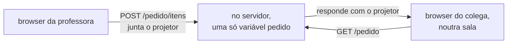
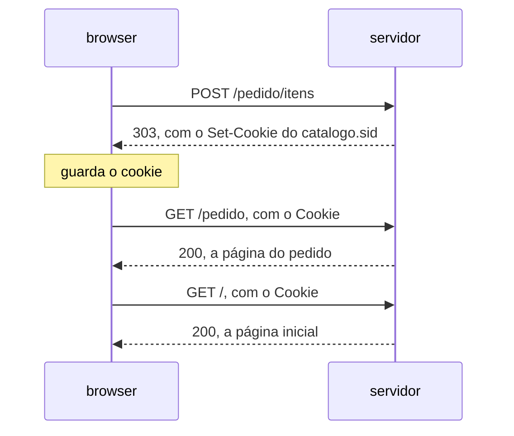
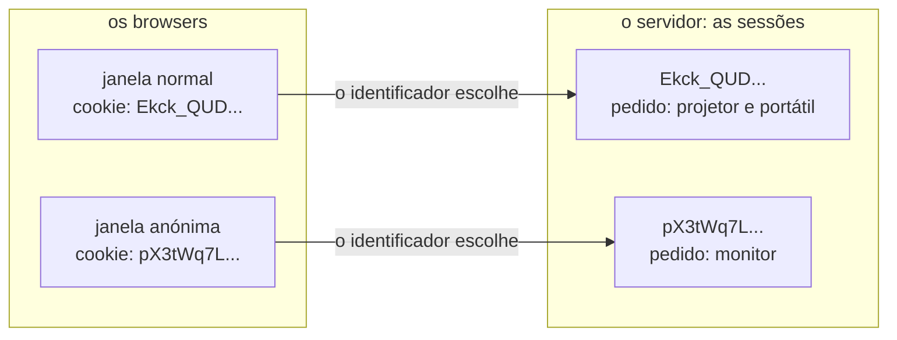
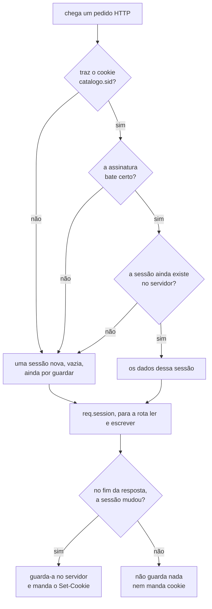
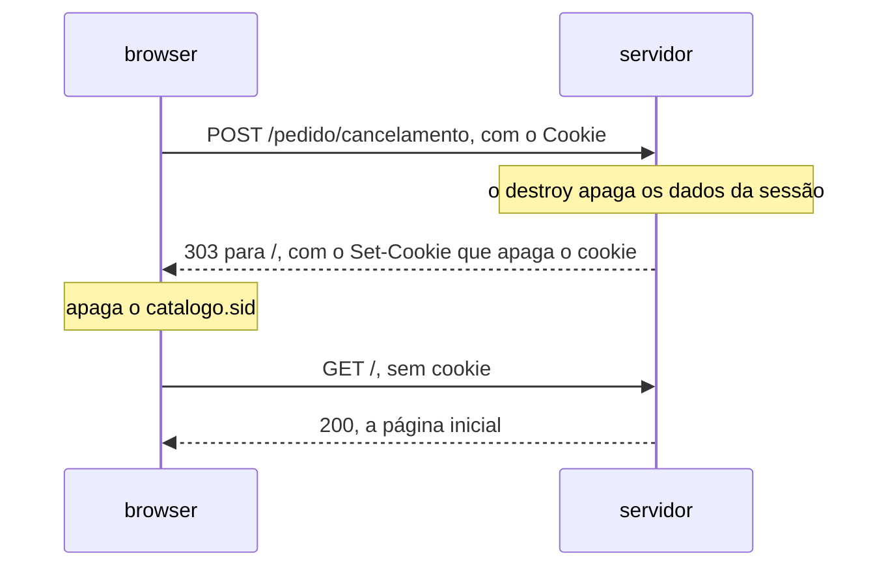

# Cookies e sessões

Neste guia, o catálogo de equipamentos do tema 05 ganha um pedido em curso. Juntas-lhe o projetor, navegas pelo catálogo, juntas o portátil e, no fim, escreves o teu nome uma vez e confirmas tudo, ou cancelas. Vês como o servidor guarda um pedido separado para cada browser, com um cookie e uma sessão. Vês também como se protege esse cookie e porque é que uma sessão não diz quem és.

Usa o HTTP sem estado do tema 01, a validação do tema 05 e o `.env` de Linguagens de Programação. Rever: [O servidor não se lembra de ti](01-do-pedido-a-resposta.md#o-servidor-não-se-lembra-de-ti), [A função que valida a reserva](05-formularios-e-validacao.md#a-função-que-valida-a-reserva) e [O ficheiro .env guarda a configuração deste computador](https://github.com/NunoMACastro/epms-2627-3ig-lp/blob/main/01-acesso-a-dados/03-arquitetura-e-setup-node.md#o-ficheiro-env-guarda-a-configuração-deste-computador). Para praticar: [ficha de exercícios](exercicios/06-cookies-e-sessoes-exercicios.md).

## Neste guia

1. [O HTTP não se lembra de nada](#o-http-não-se-lembra-de-nada)
2. [Cookies: o browser guarda e devolve](#cookies-o-browser-guarda-e-devolve)
3. [O pedido fica no servidor, e o cookie só leva o número](#o-pedido-fica-no-servidor-e-o-cookie-só-leva-o-número)
4. [O identificador vai assinado](#o-identificador-vai-assinado)
5. [Os atributos do cookie](#os-atributos-do-cookie)
6. [A sessão com o express-session](#a-sessão-com-o-express-session)
7. [Terminar a sessão](#terminar-a-sessão)
8. [Uma sessão não é uma autenticação](#uma-sessão-não-é-uma-autenticação)
9. [O roubo e a fixação de uma sessão](#o-roubo-e-a-fixação-de-uma-sessão)
10. [Exemplo guiado: o pedido em curso](#exemplo-guiado-o-pedido-em-curso)

## O HTTP não se lembra de nada

No tema 05, cada reserva era de um só equipamento. Uma professora que quisesse o projetor e o portátil para a mesma aula preenchia o formulário duas vezes, e escrevia o nome duas vezes. Neste tema, o catálogo passa a ter um pedido em curso: a lista dos equipamentos que a professora já escolheu e ainda não confirmou. Junta o projetor, vê o catálogo, junta o portátil, tira o que já não quer e, no fim, confirma tudo de uma vez.

Cada uma destas ações é um pedido HTTP diferente. Juntar o projetor é um `POST`, ver o catálogo é um `GET`, e juntar o portátil é outro `POST`. Mas o HTTP é sem estado: cada pedido HTTP chega sozinho, e o servidor não sabe, só pelo HTTP, que dois pedidos HTTP vieram do mesmo browser. Rever: [O servidor não se lembra de ti](01-do-pedido-a-resposta.md#o-servidor-não-se-lembra-de-ti). Entre um pedido HTTP e o seguinte, alguém tem de guardar o que a professora já juntou.

A primeira ideia que costuma aparecer é uma variável no servidor:

```js fragment
// A tentativa ingénua: o pedido numa variável do servidor, sem sessões.
let pedido = [];
app.post("/pedido/itens", (req, res) => {
  pedido.push(req.body.equipamento_id);
  res.redirect(303, "/pedido");
});
```

Prevê: a professora junta o projetor. Logo a seguir, um colega abre a página do pedido noutro computador, sem ter juntado nada. O que vê?

Vê o projetor. A variável `pedido` é criada uma vez, quando o servidor arranca. É a mesma para as funções de todas as rotas, em todos os pedidos HTTP, de todos os browsers. Rever: [O arranque corre uma vez, e a função de uma rota a cada pedido](02-primeiro-servidor.md#o-arranque-corre-uma-vez-e-a-função-de-uma-rota-a-cada-pedido).



No diagrama, os dois browsers usam a mesma variável. O colega vê o projetor que a professora juntou, e se juntar alguma coisa, ela vê-a no pedido dela. O servidor precisa de saber de que browser vem cada pedido HTTP, para guardar um pedido separado para cada um. É para isso que servem os cookies.

## Cookies: o browser guarda e devolve

Um **cookie** é um pequeno texto, com um nome e um valor, que o servidor pede ao browser para guardar. A partir daí, o browser devolve-o sozinho em todos os pedidos HTTP seguintes a esse servidor.

O servidor pede-o com um cabeçalho da resposta, o `Set-Cookie`:

```text
HTTP/1.1 303 See Other
Location: /pedido
Set-Cookie: catalogo.sid=s%3Am9fcUL...; Path=/; Expires=Mon, 12 Oct 2026 01:04:19 GMT; HttpOnly; SameSite=Lax
```

O browser guarda o cookie `catalogo.sid`, com o valor que vem a seguir ao `=`, até ao primeiro `;`. Em cada pedido HTTP seguinte a esse servidor, junta-o num cabeçalho do pedido HTTP, o `Cookie`:

```text
GET /pedido HTTP/1.1
Host: localhost:3000
Cookie: catalogo.sid=s%3Am9fcUL...
```



O diagrama mostra a conversa no tempo. O cookie nasce numa resposta. A partir daí, vai em todos os pedidos HTTP do browser a esse servidor, também no da página inicial, sem o servidor o ter de pedir outra vez. É assim que reconhece o browser: dois pedidos HTTP com o mesmo cookie vêm do mesmo browser.

Depois do nome e do valor, a linha do `Set-Cookie` traz as regras do cookie, separadas por `;`. O `Path=/` diz que o cookie vale para todos os caminhos do site, e o `Expires` diz até quando o browser o deve guardar. Estas regras são só para o browser e não voltam ao servidor: no cabeçalho `Cookie` vão só o nome e o valor. O `HttpOnly` e o `SameSite` são regras de segurança.

Um cookie pertence a um servidor e a um browser. O browser só o envia ao servidor de onde veio, e não a outros sites. E uma janela anónima, outro perfil do mesmo browser ou outro browser no mesmo computador têm os seus próprios cookies, separados: para o servidor, são browsers diferentes.

<details>
<summary>Para ires mais longe: os servidores do teu computador partilham os cookies</summary>

O browser escolhe os cookies que envia pelo nome do servidor, como `localhost`, e não pela porta. Um cookie criado por `http://localhost:3000` também vai nos pedidos HTTP para `http://localhost:3001`. Se tiveres dois projetos com cookies com o mesmo nome, cada um substitui o cookie do outro, e ao voltares ao primeiro o pedido que lá tinhas já não aparece. É uma das razões para cada aplicação dar ao seu cookie um nome próprio.

</details>

## O pedido fica no servidor, e o cookie só leva o número

Se o cookie vai e vem em todos os pedidos HTTP, porque não guardar o pedido em curso dentro dele, como `pedido=2,1`? Há três razões para não o fazer:

- O utilizador pode mudá-lo. O cookie está no computador do utilizador. As ferramentas de programador deixam editar qualquer cookie, e um programa pode enviar o cabeçalho `Cookie` que quiser. É a regra dos temas anteriores: o que vem do browser não é de confiança.
- O tamanho. Um cookie tem, no máximo, cerca de 4 quilobytes, e viaja em todos os pedidos HTTP, mesmo nos que não precisam dele.
- A privacidade. Quem tiver acesso ao browser pode ler o cookie, e os equipamentos do pedido em curso não têm de estar lá.

A solução é separar as duas coisas. Os dados do pedido em curso ficam no servidor, num sítio próprio para cada browser. O cookie só leva um **identificador**: um código comprido e aleatório, que diz ao servidor qual desses sítios é o deste browser. Chama-se **sessão** a este conjunto: os dados guardados no servidor para um browser, mais o identificador que o browser guarda no cookie.



No diagrama, há duas sessões no mesmo servidor. Cada janela tem o seu identificador no cookie, e cada identificador escolhe os dados da sua sessão. É como o talão da loja onde deixas o telemóvel a arranjar: o telemóvel fica lá, e tu só levas o talão, com o número.

## O identificador vai assinado

O identificador é comprido e aleatório, e por isso ninguém adivinha o de outra pessoa. Mesmo assim, o servidor só aceita identificadores que ele próprio deu. Para isso, junta a cada um uma **assinatura**: um código calculado a partir do identificador e de um segredo que só o servidor conhece. Este é o valor completo de um cookie `catalogo.sid`:

```text
s%3AEkck_QUDsRtKBc7Zr62mUfPyPJTkoWyp.Wc2KiU9WLjvd1RNuUJA9D88NfN5g9w4zH3PGBqXNigs
```

O valor tem três partes:

| Parte | Neste valor | O que é |
| --- | --- | --- |
| O começo | `s%3A` | `s:` escrito em código, como num endereço: o valor vem assinado |
| O identificador, até ao ponto | `Ekck_QUDsRtKBc7Zr62mUfPyPJTkoWyp` | O código aleatório que escolhe a sessão |
| A assinatura, depois do ponto | `Wc2KiU9WLjvd1RNuUJA9D88NfN5g9w4zH3PGBqXNigs` | Calculada a partir do identificador e do segredo |

Quando o cookie volta, o servidor calcula outra vez a assinatura do identificador, com o seu segredo, e compara-a com a que veio. Se não forem iguais, o identificador ou a assinatura foram mudados, ou o segredo já não é o mesmo. Nesse caso, o servidor ignora o cookie e trata o pedido HTTP como vindo de um browser novo. Sem conhecer o segredo, ninguém consegue fabricar um identificador que o servidor aceite.

Prevê: nas ferramentas de programador, mudas uma letra do identificador e recarregas a página do pedido. O que aparece?

O pedido vazio. A assinatura deixou de bater certo, e para o servidor é como se o browser chegasse pela primeira vez. Os dados da sessão verdadeira continuam no servidor: se puseres a letra como estava, o pedido volta. Podes experimentar no [Passo 8: o cookie no browser](#passo-8-o-cookie-no-browser).

## Os atributos do cookie

O cookie da sessão é a chave do pedido de alguém: quem o tiver, tem a sessão. Na linha do `Set-Cookie`, depois do nome e do valor, o servidor manda ao browser as regras para guardar essa chave e para a enviar. Chamam-se **atributos** do cookie:

| Atributo | O que diz ao browser | Contra quê |
| --- | --- | --- |
| `HttpOnly` | O JavaScript das páginas não pode ler este cookie; só o browser o envia ao servidor | Um script metido numa página do catálogo, que leria o cookie e o enviaria para fora |
| `SameSite=Lax` | Não enviar o cookie nos `POST` que páginas de outros sites façam ao catálogo; nas ligações normais para o catálogo, envia | Um formulário noutro site que envia para o teu catálogo |
| `Secure` | Só enviar o cookie por HTTPS, a ligação cifrada | Quem está na mesma rede e lê o cookie a passar, numa ligação sem cifra |
| `Expires` | Apagar o cookie a esta hora | Uma sessão esquecida aberta num computador da escola |

O `HttpOnly` vê-se na consola do browser. O `document.cookie` é a forma de o JavaScript de uma página ler os cookies dela, e não mostra o `catalogo.sid`. Um script metido numa página é o ataque que o escaping evita. Rever: [Escaping: o que vem de fora nunca vira HTML](04-ejs-e-reutilizacao-no-servidor.md#escaping-o-que-vem-de-fora-nunca-vira-html).

O `SameSite=Lax` dificulta um ataque a que se chama **CSRF** (do inglês cross-site request forgery, pedido forjado a partir de outro site). Uma página de outro site pode ter um formulário que envia para o teu `POST /pedido/confirmacao`. Sem o `SameSite`, alguns browsers enviavam esse pedido HTTP com o cookie de quem visita a página, como se viesse do catálogo. Com o `Lax`, esse `POST` chega sem o cookie e não mexe no pedido em curso de ninguém. Mas o `SameSite` não trava o CSRF em todos os casos, e por isso não é toda a defesa.

O catálogo corre em `http://localhost`, sem HTTPS, e por isso o seu cookie não pode ter o `Secure`. Num servidor publicado, com HTTPS, tem. O `Expires` do catálogo é 30 minutos depois da última mudança ao pedido.

Nenhum destes atributos torna a sessão uma prova de identidade. Tornam mais difícil roubar o cookie, mas quem o tiver continua a ter a sessão.

<details>
<summary>Para ires mais longe: o que o SameSite não trava</summary>

Para o browser, "outro site" é outro domínio. Uma página noutra porta do teu computador, ou noutro subdomínio do mesmo domínio, conta como o mesmo site, e o cookie vai. Um `GET` que mudasse alguma coisa também levava o cookie, porque o `Lax` o deixa ir nas ligações normais, e é mais uma razão para só mudar com `POST`. E os browsers antigos não conhecem o atributo.

</details>

## A sessão com o express-session

O Express não trata das sessões sozinho, mas a mesma equipa que o faz mantém um middleware para isso, o `express-session`. Instala-se como os outros pacotes:

```bash
npm install express-session@1.19.0
```

E importa-se no início do `server.js`, a seguir ao `import` do Express:

```js fragment
import session from "express-session";
```

O middleware ainda não está ativo: ativa-se com o `app.use`, e precisa do segredo que assina os identificadores.

### O segredo, fora do código

O segredo é configuração, e configuração que não pode ser conhecida. Se estivesse escrito no `server.js`, ia para o Git com o código, e qualquer pessoa com acesso ao repositório podia assinar os identificadores que quisesse. Por isso fica no `.env`, que não vai para o Git, como em Linguagens de Programação. O `.env.example`, que vai para o Git, diz o nome da variável, sem o valor. Rever: [O .env.example diz que variáveis é preciso definir](https://github.com/NunoMACastro/epms-2627-3ig-lp/blob/main/01-acesso-a-dados/03-arquitetura-e-setup-node.md#o-envexample-diz-que-variáveis-é-preciso-definir) e [O .gitignore deixa os segredos fora do Git](https://github.com/NunoMACastro/epms-2627-3ig-lp/blob/main/01-acesso-a-dados/03-arquitetura-e-setup-node.md#o-gitignore-deixa-os-segredos-fora-do-git).

O `.env.example` do catálogo tem esta linha, com um comentário:

```text
# O segredo que assina o cookie da sessão. Escreve no teu .env um texto longo
# e aleatório, e nunca o ponhas no Git nem no código.
SESSION_SECRET=
```

No teu `.env`, escreves `SESSION_SECRET=` seguido de um texto longo e aleatório. Este comando escreve um, com 64 carateres, que podes copiar. O `-e` manda o Node correr o código que está entre aspas, que não é um módulo, e por isso aceita o `require`:

```bash
node -e "console.log(require('node:crypto').randomBytes(32).toString('hex'))"
```

O servidor arranca com o `--env-file=.env`, que lê o `.env`, e com o `--watch`, que o volta a ligar sempre que guardas o `server.js`. Rever: [Os scripts do package.json](https://github.com/NunoMACastro/epms-2627-3ig-lp/blob/main/01-acesso-a-dados/03-arquitetura-e-setup-node.md#os-scripts-do-packagejson).

```bash
node --watch --env-file=.env server.js
```

No `server.js`, logo a seguir à `const PORTA`, o segredo lê-se do `process.env`. Rever: [A configuração fica fora do código](https://github.com/NunoMACastro/epms-2627-3ig-lp/blob/main/01-acesso-a-dados/03-arquitetura-e-setup-node.md#a-configuração-fica-fora-do-código).

```js fragment
// O segredo que assina o cookie da sessão vem do ambiente, e nunca do código.
// Sem ele, o servidor recusa-se a arrancar.
const SEGREDO = process.env.SESSION_SECRET;
if (!SEGREDO) {
  console.error("Falta o SESSION_SECRET. Copia o .env.example para .env, escreve lá um segredo e arranca com: node --env-file=.env server.js");
  process.exit(1);
}

// O nome do cookie da sessão, usado na configuração e ao terminar a sessão.
const NOME_DO_COOKIE = "catalogo.sid";
```

Sem o `SESSION_SECRET`, ou com a linha vazia, o `if` escreve no terminal o que fazer. O `process.exit(1)` termina o programa logo ali, e o 1 diz ao terminal que terminou com um erro. É melhor um servidor que não arranca e diz porquê do que um servidor que arranca e depois responde com um erro 500 a todos os pedidos HTTP. O nome do cookie fica numa constante porque vai ser usado em dois sítios: na configuração do middleware e quando a sessão terminar.

### O middleware e as suas opções

O middleware das sessões regista-se a seguir ao `express.urlencoded` e antes das rotas, porque as rotas vão usar o que ele prepara. Rever: [Uma fila, pela ordem do ficheiro](03-http-rotas-e-middleware.md#uma-fila-pela-ordem-do-ficheiro).

```js fragment
// Middleware das sessões: lê o cookie de cada pedido HTTP, encontra a sessão
// desse browser e põe-na em req.session. Cada opção está justificada.
app.use(session({
  secret: SEGREDO, // assina o cookie: o servidor só aceita identificadores que ele próprio deu
  name: NOME_DO_COOKIE, // o nome do cookie no browser
  resave: false, // não volta a guardar uma sessão que não mudou
  saveUninitialized: false, // não guarda a sessão, nem manda cookie, a quem ainda não guardou nada
  cookie: {
    httpOnly: true, // o JavaScript das páginas não consegue ler o cookie
    sameSite: "lax", // o cookie não vai nos pedidos POST que outros sites façam ao catálogo
    secure: false, // com HTTPS seria true; em http://localhost tem de ser false
    maxAge: 30 * 60 * 1000, // 30 minutos, em milissegundos, contados da última mudança
  },
}));
```

As quatro primeiras opções são do middleware, e o objeto `cookie` dá os atributos da secção [Os atributos do cookie](#os-atributos-do-cookie). Cada valor leva a razão ao lado, num comentário, porque uma configuração de segurança que ninguém sabe justificar é uma configuração que alguém vai mudar sem saber o que estraga.

Algumas opções pedem mais do que o comentário. O `name` muda o nome do cookie. Por omissão seria `connect.sid`, que diz a quem olha que o servidor usa o `express-session`, e um nome do teu site não diz nada. O `saveUninitialized: false` decide quando aparece o cookie.

Prevê: com esta configuração, o browser recebe um cookie quando abre a página inicial pela primeira vez?

Não. Uma sessão nova em que não se guardou nada não é guardada, e o browser não recebe cookie nenhum. Quem só vê o catálogo não fica com um cookie sem razão: o cookie aparece quando a pessoa junta o primeiro equipamento ao pedido. É também uma questão de privacidade, porque não se guarda nada sobre quem não pediu nada.

O `secure` está `false` porque em `http://localhost` não há HTTPS. Com `true`, o `express-session` não manda o cookie por uma ligação sem HTTPS. O browser nunca o recebe, cada pedido HTTP começa uma sessão nova, e o pedido aparece sempre vazio.

O `maxAge` escreve-se em milissegundos, e por isso a conta `30 * 60 * 1000`: 30 minutos, de 60 segundos, de 1000 milissegundos. A conta fica escrita, e não o resultado (1 800 000), para quem lê perceber o que é. O `express-session` transforma o `maxAge` no `Expires` do cookie, com a hora certa, e volta a fazê-lo sempre que a sessão muda. Cada vez que juntas ou tiras um equipamento, o prazo volta aos 30 minutos, a contar desse momento. Uma página que só mostra o pedido não muda a sessão, e não mexe no prazo.

### O que o middleware faz a cada pedido HTTP



O diagrama mostra o caminho de cada pedido HTTP pelo middleware. Se o pedido HTTP traz o cookie, a assinatura está certa e a sessão ainda existe no servidor, o middleware vai buscar os dados dessa sessão. Em todos os outros casos, cria uma sessão nova e vazia. Nos dois casos, a rota encontra um `req.session`, um objeto onde pode ler e escrever:

```js fragment
req.session.pedido = []; // guardar
const pedido = req.session.pedido; // ler
```

A primeira linha guarda um array vazio na sessão, e a segunda lê esse array para uma variável da rota. A rota nunca trata do cookie, só do `req.session`, como se fosse um objeto que se lembra de um pedido HTTP para o seguinte. No fim da resposta, se a sessão mudou, o middleware guarda-a e manda o `Set-Cookie`. Nos pedidos HTTP seguintes, o mesmo browser encontra lá o que deixou, e outro browser encontra outro objeto, o seu.

### Onde ficam as sessões

O `express-session` guarda as sessões, por omissão, na memória do próprio servidor, num armazém chamado **`MemoryStore`**. Isto tem duas consequências.

Quando o servidor reinicia, todas as sessões desaparecem. O browser continua a enviar o cookie, mas o servidor já não tem nada com aquele identificador, e trata-o como um browser novo. Com o `--watch`, basta guardares o `server.js` para isso acontecer.

E o `MemoryStore` não serve para um servidor publicado, que corre muito tempo e com muitos utilizadores: vai ocupando memória e não funciona com mais do que um processo. Para aprender, em `localhost`, serve. Num servidor publicado, as sessões guardam-se num armazém próprio, como uma base de dados.

<details>
<summary>Para ires mais longe: o aviso do MemoryStore</summary>

Quando o servidor arranca com a variável de ambiente `NODE_ENV` igual a `production`, que é a forma habitual de dizer que está publicado, o `express-session` escreve este aviso no terminal:

```text
Warning: connect.session() MemoryStore is not
designed for a production environment, as it will leak
memory, and will not scale past a single process.
```

Diz, em inglês, o que está acima: o `MemoryStore` vai ocupando memória e não funciona com mais do que um processo.

</details>

## Terminar a sessão

Quando a professora confirma o pedido, ou o cancela, o pedido acabou, e a sessão também deve acabar. Terminar uma sessão tem dois lados, e os dois são precisos.

No servidor, a sessão é destruída com o `req.session.destroy`: os dados desaparecem do armazém, e aquele identificador deixa de servir. O `destroy` recebe uma função para correr quando acabar, como o `app.listen`. Essa função recebe um erro, se a destruição falhou, e é dentro dela que se responde.

Para o browser apagar o cookie, o servidor chama o `res.clearCookie`, com o nome do cookie. O servidor manda um `Set-Cookie` com o valor vazio e uma data no passado, `Expires=Thu, 01 Jan 1970 00:00:00 GMT`, e o browser apaga o cookie.

```js fragment
// Cancelar o pedido: termina a sessão sem criar reservas.
app.post("/pedido/cancelamento", (req, res) => {
  req.session.destroy((erro) => {
    if (erro) {
      res.status(500).render("erro", { titulo: "Erro", mensagem: "Não foi possível cancelar o pedido." });
      return;
    }
    res.clearCookie(NOME_DO_COOKIE);
    res.redirect(303, "/");
  });
});
```



No cancelamento, o servidor destrói a sessão e só depois responde, com o 303 e o `Set-Cookie` que apaga o cookie. O `GET /` seguinte já vai sem cookie.

Prevê: alguém tinha copiado o cookie antes do cancelamento e envia-o agora. O que vê na página do pedido?

O pedido vazio. Com o `destroy`, o servidor já não tem a sessão daquele identificador, e começa uma sessão nova, vazia. É o `destroy` que conta para a segurança, porque o `clearCookie` só limpa o browser. Se só se apagasse o cookie, a sessão continuava no servidor, e quem tivesse a cópia continuava com o pedido.

## Uma sessão não é uma autenticação

Uma sessão sabe uma coisa: que vários pedidos HTTP vieram do mesmo browser. Não sabe quem está ao teclado. O nome que a professora escreve ao confirmar o pedido é só um texto, que qualquer pessoa podia ter escrito. E a sessão é de quem tiver o cookie, seja quem for.

**Autenticação** é confirmar quem uma pessoa é, por exemplo com um nome de utilizador e uma palavra-passe que o servidor verifica. O catálogo não tem contas, nem palavras-passe, nem páginas que só alguns podem ver. Um pedido em curso não precisa de saber quem és: precisa de não se misturar com o de outra pessoa, e a sessão chega para isso.

Usar uma sessão como se fosse uma prova de identidade é um erro de segurança. Achar que quem tem o cookie de uma sessão é a pessoa que a começou é esse erro. E achar que a reserva com o nome "Ana" foi feita pela Ana é o mesmo erro, com o nome.

## O roubo e a fixação de uma sessão

Como a sessão é de quem tem o cookie, há dois ataques que convém conhecer pelo nome. No **roubo de sessão**, alguém consegue o identificador de outra pessoa e usa-o no seu browser. Para o servidor, os dois browsers passam a ser o mesmo, e o atacante vê e muda o pedido da vítima. Na **fixação de sessão**, o atacante faz o contrário: consegue que a vítima use um identificador que ele já conhece, e espera.

| | Roubo de sessão | Fixação de sessão |
| --- | --- | --- |
| O que o atacante faz | Consegue o identificador da vítima | Dá à vítima um identificador que já conhece |
| Quando lhe serve | Logo, enquanto a sessão existir | Depois de a vítima fazer uma coisa importante nessa sessão, como entrar com a palavra-passe |
| A defesa | O `HttpOnly`, o `Secure`, a expiração curta e o `destroy` ao terminar | Um identificador novo no momento importante, com o `req.session.regenerate` |

O roubo vê-se nas tuas próprias sessões: copiar o cookie de uma janela tua para outra põe as duas com o mesmo pedido. A defesa contra a fixação, o `req.session.regenerate`, dá à sessão um identificador novo. Não a usas no catálogo, porque o catálogo não tem um momento importante como esse. Numa aplicação com autenticação, é obrigatória.

## Exemplo guiado: o pedido em curso

O exemplo parte do catálogo do fim do tema 05, o do exemplo [catalogo-com-formularios](../exemplos/aplicacoes-em-browser/catalogo-com-formularios/README.md). O formulário de reserva passa a juntar equipamentos a um pedido guardado na sessão, e o nome só se pede no fim, ao confirmar. O resultado final está pronto a correr no exemplo [catalogo-com-sessoes](../exemplos/aplicacoes-em-browser/catalogo-com-sessoes/README.md).

A partir do passo 1, o servidor arranca com `node --watch --env-file=.env server.js`. Depois de cada mudança no `server.js`, juntas outra vez os equipamentos, porque o servidor volta a ligar-se e as sessões desaparecem ([Onde ficam as sessões](#onde-ficam-as-sessões)). Se mudares só um modelo EJS, basta recarregar a página. Na confirmação, usa um nome fictício, como "Ana Reserva".

### Passo 1: o segredo e o middleware das sessões

Na pasta do catálogo, instala o `express-session` com o comando da secção [A sessão com o express-session](#a-sessão-com-o-express-session). Cria o `.env.example` e o `.env` da secção [O segredo, fora do código](#o-segredo-fora-do-código). Cria também o `.gitignore`, para o `.env` e a pasta `node_modules` nunca irem para o Git:

```text
node_modules/
.env
```

No `server.js`, faz três mudanças, com os blocos da secção [A sessão com o express-session](#a-sessão-com-o-express-session):

- o `import` da sessão, a seguir ao `import` do Express;
- a leitura do segredo e o nome do cookie, a seguir à `const PORTA`;
- o middleware das sessões, a seguir ao `express.urlencoded`.

Arranca o servidor com `node --watch --env-file=.env server.js`. As páginas não mudam, e o browser não recebe cookie nenhum: ainda nenhuma rota guarda nada na sessão.

### Passo 2: juntar ao pedido

O formulário de reserva do tema 05 passa a juntar um equipamento ao pedido, com os mesmos campos, menos o nome. No `server.js`, retira as rotas `GET /reservas/nova` e `POST /reservas`, e apaga o `views/reserva-nova.ejs`, que deixa de ser usado. Ficam o array `reservas`, o contador, as rotas `GET /reservas` e `GET /reservas/:id` e os modelos `reservas.ejs` e `reserva.ejs`, porque as reservas confirmadas continuam a aparecer lá.

Sem o `POST /reservas`, nenhuma rota manda o browser para a página de uma reserva depois de reservar: abre-se a partir da lista. Por cima da rota `GET /reservas/:id`, o comentário passa a dizê-lo:

```js fragment
// Uma reserva: a página de cada reserva, aberta a partir da lista.
```

E no `views/reserva.ejs`, o comentário do topo fica assim:

```ejs
<%# A página de uma reserva, aberta a partir da lista.
    Recebe o titulo, a reserva e o equipamento reservado. %>
```

As ligações para `/reservas/nova` passam a ir para `/pedido/item`, para nenhuma página oferecer o formulário antigo. No cabeçalho, `views/partials/cabecalho.ejs`, o `<nav>` fica assim:

```ejs
    <nav>
      <a href="/">Início</a> |
      <a href="/equipamentos">Todos os equipamentos</a> |
      <a href="/reservas">Reservas</a> |
      <a href="/pedido/item">Juntar um equipamento ao pedido</a>
    </nav>
```

Na página inicial, `views/inicio.ejs`, e na lista das reservas, `views/reservas.ejs`, a ligação do fim passa a ser esta:

```ejs
    <p><a href="/pedido/item">Fazer um pedido de reserva</a></p>
```

A `validarReserva` dá lugar à `validarItem`, com as mesmas verificações do equipamento, do dia e do tempo, e sem a do nome:

```js fragment
/**
 * Verifica um equipamento a juntar ao pedido: o equipamento, o dia e o tempo.
 * Só lê os três campos previstos; qualquer outro campo é ignorado.
 * Devolve os valores, para voltar a mostrar no formulário, e os erros,
 * com uma mensagem por campo. Sem erros, o objeto dos erros fica vazio.
 * @param {object|undefined} corpo o req.body do pedido HTTP, que pode não existir
 * @returns {object} um objeto com os valores e os erros
 */
function validarItem(corpo) {
  // Sem corpo lido, todos os campos faltam e recebem os erros já previstos.
  if (!corpo) {
    corpo = {};
  }
  const valores = {
    equipamento_id: textoDoCampo(corpo.equipamento_id),
    data: textoDoCampo(corpo.data),
    tempo: textoDoCampo(corpo.tempo),
  };
  const erros = {};

  // O equipamento tem de ser um dos da lista.
  const equipamento = equipamentos.find((equipamento) => equipamento.id === Number(valores.equipamento_id));
  if (!equipamento) {
    erros.equipamento_id = "Escolhe um equipamento da lista.";
  }

  // O dia é obrigatório, e tem de existir no calendário.
  if (valores.data === "") {
    erros.data = "Escolhe o dia da reserva.";
  } else if (!diaValido(valores.data)) {
    erros.data = "Esse dia não existe no calendário.";
  }

  // O tempo letivo é obrigatório, e é um número inteiro de 1 a 9.
  const tempo = Number(valores.tempo);
  if (valores.tempo === "") {
    erros.tempo = "Indica o tempo letivo.";
  } else if (!Number.isInteger(tempo) || tempo < 1 || tempo > 9) {
    erros.tempo = "O tempo letivo é um número inteiro de 1 a 9.";
  }

  return { valores: valores, erros: erros };
}
```

É a função do tema 05 sem o bloco do nome. O primeiro `if` continua a tratar o pedido HTTP sem corpo: os três campos faltam, e cada um recebe a sua mensagem.

Cria o modelo `views/item-novo.ejs`. É o `reserva-nova.ejs` do tema 05 sem o campo do nome, a enviar para `/pedido/itens`:

```ejs
<%# O formulário para juntar um equipamento ao pedido. Recebe o titulo,
    os equipamentos para a lista, os valores a pôr nos campos e os erros,
    um por campo. O nome só se pede no fim, ao confirmar o pedido. %>
<%- include("partials/cabecalho") %>
    <% if (Object.keys(erros).length > 0) { %>
      <p><strong>O equipamento não entrou no pedido. Corrige os campos assinalados e volta a enviar.</strong></p>
    <% } %>
    <form method="post" action="/pedido/itens">
      <p>
        <label for="equipamento_id">Equipamento
          <% if (erros.equipamento_id) { %><strong><%= erros.equipamento_id %></strong><% } %>
        </label>
        <select id="equipamento_id" name="equipamento_id" required>
          <option value="">Escolhe um equipamento</option>
          <% for (const equipamento of equipamentos) { %>
            <option value="<%= equipamento.id %>" <% if (String(equipamento.id) === valores.equipamento_id) { %>selected<% } %>><%= equipamento.nome %>, sala <%= equipamento.sala %></option>
          <% } %>
        </select>
      </p>
      <p>
        <label for="data">Dia
          <% if (erros.data) { %><strong><%= erros.data %></strong><% } %>
        </label>
        <input id="data" name="data" type="date" value="<%= valores.data %>" required>
      </p>
      <p>
        <label for="tempo">Tempo letivo, de 1 a 9
          <% if (erros.tempo) { %><strong><%= erros.tempo %></strong><% } %>
        </label>
        <input id="tempo" name="tempo" type="number" min="1" max="9" value="<%= valores.tempo %>" required>
      </p>
      <button type="submit">Juntar ao pedido</button>
    </form>
    <p><a href="/pedido">Voltar ao pedido</a></p>
<%- include("partials/rodape") %>
```

Mudam o texto da frase do topo e do botão, o `action` do formulário e a ligação do fim, que volta à página do pedido.

No sítio das rotas que tiraste, a seguir à rota `/equipamentos/:id`, acrescenta a rota que mostra o formulário e a que recebe o `POST`:

```js fragment
// O formulário para juntar um equipamento ao pedido.
app.get("/pedido/item", (req, res) => {
  res.render("item-novo", {
    titulo: "Juntar ao pedido",
    equipamentos: equipamentos,
    valores: { equipamento_id: "", data: "", tempo: "" },
    erros: {},
  });
});

// Juntar um equipamento ao pedido: valida, e guarda o item na sessão.
app.post("/pedido/itens", (req, res) => {
  const resultado = validarItem(req.body);
  if (Object.keys(resultado.erros).length > 0) {
    res.status(400).render("item-novo", {
      titulo: "Juntar ao pedido",
      equipamentos: equipamentos,
      valores: resultado.valores,
      erros: resultado.erros,
    });
    return;
  }

  // Da primeira vez, a sessão ainda não tem pedido: começa vazio.
  if (!req.session.pedido) {
    req.session.pedido = [];
  }
  req.session.pedido.push({
    equipamentoId: Number(resultado.valores.equipamento_id),
    data: resultado.valores.data,
    tempo: Number(resultado.valores.tempo),
  });
  res.redirect(303, "/pedido");
});
```

Repara nos dois caminhos: `GET /pedido/item` mostra o formulário de um item, e `POST /pedido/itens` junta um item aos itens do pedido. O `POST` valida como no tema 05, e a diferença está no que faz quando corre bem. Em vez de criar uma reserva, junta o equipamento ao pedido desta sessão, em `req.session.pedido`.

Da primeira vez, a sessão ainda não tem pedido, e o `req.session.pedido` é `undefined`. Por isso, o `if` cria-o como um array vazio antes do `push`. Sem ele, o `push` dava `TypeError: Cannot read properties of undefined (reading 'push')`. É neste momento que a sessão deixa de estar vazia e o browser recebe o cookie. O item guarda o número do equipamento, e não o equipamento inteiro, porque o nome e a sala vêm sempre da lista dos equipamentos, que é a fonte de verdade.

A página do pedido precisa do nome de cada equipamento. A seguir à `validarItem`, acrescenta uma função que junta a cada item o seu equipamento, como a lista das reservas fazia no tema 05:

```js fragment
/**
 * Junta a cada item do pedido o seu equipamento, para a página mostrar o nome.
 * @param {object[]} pedido os itens guardados na sessão
 * @returns {object[]} uma linha por item, com o item e o equipamento
 */
function linhasDoPedido(pedido) {
  const linhas = [];
  for (const item of pedido) {
    const equipamento = equipamentos.find((equipamento) => equipamento.id === item.equipamentoId);
    linhas.push({ item: item, equipamento: equipamento });
  }
  return linhas;
}
```

Para cada item, o `find` procura o equipamento com o mesmo `id`, e a linha junta os dois. Com o projetor e o portátil no pedido, a função devolve duas linhas, cada uma com o item e o seu equipamento.

Antes das duas rotas do formulário, acrescenta a rota da página do pedido:

```js fragment
// O pedido em curso: os equipamentos já juntos, a confirmação e o cancelamento.
app.get("/pedido", (req, res) => {
  const pedido = req.session.pedido || [];
  res.render("pedido", { titulo: "O teu pedido", linhas: linhasDoPedido(pedido), valorNome: "", erroNome: "" });
});
```

O `req.session.pedido || []` dá o pedido da sessão, ou um array vazio se ainda não houver pedido. O `valorNome` e o `erroNome` são do formulário de confirmação do passo 5, e por agora vão vazios.

Cria o `views/pedido.ejs` com esta primeira versão, que mostra a lista dos equipamentos ou a mensagem do pedido vazio. Os botões entram no passo 5:

```ejs
<%# views/pedido.ejs: a primeira lista dos itens da sessão. %>
<%- include("partials/cabecalho") %>
<% if (linhas.length === 0) { %>
  <p>O teu pedido está vazio.</p>
<% } else { %>
  <ul>
    <% for (const linha of linhas) { %>
      <li><%= linha.equipamento.nome %>, sala <%= linha.equipamento.sala %>, dia <%= linha.item.data %>, tempo <%= linha.item.tempo %></li>
    <% } %>
  </ul>
<% } %>
<p><a href="/pedido/item">Juntar um equipamento</a></p>
<%- include("partials/rodape") %>
```

Abre o catálogo em duas janelas, uma normal e uma anónima. A anónima abre-se com Ctrl+Shift+N no Chrome e com Ctrl+Shift+P no Firefox; no Mac, com Cmd em vez de Ctrl. Na janela normal, junta o projetor e o portátil. Na anónima, abre `/pedido`: está vazio. Junta lá o monitor e volta à normal, que continua com os seus dois. São duas sessões isoladas, uma para cada browser.

### Passo 3: o pedido no menu

O menu passa a mostrar quantos equipamentos tem o pedido, em todas as páginas. O número vem da sessão, e todas as rotas teriam de o passar ao `res.render`. Em vez disso, um middleware põe-no no **`res.locals`**, um objeto da resposta cujos valores o Express junta aos dados de todos os modelos dessa resposta:

```js fragment
// Para todas as páginas: quantos equipamentos tem o pedido desta sessão.
// O res.locals põe o valor à disposição de todos os modelos, incluindo o cabeçalho.
app.use((req, res, next) => {
  const pedido = req.session.pedido;
  res.locals.itensNoPedido = pedido ? pedido.length : 0;
  next();
});
```

O middleware fica a seguir ao das sessões, porque lê o `req.session`, e antes das rotas, porque os modelos das rotas usam o valor. Sem pedido, o número é 0. No cabeçalho, o `<nav>` ganha a ligação para o pedido, com o número:

```ejs
    <nav>
      <a href="/">Início</a> |
      <a href="/equipamentos">Todos os equipamentos</a> |
      <a href="/reservas">Reservas</a> |
      <a href="/pedido/item">Juntar um equipamento ao pedido</a> |
      <a href="/pedido">O teu pedido (<%= itensNoPedido %>)</a>
    </nav>
```

O menu mostra "O teu pedido (0)" até juntares o primeiro equipamento, e "O teu pedido (2)" depois de juntares dois. A ligação para o formulário, do passo 2, fica no menu, na página inicial e na lista das reservas.

### Passo 4: tirar do pedido

Cada equipamento do pedido vai ter um botão para o tirar. O botão é um pequeno formulário com `POST`, porque tirar muda o pedido, e o caminho leva a posição do equipamento na lista: `/pedido/itens/2/remocao` tira o segundo. A seguir à rota do `POST /pedido/itens`, acrescenta:

```js fragment
// Tirar um equipamento do pedido: POST /pedido/itens/2/remocao tira o segundo.
app.post("/pedido/itens/:posicao/remocao", (req, res) => {
  const pedido = req.session.pedido || [];
  const posicao = Number(req.params.posicao);
  if (!Number.isInteger(posicao) || posicao < 1 || posicao > pedido.length) {
    res.status(400).render("erro", {
      titulo: "Pedido inválido",
      mensagem: "Esse equipamento não está no teu pedido.",
    });
    return;
  }
  pedido.splice(posicao - 1, 1);
  res.redirect(303, "/pedido");
});
```

A posição vem do pedido HTTP, por isso verifica-se como o `:id` dos temas anteriores: tem de ser um número inteiro, de 1 até ao número de equipamentos do pedido. O `splice(posicao - 1, 1)` tira do array um elemento, nessa posição. O `- 1` existe porque a página conta a partir de 1, e o array a partir de 0. Rever: [Métodos que alteram o array](https://github.com/NunoMACastro/edu-docs-2ig-js-guias-2526/blob/8cf6ade3cf3d4508ea0fb4fbc5b2bedb29869a8f/JavaScript/07-Arrays.md#2-métodos-que-alteram-o-array-mutáveis). A rota ainda não tem botão: o modelo do passo 5 junta um a cada equipamento.

### Passo 5: confirmar e cancelar

O botão de remoção precisa da posição de cada linha. O `for...of` dá cada elemento, mas não a posição, e por isso o modelo usa o `for` clássico, com um contador. Rever: [O for clássico](https://github.com/NunoMACastro/edu-docs-2ig-js-guias-2526/blob/8cf6ade3cf3d4508ea0fb4fbc5b2bedb29869a8f/JavaScript/06-Ciclos.md#1-for-clássico). Em `for (let i = 0; i < linhas.length; i++)`, o `let i = 0` corre uma vez, antes da primeira volta. A condição `i < linhas.length` verifica-se antes de cada volta, e o `i++` soma 1 depois de cada volta. O `linhas[i]` é a linha no índice `i`, e a página mostra a posição como `i + 1`, porque para quem a usa o primeiro equipamento é o número 1.

Com duas linhas, o projetor e o portátil, o ciclo corre assim:

| `i` antes da condição | `i < 2` | O que esta volta mostra | Depois da volta |
| --- | --- | --- | --- |
| 0 | Verdadeiro | Projetor, posição 1 | `i++` passa `i` a 1 |
| 1 | Verdadeiro | Portátil, posição 2 | `i++` passa `i` a 2 |
| 2 | Falso | Nada; o ciclo termina | Não há incremento |

O índice 2 já ficaria fora das duas linhas, e a condição impede essa leitura.

Substitui o conteúdo do `views/pedido.ejs` por esta versão, com o botão de cada equipamento, a confirmação com o nome e o cancelamento:

```ejs
<%# O pedido em curso, guardado na sessão. Recebe o titulo, as linhas (cada
    uma com o item e o equipamento), e o nome e o erro do formulário de
    confirmação, vazios da primeira vez. %>
<%- include("partials/cabecalho") %>
    <% if (linhas.length === 0) { %>
      <p>O teu pedido está vazio.</p>
    <% } else { %>
      <ol>
        <% for (let i = 0; i < linhas.length; i++) { %>
          <li>
            <%= linhas[i].equipamento.nome %>, sala <%= linhas[i].equipamento.sala %>: dia <%= linhas[i].item.data %>, tempo <%= linhas[i].item.tempo %>
            <form method="post" action="/pedido/itens/<%= i + 1 %>/remocao">
              <button type="submit">Tirar do pedido</button>
            </form>
          </li>
        <% } %>
      </ol>
    <% } %>
    <p><a href="/pedido/item">Juntar um equipamento ao pedido</a></p>
    <% if (linhas.length > 0) { %>
      <h2>Confirmar o pedido</h2>
      <form method="post" action="/pedido/confirmacao">
        <p>
          <label for="nome">O teu nome
            <% if (erroNome) { %><strong><%= erroNome %></strong><% } %>
          </label>
          <input id="nome" name="nome" maxlength="40" value="<%= valorNome %>" required>
        </p>
        <button type="submit">Confirmar o pedido</button>
      </form>
      <h2>Cancelar o pedido</h2>
      <form method="post" action="/pedido/cancelamento">
        <button type="submit">Cancelar o pedido</button>
      </form>
    <% } %>
<%- include("partials/rodape") %>
```

A lista passa a ser um `<ol>`, e cada linha tem o seu formulário de remoção, com a posição `i + 1` no caminho. A confirmação e o cancelamento só aparecem quando o pedido tem alguma coisa. O campo do nome é o do tema 05: quando o nome está errado, o `value` traz o que a pessoa escreveu e a etiqueta traz a mensagem.

A confirmação valida o nome com uma função pequena, que fica entre a `validarItem` e a `linhasDoPedido`:

```js fragment
/**
 * Verifica o nome de quem confirma o pedido: obrigatório, e até 40 carateres.
 * Devolve a mensagem de erro, ou o texto vazio se o nome servir.
 * @param {string} nome o nome, já limpo pela textoDoCampo
 * @returns {string}
 */
function erroDoNome(nome) {
  if (nome === "") {
    return "Escreve o teu nome.";
  }
  if (nome.length > 40) {
    return "O nome tem, no máximo, 40 carateres.";
  }
  return "";
}
```

A função devolve a mensagem do primeiro problema, ou o texto vazio quando o nome serve: `erroDoNome("")` dá `"Escreve o teu nome."`, e `erroDoNome("Ana Reserva")` dá `""`.

A seguir à rota de remoção, acrescenta a confirmação, que valida o nome, cria uma reserva por equipamento e termina a sessão:

```js fragment
// Confirmar o pedido: cria uma reserva por equipamento e termina a sessão.
app.post("/pedido/confirmacao", (req, res) => {
  const pedido = req.session.pedido || [];
  if (pedido.length === 0) {
    res.status(400).render("erro", {
      titulo: "Pedido vazio",
      mensagem: "Não há nada no teu pedido para confirmar.",
    });
    return;
  }

  // Sem corpo lido, o nome fica vazio e a validação devolve a sua mensagem.
  let corpo = req.body;
  if (!corpo) {
    corpo = {};
  }
  const nome = textoDoCampo(corpo.nome);
  const erroNome = erroDoNome(nome);
  if (erroNome !== "") {
    res.status(400).render("pedido", { titulo: "O teu pedido", linhas: linhasDoPedido(pedido), valorNome: nome, erroNome: erroNome });
    return;
  }

  for (const item of pedido) {
    reservas.push({
      id: proximoIdReserva,
      equipamentoId: item.equipamentoId,
      data: item.data,
      tempo: item.tempo,
      nome: nome,
    });
    proximoIdReserva = proximoIdReserva + 1;
  }

  // O pedido acabou: a sessão é destruída no servidor, e o cookie apagado no browser.
  req.session.destroy((erro) => {
    if (erro) {
      res.status(500).render("erro", { titulo: "Erro", mensagem: "Não foi possível terminar o pedido." });
      return;
    }
    res.clearCookie(NOME_DO_COOKIE);
    res.redirect(303, "/reservas");
  });
});
```

Lê-a por blocos, de cima para baixo. O primeiro `if` recusa um pedido em curso sem equipamentos, com a página de erro: o formulário não aparece nesse caso, mas um pedido HTTP feito à mão pode chegar. A seguir vem o nome. Como na `validarItem`, um pedido HTTP sem corpo dá um objeto vazio no `corpo`, e a `erroDoNome` encontra o erro habitual. Com o nome errado, a resposta é a página do pedido outra vez, com o 400, o nome escrito e a mensagem, sem criar reservas nem terminar a sessão. Com tudo certo, o `for...of` cria uma reserva por equipamento, com o mesmo nome, e o `destroy` termina a sessão. Dentro dele, o `clearCookie` apaga o cookie, e o 303 leva o browser à lista das reservas.

Por fim, a seguir à confirmação, acrescenta a rota do cancelamento, a da secção [Terminar a sessão](#terminar-a-sessão). Destrói a sessão sem criar reservas, e volta à página inicial.

### Passo 6: o servidor completo

O `server.js` no fim do exemplo:

```js
// server.js: o catálogo de equipamentos da escola, agora com um pedido em curso.
// Quem quer reservar junta ao pedido um ou mais equipamentos, página a página,
// e no fim confirma tudo de uma vez, ou cancela. O pedido fica guardado na
// sessão: os dados ficam no servidor, e o browser só guarda um cookie com o
// identificador da sessão.
import express from "express";
import session from "express-session";

const app = express();
const PORTA = 3000;

// O segredo que assina o cookie da sessão vem do ambiente, e nunca do código.
// Sem ele, o servidor recusa-se a arrancar.
const SEGREDO = process.env.SESSION_SECRET;
if (!SEGREDO) {
  console.error("Falta o SESSION_SECRET. Copia o .env.example para .env, escreve lá um segredo e arranca com: node --env-file=.env server.js");
  process.exit(1);
}

// O nome do cookie da sessão, usado na configuração e ao terminar a sessão.
const NOME_DO_COOKIE = "catalogo.sid";

// O motor de modelos: o res.render vai procurar os ficheiros .ejs
// na pasta views.
app.set("view engine", "ejs");

// Os dados ficam em memória: existem enquanto o servidor estiver ligado.
const equipamentos = [
  { id: 1, nome: "Portátil", sala: "B12" },
  { id: 2, nome: "Projetor", sala: "A03" },
  { id: 3, nome: "Impressora", sala: "Secretaria" },
  { id: 4, nome: "Monitor", sala: "B12" },
];
const reservas = [];
let proximoIdReserva = 1;

/**
 * Devolve o texto de um campo do formulário, sem os espaços das pontas.
 * Um campo que não veio, ou que veio repetido (e chega como um array),
 * não é um texto: devolve o texto vazio.
 * @param {unknown} valor o valor tal como chegou em req.body
 * @returns {string}
 */
function textoDoCampo(valor) {
  if (typeof valor !== "string") {
    return "";
  }
  return valor.trim();
}

/**
 * Confirma que um texto no formato AAAA-MM-DD é um dia que existe.
 * O new Date aceita "2026-02-30" e transforma-o em 2 de março; por isso
 * confirma-se que o dia que sai é o mesmo que entrou.
 * @param {string} texto o dia, como o campo type="date" o envia
 * @returns {boolean}
 */
function diaValido(texto) {
  const dia = new Date(texto);
  if (Number.isNaN(dia.getTime())) {
    return false;
  }
  return dia.toISOString().slice(0, 10) === texto;
}

/**
 * Verifica um equipamento a juntar ao pedido: o equipamento, o dia e o tempo.
 * Só lê os três campos previstos; qualquer outro campo é ignorado.
 * Devolve os valores, para voltar a mostrar no formulário, e os erros,
 * com uma mensagem por campo. Sem erros, o objeto dos erros fica vazio.
 * @param {object|undefined} corpo o req.body do pedido HTTP, que pode não existir
 * @returns {object} um objeto com os valores e os erros
 */
function validarItem(corpo) {
  // Sem corpo lido, todos os campos faltam e recebem os erros já previstos.
  if (!corpo) {
    corpo = {};
  }
  const valores = {
    equipamento_id: textoDoCampo(corpo.equipamento_id),
    data: textoDoCampo(corpo.data),
    tempo: textoDoCampo(corpo.tempo),
  };
  const erros = {};

  // O equipamento tem de ser um dos da lista.
  const equipamento = equipamentos.find((equipamento) => equipamento.id === Number(valores.equipamento_id));
  if (!equipamento) {
    erros.equipamento_id = "Escolhe um equipamento da lista.";
  }

  // O dia é obrigatório, e tem de existir no calendário.
  if (valores.data === "") {
    erros.data = "Escolhe o dia da reserva.";
  } else if (!diaValido(valores.data)) {
    erros.data = "Esse dia não existe no calendário.";
  }

  // O tempo letivo é obrigatório, e é um número inteiro de 1 a 9.
  const tempo = Number(valores.tempo);
  if (valores.tempo === "") {
    erros.tempo = "Indica o tempo letivo.";
  } else if (!Number.isInteger(tempo) || tempo < 1 || tempo > 9) {
    erros.tempo = "O tempo letivo é um número inteiro de 1 a 9.";
  }

  return { valores: valores, erros: erros };
}

/**
 * Verifica o nome de quem confirma o pedido: obrigatório, e até 40 carateres.
 * Devolve a mensagem de erro, ou o texto vazio se o nome servir.
 * @param {string} nome o nome, já limpo pela textoDoCampo
 * @returns {string}
 */
function erroDoNome(nome) {
  if (nome === "") {
    return "Escreve o teu nome.";
  }
  if (nome.length > 40) {
    return "O nome tem, no máximo, 40 carateres.";
  }
  return "";
}

/**
 * Junta a cada item do pedido o seu equipamento, para a página mostrar o nome.
 * @param {object[]} pedido os itens guardados na sessão
 * @returns {object[]} uma linha por item, com o item e o equipamento
 */
function linhasDoPedido(pedido) {
  const linhas = [];
  for (const item of pedido) {
    const equipamento = equipamentos.find((equipamento) => equipamento.id === item.equipamentoId);
    linhas.push({ item: item, equipamento: equipamento });
  }
  return linhas;
}

// Middleware de registo: escreve no terminal cada pedido que chega,
// e passa-o à frente. Está antes das rotas, para ver todos os pedidos.
app.use((req, res, next) => {
  console.log(`${req.method} ${req.url}`);
  next();
});

// Middleware que lê o corpo dos formulários enviados por POST e o põe em
// req.body. Tem de estar antes das rotas que usam o req.body.
app.use(express.urlencoded({ extended: false }));

// Middleware das sessões: lê o cookie de cada pedido HTTP, encontra a sessão
// desse browser e põe-na em req.session. Cada opção está justificada.
app.use(session({
  secret: SEGREDO, // assina o cookie: o servidor só aceita identificadores que ele próprio deu
  name: NOME_DO_COOKIE, // o nome do cookie no browser
  resave: false, // não volta a guardar uma sessão que não mudou
  saveUninitialized: false, // não guarda a sessão, nem manda cookie, a quem ainda não guardou nada
  cookie: {
    httpOnly: true, // o JavaScript das páginas não consegue ler o cookie
    sameSite: "lax", // o cookie não vai nos pedidos POST que outros sites façam ao catálogo
    secure: false, // com HTTPS seria true; em http://localhost tem de ser false
    maxAge: 30 * 60 * 1000, // 30 minutos, em milissegundos, contados da última mudança
  },
}));

// Para todas as páginas: quantos equipamentos tem o pedido desta sessão.
// O res.locals põe o valor à disposição de todos os modelos, incluindo o cabeçalho.
app.use((req, res, next) => {
  const pedido = req.session.pedido;
  res.locals.itensNoPedido = pedido ? pedido.length : 0;
  next();
});

// Página inicial, com a pesquisa por sala e a ligação para reservar.
app.get("/", (req, res) => {
  res.render("inicio", { titulo: "Início" });
});

// Lista de equipamentos. Com ?sala=B12, só os dessa sala.
app.get("/equipamentos", (req, res) => {
  const sala = req.query.sala;
  let lista = equipamentos;
  if (sala) {
    lista = equipamentos.filter((equipamento) => equipamento.sala === sala);
  }
  res.render("equipamentos", { titulo: "Equipamentos", equipamentos: lista, sala: sala });
});

// Um equipamento: GET /equipamentos/2. O :id é um parâmetro de rota.
app.get("/equipamentos/:id", (req, res) => {
  const id = Number(req.params.id); // chega como texto, "2", e passa a número
  if (!Number.isInteger(id) || id < 1) {
    res.status(400).render("erro", {
      titulo: "Pedido inválido",
      mensagem: "O identificador tem de ser um número inteiro positivo.",
    });
    return;
  }
  const equipamento = equipamentos.find((equipamento) => equipamento.id === id);
  if (!equipamento) {
    res.status(404).render("erro", {
      titulo: "Equipamento não encontrado",
      mensagem: `Não existe o equipamento ${id}.`,
    });
    return;
  }
  res.render("equipamento", { titulo: equipamento.nome, equipamento: equipamento });
});

// O pedido em curso: os equipamentos já juntos, a confirmação e o cancelamento.
app.get("/pedido", (req, res) => {
  const pedido = req.session.pedido || [];
  res.render("pedido", { titulo: "O teu pedido", linhas: linhasDoPedido(pedido), valorNome: "", erroNome: "" });
});

// O formulário para juntar um equipamento ao pedido.
app.get("/pedido/item", (req, res) => {
  res.render("item-novo", {
    titulo: "Juntar ao pedido",
    equipamentos: equipamentos,
    valores: { equipamento_id: "", data: "", tempo: "" },
    erros: {},
  });
});

// Juntar um equipamento ao pedido: valida, e guarda o item na sessão.
app.post("/pedido/itens", (req, res) => {
  const resultado = validarItem(req.body);
  if (Object.keys(resultado.erros).length > 0) {
    res.status(400).render("item-novo", {
      titulo: "Juntar ao pedido",
      equipamentos: equipamentos,
      valores: resultado.valores,
      erros: resultado.erros,
    });
    return;
  }

  // Da primeira vez, a sessão ainda não tem pedido: começa vazio.
  if (!req.session.pedido) {
    req.session.pedido = [];
  }
  req.session.pedido.push({
    equipamentoId: Number(resultado.valores.equipamento_id),
    data: resultado.valores.data,
    tempo: Number(resultado.valores.tempo),
  });
  res.redirect(303, "/pedido");
});

// Tirar um equipamento do pedido: POST /pedido/itens/2/remocao tira o segundo.
app.post("/pedido/itens/:posicao/remocao", (req, res) => {
  const pedido = req.session.pedido || [];
  const posicao = Number(req.params.posicao);
  if (!Number.isInteger(posicao) || posicao < 1 || posicao > pedido.length) {
    res.status(400).render("erro", {
      titulo: "Pedido inválido",
      mensagem: "Esse equipamento não está no teu pedido.",
    });
    return;
  }
  pedido.splice(posicao - 1, 1);
  res.redirect(303, "/pedido");
});

// Confirmar o pedido: cria uma reserva por equipamento e termina a sessão.
app.post("/pedido/confirmacao", (req, res) => {
  const pedido = req.session.pedido || [];
  if (pedido.length === 0) {
    res.status(400).render("erro", {
      titulo: "Pedido vazio",
      mensagem: "Não há nada no teu pedido para confirmar.",
    });
    return;
  }

  // Sem corpo lido, o nome fica vazio e a validação devolve a sua mensagem.
  let corpo = req.body;
  if (!corpo) {
    corpo = {};
  }
  const nome = textoDoCampo(corpo.nome);
  const erroNome = erroDoNome(nome);
  if (erroNome !== "") {
    res.status(400).render("pedido", { titulo: "O teu pedido", linhas: linhasDoPedido(pedido), valorNome: nome, erroNome: erroNome });
    return;
  }

  for (const item of pedido) {
    reservas.push({
      id: proximoIdReserva,
      equipamentoId: item.equipamentoId,
      data: item.data,
      tempo: item.tempo,
      nome: nome,
    });
    proximoIdReserva = proximoIdReserva + 1;
  }

  // O pedido acabou: a sessão é destruída no servidor, e o cookie apagado no browser.
  req.session.destroy((erro) => {
    if (erro) {
      res.status(500).render("erro", { titulo: "Erro", mensagem: "Não foi possível terminar o pedido." });
      return;
    }
    res.clearCookie(NOME_DO_COOKIE);
    res.redirect(303, "/reservas");
  });
});

// Cancelar o pedido: termina a sessão sem criar reservas.
app.post("/pedido/cancelamento", (req, res) => {
  req.session.destroy((erro) => {
    if (erro) {
      res.status(500).render("erro", { titulo: "Erro", mensagem: "Não foi possível cancelar o pedido." });
      return;
    }
    res.clearCookie(NOME_DO_COOKIE);
    res.redirect(303, "/");
  });
});

// A lista das reservas feitas desde que o servidor arrancou.
app.get("/reservas", (req, res) => {
  // Para cada reserva, junta-se o equipamento, para a página mostrar o nome.
  const linhas = [];
  for (const reserva of reservas) {
    const equipamento = equipamentos.find((equipamento) => equipamento.id === reserva.equipamentoId);
    linhas.push({ reserva: reserva, equipamento: equipamento });
  }
  res.render("reservas", { titulo: "Reservas", linhas: linhas });
});

// Uma reserva: a página de cada reserva, aberta a partir da lista.
app.get("/reservas/:id", (req, res) => {
  const id = Number(req.params.id);
  if (!Number.isInteger(id) || id < 1) {
    res.status(400).render("erro", {
      titulo: "Pedido inválido",
      mensagem: "O número da reserva tem de ser um número inteiro positivo.",
    });
    return;
  }
  const reserva = reservas.find((reserva) => reserva.id === id);
  if (!reserva) {
    res.status(404).render("erro", {
      titulo: "Reserva não encontrada",
      mensagem: `Não existe a reserva ${id}.`,
    });
    return;
  }
  const equipamento = equipamentos.find((equipamento) => equipamento.id === reserva.equipamentoId);
  res.render("reserva", { titulo: `Reserva ${reserva.id}`, reserva: reserva, equipamento: equipamento });
});

// Middleware final: só chega aqui um pedido a que nenhuma rota respondeu.
app.use((req, res) => {
  res.status(404).render("erro", {
    titulo: "Página não encontrada",
    mensagem: "Este endereço não existe no catálogo.",
  });
});

app.listen(PORTA, (erro) => {
  if (erro) {
    console.error(`Não foi possível ligar o servidor: ${erro.message}`);
    return;
  }
  console.log(`Servidor a correr em http://localhost:${PORTA}`);
});
```

Compara-o com o teu. O código deve ser o mesmo, e só o comentário do topo, que vinha do tema 05, pode ser diferente.

O ficheiro lê-se pela ordem da fila. Primeiro vêm o segredo, os dados e as cinco funções. Seguem-se o registo, o `express.urlencoded`, a sessão e o `res.locals`, e depois as rotas dos equipamentos, do pedido e das reservas, o middleware final e o `listen`. Os modelos novos são o `item-novo.ejs` do passo 2 e o `pedido.ejs` do passo 5.

As seis rotas novas resumem-se numa tabela de contratos, como no tema 03. Rever: [A tabela de contratos HTTP](03-http-rotas-e-middleware.md#a-tabela-de-contratos-http).

| Método | Caminho | O que faz | Respostas |
| --- | --- | --- | --- |
| `GET` | `/pedido` | Mostra o pedido em curso | 200, a página do pedido, vazia se ainda não houver pedido |
| `GET` | `/pedido/item` | Mostra o formulário para juntar um equipamento | 200, o formulário |
| `POST` | `/pedido/itens` | Junta um equipamento ao pedido; corpo: `equipamento_id`, `data`, `tempo` | 303 para `/pedido`, com o `Set-Cookie` da primeira vez; 400, o formulário com as mensagens |
| `POST` | `/pedido/itens/:posicao/remocao` | Tira o equipamento dessa posição | 303 para `/pedido`; 400 se a posição não estiver no pedido |
| `POST` | `/pedido/confirmacao` | Cria uma reserva por equipamento e termina a sessão; corpo: `nome` | 303 para `/reservas`, com o cookie apagado; 400, o pedido com a mensagem do nome; 400, a página de erro se o pedido estiver vazio |
| `POST` | `/pedido/cancelamento` | Termina a sessão sem criar reservas | 303 para `/`, com o cookie apagado |

Repara que `/pedido/item` e `/pedido/itens` só diferem numa letra. Com a letra trocada num `action` ou numa ligação, a resposta é o 404 do middleware final.

### Passo 7: os resultados

| O que se faz | O que acontece |
| --- | --- |
| Abrir o catálogo pela primeira vez | Nenhum cookie: nada foi guardado na sessão |
| Juntar o projetor ao pedido | 303 para `/pedido`, com o `Set-Cookie` do `catalogo.sid`; o menu passa a "O teu pedido (1)" |
| Juntar o portátil | O pedido tem dois equipamentos; o cookie tem o mesmo valor, e o `Expires` passa para 30 minutos depois |
| Juntar um equipamento com o tempo 12 | 400, o formulário com a mensagem do tempo; o pedido continua com dois |
| Abrir `/pedido` numa janela anónima, e juntar lá o monitor | O pedido começa vazio, porque é outro browser e outra sessão; depois, tem só o monitor |
| Tirar o primeiro equipamento | O pedido fica só com o portátil |
| Confirmar com o nome vazio | 400, a página do pedido com "Escreve o teu nome." |
| Confirmar com o nome "Ana Reserva" | 303 para `/reservas`, com a reserva criada; o `Set-Cookie` apaga o cookie; o menu volta a "O teu pedido (0)" |
| Cancelar, na janela anónima | 303 para a página inicial; o cookie é apagado, e o monitor desaparece do pedido |
| Reiniciar o servidor com um pedido a meio | O pedido desaparece: as sessões estavam na memória do servidor |

O browser não te deixa enviar o tempo 12 nem o nome vazio, por causa da sua validação. Para ver os dois 400, acrescenta o `novalidate` aos dois formulários, o do `views/item-novo.ejs` e o da confirmação, no `views/pedido.ejs`, como no tema 05, e tira-o no fim.

### Passo 8: o cookie no browser

Com o catálogo a correr, as ferramentas de programador mostram o cookie e a sessão a trabalhar. Faz tudo isto no teu catálogo, com as tuas sessões e os dados inventados:

1. No separador Rede, junta um equipamento ao pedido e clica no `POST` a `itens`. Nos cabeçalhos da resposta está o `Set-Cookie`, com o nome, o valor e os atributos. No `GET /pedido` que vem a seguir, nos cabeçalhos do pedido HTTP, está o `Cookie`, só com o nome e o valor. Abre a página inicial: o cookie também vai. Se a lista se limpar quando a página muda, liga o "Preserve log" ("Manter registo"), como no tema 05. Rever: [O separador Rede mostra cada pedido e cada resposta](01-do-pedido-a-resposta.md#o-separador-rede-mostra-cada-pedido-e-cada-resposta).
2. Abre o separador dos cookies: no Chrome, Application ("Aplicação"); no Firefox, Storage ("Armazenamento"). À esquerda, na secção Cookies, escolhe `http://localhost:3000`. Lá está o `catalogo.sid`, com o valor e uma coluna para cada atributo: a data de expiração, o `HttpOnly` assinalado, o `SameSite` com `Lax` e o `Secure` por assinalar. O valor é um código, e não tem o projetor em lado nenhum.
3. No separador Console ("Consola"), escreve `document.cookie` e carrega em Enter. O `catalogo.sid` não aparece, porque é `HttpOnly`.
4. No separador dos cookies, muda uma letra do identificador, entre o `s%3A` e o ponto, e recarrega a página do pedido: aparece vazio. Volta a pôr a letra como estava e recarrega: o pedido volta.
5. Na janela anónima, junta um equipamento, para ela ter o seu cookie. Copia o valor do cookie da janela normal e cola-o no lugar do valor do cookie da anónima. Recarrega a anónima: mostra o pedido da janela normal. É um roubo de sessão, entre duas janelas tuas.
6. Confirma o pedido na janela normal. Na anónima, que ainda tem o valor copiado, recarrega a página do pedido: está vazio, porque a sessão foi destruída.

Se o browser do teu computador não te deixar mudar cookies, faz os pontos 1 a 3 e deixa os pontos 4 a 6 para um computador que deixe. Até lá, vês no projetor o que acontece.

## Erros frequentes

### Falta o SESSION_SECRET

O terminal mostra a mensagem do `server.js`, e o servidor não arranca. Com o `--watch`, a última linha é `Failed running 'server.js'. Waiting for file changes before restarting...`. Há três causas possíveis: não há `SESSION_SECRET` no `.env`, a linha está vazia, ou o servidor arrancou sem o `--env-file=.env` e não leu o ficheiro. Confirma as três, por esta ordem.

### node: .env: not found

O servidor arrancou com o `--env-file=.env`, e não há `.env` na pasta onde o arrancaste. Copia o `.env.example` para `.env`, escreve lá o segredo e arranca dentro da pasta do projeto. Rever: [npm run dev diz que não encontra o .env](https://github.com/NunoMACastro/epms-2627-3ig-lp/blob/main/01-acesso-a-dados/03-arquitetura-e-setup-node.md#npm-run-dev-diz-que-não-encontra-o-env).

### Todas as páginas dão 500, com Cannot read properties of undefined (reading 'pedido')

O `req.session` ainda não existe quando o middleware do `res.locals` corre, porque o middleware das sessões está abaixo dele. Como o middleware do `res.locals` corre em todos os pedidos HTTP, nenhuma página funciona. A ordem certa é esta: o registo, o `express.urlencoded`, a sessão, o `res.locals`, as rotas e o middleware final.

### O pedido desapareceu

Há três causas possíveis, e nenhuma é um erro no código. O servidor reiniciou, e com o `--watch` basta guardar o `server.js`: as sessões estavam na memória. Passaram mais de 30 minutos desde a última mudança ao pedido, e o cookie expirou. Ou estás noutra janela, anónima, ou noutro browser, e é outra sessão.

### Duas janelas do mesmo browser partilham o pedido

Não é um erro. Duas janelas normais, ou dois separadores, do mesmo browser partilham os cookies, e por isso a sessão. O número do menu de uma delas só muda quando a recarregas, porque a página foi feita antes da mudança. Para teres duas sessões no mesmo computador, usa uma janela normal e uma anónima, ou dois browsers.

## Palavras novas deste guia

- Cookie: pequeno texto com um nome e um valor, que o servidor pede ao browser para guardar e que o browser lhe devolve em todos os pedidos HTTP seguintes.
- Identificador: o código comprido e aleatório que o cookie da sessão leva, e que diz ao servidor qual é a sessão deste browser.
- Sessão: os dados guardados no servidor para um browser, mais o identificador que o browser guarda no cookie.
- Assinatura: código calculado a partir do identificador e de um segredo do servidor, que mostra se o identificador foi mudado.
- Atributos do cookie: as regras que o servidor manda ao browser na linha do `Set-Cookie`, depois do nome e do valor, para guardar e enviar o cookie.
- `HttpOnly`: atributo do cookie que impede o JavaScript das páginas de o ler.
- `SameSite`: atributo do cookie que diz se ele vai nos pedidos HTTP que chegam de páginas de outros sites; com `Lax`, não vai nos `POST`.
- `Secure`: atributo do cookie que só o deixa ir por HTTPS.
- CSRF: ataque em que uma página de outro site faz o browser de quem a visita enviar um pedido HTTP ao teu servidor, com o cookie dessa pessoa.
- `MemoryStore`: o armazém das sessões na memória do servidor, que o `express-session` usa por omissão e que só serve para desenvolvimento.
- `res.locals`: objeto da resposta cujos valores o Express junta aos dados de todos os modelos dessa resposta.
- Autenticação: confirmar quem uma pessoa é, por exemplo com um nome de utilizador e uma palavra-passe que o servidor verifica.
- Roubo de sessão: usar o identificador de outra pessoa para ficar com a sessão dela.
- Fixação de sessão: levar a vítima a usar um identificador que o atacante já conhece.

## O que vem a seguir

No tema 07, Erros e segurança web, o catálogo trata os erros sem mostrar o código e ganha a defesa própria contra o CSRF.

## Para saber mais

- [express-session](https://expressjs.com/en/resources/middleware/session.html), na documentação do Express, em inglês: todas as opções do middleware, como o `name`, o `saveUninitialized` e o `cookie`.
- [Using HTTP cookies](https://developer.mozilla.org/en-US/docs/Web/HTTP/Guides/Cookies), na MDN, em inglês: como o servidor cria um cookie e como o browser o guarda e devolve.
- [Set-Cookie](https://developer.mozilla.org/en-US/docs/Web/HTTP/Reference/Headers/Set-Cookie), na MDN, em inglês: cada atributo do cookie, incluindo o `SameSite`.


