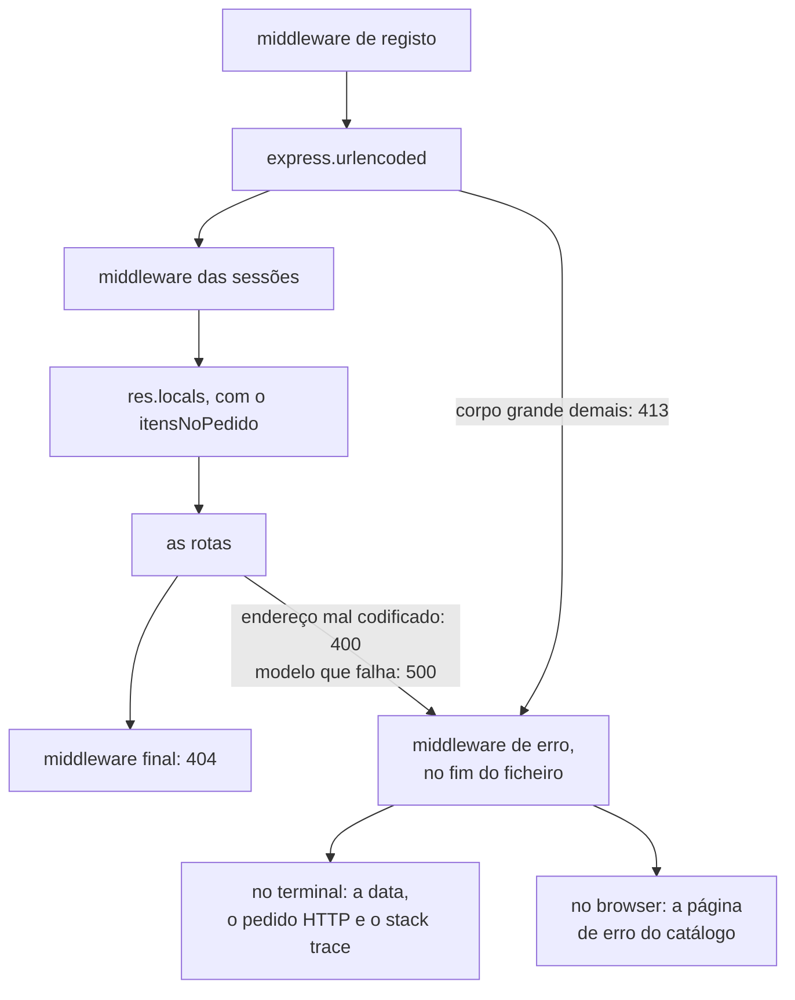
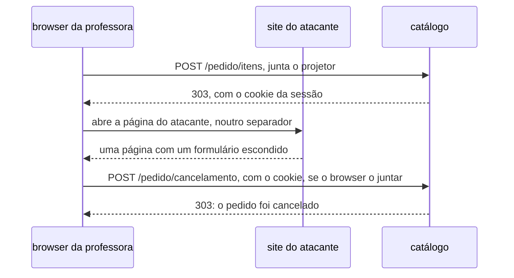
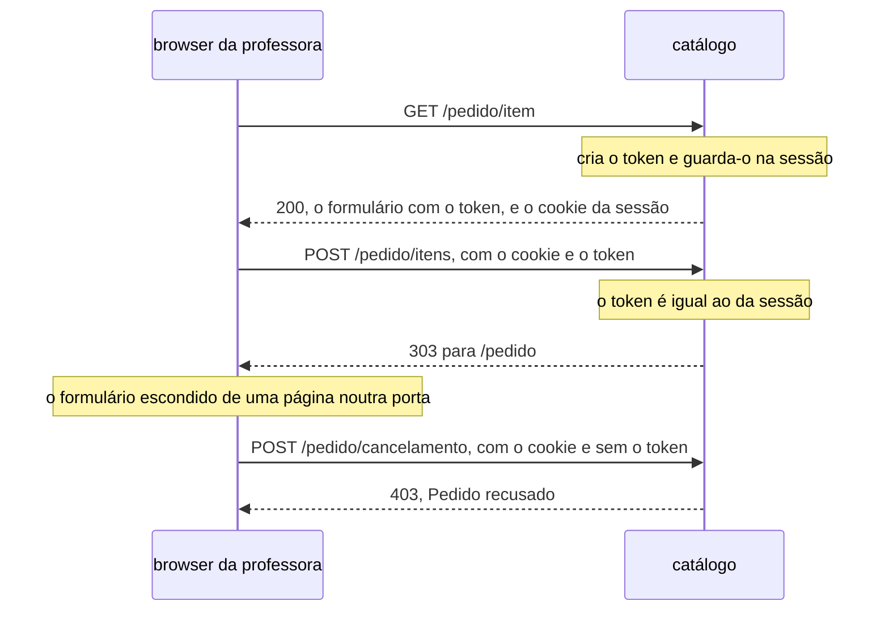

# Erros e segurança web

Neste guia, o catálogo do tema 06 fica preparado para quando as coisas correm mal. Uma falha passa a dar uma página do catálogo, com o código certo, e o terminal fica com o que é preciso para a corrigir. Vês também como se guardam os segredos, onde o escaping do `<%=` não chega e como um token trava os formulários enviados por outros sites.

Usa as páginas de erro e o escaping do tema 04 e as sessões do tema 06. Rever: [Um erro também se responde com uma página](04-ejs-e-reutilizacao-no-servidor.md#um-erro-também-se-responde-com-uma-página), [Escaping: o que vem de fora nunca vira HTML](04-ejs-e-reutilizacao-no-servidor.md#escaping-o-que-vem-de-fora-nunca-vira-html), [O segredo, fora do código](06-cookies-e-sessoes.md#o-segredo-fora-do-código) e [Os atributos do cookie](06-cookies-e-sessoes.md#os-atributos-do-cookie). Para praticar: [ficha de exercícios](exercicios/07-erros-e-seguranca-web-exercicios.md).

## Neste guia

1. [Quem errou: o pedido HTTP ou o servidor](#quem-errou-o-pedido-http-ou-o-servidor)
2. [O erro que ninguém previu](#o-erro-que-ninguém-previu)
3. [O middleware de erro](#o-middleware-de-erro)
4. [O que se escreve no terminal](#o-que-se-escreve-no-terminal)
5. [Os segredos](#os-segredos)
6. [O escaping depende do sítio](#o-escaping-depende-do-sítio)
7. [O CSRF: o pedido HTTP que outro site faz em teu nome](#o-csrf-o-pedido-http-que-outro-site-faz-em-teu-nome)
8. [O token contra o CSRF](#o-token-contra-o-csrf)
9. [Exemplo guiado: o catálogo preparado para falhar](#exemplo-guiado-o-catálogo-preparado-para-falhar)

## Quem errou: o pedido HTTP ou o servidor

Abre `/equipamentos/abc` no catálogo e recebes a página "Pedido inválido", com o código 400. O servidor está bem: quem escreveu o endereço é que se enganou, e pode corrigi-lo. Agora imagina que o modelo da página de um equipamento tem um erro e falha sempre que alguém a abre. O endereço está certo, e quem o abriu não pode fazer nada. Perante uma falha, a primeira pergunta é esta: quem errou, o pedido HTTP ou o servidor?

Os códigos de estado respondem pelo primeiro algarismo. Os começados por 4, a que se chama 4xx, dizem que o problema está no pedido HTTP: o que se pediu não existe, está mal escrito ou não é permitido. Já conheces o 400, o 404 e, do limite do `express.urlencoded`, o 413. Rever: [o limite do corpo, no tema 05](05-formularios-e-validacao.md#o-corpo-do-pedido-e-o-middleware-que-o-lê). Este tema junta-lhes o 403:

| Código | Quando | No catálogo |
| --- | --- | --- |
| 400 | O pedido HTTP está mal feito | `/equipamentos/abc`; um formulário com um campo errado |
| 403 | O servidor percebeu o pedido HTTP, e recusa-o | Um formulário enviado por uma página de outro site |
| 404 | O que se pediu não existe | `/equipamentos/9`; um endereço que nenhuma rota trata |
| 413 | O pedido HTTP é grande demais | Um corpo com mais de 100 quilobytes, o limite do `express.urlencoded` |

Os começados por 5, os 5xx, dizem que o problema está no servidor. O mais comum é o 500, Internal Server Error (erro interno do servidor). Pode ser um erro no código de uma rota, um modelo que lê uma propriedade de um valor que não existe ou uma base de dados que não responde. Quem usa o catálogo só pode tentar mais tarde. Quem tem de agir é quem mantém o servidor, e para isso precisa de saber o que aconteceu.

Daqui sai a regra deste tema: uma falha tem dois destinatários, e cada um recebe coisas diferentes. Quem usa o catálogo recebe, no browser, uma página do catálogo com o código certo e uma frase que diz o que se passou e o que pode fazer. Não recebe nada sobre o funcionamento do servidor. Quem mantém o servidor recebe, no terminal, tudo o que precisa para encontrar e corrigir a causa.

## O erro que ninguém previu

Os 400 e os 404 do catálogo são previstos: há um `if` que os deteta e uma resposta escrita para cada um. Um 500 vem de uma linha que falha quando não devia. Imagina que o modelo da página de um equipamento passa a mostrar o fabricante, com `equipamento.fabricante.nome`, e que os equipamentos não têm fabricante. O `equipamento.fabricante` é `undefined`, e ler uma propriedade de `undefined` dá um `TypeError`.

Sem nada no servidor que trate o erro, o Express responde ele próprio, com o código 500 e uma página sua. Essa página mostra a mensagem do erro e o **stack trace** (à letra, o rasto da pilha de chamadas). O stack trace é a lista das funções que estavam a correr quando o erro aconteceu, cada uma com o ficheiro e o número da linha. São as linhas começadas por `at` que já viste no terminal. Rever: [Uma mensagem de erro lê-se pelo tipo e pela linha](02-primeiro-servidor.md#uma-mensagem-de-erro-lê-se-pelo-tipo-e-pela-linha).

Num computador em que o catálogo está na pasta `/Users/ana/projetos/catalogo`, a página do Express começa assim (aqui, sem algumas linhas):

```text
TypeError: /Users/ana/projetos/catalogo/views/equipamento.ejs:4
    2| <%- include("partials/cabecalho") %>
    3|     <p>Número: <%= equipamento.id %></p>
 >> 4|     <p>Fabricante: <%= equipamento.fabricante.nome %></p>
    5|     <p>Sala: <a href="/equipamentos?sala=<%= equipamento.sala %>"><%= equipamento.sala %></a></p>

Cannot read properties of undefined (reading 'nome')
    at eval ("/Users/ana/projetos/catalogo/views/equipamento.ejs":18:49)
    at equipamento (/Users/ana/projetos/catalogo/node_modules/ejs/lib/cjs/ejs.js:617:23)
```

Para ti, a programar, isto é útil: diz o ficheiro, a linha e o erro. Para quem usa o catálogo, não serve de nada, e uma parte é perigosa. Mostra o nome de quem usa o computador e a organização das pastas. Mostra as bibliotecas do servidor, porque a pasta `node_modules` aparece nos caminhos. E mostra linhas do próprio modelo. Quem procura uma forma de atacar um servidor começa por aqui: provoca erros e lê o que eles revelam.

Além disso, a página está em inglês, não tem o cabeçalho nem o menu do catálogo e não diz a quem a vê o que pode fazer. O servidor tem de tratar ele próprio os seus erros.

<details>
<summary>Para ires mais longe: a página do Express em modo de produção</summary>

A variável de ambiente `NODE_ENV` igual a `production` é a forma habitual de dizer a um servidor que está publicado. Com ela, a página de erro do Express mostra só `Internal Server Error`, sem o stack trace. O terminal continua a mostrar o erro completo. Ajuda, mas depende de alguém se lembrar de pôr a variável, e a página continua em inglês, sem o menu do catálogo e sem dizer o que fazer.

</details>

## O middleware de erro

O Express tem um tipo especial de middleware, só para erros: o **middleware de erro**. Distingue-se dos outros por uma só coisa. Tem quatro parâmetros, `(erro, req, res, next)`, e o primeiro é o erro.

Quando uma rota, um middleware ou um modelo falham, o Express deixa de correr as rotas e os middlewares normais. Salta para o primeiro middleware de erro que estiver abaixo, pela ordem do ficheiro, e passa-lhe o erro no primeiro parâmetro. Não tens de escrever nada para isto acontecer: basta o erro acontecer numa rota ou num modelo EJS. Rever: [Uma fila, pela ordem do ficheiro](03-http-rotas-e-middleware.md#uma-fila-pela-ordem-do-ficheiro).



O diagrama mostra a fila do catálogo. Cada falha salta do sítio onde nasce para o middleware de erro, no fim, e tudo o que está pelo meio fica por correr. A falha de um modelo nasce nas rotas, e o middleware final do 404 nem chega a correr.

O middleware de erro do catálogo é este:

```js fragment
// Middleware de erro: tem quatro parâmetros, e o Express só o chama quando
// uma rota, um middleware ou um modelo falham. Regista o erro completo no
// terminal, para quem o vai corrigir, e mostra ao utilizador uma página que
// não revela detalhes internos do servidor. Fica depois de tudo, até do middleware final.
app.use((erro, req, res, next) => {
  console.error(`${new Date().toISOString()} ERRO ${req.method} ${req.url}`);
  console.error(erro.stack);

  // A página de erro inclui o cabeçalho, que usa o itensNoPedido. Se a falha
  // aconteceu antes do middleware que o prepara, ele ainda não existe.
  res.locals.itensNoPedido = res.locals.itensNoPedido || 0;

  // Alguns erros já trazem um código 4xx: o express.urlencoded dá o 413 a um
  // corpo grande demais. Esses são falhas do pedido HTTP; tudo o resto é um 500.
  if (erro.status >= 400 && erro.status < 500) {
    res.status(erro.status).render("erro", {
      titulo: "Pedido recusado",
      mensagem: "O servidor não conseguiu tratar este pedido. Volta à página anterior e tenta outra vez.",
    });
    return;
  }
  res.status(500).render("erro", {
    titulo: "Erro no servidor",
    mensagem: "Alguma coisa correu mal do nosso lado. Tenta outra vez daqui a pouco.",
  });
});
```

Lê-o em três partes. As duas primeiras linhas são para quem mantém o servidor. Escrevem no terminal a data, o método e o endereço do pedido HTTP, e depois o `erro.stack`, que junta a mensagem e o stack trace. As últimas linhas respondem com o 500 e com a página de erro do catálogo, com uma frase geral: é a parte para quem usa o catálogo. No meio estão duas partes, explicadas na subsecção seguinte.

A página não usa o `erro.message`. A mensagem de um erro inesperado é escrita para programadores, e pode ter caminhos, nomes de variáveis ou pedaços de dados. Não ajuda em nada quem usa o catálogo.

O middleware não usa o `next`, e o parâmetro parece sobrar.

Prevê: tiras o `next` e ficas com `(erro, req, res)`. O que aparece quando o modelo falha?

A página do Express, com o stack trace, outra vez. O Express conta os parâmetros da função para saber se é um middleware de erro. Com três, é um middleware normal, que nunca recebe os erros. São sempre quatro, mesmo que não uses o `next`.

O sítio também conta. O middleware de erro fica no fim do ficheiro, depois de todas as rotas e do middleware final, logo antes do `app.listen`. Um middleware de erro acima das rotas nunca recebe os erros delas, porque um erro só salta para baixo.

E o middleware de erro não substitui o `return`. Sem o `return` depois de uma página de erro, a segunda página fica pronta quando a primeira já saiu. O erro acontece depois de a função da rota acabar, onde nenhum middleware o apanha, e o servidor vai abaixo, como no tema 04. Rever: [A página de erro certa, com o código errado, e o servidor em baixo](04-ejs-e-reutilizacao-no-servidor.md#a-página-de-erro-certa-com-o-código-errado-e-o-servidor-em-baixo).

### O código que o erro traz e o número do menu

Nem todos os erros são falhas do servidor. O `express.urlencoded` recusa um corpo com mais de 100 quilobytes com um erro que traz a propriedade `status`, com o valor 413. O Express recusa um endereço com um código `%` que não corresponde a nenhum carácter, como `/equipamentos/%E0%A4%A`, com um erro que traz o 400. São falhas do pedido HTTP, e responder-lhes com o 500 seria dizer que o servidor falhou quando não falhou. Por isso, o `if` do meio responde com o código que o erro traz, quando é um 4xx, e com a página "Pedido recusado". Tudo o resto é um 500. Nos títulos das páginas de erro, como "Pedido recusado" e "Pedido inválido", o pedido é o pedido HTTP, e não o teu pedido em curso.

O 413 tem mais um problema, que se vê no diagrama da secção. Nasce no `express.urlencoded`, antes do middleware que põe o `itensNoPedido` no `res.locals`. A página de erro inclui o cabeçalho, e o cabeçalho usa o `itensNoPedido`. Rever: [Passo 3: o pedido no menu](06-cookies-e-sessoes.md#passo-3-o-pedido-no-menu). Sem esse valor, a própria página de erro falha, e o Express responde com a página dele, com o stack trace.

Por isso o middleware garante o valor: `res.locals.itensNoPedido || 0` fica com o valor que lá estiver, ou com 0 se não houver nenhum. O 400 e o 500 nascem nas rotas, quando o valor já existe. Mas uma página de erro tem de funcionar mesmo quando tudo o resto falhou.

## O que se escreve no terminal

Depois de uma falha, o que o servidor escreveu no terminal é a única forma de saber o que aconteceu. A esse texto chama-se **registo do servidor**, ou só registo, e não é o registo de uma tabela, do tema 01. O catálogo já tem dois. O middleware de registo do tema 03 escreve uma linha por pedido HTTP, com o método e o endereço. O middleware de erro escreve, para cada falha, a data, o pedido HTTP e o stack trace.

Um bom registo é mínimo: tem o que é preciso para perceber e corrigir uma falha, e mais nada. Para cada falha, quer dizer quando aconteceu, que pedido HTTP a provocou e o que falhou. Com estas três coisas, quem lê o registo consegue repetir a falha e encontrar a linha. É o que o middleware de erro escreve:

```text
2026-12-01T10:15:03.481Z ERRO GET /equipamentos/2
TypeError: /Users/ana/projetos/catalogo/views/equipamento.ejs:4
...
```

A primeira linha tem a data, a hora, o método e o endereço, e por baixo vem o stack trace. A hora vem em UTC, a hora de referência mundial, marcada pelo `Z` do fim. Em Portugal continental, é a do relógio no inverno, e uma hora a menos no verão.

O registo não é um sítio seguro: é lido por quem mantém o servidor, guardado em ficheiros e copiado para outros sítios. Por isso, há três coisas que nunca se escrevem lá:

- Os segredos, como o `SESSION_SECRET`, as palavras-passe e as chaves de acesso, nem numa mensagem de erro sobre eles.
- Os identificadores de sessão e os cookies. Quem tem o identificador tem a sessão, e escrever o cabeçalho `Cookie` no registo é deixar lá as chaves de todos os pedidos em curso. Rever: [O roubo e a fixação de uma sessão](06-cookies-e-sessoes.md#o-roubo-e-a-fixação-de-uma-sessão).
- O corpo dos pedidos HTTP. O `req.body` tem o que as pessoas escrevem nos formulários, como nomes, números de aluno e, numa aplicação com contas, palavras-passe. Um `console.log(req.body)` esquecido de quando estavas a depurar é um registo de dados pessoais.

O endereço também pode ter dados, nos parâmetros de pesquisa. No catálogo, a sala pesquisada não é um dado pessoal, e pode ficar. Numa aplicação em que se pesquisasse pelo nome de um aluno, já não podia.

## Os segredos

No tema 06, o segredo que assina o cookie da sessão ficou no `.env`, que não vai para o Git, e o servidor recusa-se a arrancar sem ele. Este tema acrescenta uma verificação e uma regra.

A verificação é o tamanho. Um segredo curto, como `teste` ou `123456`, adivinha-se, e quem souber o segredo consegue assinar identificadores que o servidor aceita. Rever: [O identificador vai assinado](06-cookies-e-sessoes.md#o-identificador-vai-assinado). O catálogo recusa um segredo com menos de 32 carateres:

```js fragment
// Um segredo curto adivinha-se. A mensagem não mostra o segredo: só o tamanho.
if (SEGREDO.length < 32) {
  console.error(`O SESSION_SECRET tem ${SEGREDO.length} carateres; tem de ter pelo menos 32.`);
  process.exit(1);
}
```

Com um segredo de 10 carateres, o servidor escreve `O SESSION_SECRET tem 10 carateres; tem de ter pelo menos 32.` e não arranca. A mensagem diz o tamanho, que é o que ajuda a corrigir, e não mostra o segredo, porque o terminal é um registo.

A verificação só recusa segredos curtos. A mesma letra escrita 32 vezes passa, e continua fácil de adivinhar. Por isso, não inventes o segredo. Gera-o com o comando do tema 06, que dá 64 carateres aleatórios, e guarda-o só no `.env`.

A regra é o que fazer quando um segredo é revelado: se foi para o Git, se apareceu num registo, se alguém o viu no teu ecrã. Troca-se por um novo, sempre. Não chega apagá-lo do sítio onde apareceu, porque não sabes quem o viu. O servidor só lê o segredo novo quando volta a arrancar.

Prevê: tens um pedido a meio, trocas o segredo no `.env` e o servidor volta a arrancar. O que mostra a página do pedido?

O pedido vazio, por duas razões ao mesmo tempo. O reinício apagou as sessões, que só estavam na memória do servidor. Rever: [Onde ficam as sessões](06-cookies-e-sessoes.md#onde-ficam-as-sessões). E o segredo novo já não aceita o identificador antigo, que o browser continua a enviar, porque a assinatura deixa de bater certo. Se experimentares, não consegues saber qual das duas apagou o pedido.

A segunda é a que interessa quando um segredo foi revelado. Com o segredo novo, os identificadores antigos deixam de valer, mesmo que as sessões estivessem guardadas numa base de dados, e quem tivesse roubado um já não o pode usar.

## O escaping depende do sítio

No tema 04, o `<%=` protegia os dois sítios onde os valores apareciam: o texto de uma etiqueta, como `<p><%= mensagem %></p>`, e o valor de um atributo entre aspas. Rever: [Escaping: o que vem de fora nunca vira HTML](04-ejs-e-reutilizacao-no-servidor.md#escaping-o-que-vem-de-fora-nunca-vira-html). O `<%=` só troca os carateres que são perigosos em HTML: o `<`, o `>`, o `&`, as aspas e o apóstrofo. Noutros sítios de uma página, os carateres perigosos são outros, e o `<%=` deixa-os passar. A proteção escolhe-se pelo sítio onde o valor entra, e a isso chama-se **escaping contextual**.

Prevê: um valor vindo de fora, `x autofocus onfocus=alert(1)`, entra num atributo sem aspas, com `<%=`. O escaping protege a página?

Não, porque o valor não tem nenhum dos carateres que o `<%=` troca:

| Onde está o valor | O modelo | O que o browser recebe | Resultado |
| --- | --- | --- | --- |
| Atributo com aspas | `<input value="<%= v %>">` | `<input value="x autofocus onfocus=alert(1)">` | Seguro: é tudo o valor do atributo |
| Atributo sem aspas | `<input value=<%= v %>>` | `<input value=x autofocus onfocus=alert(1)>` | Perigoso: o espaço acaba o valor, e o resto são atributos novos; o `onfocus` corre um script quando o campo ganha o foco |

Sem as aspas, o fim do valor é marcado por um espaço, e o espaço não é escapado. Por isso, os atributos levam sempre aspas. Quem ataca não precisa de escrever no teu browser: põe o valor num endereço e leva outra pessoa a abri-lo, como no tema 04.

Dentro de um `<script>`, o problema é o mesmo, noutra língua. Com o valor `1;alert(1)`, o modelo `<script>const tempo = <%= v %>;</script>` dá ao browser `<script>const tempo = 1;alert(1);</script>`. O `;` e os parênteses não são carateres de HTML, e o valor virou código JavaScript, que corre. A regra é não pôr valores dentro de scripts. O catálogo não tem scripts, que é a forma mais simples de a cumprir.

Nos endereços, o perigo é outro. Um `href` com um endereço escrito por alguém, como `<a href="<%= site %>">`, recebe tal e qual o valor `javascript:alert(1)`, que não tem nenhum carácter de HTML. Quando alguém carregar na ligação, o browser corre o script, em vez de abrir uma página. O escaping não ajuda. O que ajuda é a validação no servidor, do tema 05: um endereço que vem de fora só se aceita se começar por `https://` ou `http://`. Rever: [Validar no servidor](05-formularios-e-validacao.md#validar-no-servidor). O catálogo não guarda endereços, mas uma aplicação com o "site do fornecedor" teria de o fazer.

No tema 04, a injeção de código na página precisava de alguém que abrisse um endereço com o script. O nome que se escreve ao confirmar um pedido é mais grave, porque aparece na lista das reservas, que toda a gente vê. Se esse nome entrasse sem escaping, um script escrito por uma pessoa correria no browser de todas as que abrissem a lista. A este caso chama-se **injeção guardada**: o código fica guardado como um dado e corre mais tarde, no browser de outras pessoas, sem ser preciso enganar ninguém. No catálogo, o nome entra com `<%=`, e um `<script>` escrito no nome aparece na lista como texto.

<details>
<summary>Para ires mais longe: um valor entre aspas, dentro de um script</summary>

Pôr o valor entre aspas, dentro do script, também não resolve. Com `<script>const nome = "<%= v %>";</script>` e o valor `Ana" + alert(1) + "`, o browser recebe `<script>const nome = "Ana&#34; + alert(1) + &#34;";</script>`. O `alert` não corre, mas o nome fica com `&#34;` escrito, porque dentro de um script o browser não desfaz os códigos do HTML. O escaping do HTML protege mal, e estraga os dados.

</details>

## O CSRF: o pedido HTTP que outro site faz em teu nome

O CSRF ficou definido no tema 06. Nesse ataque, uma página de outro site faz o browser de quem a visita enviar um pedido HTTP ao teu servidor, com o cookie dessa pessoa. Rever: [Os atributos do cookie](06-cookies-e-sessoes.md#os-atributos-do-cookie). O ataque aproveita uma regra dos cookies: o browser junta o cookie de um site aos pedidos HTTP para esse site, sem perguntar a ninguém.

Imagina que a professora tem um pedido em curso no catálogo e, noutro separador, abre uma página de outro site, feita por alguém mal-intencionado. Essa página tem um formulário escondido, que se envia sozinho, com um `POST` para `http://localhost:3000/pedido/cancelamento`:



O `POST` do cancelamento sai do browser da professora, enviado pelo formulário escondido. Se o browser lhe juntar o cookie da sessão do catálogo, o servidor vê um cancelamento vindo da sessão dela, e cancela-lhe o pedido sem ela saber. O atacante nunca viu o cookie: usou o browser dela para o enviar.

Com o `SameSite=Lax` do tema 06, um `POST` que vem de outro site chega sem o cookie, e neste caso o ataque falha. Mas o `SameSite` não chega como defesa, por quatro razões:

- uma página noutra porta do mesmo computador, ou noutro nome do mesmo domínio, como `moodle.escola.pt` para `catalogo.escola.pt`, conta como o mesmo site, e o cookie vai;
- o `Lax` deixa ir o cookie num `GET` vindo de outro site, como o de uma ligação, e uma rota que mudasse dados com um `GET` ficava desprotegida;
- os browsers antigos não conhecem o atributo;
- basta alguém mudar a configuração do cookie, sem saber porquê, para a proteção desaparecer.

Da segunda razão sai uma regra para as rotas: nada que mude dados se faz com `GET`. O catálogo cumpre-a desde o tema 05, e juntar, tirar, confirmar e cancelar são todos `POST`. Rever: [GET serve para ver e POST para mudar](01-do-pedido-a-resposta.md#get-serve-para-ver-e-post-para-mudar). Das outras sai a necessidade de uma defesa própria, que não dependa do cookie.

## O token contra o CSRF

O **token contra o CSRF** é um código aleatório, um por sessão. O servidor guarda-o na sessão e escreve-o em cada formulário que muda alguma coisa, num campo escondido. Quando o formulário é enviado, o token vai no corpo, e o servidor compara-o com o da sessão. Se não vier, ou não for igual, o pedido HTTP é recusado com o 403.

O ataque falha porque a página do atacante não consegue saber o token. O token só está escrito nas páginas do catálogo, e o browser não deixa uma página de outro site ler o que as páginas do catálogo contêm. É a regra da **mesma origem**: uma página só lê as respostas que vêm da sua origem, isto é, com o mesmo protocolo, o mesmo computador e a mesma porta. O `http://localhost:3000` e o `http://localhost:4000` já são origens diferentes. O atacante consegue fazer o browser enviar um pedido HTTP, mas não consegue ler as respostas, e por isso não sabe o que pôr no campo escondido. Para esta regra, outra porta já é outra origem, e a página noutra porta, que o `SameSite` deixa passar, também não lê o token.



O diagrama mostra os dois caminhos. O formulário do catálogo traz o token que o servidor lá escreveu, e passa. O formulário escondido de uma página noutra porta leva o cookie, porque o `SameSite` a deixa passar, mas não leva o token, e é recusado.

No catálogo, a defesa tem três peças. A primeira é uma função que cria o token, quando a sessão ainda não o tem, e o põe no `res.locals`:

```js fragment
/**
 * Garante que a sessão tem um token contra o CSRF, e põe-no à disposição dos
 * modelos. O token é um código aleatório, um por sessão, que os formulários
 * enviam num campo escondido; uma página de outro site não o conhece.
 * @param {object} req o pedido HTTP
 * @param {object} res a resposta
 */
function prepararTokenCsrf(req, res) {
  if (!req.session.csrf) {
    req.session.csrf = randomBytes(32).toString("hex");
  }
  res.locals.csrf = req.session.csrf;
}
```

O `randomBytes` vem do módulo `node:crypto`, que faz parte do Node, e importa-se no início do ficheiro com `import { randomBytes } from "node:crypto";`. O `randomBytes(32)` dá 32 bytes aleatórios, e o `toString("hex")` escreve-os como 64 carateres de `0` a `9` e de `a` a `f`. É a mesma receita do comando que gera o `SESSION_SECRET`. O `if` só cria o token da primeira vez, e por isso há um por sessão: os formulários seguintes levam o mesmo.

A rota do formulário que junta um equipamento ao pedido chama a função antes de mostrar a página, porque é o primeiro formulário que muda a sessão:

```js fragment
// O formulário para juntar um equipamento ao pedido. É aqui que a sessão
// recebe o token contra o CSRF, porque é o primeiro formulário que a muda.
app.get("/pedido/item", (req, res) => {
  prepararTokenCsrf(req, res);
  res.render("item-novo", {
    titulo: "Juntar ao pedido",
    equipamentos: equipamentos,
    valores: { equipamento_id: "", data: "", tempo: "" },
    erros: {},
  });
});
```

Prevê: abres `/pedido/item` com o pedido vazio. O browser recebe um cookie?

Recebe, ao contrário do tema 06, em que o cookie só aparecia ao juntar o primeiro equipamento. A sessão tem de existir para guardar o token que o formulário vai levar, e a função guardou-o lá. Quem só vê o catálogo continua sem cookie. Guardar o token não muda o pedido nem as reservas: é a sessão a preparar o formulário, e o `GET` continua a não mudar dados.

A segunda peça põe o token à disposição de todas as páginas, no middleware que já punha o número de equipamentos do pedido:

```js fragment
// Para todas as páginas: quantos equipamentos tem o pedido desta sessão, e o
// token contra o CSRF, se a sessão já o tiver. O res.locals põe os dois à
// disposição de todos os modelos.
app.use((req, res, next) => {
  const pedido = req.session.pedido;
  res.locals.itensNoPedido = pedido ? pedido.length : 0;
  res.locals.csrf = req.session.csrf || "";
  next();
});
```

O `req.session.csrf || ""` dá o token da sessão, ou o texto vazio se a sessão ainda não o tiver. Cada formulário `POST` leva o token num campo escondido, com o nome `_csrf`:

```ejs
<input type="hidden" name="_csrf" value="<%= csrf %>">
```

O campo escondido não aparece na página, mas vai no corpo do `POST`, como os outros campos, com o token que o `<%=` lá escreveu. O token entra no `res.locals` em dois sítios por causa da primeira visita ao formulário. O middleware corre antes da rota, quando a sessão ainda não tem token, e dá o texto vazio. É a função, já na rota, que põe lá o token acabado de criar.

A terceira peça é a verificação, num middleware que corre antes de todas as rotas e só faz alguma coisa nos `POST`:

```js fragment
// Proteção contra o CSRF: todos os pedidos POST têm de trazer, no campo
// escondido _csrf, o token desta sessão. Sem ele, ou com outro, recusa-se.
app.use((req, res, next) => {
  if (req.method !== "POST") {
    next();
    return;
  }
  const token = req.session.csrf;
  // Sem corpo lido pelo express.urlencoded, não há campo _csrf para comparar.
  if (!token || !req.body || req.body._csrf !== token) {
    res.status(403).render("erro", {
      titulo: "Pedido recusado",
      mensagem: "Este formulário já não é válido. Volta à página do formulário, recarrega-a e tenta outra vez.",
    });
    return;
  }
  next();
});
```

O `||` avalia as condições da esquerda para a direita e para na primeira verdadeira. Sem token na sessão, o pedido HTTP é logo recusado. Com token, vê-se se há corpo: sem corpo lido pelo `express.urlencoded`, não há campo `_csrf`, e o 403 sai sem se tentar ler uma propriedade de `undefined`. Só com corpo se compara o campo com o token da sessão.

A verificação está num middleware para todos os `POST`, e não em cada rota. Assim, nenhum formulário novo fica desprotegido por esquecimento: um `POST` sem o token é recusado, venha para onde vier. Fica depois do `express.urlencoded`, porque lê o `req.body`, e depois da sessão, porque lê o `req.session`. Quando a sessão termina, o token vai com ela, e um formulário que ficou aberto numa página antiga é recusado. Rever: [Terminar a sessão](06-cookies-e-sessoes.md#terminar-a-sessão).

## Exemplo guiado: o catálogo preparado para falhar

O exemplo parte do catálogo do fim do tema 06, o do exemplo [catalogo-com-sessoes](../exemplos/aplicacoes-em-browser/catalogo-com-sessoes/README.md). As páginas e as rotas não mudam: muda o que acontece quando alguma coisa corre mal. O resultado final está pronto a correr no exemplo [catalogo-com-seguranca](../exemplos/aplicacoes-em-browser/catalogo-com-seguranca/README.md).

O servidor arranca com `node --watch --env-file=.env server.js`, como no tema 06, e volta a ligar-se depois de cada mudança no `server.js`, sem as sessões que tinha. A partir do passo 4, depois de guardares o `server.js`, recarrega a página do formulário antes de o enviar, porque o token antigo foi com a sessão. Sempre que confirmares um pedido, usa um nome fictício, como "Ana Reserva".

### Passo 1: provocar um 500 e ler a página do Express

Para ver a página de erro do Express, é preciso uma falha que o servidor ainda não trata. No `views/equipamento.ejs`, a seguir à linha do número, acrescenta esta linha, que tem um erro de propósito:

```ejs
    <p>Fabricante: <%= equipamento.fabricante.nome %></p>
```

Abre `/equipamentos/2`. O browser mostra a página do Express, com o código 500, o `TypeError` e o stack trace, com os caminhos do teu computador. É a página da secção [O erro que ninguém previu](#o-erro-que-ninguém-previu). O terminal mostra o mesmo erro, e o servidor continua ligado. Deixa a linha ficar, para o passo 2.

### Passo 2: o middleware de erro

No fim do `server.js`, depois do middleware final e antes do `app.listen`, acrescenta o middleware de erro da secção [O middleware de erro](#o-middleware-de-erro). Com a linha do fabricante ainda no modelo, confirma o que mudou:

1. Abre `/equipamentos/2`. A página é "Erro no servidor", com o menu do catálogo, a frase geral e o código 500. No terminal aparecem a linha com a data e `ERRO GET /equipamentos/2` e o stack trace.
2. Abre o código-fonte da página e procura o nome de uma pasta do teu computador ou a palavra `node_modules`. Não há nenhum.
3. Tira a linha do fabricante do modelo e recarrega a página: o equipamento volta a aparecer.

As duas partes do meio do middleware veem-se com dois pedidos HTTP que falham antes de chegar à função de uma rota. No browser, abre `/equipamentos/%E0%A4%A`: o código é 400 e a página é "Pedido recusado", com `URIError: Failed to decode param '%E0%A4%A'` no terminal.

Para o 413, o formulário não serve, porque o browser não deixa escrever mais de 40 carateres no nome. Com o servidor ligado, noutro terminal, este comando envia à confirmação um nome com 200 000 carateres e escreve o código da resposta:

```bash
node -e "fetch('http://localhost:3000/pedido/confirmacao', { method: 'POST', headers: { 'Content-Type': 'application/x-www-form-urlencoded' }, body: 'nome=' + 'a'.repeat(200000) }).then((resposta) => console.log(resposta.status))"
```

O comando escreve `413`, e o terminal do servidor mostra a linha do erro e `PayloadTooLargeError: request entity too large`.

A página de erro serve agora os 4xx e o 500, e o código de estado já não o escolhem só as rotas. No `views/erro.ejs`, o comentário do topo passa a dizê-lo:

```ejs
<%# A página de erro, para os 4xx e para o 500. Recebe o titulo e a
    mensagem; o código de estado escolhe-o quem chama o res.render. %>
```

### Passo 3: o tamanho do segredo

No `server.js`, a seguir ao `if` que confirma que o segredo existe, acrescenta a verificação do tamanho da secção [Os segredos](#os-segredos). Se o teu segredo foi gerado com o comando do tema 06, tem 64 carateres, e o servidor arranca como antes.

Para ver a recusa, muda por um momento o segredo do `.env` para `abcdefghij`, que tem 10 carateres, e guarda. O terminal mostra `O SESSION_SECRET tem 10 carateres; tem de ter pelo menos 32.` e, com o `--watch`, `Failed running 'server.js'. Waiting for file changes before restarting...`. Se a mensagem não aparecer, o `--watch` não deu pela mudança do `.env`: para o servidor com Ctrl+C e arranca-o outra vez. No fim, repõe o segredo bom, guarda e confirma que o servidor voltou a ligar.

### Passo 4: o token contra o CSRF

No `server.js`, faz estas mudanças, com os blocos da secção [O token contra o CSRF](#o-token-contra-o-csrf):

- o `import { randomBytes } from "node:crypto";`, a seguir ao `import` da sessão;
- a função `prepararTokenCsrf`, entre a `erroDoNome` e a `linhasDoPedido`;
- a linha do `csrf` e o comentário novo, no middleware do `res.locals`;
- o middleware de verificação, logo a seguir ao do `res.locals`;
- a chamada à função, com o comentário novo, na rota `GET /pedido/item`.

Se experimentares agora, antes de mexer nos modelos, todos os formulários dão 403 e "Pedido recusado". O servidor já exige o token, e os formulários ainda não o enviam.

Com a verificação, um `POST` sem corpo recebe o 403 antes de chegar a uma rota. As duas guardas do corpo ausente, do tema 06, deixam de ser precisas, e o exemplo tira-as:

- na `validarItem`, sai o `if (!corpo)`, com o comentário por cima, e o `@param` volta a ser `@param {object} corpo o req.body do pedido HTTP`;
- na confirmação, saem o comentário e as quatro linhas do `let corpo`, e a linha do nome passa a `const nome = textoDoCampo(req.body.nome);`.

Nos modelos, o campo escondido entra nos quatro formulários `POST`. Um é o de juntar um equipamento, em `item-novo.ejs`. Os outros três são os da página do pedido, em `pedido.ejs`: o de cada botão de remoção, o da confirmação e o do cancelamento. O formulário de pesquisa da página inicial não leva token, porque envia por `GET` e não muda nada. Os dois modelos ficam assim:

```ejs
<%# O formulário para juntar um equipamento ao pedido. Recebe o titulo,
    os equipamentos para a lista, os valores a pôr nos campos e os erros,
    um por campo. O nome só se pede no fim, ao confirmar o pedido. O campo
    escondido _csrf leva o token da sessão. %>
<%- include("partials/cabecalho") %>
    <% if (Object.keys(erros).length > 0) { %>
      <p><strong>O equipamento não entrou no pedido. Corrige os campos assinalados e volta a enviar.</strong></p>
    <% } %>
    <form method="post" action="/pedido/itens">
      <input type="hidden" name="_csrf" value="<%= csrf %>">
      <p>
        <label for="equipamento_id">Equipamento
          <% if (erros.equipamento_id) { %><strong><%= erros.equipamento_id %></strong><% } %>
        </label>
        <select id="equipamento_id" name="equipamento_id" required>
          <option value="">Escolhe um equipamento</option>
          <% for (const equipamento of equipamentos) { %>
            <option value="<%= equipamento.id %>" <% if (String(equipamento.id) === valores.equipamento_id) { %>selected<% } %>><%= equipamento.nome %>, sala <%= equipamento.sala %></option>
          <% } %>
        </select>
      </p>
      <p>
        <label for="data">Dia
          <% if (erros.data) { %><strong><%= erros.data %></strong><% } %>
        </label>
        <input id="data" name="data" type="date" value="<%= valores.data %>" required>
      </p>
      <p>
        <label for="tempo">Tempo letivo, de 1 a 9
          <% if (erros.tempo) { %><strong><%= erros.tempo %></strong><% } %>
        </label>
        <input id="tempo" name="tempo" type="number" min="1" max="9" value="<%= valores.tempo %>" required>
      </p>
      <button type="submit">Juntar ao pedido</button>
    </form>
    <p><a href="/pedido">Voltar ao pedido</a></p>
<%- include("partials/rodape") %>
```

```ejs
<%# O pedido em curso, guardado na sessão. Recebe o titulo, as linhas (cada
    uma com o item e o equipamento), e o nome e o erro do formulário de
    confirmação, vazios da primeira vez. Cada formulário leva, no campo
    escondido _csrf, o token da sessão. %>
<%- include("partials/cabecalho") %>
    <% if (linhas.length === 0) { %>
      <p>O teu pedido está vazio.</p>
    <% } else { %>
      <ol>
        <% for (let i = 0; i < linhas.length; i++) { %>
          <li>
            <%= linhas[i].equipamento.nome %>, sala <%= linhas[i].equipamento.sala %>: dia <%= linhas[i].item.data %>, tempo <%= linhas[i].item.tempo %>
            <form method="post" action="/pedido/itens/<%= i + 1 %>/remocao">
              <input type="hidden" name="_csrf" value="<%= csrf %>">
              <button type="submit">Tirar do pedido</button>
            </form>
          </li>
        <% } %>
      </ol>
    <% } %>
    <p><a href="/pedido/item">Juntar um equipamento ao pedido</a></p>
    <% if (linhas.length > 0) { %>
      <h2>Confirmar o pedido</h2>
      <form method="post" action="/pedido/confirmacao">
        <input type="hidden" name="_csrf" value="<%= csrf %>">
        <p>
          <label for="nome">O teu nome
            <% if (erroNome) { %><strong><%= erroNome %></strong><% } %>
          </label>
          <input id="nome" name="nome" maxlength="40" value="<%= valorNome %>" required>
        </p>
        <button type="submit">Confirmar o pedido</button>
      </form>
      <h2>Cancelar o pedido</h2>
      <form method="post" action="/pedido/cancelamento">
        <input type="hidden" name="_csrf" value="<%= csrf %>">
        <button type="submit">Cancelar o pedido</button>
      </form>
    <% } %>
<%- include("partials/rodape") %>
```

Em cada formulário `POST`, o campo escondido é a primeira linha dentro do `<form>`, e o comentário do topo de cada modelo passa a dizer que ele lá está. O resto é igual ao do tema 06. Junta dois equipamentos, tira um e confirma o pedido: tudo funciona como antes.

### Passo 5: o servidor completo

O `server.js` no fim do exemplo:

```js
// server.js: o catálogo de equipamentos da escola, com o pedido em curso na
// sessão, agora preparado para quando as coisas correm mal: um middleware de
// erro que regista a falha no terminal e mostra ao utilizador uma página que
// não revela detalhes internos do servidor, e um token contra o CSRF em todos os
// formulários que mudam a sessão.
import express from "express";
import session from "express-session";
import { randomBytes } from "node:crypto";

const app = express();
const PORTA = 3000;

// O segredo que assina o cookie da sessão vem do ambiente, e nunca do código.
// Sem ele, o servidor recusa-se a arrancar.
const SEGREDO = process.env.SESSION_SECRET;
if (!SEGREDO) {
  console.error("Falta o SESSION_SECRET. Copia o .env.example para .env, escreve lá um segredo e arranca com: node --env-file=.env server.js");
  process.exit(1);
}
// Um segredo curto adivinha-se. A mensagem não mostra o segredo: só o tamanho.
if (SEGREDO.length < 32) {
  console.error(`O SESSION_SECRET tem ${SEGREDO.length} carateres; tem de ter pelo menos 32.`);
  process.exit(1);
}

// O nome do cookie da sessão, usado na configuração e ao terminar a sessão.
const NOME_DO_COOKIE = "catalogo.sid";

// O motor de modelos: o res.render vai procurar os ficheiros .ejs
// na pasta views.
app.set("view engine", "ejs");

// Os dados ficam em memória: existem enquanto o servidor estiver ligado.
const equipamentos = [
  { id: 1, nome: "Portátil", sala: "B12" },
  { id: 2, nome: "Projetor", sala: "A03" },
  { id: 3, nome: "Impressora", sala: "Secretaria" },
  { id: 4, nome: "Monitor", sala: "B12" },
];
const reservas = [];
let proximoIdReserva = 1;

/**
 * Devolve o texto de um campo do formulário, sem os espaços das pontas.
 * Um campo que não veio, ou que veio repetido (e chega como um array),
 * não é um texto: devolve o texto vazio.
 * @param {unknown} valor o valor tal como chegou em req.body
 * @returns {string}
 */
function textoDoCampo(valor) {
  if (typeof valor !== "string") {
    return "";
  }
  return valor.trim();
}

/**
 * Confirma que um texto no formato AAAA-MM-DD é um dia que existe.
 * O new Date aceita "2026-02-30" e transforma-o em 2 de março; por isso
 * confirma-se que o dia que sai é o mesmo que entrou.
 * @param {string} texto o dia, como o campo type="date" o envia
 * @returns {boolean}
 */
function diaValido(texto) {
  const dia = new Date(texto);
  if (Number.isNaN(dia.getTime())) {
    return false;
  }
  return dia.toISOString().slice(0, 10) === texto;
}

/**
 * Verifica um equipamento a juntar ao pedido: o equipamento, o dia e o tempo.
 * Só lê os três campos previstos; qualquer outro campo é ignorado.
 * Devolve os valores, para voltar a mostrar no formulário, e os erros,
 * com uma mensagem por campo. Sem erros, o objeto dos erros fica vazio.
 * @param {object} corpo o req.body do pedido HTTP
 * @returns {object} um objeto com os valores e os erros
 */
function validarItem(corpo) {
  const valores = {
    equipamento_id: textoDoCampo(corpo.equipamento_id),
    data: textoDoCampo(corpo.data),
    tempo: textoDoCampo(corpo.tempo),
  };
  const erros = {};

  // O equipamento tem de ser um dos da lista.
  const equipamento = equipamentos.find((equipamento) => equipamento.id === Number(valores.equipamento_id));
  if (!equipamento) {
    erros.equipamento_id = "Escolhe um equipamento da lista.";
  }

  // O dia é obrigatório, e tem de existir no calendário.
  if (valores.data === "") {
    erros.data = "Escolhe o dia da reserva.";
  } else if (!diaValido(valores.data)) {
    erros.data = "Esse dia não existe no calendário.";
  }

  // O tempo letivo é obrigatório, e é um número inteiro de 1 a 9.
  const tempo = Number(valores.tempo);
  if (valores.tempo === "") {
    erros.tempo = "Indica o tempo letivo.";
  } else if (!Number.isInteger(tempo) || tempo < 1 || tempo > 9) {
    erros.tempo = "O tempo letivo é um número inteiro de 1 a 9.";
  }

  return { valores: valores, erros: erros };
}

/**
 * Verifica o nome de quem confirma o pedido: obrigatório, e até 40 carateres.
 * Devolve a mensagem de erro, ou o texto vazio se o nome servir.
 * @param {string} nome o nome, já limpo pela textoDoCampo
 * @returns {string}
 */
function erroDoNome(nome) {
  if (nome === "") {
    return "Escreve o teu nome.";
  }
  if (nome.length > 40) {
    return "O nome tem, no máximo, 40 carateres.";
  }
  return "";
}

/**
 * Garante que a sessão tem um token contra o CSRF, e põe-no à disposição dos
 * modelos. O token é um código aleatório, um por sessão, que os formulários
 * enviam num campo escondido; uma página de outro site não o conhece.
 * @param {object} req o pedido HTTP
 * @param {object} res a resposta
 */
function prepararTokenCsrf(req, res) {
  if (!req.session.csrf) {
    req.session.csrf = randomBytes(32).toString("hex");
  }
  res.locals.csrf = req.session.csrf;
}

/**
 * Junta a cada item do pedido o seu equipamento, para a página mostrar o nome.
 * @param {object[]} pedido os itens guardados na sessão
 * @returns {object[]} uma linha por item, com o item e o equipamento
 */
function linhasDoPedido(pedido) {
  const linhas = [];
  for (const item of pedido) {
    const equipamento = equipamentos.find((equipamento) => equipamento.id === item.equipamentoId);
    linhas.push({ item: item, equipamento: equipamento });
  }
  return linhas;
}

// Middleware de registo: escreve no terminal cada pedido que chega,
// e passa-o à frente. Está antes das rotas, para ver todos os pedidos.
app.use((req, res, next) => {
  console.log(`${req.method} ${req.url}`);
  next();
});

// Middleware que lê o corpo dos formulários enviados por POST e o põe em
// req.body. Tem de estar antes das rotas que usam o req.body.
app.use(express.urlencoded({ extended: false }));

// Middleware das sessões: lê o cookie de cada pedido HTTP, encontra a sessão
// desse browser e põe-na em req.session. Cada opção está justificada.
app.use(session({
  secret: SEGREDO, // assina o cookie: o servidor só aceita identificadores que ele próprio deu
  name: NOME_DO_COOKIE, // o nome do cookie no browser
  resave: false, // não volta a guardar uma sessão que não mudou
  saveUninitialized: false, // não guarda a sessão, nem manda cookie, a quem ainda não guardou nada
  cookie: {
    httpOnly: true, // o JavaScript das páginas não consegue ler o cookie
    sameSite: "lax", // o cookie não vai nos pedidos POST que outros sites façam ao catálogo
    secure: false, // com HTTPS seria true; em http://localhost tem de ser false
    maxAge: 30 * 60 * 1000, // 30 minutos, em milissegundos, contados da última mudança
  },
}));

// Para todas as páginas: quantos equipamentos tem o pedido desta sessão, e o
// token contra o CSRF, se a sessão já o tiver. O res.locals põe os dois à
// disposição de todos os modelos.
app.use((req, res, next) => {
  const pedido = req.session.pedido;
  res.locals.itensNoPedido = pedido ? pedido.length : 0;
  res.locals.csrf = req.session.csrf || "";
  next();
});

// Proteção contra o CSRF: todos os pedidos POST têm de trazer, no campo
// escondido _csrf, o token desta sessão. Sem ele, ou com outro, recusa-se.
app.use((req, res, next) => {
  if (req.method !== "POST") {
    next();
    return;
  }
  const token = req.session.csrf;
  // Sem corpo lido pelo express.urlencoded, não há campo _csrf para comparar.
  if (!token || !req.body || req.body._csrf !== token) {
    res.status(403).render("erro", {
      titulo: "Pedido recusado",
      mensagem: "Este formulário já não é válido. Volta à página do formulário, recarrega-a e tenta outra vez.",
    });
    return;
  }
  next();
});

// Página inicial, com a pesquisa por sala e a ligação para reservar.
app.get("/", (req, res) => {
  res.render("inicio", { titulo: "Início" });
});

// Lista de equipamentos. Com ?sala=B12, só os dessa sala.
app.get("/equipamentos", (req, res) => {
  const sala = req.query.sala;
  let lista = equipamentos;
  if (sala) {
    lista = equipamentos.filter((equipamento) => equipamento.sala === sala);
  }
  res.render("equipamentos", { titulo: "Equipamentos", equipamentos: lista, sala: sala });
});

// Um equipamento: GET /equipamentos/2. O :id é um parâmetro de rota.
app.get("/equipamentos/:id", (req, res) => {
  const id = Number(req.params.id); // chega como texto, "2", e passa a número
  if (!Number.isInteger(id) || id < 1) {
    res.status(400).render("erro", {
      titulo: "Pedido inválido",
      mensagem: "O identificador tem de ser um número inteiro positivo.",
    });
    return;
  }
  const equipamento = equipamentos.find((equipamento) => equipamento.id === id);
  if (!equipamento) {
    res.status(404).render("erro", {
      titulo: "Equipamento não encontrado",
      mensagem: `Não existe o equipamento ${id}.`,
    });
    return;
  }
  res.render("equipamento", { titulo: equipamento.nome, equipamento: equipamento });
});

// O pedido em curso: os equipamentos já juntos, a confirmação e o cancelamento.
app.get("/pedido", (req, res) => {
  const pedido = req.session.pedido || [];
  res.render("pedido", { titulo: "O teu pedido", linhas: linhasDoPedido(pedido), valorNome: "", erroNome: "" });
});

// O formulário para juntar um equipamento ao pedido. É aqui que a sessão
// recebe o token contra o CSRF, porque é o primeiro formulário que a muda.
app.get("/pedido/item", (req, res) => {
  prepararTokenCsrf(req, res);
  res.render("item-novo", {
    titulo: "Juntar ao pedido",
    equipamentos: equipamentos,
    valores: { equipamento_id: "", data: "", tempo: "" },
    erros: {},
  });
});

// Juntar um equipamento ao pedido: valida, e guarda o item na sessão.
app.post("/pedido/itens", (req, res) => {
  const resultado = validarItem(req.body);
  if (Object.keys(resultado.erros).length > 0) {
    res.status(400).render("item-novo", {
      titulo: "Juntar ao pedido",
      equipamentos: equipamentos,
      valores: resultado.valores,
      erros: resultado.erros,
    });
    return;
  }

  // Da primeira vez, a sessão ainda não tem pedido: começa vazio.
  if (!req.session.pedido) {
    req.session.pedido = [];
  }
  req.session.pedido.push({
    equipamentoId: Number(resultado.valores.equipamento_id),
    data: resultado.valores.data,
    tempo: Number(resultado.valores.tempo),
  });
  res.redirect(303, "/pedido");
});

// Tirar um equipamento do pedido: POST /pedido/itens/2/remocao tira o segundo.
app.post("/pedido/itens/:posicao/remocao", (req, res) => {
  const pedido = req.session.pedido || [];
  const posicao = Number(req.params.posicao);
  if (!Number.isInteger(posicao) || posicao < 1 || posicao > pedido.length) {
    res.status(400).render("erro", {
      titulo: "Pedido inválido",
      mensagem: "Esse equipamento não está no teu pedido.",
    });
    return;
  }
  pedido.splice(posicao - 1, 1);
  res.redirect(303, "/pedido");
});

// Confirmar o pedido: cria uma reserva por equipamento e termina a sessão.
app.post("/pedido/confirmacao", (req, res) => {
  const pedido = req.session.pedido || [];
  if (pedido.length === 0) {
    res.status(400).render("erro", {
      titulo: "Pedido vazio",
      mensagem: "Não há nada no teu pedido para confirmar.",
    });
    return;
  }

  const nome = textoDoCampo(req.body.nome);
  const erroNome = erroDoNome(nome);
  if (erroNome !== "") {
    res.status(400).render("pedido", { titulo: "O teu pedido", linhas: linhasDoPedido(pedido), valorNome: nome, erroNome: erroNome });
    return;
  }

  for (const item of pedido) {
    reservas.push({
      id: proximoIdReserva,
      equipamentoId: item.equipamentoId,
      data: item.data,
      tempo: item.tempo,
      nome: nome,
    });
    proximoIdReserva = proximoIdReserva + 1;
  }

  // O pedido acabou: a sessão é destruída no servidor, e o cookie apagado no browser.
  req.session.destroy((erro) => {
    if (erro) {
      res.status(500).render("erro", { titulo: "Erro", mensagem: "Não foi possível terminar o pedido." });
      return;
    }
    res.clearCookie(NOME_DO_COOKIE);
    res.redirect(303, "/reservas");
  });
});

// Cancelar o pedido: termina a sessão sem criar reservas.
app.post("/pedido/cancelamento", (req, res) => {
  req.session.destroy((erro) => {
    if (erro) {
      res.status(500).render("erro", { titulo: "Erro", mensagem: "Não foi possível cancelar o pedido." });
      return;
    }
    res.clearCookie(NOME_DO_COOKIE);
    res.redirect(303, "/");
  });
});

// A lista das reservas feitas desde que o servidor arrancou.
app.get("/reservas", (req, res) => {
  // Para cada reserva, junta-se o equipamento, para a página mostrar o nome.
  const linhas = [];
  for (const reserva of reservas) {
    const equipamento = equipamentos.find((equipamento) => equipamento.id === reserva.equipamentoId);
    linhas.push({ reserva: reserva, equipamento: equipamento });
  }
  res.render("reservas", { titulo: "Reservas", linhas: linhas });
});

// Uma reserva: a página de cada reserva, aberta a partir da lista.
app.get("/reservas/:id", (req, res) => {
  const id = Number(req.params.id);
  if (!Number.isInteger(id) || id < 1) {
    res.status(400).render("erro", {
      titulo: "Pedido inválido",
      mensagem: "O número da reserva tem de ser um número inteiro positivo.",
    });
    return;
  }
  const reserva = reservas.find((reserva) => reserva.id === id);
  if (!reserva) {
    res.status(404).render("erro", {
      titulo: "Reserva não encontrada",
      mensagem: `Não existe a reserva ${id}.`,
    });
    return;
  }
  const equipamento = equipamentos.find((equipamento) => equipamento.id === reserva.equipamentoId);
  res.render("reserva", { titulo: `Reserva ${reserva.id}`, reserva: reserva, equipamento: equipamento });
});

// Middleware final: só chega aqui um pedido a que nenhuma rota respondeu.
app.use((req, res) => {
  res.status(404).render("erro", {
    titulo: "Página não encontrada",
    mensagem: "Este endereço não existe no catálogo.",
  });
});

// Middleware de erro: tem quatro parâmetros, e o Express só o chama quando
// uma rota, um middleware ou um modelo falham. Regista o erro completo no
// terminal, para quem o vai corrigir, e mostra ao utilizador uma página que
// não revela detalhes internos do servidor. Fica depois de tudo, até do middleware final.
app.use((erro, req, res, next) => {
  console.error(`${new Date().toISOString()} ERRO ${req.method} ${req.url}`);
  console.error(erro.stack);

  // A página de erro inclui o cabeçalho, que usa o itensNoPedido. Se a falha
  // aconteceu antes do middleware que o prepara, ele ainda não existe.
  res.locals.itensNoPedido = res.locals.itensNoPedido || 0;

  // Alguns erros já trazem um código 4xx: o express.urlencoded dá o 413 a um
  // corpo grande demais. Esses são falhas do pedido HTTP; tudo o resto é um 500.
  if (erro.status >= 400 && erro.status < 500) {
    res.status(erro.status).render("erro", {
      titulo: "Pedido recusado",
      mensagem: "O servidor não conseguiu tratar este pedido. Volta à página anterior e tenta outra vez.",
    });
    return;
  }
  res.status(500).render("erro", {
    titulo: "Erro no servidor",
    mensagem: "Alguma coisa correu mal do nosso lado. Tenta outra vez daqui a pouco.",
  });
});

app.listen(PORTA, (erro) => {
  if (erro) {
    console.error(`Não foi possível ligar o servidor: ${erro.message}`);
    return;
  }
  console.log(`Servidor a correr em http://localhost:${PORTA}`);
});
```

Compara-o com o teu. O código deve ser o mesmo, e só o comentário do topo, que vinha do tema 06, pode ser diferente.

O ficheiro lê-se pela ordem da fila. Primeiro vêm as duas verificações do segredo, os dados e as seis funções. Seguem-se o registo, o `express.urlencoded`, a sessão, o `res.locals` e a verificação do token, e depois as rotas, o middleware final, o middleware de erro e o `listen`. O 403 do token é uma resposta da própria verificação, e não passa pelo middleware de erro.

### Passo 6: os resultados

| O que se faz | O que acontece |
| --- | --- |
| Abrir a página inicial pela primeira vez | Nenhum cookie |
| Abrir `/pedido/item` | O formulário, com o campo escondido `_csrf` e um valor de 64 carateres no código-fonte; o browser recebe o cookie da sessão |
| Juntar o projetor e o portátil, tirar um e confirmar com "Ana Reserva" | Como no tema 06: a reserva aparece na lista, e o cookie é apagado |
| Juntar um equipamento depois de apagar ou mudar o valor do `_csrf` nas ferramentas de programador | 403, "Pedido recusado" |
| Juntar um equipamento, abrir `/pedido` em dois separadores, confirmar num e cancelar no outro | No segundo, 403 e "Pedido recusado", porque a sessão já não existe |
| Confirmar um pedido com o nome `<script>alert(1)</script>` | A lista das reservas mostra o nome como texto; no código-fonte, `&lt;script&gt;alert(1)&lt;/script&gt;` |
| Trocar o `SESSION_SECRET`, com um pedido a meio, e o servidor volta a arrancar | O pedido aparece vazio, e o browser continua a enviar o cookie antigo |

Para mudar o valor do `_csrf`, abre as ferramentas de programador no separador Elements ("Elementos"; no Firefox, "Inspetor"). Encontra o campo escondido dentro do formulário e faz duplo clique sobre o valor do `value`.

A experiência do atributo sem aspas faz-se no teu catálogo, e desfaz-se no fim:

1. No `views/pedido.ejs`, no campo do nome, tira as aspas do `value`, para ficar `value=<%= valorNome %>`, e tira também o `maxlength="40"`.
2. Junta um equipamento e, na confirmação, escreve no nome `x autofocus onfocus=alert(1) aaaaaaaaaaaaaaa`, que tem 44 carateres. Os `a` do fim só servem para passar dos 40 carateres, para o nome ser recusado e voltar ao campo. A página do pedido volta com a mensagem do nome comprido, e o browser mostra uma janela com "1". No código-fonte, o campo ficou `value=x autofocus onfocus=alert(1) aaaaaaaaaaaaaaa`.
3. Repõe só as aspas. Volta a abrir `/pedido`, escreve outra vez o mesmo nome e envia: o nome aparece no campo como texto, sem janela nenhuma.
4. Repõe o `maxlength="40"`.

### Passo 7: a matriz de falhas

Uma **matriz de falhas** é uma tabela das falhas que um servidor conhece. Para cada uma, diz como se provoca, que código dá, o que vê quem usa a aplicação e o que fica no terminal. Obriga a pensar em cada falha antes de ela acontecer. É também a lista do que se verifica antes de entregar, e o que se dá a quem vai manter o servidor. A do catálogo:

| Falha | Como se provoca | Código | O que o utilizador vê | O que fica no terminal |
| --- | --- | --- | --- | --- |
| Identificador inválido | `/equipamentos/abc` | 400 | "Pedido inválido", com a regra do identificador | A linha do pedido HTTP |
| Equipamento que não existe | `/equipamentos/9` | 404 | "Equipamento não encontrado" | A linha do pedido HTTP |
| Endereço que não existe | `/nao-existe` | 404 | "Página não encontrada" | A linha do pedido HTTP |
| Campo inválido num formulário | O tempo 12, com `novalidate` no `<form>` do `item-novo.ejs` | 400 | O formulário, com a mensagem no campo | A linha do pedido HTTP |
| Formulário sem o token, ou com outro | Apagar ou mudar o valor do `_csrf` nas ferramentas de programador | 403 | "Pedido recusado", com o que fazer | A linha do pedido HTTP |
| Endereço mal codificado | `/equipamentos/%E0%A4%A` | 400 | "Pedido recusado" | A data, o pedido HTTP e o erro |
| Corpo grande demais | O comando do passo 2 | 413 | "Pedido recusado" | A data, o pedido HTTP e o erro |
| Erro no código ou num modelo | A linha do fabricante, do passo 1 | 500 | "Erro no servidor", sem pormenores | A data, o pedido HTTP e o stack trace |
| Segredo em falta ou curto | Arrancar com o `SESSION_SECRET` vazio, ou com 10 carateres | Nenhum: não arranca | Nada, porque o servidor não está ligado | A mensagem, sem o segredo |

O `novalidate` é o do tema 05, que desliga a validação do browser. Rever: [Validar no servidor](05-formularios-e-validacao.md#validar-no-servidor). Uma matriz preenche-se a provocar cada falha no servidor, e não a imaginar o resultado: em cada linha fica o que se viu.

## Erros frequentes

### Continua a aparecer a página do Express, com o stack trace

O middleware de erro tem três parâmetros, e não quatro, ou está acima das rotas. Confirma as duas coisas: `(erro, req, res, next)`, e o sítio, no fim do ficheiro, depois do middleware final e logo antes do `app.listen`.

### O middleware de erro está certo, e o servidor vai abaixo na mesma

O terminal mostra `Cannot set headers after they are sent to the client`, e o servidor deixa de responder. Falta um `return` depois de uma resposta, e o middleware de erro não apanha esta falha. Procura, na rota do pedido HTTP que estavas a fazer, uma resposta de erro sem o `return` a seguir.

### Todos os formulários dão "Pedido recusado"

O campo escondido não está no formulário, tem outro nome (o middleware lê o `_csrf`), ou o token não chega ao modelo. Abre o código-fonte da página e procura `name="_csrf"`: tem de estar dentro do `<form>`, com um valor de 64 carateres. Se o valor estiver vazio, a sessão ainda não tem token, e a rota que mostra o formulário tem de chamar a `prepararTokenCsrf`.

### Um formulário que ficou aberto dá "Pedido recusado"

Não é um erro. A sessão terminou: confirmaste ou cancelaste o pedido noutro separador, ou guardaste o `server.js` e o `--watch` voltou a ligar o servidor sem as sessões. O token do formulário era o da sessão antiga. Recarrega a página do formulário e envia outra vez.

### O servidor não arranca, e o segredo está no .env

O segredo tem menos de 32 carateres, e a mensagem diz quantos tem. Gera um novo com o comando do tema 06. Rever: [O segredo, fora do código](06-cookies-e-sessoes.md#o-segredo-fora-do-código).

## Palavras novas deste guia

- Stack trace: a lista das funções que estavam a correr quando um erro aconteceu, cada uma com o ficheiro e o número da linha.
- Middleware de erro: middleware com quatro parâmetros, o primeiro dos quais é o erro, que o Express chama quando uma rota, um middleware ou um modelo falham.
- Registo do servidor: o que o servidor escreve no terminal, para quem o mantém perceber e corrigir uma falha.
- Escaping contextual: escolher a proteção de um valor pelo sítio da página onde ele entra.
- Injeção guardada: código guardado como um dado, que corre mais tarde no browser de outras pessoas.
- Token contra o CSRF: código aleatório, um por sessão, que o servidor escreve nos formulários e exige em cada `POST`.
- Mesma origem: a regra dos browsers que só deixa uma página ler as respostas com o mesmo protocolo, o mesmo computador e a mesma porta.
- Matriz de falhas: tabela das falhas de um servidor, com a forma de provocar cada uma, o código, o que o utilizador vê e o que fica no terminal.

## O que vem a seguir

No tema 08, Integração e ensaio do módulo, o catálogo junta tudo o que ganhou num só percurso, e a matriz de falhas é a lista do que verificar.

## Para saber mais

- [Error Handling](https://expressjs.com/en/guide/error-handling/), na documentação do Express, em inglês: como o Express trata os erros e como se escreve um middleware de erro.
- [Cross-site request forgery (CSRF)](https://developer.mozilla.org/en-US/docs/Web/Security/Attacks/CSRF), na MDN, em inglês: o ataque e as defesas, incluindo o token e o `SameSite`.
- [Same-origin policy](https://developer.mozilla.org/en-US/docs/Web/Security/Defenses/Same-origin_policy), na MDN, em inglês: o que conta como a mesma origem, e o que uma página não pode ler de outra origem.


