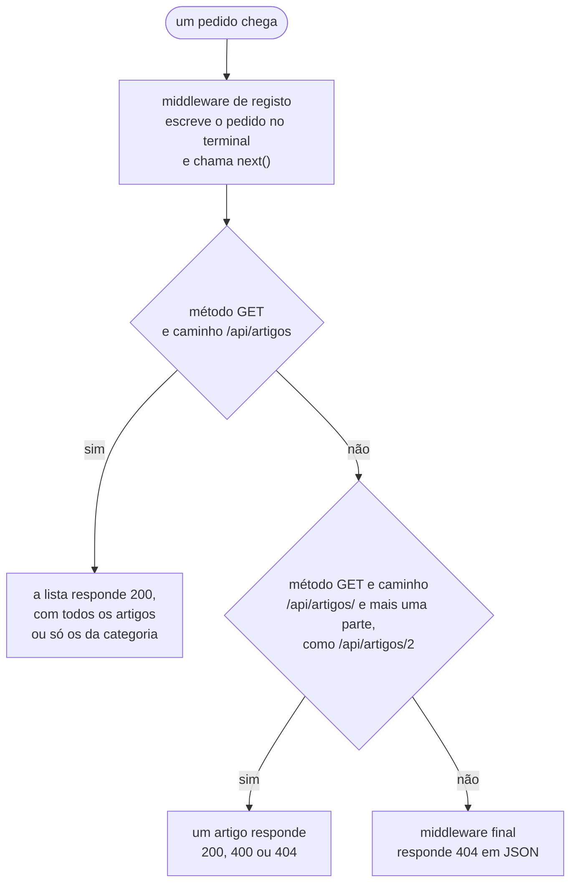

# Laboratório: HTTP, rotas e middleware

## O que vais construir

Constróis, a partir de uma pasta vazia, a API da papelaria: um servidor Express que responde só com dados, em JSON, sobre os oito artigos à venda. Dá a lista, só os de uma categoria ou um artigo pelo número, e responde 400 ou 404 a um pedido mal feito ou a um artigo que não existe.



O diagrama mostra a API acabada. Cada pedido passa pelo middleware de registo e segue para as rotas, e o que nenhuma rota trata acaba no middleware final.

1. [Fase 1: Os três códigos deste tema](#fase-1-os-três-códigos-deste-tema)
2. [Fase 2: O Express liga cada rota a uma função](#fase-2-o-express-liga-cada-rota-a-uma-função)
3. [Fase 3: No caminho: parâmetros de rota](#fase-3-no-caminho-parâmetros-de-rota)
4. [Fase 4: Depois do ponto de interrogação: parâmetros de pesquisa](#fase-4-depois-do-ponto-de-interrogação-parâmetros-de-pesquisa)
5. [Fase 5: O separador Rede mostra os dados que o pedido levou](#fase-5-o-separador-rede-mostra-os-dados-que-o-pedido-levou)
6. [Fase 6: Um middleware é uma função por onde passam os pedidos](#fase-6-um-middleware-é-uma-função-por-onde-passam-os-pedidos)
7. [Fase 7: O middleware final](#fase-7-o-middleware-final)
8. [Fase 8: A tabela de contratos HTTP](#fase-8-a-tabela-de-contratos-http)

## O que precisas

- O Visual Studio Code, com o terminal, que se abre no menu "Terminal", "New Terminal" ("Novo Terminal", em português).
- O Node.js 24, que traz o npm: `node --version` mostra uma versão como `v24.17.0`.
- Internet, para instalar o Express em [Preparar o projeto](#preparar-o-projeto).
- Um browser com as ferramentas de programador, como o Chrome ou o Edge: no Windows, F12; no Mac, Cmd+Option+I.

## Preparar o projeto

Preparas a pasta da API como no tema 02: o `package.json`, o Express e o `"type": "module"`. Rever: [O npm e o ficheiro package.json](../02-primeiro-servidor.md#o-npm-e-o-ficheiro-packagejson), [Instalar o Express cria a pasta node_modules](../02-primeiro-servidor.md#instalar-o-express-cria-a-pasta-node_modules) e [O "type": "module" deixa o Node aceitar o import](../02-primeiro-servidor.md#o-type-module-deixa-o-node-aceitar-o-import).

1. Abre no Visual Studio Code a tua pasta de trabalho de Sistemas de Informação, a dos laboratórios anteriores, no menu "File", "Open Folder". Essa pasta fica fora do repositório dos materiais da disciplina. Abre um terminal novo, que já começa nessa pasta, e cria nele a pasta da API e entra nela. No Windows, os comandos são iguais:

   ```bash
   mkdir papelaria-api
   cd papelaria-api
   ```

   O que deves ver: a pasta `papelaria-api` no explorador do editor. Os comandos não escrevem nada no terminal.

2. Cria o `package.json`:

   ```bash
   npm init -y
   ```

   O que deves ver: `Wrote to`, o caminho do ficheiro e o conteúdo que o npm lá escreveu, com `"name": "papelaria-api"`, tirado do nome da pasta, e `"type": "commonjs"` na última linha. Se o terminal disser que o `npm.ps1` não pode ser carregado, vê [O npm não corre na PowerShell do Windows](#o-npm-não-corre-na-powershell-do-windows).

3. Instala o Express. É o único passo do laboratório que precisa de internet:

   ```bash
   npm install express
   ```

   O que deves ver, no fim: `added 65 packages` e `found 0 vulnerabilities`. O número de pacotes pode ser outro. Na pasta, aparecem a `node_modules` e o `package-lock.json`. Se ficar muito tempo parado, ou acabar com linhas `npm error`, vê [O npm install falha ou fica parado](#o-npm-install-falha-ou-fica-parado).

4. Muda o `"type"` para `"module"`, para o Node aceitar o `import` com que o servidor vai começar:

   ```bash
   npm pkg set type=module
   ```

   O que deves ver: nenhuma mensagem no terminal. No editor, o `package.json` fica assim, e só o número da versão do Express pode ser outro:

   ```json
   {
     "name": "papelaria-api",
     "version": "1.0.0",
     "description": "",
     "main": "index.js",
     "scripts": {
       "test": "echo \"Error: no test specified\" && exit 1"
     },
     "keywords": [],
     "author": "",
     "license": "ISC",
     "type": "module",
     "dependencies": {
       "express": "^5.3.0"
     }
   }
   ```

## Fase 1: Os três códigos deste tema

Prevês, sem escrever código, de onde vêm os dados de sete pedidos à API e que código de estado recebe cada um. O que decide entre o 400 e o 404 é se o pedido faz sentido. Rever: [Parte 1: Os dados que um pedido traz](../03-http-rotas-e-middleware.md#parte-1-os-dados-que-um-pedido-traz) e [Os três códigos deste tema](../03-http-rotas-e-middleware.md#os-três-códigos-deste-tema).

1. A API vai ter os oito artigos da papelaria, nas categorias Papel, Escrita e Desenho. Os números dos artigos são inteiros, de 1 para cima, e hoje vão do 1 ao 8. O artigo 2 é a esferográfica azul. Para cada pedido, prevê de cabeça de onde vêm os dados (do caminho, da pesquisa ou de nenhum dos dois) e que código recebe:

   - `GET /api/artigos/2`
   - `GET /api/artigos/abc`
   - `GET /api/artigos/0`
   - `GET /api/artigos/99`
   - `GET /api/artigos?categoria=Papel`
   - `GET /api/artigos?categoria=Cola`
   - `GET /nao-existe`

   A resposta:

   | Pedido | Os dados vêm | Código |
   | --- | --- | --- |
   | `GET /api/artigos/2` | do caminho | 200, com a esferográfica azul |
   | `GET /api/artigos/abc` | do caminho | 400: `abc` nunca pode ser o número de um artigo |
   | `GET /api/artigos/0` | do caminho | 400: é um número, mas os artigos começam no 1 |
   | `GET /api/artigos/99` | do caminho | 404: podia ser o número de um artigo, mas não existe |
   | `GET /api/artigos?categoria=Papel` | da pesquisa | 200, com três artigos |
   | `GET /api/artigos?categoria=Cola` | da pesquisa | 200, com uma lista vazia: a lista existe, só não tem artigos |
   | `GET /nao-existe` | de nenhum sítio | 404: nenhuma rota trata este caminho |

   Nas fases seguintes, cada um destes pedidos passa a funcionar, e confirmas o código no browser.

### Paragem 1

Tens uma previsão para cada pedido e sabes porque é que cada código é o certo.

Pensa antes de continuares: que código recebe `GET /api/artigos/2.5`? A resposta: 400. O `2.5` é um número, mas não é inteiro, e por isso nunca pode ser o número de um artigo.

## Fase 2: O Express liga cada rota a uma função

Escreves a primeira versão do `server.js`, com uma só rota, que responde com os oito artigos em JSON. É o servidor do tema 02, agora com os dados da papelaria. Rever: [O Express liga cada rota a uma função](../02-primeiro-servidor.md#o-express-liga-cada-rota-a-uma-função) e [A resposta leva texto, com res.send, ou dados, com res.json](../02-primeiro-servidor.md#a-resposta-leva-texto-com-ressend-ou-dados-com-resjson).

1. Na pasta `papelaria-api`, ao lado do `package.json`, cria o ficheiro `server.js` com esta primeira versão, e guarda. Copia o array dos artigos, que são só dados, e escreve tu o resto. Os caminhos desta API começam todos por `/api`, para não se confundirem com os das páginas, quando o mesmo servidor também as tiver. Os preços estão em cêntimos, em números inteiros: 250 são 2,50 euros.

   ```js
   // server.js: a API da papelaria, num só ficheiro.
   // Responde só com dados, em JSON. Mostra os dados que um pedido traz no
   // caminho e na pesquisa, os códigos 200, 400 e 404 e o middleware.
   import express from "express";

   const app = express();
   const PORTA = 3000;

   // Os artigos da papelaria, em memória: existem enquanto o servidor estiver
   // ligado. São os mesmos oito que vais guardar no MongoDB Atlas em Linguagens
   // de Programação, com um id numérico em vez do _id.
   const artigos = [
     { id: 1, nome: "Caderno A4 quadriculado", categoria: "Papel", stock: 12, stockMinimo: 5, precoCentimos: 250 },
     { id: 2, nome: "Esferográfica azul", categoria: "Escrita", stock: 3, stockMinimo: 10, precoCentimos: 60 },
     { id: 3, nome: "Bloco de notas A5", categoria: "Papel", stock: 0, stockMinimo: 4, precoCentimos: 180 },
     { id: 4, nome: "Lápis HB", categoria: "Escrita", stock: 25, stockMinimo: 10, precoCentimos: 35 },
     { id: 5, nome: "Resma de papel A4", categoria: "Papel", stock: 4, stockMinimo: 3, precoCentimos: 520 },
     { id: 6, nome: "Marcador fluorescente", categoria: "Escrita", stock: 8, stockMinimo: 10, precoCentimos: 95 },
     { id: 7, nome: "Régua de 30 cm", categoria: "Desenho", stock: 6, stockMinimo: 3, precoCentimos: 120 },
     { id: 8, nome: "Compasso escolar", categoria: "Desenho", stock: 1, stockMinimo: 2, precoCentimos: 450 },
   ];

   // Lista de artigos.
   app.get("/api/artigos", (req, res) => {
     res.json(artigos);
   });

   app.listen(PORTA, (erro) => {
     if (erro) {
       console.error(`Não foi possível ligar a API: ${erro.message}`);
       return;
     }
     console.log(`API a correr em http://localhost:${PORTA}`);
   });
   ```

   O comentário do topo já descreve a API acabada, com o que vais acrescentar nas fases seguintes.

2. No terminal, na pasta `papelaria-api`, liga o servidor:

   ```bash
   node --watch server.js
   ```

   O que deves ver: `API a correr em http://localhost:3000`, e o terminal fica ocupado. Com o `--watch`, o Node volta a ligar o servidor sozinho sempre que guardas o `server.js`. O terminal limpa-se e mostra, entre outras, a linha `Restarting 'server.js'` e, outra vez, a mensagem do arranque. Por isso, neste laboratório, não tens de o parar com Ctrl+C depois de cada alteração: basta guardares. Se aparecer um erro em vez daquela linha, vê [O servidor não arranca](#o-servidor-não-arranca).

3. No browser, abre `http://localhost:3000/api/artigos`.

   O que deves ver: os oito artigos, em JSON, a começar por `[{"id":1,"nome":"Caderno A4 quadriculado","categoria":"Papel",`. O browser pode mostrá-los arrumados ou numa só linha. Isto quer dizer que a rota da lista respondeu com o array.

### Paragem 2

`GET /api/artigos` responde com os oito artigos, e o servidor continua ligado no terminal.

Pensa antes de continuares: o que mostra agora `http://localhost:3000/api/artigos/2`? A resposta: `Cannot GET /api/artigos/2`, com o código 404. A API ainda só tem a rota da lista, e quem responde é o próprio Express.

## Fase 3: No caminho: parâmetros de rota

Acrescentas a rota de um artigo, que lê o número do artigo no caminho e responde 200, 400 ou 404. O `:id` da rota é um parâmetro de rota, e o valor dele chega sempre como texto. Rever: [No caminho: parâmetros de rota](../03-http-rotas-e-middleware.md#no-caminho-parâmetros-de-rota), [Tudo chega como texto](../03-http-rotas-e-middleware.md#tudo-chega-como-texto), [A rota escolhe o código com res.status](../03-http-rotas-e-middleware.md#a-rota-escolhe-o-código-com-resstatus) e [Os três códigos deste tema](../03-http-rotas-e-middleware.md#os-três-códigos-deste-tema).

1. Em `server.js`, a seguir à rota da lista e antes do `app.listen`, acrescenta a rota de um artigo. Escreve as duas mensagens de erro exatamente assim, porque são as que vais confirmar no browser:

   ```js
   // Um artigo: GET /api/artigos/2. O :id é um parâmetro de rota.
   app.get("/api/artigos/:id", (req, res) => {
     const id = Number(req.params.id); // chega como texto, "2", e passa a número
     if (!Number.isInteger(id) || id < 1) {
       res.status(400).json({ erro: "O identificador do artigo tem de ser um número inteiro positivo" });
       return;
     }
     const artigo = artigos.find((artigo) => artigo.id === id);
     if (!artigo) {
       res.status(404).json({ erro: `Não existe o artigo ${id}` });
       return;
     }
     res.json(artigo);
   });
   ```

   A rota pergunta primeiro se o `id` serve, e responde 400 se não servir; só depois procura o artigo, e responde 404 se não o encontrar. O `return` a seguir a cada resposta de erro acaba a função.

2. Guarda. No browser, abre as ferramentas de programador no separador "Rede" ("Network") e abre, um de cada vez, os cinco endereços da tabela abaixo. Em cada um, clica no pedido, que tem o nome do fim do endereço, como `2` ou `abc`, e lê o "Código de estado" ("Status Code"), no separador "Cabeçalhos" ("Headers").

   O que deves ver:

   | Endereço | Código | Resposta |
   | --- | --- | --- |
   | `http://localhost:3000/api/artigos/2` | 200 | `{"id":2,"nome":"Esferográfica azul","categoria":"Escrita","stock":3,"stockMinimo":10,"precoCentimos":60}` |
   | `http://localhost:3000/api/artigos/abc` | 400 | `{"erro":"O identificador do artigo tem de ser um número inteiro positivo"}` |
   | `http://localhost:3000/api/artigos/0` | 400 | a mesma mensagem |
   | `http://localhost:3000/api/artigos/2.5` | 400 | a mesma mensagem |
   | `http://localhost:3000/api/artigos/99` | 404 | `{"erro":"Não existe o artigo 99"}` |

   Isto quer dizer que a rota separa o pedido mal feito, com 400, do artigo que não existe, com 404. Se aparecer 304 em vez de 200, ativa "Desativar cache" ("Disable cache"), no topo do separador Rede, e recarrega a página. Se o terminal mostrar `Cannot set headers after they are sent to the client`, vê [este problema](#o-terminal-mostra-cannot-set-headers-after-they-are-sent-to-the-client).

3. Provoca um erro de propósito. Na linha `const id = Number(req.params.id);`, apaga o `Number(` e o `)` que o fecha, para ficar `const id = req.params.id;`. Guarda e, antes de abrires `http://localhost:3000/api/artigos/2`, prevê: que código recebe agora o artigo 2, que existe?

   A resposta: 400, com a mensagem do identificador. Sem o `Number`, o `id` fica com o texto `"2"`, e `Number.isInteger("2")` é `false`, porque um texto nunca é um número, mesmo que só tenha algarismos.

4. Repõe o `Number(...)`, guarda e abre outra vez `http://localhost:3000/api/artigos/2`. O que deves ver: o código 200 e a esferográfica azul.

### Paragem 3

A rota de um artigo responde como a tabela do passo 2, e o `Number` está de volta.

Pensa antes de continuares: se tirasses o `return` do primeiro `if`, o que recebia o browser em `/api/artigos/abc`, e o que aparecia no terminal? A resposta: o browser recebia na mesma o 400, com a mensagem do identificador. Mas a função continuava, não encontrava nenhum artigo e tentava responder outra vez, com o 404. O terminal mostrava um erro começado por `Error [ERR_HTTP_HEADERS_SENT]: Cannot set headers after they are sent to the client`, e o servidor continuava ligado. Rever: [Responder uma vez, e sair](../03-http-rotas-e-middleware.md#responder-uma-vez-e-sair).

## Fase 4: Depois do ponto de interrogação: parâmetros de pesquisa

Mudas a rota da lista para aceitar uma categoria no fim do endereço, como em `?categoria=Papel`, e responder só com os artigos dessa categoria. A categoria é um parâmetro de pesquisa, e a rota lê-a em `req.query`. Rever: [Depois do ponto de interrogação: parâmetros de pesquisa](../03-http-rotas-e-middleware.md#depois-do-ponto-de-interrogação-parâmetros-de-pesquisa).

1. Em `server.js`, troca a rota da lista, com o comentário por cima, por esta versão:

   ```js
   // Lista de artigos. Com ?categoria=Papel, só os dessa categoria.
   app.get("/api/artigos", (req, res) => {
     const categoria = req.query.categoria;
     if (categoria) {
       const daCategoria = artigos.filter((artigo) => artigo.categoria === categoria);
       res.json(daCategoria);
       return;
     }
     res.json(artigos);
   });
   ```

   Sem categoria no endereço, o `req.query.categoria` é `undefined`, o `if` não entra, e a rota responde com a lista toda.

2. Guarda e abre, um de cada vez, os três endereços da tabela abaixo.

   O que deves ver:

   | Endereço | Código | Resposta |
   | --- | --- | --- |
   | `http://localhost:3000/api/artigos?categoria=Papel` | 200 | os artigos 1, 3 e 5: o caderno, o bloco de notas e a resma de papel |
   | `http://localhost:3000/api/artigos?categoria=Cola` | 200 | `[]` |
   | `http://localhost:3000/api/artigos` | 200 | os oito artigos |

   A lista vazia, com 200, quer dizer que a papelaria não tem artigos da categoria Cola.

3. Antes de abrires `http://localhost:3000/api/artigos?categoria=papel`, com o `p` minúsculo, prevê o que recebes.

   A resposta: `[]`, com 200. O `===` compara os dois textos letra a letra, e `"papel"` não é igual a `"Papel"`. Para a API, é uma categoria sem artigos, e não um pedido mal feito.

4. Abre também `http://localhost:3000/api/artigos?categoria=`, com a categoria vazia. Antes de carregares em Enter, confirma que o browser não completou o endereço com uma categoria que já abriste. O que deves ver: os oito artigos. O texto vazio, como o `undefined`, não entra no `if`.

### Paragem 4

A lista responde com todos os artigos, só com os de uma categoria, ou vazia, sempre com 200.

Pensa antes de continuares: `/api/artigos?categoria=Papel` e `/api/artigos/1` chegam à mesma rota? A resposta: não. O `?categoria=Papel` não faz parte do caminho, e o pedido chega à rota da lista. O `/1` é mais uma parte do caminho, e por isso o pedido só encaixa em `/api/artigos/:id`.

## Fase 5: O separador Rede mostra os dados que o pedido levou

Vês, nas ferramentas de programador, onde fica cada dado de um pedido: a categoria nos parâmetros de pesquisa e o número do artigo no caminho. Rever: [O separador Rede mostra os dados que o pedido levou](../03-http-rotas-e-middleware.md#o-separador-rede-mostra-os-dados-que-o-pedido-levou).

1. Com o separador "Rede" aberto, abre `http://localhost:3000/api/artigos?categoria=Escrita`. Clica no pedido `artigos?categoria=Escrita` e abre o separador "Payload" (no Chrome em português, "Carga"; no Firefox, "Pedido").

   O que deves ver: a secção "Query String Parameters", a dos parâmetros de pesquisa, com `categoria: Escrita`. Isto quer dizer que a categoria chegou ao servidor com o nome que a rota lê.

2. Abre `http://localhost:3000/api/artigos/3` e clica no pedido `3`. Antes de procurares, prevê: onde aparece o 3?

   A resposta: não aparece no "Payload", porque não é um parâmetro de pesquisa, e neste pedido o separador pode nem existir. O 3 faz parte do caminho: vê-se em "Cabeçalhos" ("Headers"), no "URL do pedido" ("Request URL"), `http://localhost:3000/api/artigos/3`, por cima do "Código de estado" ("Status Code"), que é 200.

### Paragem 5

Sabes onde ver, no browser, o caminho, a pesquisa e o código de cada pedido.

Pensa antes de continuares: um colega abre `/api/artigos?Categoria=Papel`, com o `C` maiúsculo, e recebe os oito artigos. Como o descobres no browser, e porque acontece? A resposta: no "Payload", o parâmetro aparece como `Categoria`. A rota lê `req.query.categoria`, com minúscula, que fica `undefined`, e por isso o `if` não entra e a rota responde com a lista toda.

## Fase 6: Um middleware é uma função por onde passam os pedidos

Acrescentas o middleware de registo, que escreve no terminal cada pedido que chega e o passa à frente com `next()`. Depois, tiras o `next()` de propósito, para veres um pedido ficar parado. Rever: [Um middleware é uma função por onde passam os pedidos](../03-http-rotas-e-middleware.md#um-middleware-é-uma-função-por-onde-passam-os-pedidos) e [Uma fila, pela ordem do ficheiro](../03-http-rotas-e-middleware.md#uma-fila-pela-ordem-do-ficheiro).

1. Em `server.js`, a seguir ao array dos artigos e antes da rota da lista, acrescenta:

   ```js
   // Middleware de registo: escreve no terminal cada pedido que chega,
   // e passa-o à frente. Está antes das rotas, para ver todos os pedidos.
   app.use((req, res, next) => {
     console.log(`${req.method} ${req.url}`);
     next();
   });
   ```

2. Guarda e abre estes três endereços: `http://localhost:3000/api/artigos`, `http://localhost:3000/api/artigos/2` e `http://localhost:3000/api/artigos?categoria=Papel`. Olha para o terminal do servidor.

   O que deves ver, por baixo de `API a correr em http://localhost:3000`, uma linha por pedido, com o método e o endereço:

   ```text
   GET /api/artigos
   GET /favicon.ico
   GET /api/artigos/2
   GET /favicon.ico
   GET /api/artigos?categoria=Papel
   GET /favicon.ico
   ```

   As linhas `GET /favicon.ico` são de um endereço que não escreveste: é o browser a pedir sozinho, depois de cada página, o ícone que mostra no separador. A API não tem ícone, e esse pedido acaba com 404. Conforme o browser, pode aparecer menos vezes, ou nenhuma.

3. Provoca um erro de propósito: apaga a linha `next();` do middleware e guarda. Antes de abrires `http://localhost:3000/api/artigos`, prevê: o que mostra o browser?

   A resposta: nada de novo. O browser fica à espera, com o indicador de carregamento a rodar, e pode continuar a mostrar a página anterior. No terminal, aparece `GET /api/artigos`, e mais nada, sem mensagem de erro. O middleware recebeu o pedido, não respondeu e não o passou à frente, e por isso o pedido ficou parado.

4. Repõe o `next();` e guarda. Abre outra vez `http://localhost:3000/api/artigos`. O que deves ver: a lista dos artigos, e a linha do pedido no terminal. Se o browser mostrar uma página de erro com `ERR_EMPTY_RESPONSE`, é o pedido que tinha ficado parado: o servidor antigo foi desligado antes de lhe responder. Abre outra vez o endereço.

### Paragem 6

Cada pedido escreve uma linha no terminal, e a rota responde-lhe a seguir.

Pensa antes de continuares: um pedido a `/nao-existe`, a que nenhuma rota responde, aparece no terminal? A resposta: aparece. O middleware de registo está antes das rotas, e todos os pedidos passam por ele antes de chegarem a elas. Depois, como nenhuma rota responde, o Express responde com `Cannot GET /nao-existe`.

## Fase 7: O middleware final

Acrescentas, no fim da fila, o middleware final, que responde em JSON aos pedidos a que nenhuma rota respondeu. Depois, mudas os dois middlewares de sítio, um de cada vez, para veres porque é que a ordem do ficheiro conta. Rever: [O middleware final](../03-http-rotas-e-middleware.md#o-middleware-final) e [Uma fila, pela ordem do ficheiro](../03-http-rotas-e-middleware.md#uma-fila-pela-ordem-do-ficheiro).

1. Antes de acrescentares o middleware final, abre `http://localhost:3000/nao-existe` e vê o código no separador Rede.

   O que deves ver: o código 404 e uma pequena página com `Cannot GET /nao-existe`. Nenhuma rota respondeu, e o Express respondeu por ti com uma página HTML. Um programa à espera de JSON, como uma página em React que pede os artigos com `fetch`, não a consegue ler. Rever, em Linguagens de Programação: [O middleware final fica depois de todas as rotas](https://github.com/NunoMACastro/epms-2627-3ig-lp/blob/main/01-acesso-a-dados/04-api-express-e-contratos.md#o-middleware-final-fica-depois-de-todas-as-rotas) e [Todos os erros da API têm a mesma forma](https://github.com/NunoMACastro/epms-2627-3ig-lp/blob/main/01-acesso-a-dados/04-api-express-e-contratos.md#todos-os-erros-da-api-têm-a-mesma-forma).

2. Em `server.js`, a seguir à rota de um artigo e antes do `app.listen`, acrescenta:

   ```js
   // Middleware final: só chega aqui um pedido a que nenhuma rota respondeu.
   // Numa API, até o "não encontrado" é uma resposta em JSON.
   app.use((req, res) => {
     res.status(404).json({ erro: "Rota não encontrada" });
   });
   ```

3. Guarda e abre outra vez `http://localhost:3000/nao-existe`. O que deves ver: `{"erro":"Rota não encontrada"}`, com o código 404. Abre também `http://localhost:3000/`, a raiz, com o caminho `/`: a resposta é a mesma, porque esta API não tem página inicial. Isto quer dizer que todos os pedidos que nenhuma rota trata acabam agora no middleware final, com uma resposta em JSON.

4. Agora, um erro de ordem, de propósito. Corta o middleware de registo, com o comentário, e cola-o logo antes do middleware final, abaixo das rotas. Guarda e, antes de abrires `http://localhost:3000/api/artigos` e depois `http://localhost:3000/nao-existe`, prevê: que linhas vão aparecer no terminal?

   A resposta: os dois pedidos respondem como antes, mas no terminal só aparecem `GET /nao-existe` e, talvez, linhas `GET /favicon.ico`, mesmo logo a seguir a abrires a lista. O pedido a `/api/artigos` acabou na rota da lista e nunca chegou ao middleware de registo. Só passam por ele os pedidos que nenhuma rota tratou, a caminho do middleware final, como o do ícone.

5. Põe o middleware de registo outra vez no sítio dele, logo a seguir ao array dos artigos. Guarda e abre `http://localhost:3000/api/artigos`. O que deves ver: a linha `GET /api/artigos` outra vez no terminal.

6. O último erro de ordem. Corta o middleware final, com o comentário, e cola-o logo a seguir ao middleware de registo, antes das rotas. Guarda e abre `http://localhost:3000/api/artigos/2`.

   O que deves ver: `{"erro":"Rota não encontrada"}`, com 404, também nos endereços que existem, e a linha de cada pedido no terminal. O middleware final responde a tudo o que lhe chega e não chama `next()`, e por isso nenhum pedido chega às rotas. O de registo, que está antes dele, continua a ver todos.

7. Põe o middleware final outra vez no fim, logo antes do `app.listen`. Guarda e confirma que `http://localhost:3000/api/artigos/2` volta a responder com a esferográfica azul. Se continuar a dar `Rota não encontrada`, vê [este problema](#todos-os-pedidos-aos-artigos-dão-rota-não-encontrada).

### Paragem 7

O middleware de registo está antes das rotas, o final está depois delas, e os pedidos da fase 1 respondem como a tabela dessa fase previa. O `server.js` completo, como o teu deve estar agora:

```js
// server.js: a API da papelaria, num só ficheiro.
// Responde só com dados, em JSON. Mostra os dados que um pedido traz no
// caminho e na pesquisa, os códigos 200, 400 e 404 e o middleware.
import express from "express";

const app = express();
const PORTA = 3000;

// Os artigos da papelaria, em memória: existem enquanto o servidor estiver
// ligado. São os mesmos oito que vais guardar no MongoDB Atlas em Linguagens
// de Programação, com um id numérico em vez do _id.
const artigos = [
  { id: 1, nome: "Caderno A4 quadriculado", categoria: "Papel", stock: 12, stockMinimo: 5, precoCentimos: 250 },
  { id: 2, nome: "Esferográfica azul", categoria: "Escrita", stock: 3, stockMinimo: 10, precoCentimos: 60 },
  { id: 3, nome: "Bloco de notas A5", categoria: "Papel", stock: 0, stockMinimo: 4, precoCentimos: 180 },
  { id: 4, nome: "Lápis HB", categoria: "Escrita", stock: 25, stockMinimo: 10, precoCentimos: 35 },
  { id: 5, nome: "Resma de papel A4", categoria: "Papel", stock: 4, stockMinimo: 3, precoCentimos: 520 },
  { id: 6, nome: "Marcador fluorescente", categoria: "Escrita", stock: 8, stockMinimo: 10, precoCentimos: 95 },
  { id: 7, nome: "Régua de 30 cm", categoria: "Desenho", stock: 6, stockMinimo: 3, precoCentimos: 120 },
  { id: 8, nome: "Compasso escolar", categoria: "Desenho", stock: 1, stockMinimo: 2, precoCentimos: 450 },
];

// Middleware de registo: escreve no terminal cada pedido que chega,
// e passa-o à frente. Está antes das rotas, para ver todos os pedidos.
app.use((req, res, next) => {
  console.log(`${req.method} ${req.url}`);
  next();
});

// Lista de artigos. Com ?categoria=Papel, só os dessa categoria.
app.get("/api/artigos", (req, res) => {
  const categoria = req.query.categoria;
  if (categoria) {
    const daCategoria = artigos.filter((artigo) => artigo.categoria === categoria);
    res.json(daCategoria);
    return;
  }
  res.json(artigos);
});

// Um artigo: GET /api/artigos/2. O :id é um parâmetro de rota.
app.get("/api/artigos/:id", (req, res) => {
  const id = Number(req.params.id); // chega como texto, "2", e passa a número
  if (!Number.isInteger(id) || id < 1) {
    res.status(400).json({ erro: "O identificador do artigo tem de ser um número inteiro positivo" });
    return;
  }
  const artigo = artigos.find((artigo) => artigo.id === id);
  if (!artigo) {
    res.status(404).json({ erro: `Não existe o artigo ${id}` });
    return;
  }
  res.json(artigo);
});

// Middleware final: só chega aqui um pedido a que nenhuma rota respondeu.
// Numa API, até o "não encontrado" é uma resposta em JSON.
app.use((req, res) => {
  res.status(404).json({ erro: "Rota não encontrada" });
});

app.listen(PORTA, (erro) => {
  if (erro) {
    console.error(`Não foi possível ligar a API: ${erro.message}`);
    return;
  }
  console.log(`API a correr em http://localhost:${PORTA}`);
});
```

Entre os artigos e o `app.listen`, os blocos estão pela ordem da fila: o middleware de registo, as duas rotas e o middleware final. Cada pedido desce por eles, do primeiro para o último, até um lhe responder.

Pensa antes de continuares: se a API ganhasse uma rota nova, `GET /api/estado`, onde a escreverias? A resposta: entre o middleware de registo e o middleware final, ao pé das outras rotas. Abaixo do middleware final, a rota nova nunca respondia, porque o final responde 404 a tudo o que lhe chega.

## Fase 8: A tabela de contratos HTTP

Escreves a tabela de contratos HTTP da tua API num ficheiro de texto e verificas cada linha no browser. O contrato diz que pedidos a API aceita, com que dados, e todas as respostas que cada um pode ter, também as de erro. Rever: [A tabela de contratos HTTP](../03-http-rotas-e-middleware.md#a-tabela-de-contratos-http).

1. Na tua pasta de trabalho de Sistemas de Informação, fora da pasta `papelaria-api`, cria o ficheiro `respostas-03.md`. Fica fora da API, porque não é código dela. Começa a tabela com estas duas linhas:

   ```markdown
   | Método | Caminho | Entrada | Respostas possíveis |
   | --- | --- | --- | --- |
   ```

   O que deves ver: no explorador, o `respostas-03.md` ao lado da pasta `papelaria-api`, e não dentro dela. Se ficou lá dentro, arrasta-o para fora.

2. Por baixo, escreve uma linha por cada pedido que a API aceita, e mais uma para qualquer outro pedido. Em cada linha, põe todas as respostas possíveis, com o código e o corpo, também as de erro. O que deves ver: três linhas por baixo do cabeçalho, uma para `GET /api/artigos`, uma para `GET /api/artigos/:id` e uma para qualquer outro pedido.

3. Verifica cada resposta da tabela com um pedido no browser, com o separador Rede aberto. Para a rota de um artigo, são três pedidos: um a um artigo que existe, um com o número mal feito e um a um artigo que não existe. Para a linha de qualquer outro pedido, basta um caminho que não existe, porque a barra de endereço só faz pedidos `GET`. O que deves ver: em cada pedido, o código e o corpo que escreveste. Se um não bater, corrige a linha da tabela e repete o pedido.

### Paragem 8

A tua tabela tem uma linha por pedido, com todas as respostas, e verificaste cada uma no browser. Confere-a com o contrato da API:

| Método | Caminho | Entrada | Respostas possíveis |
| --- | --- | --- | --- |
| `GET` | `/api/artigos` | Pesquisa: `categoria`, opcional; ausente ou vazia, pede a lista toda | 200, lista JSON de artigos; sem artigos da categoria, `[]` |
| `GET` | `/api/artigos/:id` | Caminho: `id`, inteiro positivo | 200, o artigo em JSON; 400, `{"erro":"O identificador do artigo tem de ser um número inteiro positivo"}`; 404, `{"erro":"Não existe o artigo 99"}`, com o número pedido |
| Qualquer | Qualquer outro | Nenhuma | 404, `{"erro":"Rota não encontrada"}` |

Pensa antes de continuares: um colega pede `/api/artigos?categoria=Cola`, recebe `[]` e diz que a API está avariada. Que linha do contrato lhe mostras? A resposta: a de `GET /api/artigos`. Sem artigos da categoria, o contrato promete `[]`, com 200, e foi isso que a API respondeu.

## Se alguma coisa falhar

1. Estás na pasta certa? O `pwd` mostra no terminal a pasta em que estás; na linha de comandos clássica do Windows, é o `cd` sozinho. Os comandos do npm e o `node --watch server.js` correm na pasta `papelaria-api`, a do `package.json`. Se o Node escrever `Error: Cannot find module` com um caminho acabado em `server.js`, estás noutra pasta. Para o servidor com Ctrl+C, entra na pasta da API com `cd papelaria-api` e liga-o outra vez com `node --watch server.js`.
2. O servidor está ligado, e guardaste o ficheiro? O terminal tem de mostrar `API a correr em http://localhost:3000`, outra vez a seguir a cada vez que guardas. Se mostrar um erro, lê-o antes de mudares outra linha. Um ficheiro por guardar tem um ponto no lugar do X, no separador do editor.
3. O endereço está certo? Começa por `http://`, e não por `https://`, tem a porta 3000 e o caminho começa por `/api`. Se o browser disser que o `localhost` recusou a ligação, o servidor não está ligado.
4. O teu `server.js` está igual ao do laboratório? Compara-o com o da [Paragem 7](#paragem-7). Antes da fase 7, o teu tem menos blocos, e, antes da fase 4, a rota da lista ainda é a primeira versão, a da fase 2.
5. Provoca só um erro de cada vez, e repõe o código antes do seguinte. Se não encontrares a causa de um erro, escreve num comentário no fim do `server.js` o que esperavas, o que obtiveste e a tua hipótese, antes de mudares outra linha.

### O npm não corre na PowerShell do Windows

O terminal diz que o ficheiro `npm.ps1` não pode ser carregado, porque a execução de scripts está desativada. Não mudes essa regra de segurança do Windows. Abre antes a linha de comandos clássica: no painel do terminal, carrega na seta ao lado do "+" e escolhe "Command Prompt". Esse terminal abre na pasta de trabalho, e por isso entra outra vez na da API com `cd papelaria-api`. Outra saída é escrever `npm.cmd` no lugar de `npm`, como em `npm.cmd init -y`.

### O npm install falha ou fica parado

Sem rede, o npm não chega ao Express: o comando fica muito tempo parado, ou termina com linhas `npm error`. Avisa o professor. Ele tem um ambiente preparado para esta API, num programa chamado Docker, com o `package.json` e o `package-lock.json` deste projeto e o Express pronto a instalar sem rede. Segue as instruções dele. Com o ambiente pronto, confirma que o teu `package.json` está como o do passo 4 e continua na [fase 1](#fase-1-os-três-códigos-deste-tema).

No ambiente preparado, é o Docker que liga o servidor, com o mesmo `node --watch server.js`. Os endereços usam a porta que o professor te indicar, em vez da 3000, mesmo que o servidor escreva 3000. Se, depois de guardares, os registos do servidor não mostrarem `Restarting 'server.js'`, pede ao professor para o voltar a ligar. Nos registos aparece também, de 5 em 5 segundos, um pedido `GET /api/artigos?verificacao=docker`, que não é teu: é o Docker a confirmar que a API responde. Não o contes quando leres as linhas dos teus pedidos. Quando houver internet, corre `npm install express` na tua pasta `papelaria-api`.

Não copies a pasta `node_modules` de um colega ou de outro computador, porque pode não funcionar no teu. Uma mensagem com `EACCES` ou `permission denied` também é para o professor: não uses `sudo` nem mudes as permissões.

### O servidor não arranca

Lê primeiro a linha que começa pelo tipo do erro, e depois a que tem o nome do teu ficheiro e o número da linha. Com o `--watch`, depois do erro aparece uma linha começada por `Failed running 'server.js'` ou `Completed running 'server.js'`, e o terminal fica ocupado, à espera de que guardes outra vez o `server.js`. Um erro no `server.js` corrige-se e guarda-se. Para correr um comando, como nos dois primeiros casos, para primeiro o servidor com Ctrl+C e, depois do comando, liga-o outra vez com `node --watch server.js`.

- `Cannot use import statement outside a module`: falta o `"type": "module"` no `package.json`. Corre `npm pkg set type=module`, como no passo 4 de [Preparar o projeto](#preparar-o-projeto).
- `Cannot find package 'express'`: o Node não encontra o Express a partir da pasta do `server.js`. Confirma que o `server.js` está dentro de `papelaria-api`, ao lado do `package.json`, e não na pasta de cima. Se a pasta `node_modules` não existir, corre `npm install express`, como no passo 3 de [Preparar o projeto](#preparar-o-projeto).
- `Não foi possível ligar a API: listen EADDRINUSE`: a porta 3000 está ocupada, quase sempre por um servidor que deixaste ligado noutro terminal, como o do catálogo de equipamentos, do laboratório 02. Procura-o na lista dos terminais, à direita do painel, e para-o com Ctrl+C. Não pares processos que não reconheces. Depois, guarda outra vez o teu `server.js`: o `--watch` só volta a tentar quando o ficheiro muda.
- `SyntaxError`, com outra mensagem: falta fechar uma aspa, um parêntese ou uma chaveta, quase sempre no bloco que acabaste de acrescentar. Corrige e guarda.

### O terminal mostra ReferenceError: equipamentos is not defined

Copiaste uma linha do guia, que usa os equipamentos do catálogo. Nesta API, os nomes são `artigos` e `artigo`: troca-os na linha que o terminal indica, a que tem o nome do teu `server.js`. O browser recebe um 500, porque o erro é do servidor, e não do pedido.

### O terminal mostra Cannot set headers after they are sent to the client

Uma rota respondeu duas vezes ao mesmo pedido, porque falta o `return` a seguir a uma resposta de erro. Compara a tua rota de um artigo com a da [fase 3](#fase-3-no-caminho-parâmetros-de-rota). Rever: [Responder uma vez, e sair](../03-http-rotas-e-middleware.md#responder-uma-vez-e-sair).

### Todos os pedidos aos artigos dão Rota não encontrada

O middleware final está acima das rotas, como no passo 6 da fase 7: põe-no logo antes do `app.listen`. Se não for isso, compara letra a letra o caminho do `app.get` com o endereço: pode estar `/artigos` onde devia estar `/api/artigos`.

## Desafios

1. Acrescenta a rota `GET /api/artigos/sem-stock`, que responde com a lista dos artigos com stock zero. Decide em que sítio do ficheiro a pões antes de a experimentares. Pista: se a rota nova responder 400, com a mensagem do identificador, lê [O caminho fixo vem antes do caminho com parâmetro](../03-http-rotas-e-middleware.md#o-caminho-fixo-vem-antes-do-caminho-com-parâmetro).
2. Acrescenta a rota nova à tua tabela de contratos, no `respostas-03.md`, e confirma que `/api/artigos/2` continua a responder com a esferográfica azul.

## Antes de terminares

- [ ] Os sete pedidos da fase 1 respondem com os códigos dessa tabela, e as mensagens de erro são letra a letra as do contrato da [Paragem 8](#paragem-8).
- [ ] Viste, no separador Rede, um 200, um 400 e um 404 da rota de um artigo, e sabes dizer porque é que cada pedido recebe o seu código.
- [ ] Corrigiste os erros que provocaste e repetiste os pedidos que já funcionavam.
- [ ] O teu `server.js` tem o mesmo código que o da [Paragem 7](#paragem-7), mais o que acrescentaste nos desafios.
- [ ] O `respostas-03.md` tem a tabela de contratos, com todas as respostas de cada pedido, e verificaste cada linha no browser.
- [ ] Consegues explicar, por palavras tuas, a diferença entre um parâmetro de rota e um parâmetro de pesquisa.


