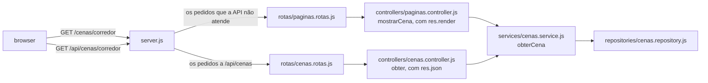
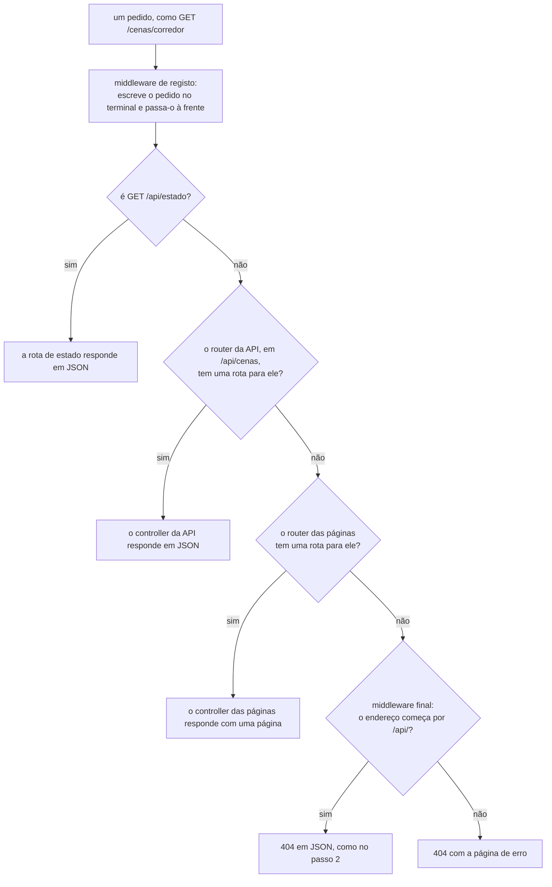

# Laboratório: EJS e reutilização no servidor

## O que vais construir

Vais fazer o passo 3 de Fechado na escola: o jogo ganha páginas, construídas no servidor com EJS, ao lado da API do passo 2. No fim, abres `http://localhost:3000/`, carregas em "Começar" e jogas uma partida inteira no browser, a clicar nas escolhas.

```text
fechado-na-escola/
├── contrato-da-api.md                 não muda
├── package.json                       ganha o EJS
├── package-lock.json                  ganha o EJS, com a versão exata
├── views/                             os modelos das páginas, na raiz do projeto
│   ├── inicio.ejs                     a página inicial
│   ├── cena.ejs                       a página de uma cena, com as escolhas
│   ├── erro.ejs                       a página de erro, para o 400 e o 404
│   └── partials/
│       ├── cabecalho.ejs              o início de todas as páginas
│       └── rodape.ejs                 o fim de todas as páginas
└── src/
    ├── server.js                      monta também as rotas das páginas
    ├── seed.js                        não muda
    ├── db/
    │   └── mongoose.js                não muda
    ├── models/
    │   └── cena.model.js              não muda
    ├── repositories/
    │   └── cenas.repository.js        não muda
    ├── services/
    │   └── cenas.service.js           não muda, e serve a API e as páginas
    ├── controllers/
    │   ├── cenas.controller.js        não muda
    │   └── paginas.controller.js      o HTTP das páginas
    └── rotas/
        ├── cenas.rotas.js             não muda
        └── paginas.rotas.js           que pedido de página vai para que função
```

1. [Fase 1: O Express procura os modelos na pasta views](#fase-1-o-express-procura-os-modelos-na-pasta-views)
2. [Fase 2: O res.render responde com uma página](#fase-2-o-resrender-responde-com-uma-página)
3. [Fase 3: As marcas do EJS](#fase-3-as-marcas-do-ejs)
4. [Fase 4: Ciclos e condições dentro do modelo](#fase-4-ciclos-e-condições-dentro-do-modelo)
5. [Fase 5: A rota escolhe os dados, e o modelo mostra-os](#fase-5-a-rota-escolhe-os-dados-e-o-modelo-mostra-os)
6. [Fase 6: Partes partilhadas: o cabeçalho e o rodapé](#fase-6-partes-partilhadas-o-cabeçalho-e-o-rodapé)
7. [Fase 7: Um erro também se responde com uma página](#fase-7-um-erro-também-se-responde-com-uma-página)
8. [Fase 8: Escaping: o que vem de fora nunca vira HTML](#fase-8-escaping-o-que-vem-de-fora-nunca-vira-html)
9. [Fase 9: O browser recebe só o HTML](#fase-9-o-browser-recebe-só-o-html)
10. [Fase 10: Um commit guarda uma fotografia do projeto](#fase-10-um-commit-guarda-uma-fotografia-do-projeto)

## O que precisas

- O projeto do passo 2, com o commit desse passo. Se não o tiveres, copia a pasta `fechado-na-escola-passo-02`, dos exemplos do repositório de Linguagens de Programação ([no GitHub](https://github.com/NunoMACastro/epms-2627-3ig-lp/blob/main/exemplos/acesso-a-dados/fechado-na-escola-passo-02/README.md)), para a tua pasta de trabalho, sem o `README.md`. Faz o `npm install` e o `.env` do "Como correr" dela, sem ligar o jogo. Depois guarda-a no Git: `git init`, `git config user.name "O teu nome"`, `git config user.email "o teu email da escola"`, `git add .` e `git commit -m "Passo 2"`.
- O Node.js 22 ou mais recente, como no passo 2: confirma com `node --version`.
- O teu cluster do Atlas e internet: o jogo só arranca ligado à base de dados.
- O browser, com o separador "Rede" das ferramentas de programador (F12; no Mac, Cmd+Option+I).

## Preparar o projeto

1. Abre a pasta do jogo no Visual Studio Code e repõe as cenas na base de dados, porque as tabelas deste laboratório contam com as onze cenas do seed. No terminal, na pasta do jogo, corre:

   ```bash
   npm run seed
   ```

   O que deves ver: `Ligada à base de dados fechado-na-escola`, uma linha com as cenas apagadas e `Inseridas 11 cenas`. Se aparecer `O seed falhou`, vê [O seed ou o jogo não chegam à base de dados](#o-seed-ou-o-jogo-não-chegam-à-base-de-dados).

2. No mesmo terminal, liga o jogo e deixa-o ligado até ao fim:

   ```bash
   npm run dev
   ```

   O que deves ver: `Ligada à base de dados fechado-na-escola` e `Fechado na escola em http://localhost:3000`. Este é o primeiro terminal, e é nele que aparecem os pedidos e os erros. Com o `--watch` do `npm run dev`, o jogo reinicia sozinho sempre que guardas um ficheiro `.js` que ele já usa, e não precisas de o parar.

3. Abre um segundo terminal, para os comandos, no menu "Terminal", com "New Terminal". O terminal novo abre já na pasta do jogo. Passas de um terminal para o outro na lista à direita do painel do terminal.

4. No browser, abre as ferramentas de programador no separador "Rede" ("Network", com o browser em inglês) e confirma que "Disable cache" (desativar a cache) está marcado. Sem isso, um pedido que já fizeste pode voltar com o código 304, e não com o 200 que as tabelas dizem.

Se continuas o laboratório numa aula seguinte, repete estes quatro passos e retoma na fase em que paraste.

## Fase 1: O Express procura os modelos na pasta views

Instalas o EJS, dizes ao Express que as páginas do jogo se fazem com ele e crias a pasta dos modelos, `views`. É nessa pasta que o Express vai procurar cada modelo que uma rota pedir. Rever: [O Express procura os modelos na pasta views](../04-ejs-e-reutilizacao-no-servidor.md#o-express-procura-os-modelos-na-pasta-views).

1. No segundo terminal, instala o EJS, na versão dos exemplos da disciplina:

   ```bash
   npm install ejs@7.0.1
   ```

   O que deves ver: `added 1 package` e, mais abaixo, `found 0 vulnerabilities`. O `package.json` ganha a linha `"ejs": "^7.0.1"` nas dependências, antes do `"express"`. O jogo, no primeiro terminal, continua ligado, sem reiniciar. Se o npm ficar parado, ou acabar com linhas `npm error`, vê [O npm install falha ou fica parado](#o-npm-install-falha-ou-fica-parado).

2. Em `src/server.js`, logo a seguir à linha da `PORTA`, acrescenta o motor dos modelos:

   ```js
   // O motor dos modelos das páginas. O Express procura os modelos na pasta
   // views da pasta de onde arrancas o servidor, que é a raiz do projeto.
   app.set("view engine", "ejs");
   ```

   Guarda. O que deves ver: no primeiro terminal, o jogo reinicia e volta a escrever `Ligada à base de dados fechado-na-escola` e `Fechado na escola em http://localhost:3000`. O `server.js` não tem nenhum `import` do EJS: é o Express que o vai buscar, quando uma rota pedir uma página.

3. Cria a pasta `views` na raiz do projeto, ao lado do `package.json`. No explorador do Visual Studio Code, clica no espaço vazio por baixo dos ficheiros, para não teres nenhum ficheiro nem pasta selecionados. Depois carrega no botão de pasta nova ("New Folder..."), escreve `views` e carrega em Enter.

   O que deves ver: a pasta `views` ao mesmo nível da `src` e do `package.json`. Se ela aparecer dentro da `src`, arrasta-a para cima, para a raiz do projeto.

### Paragem 1

A pasta `views` está na raiz do projeto, vazia, e o `package.json` tem o EJS. A API responde como no passo 2: abre `http://localhost:3000/api/cenas/inicio`, que mostra a primeira cena em JSON.

Pensa antes de continuares: o `server.js` está em `src`. Porque é que a pasta `views` não fica lá, ao lado dele? A resposta: o Express procura a pasta `views` na pasta de onde se arranca o servidor, e não na pasta do `server.js`. O `npm run dev` arranca sempre na pasta do `package.json`, a raiz do projeto, mesmo que o terminal esteja noutra pasta do projeto. No catálogo do guia, o `server.js` estava na raiz do projeto, e por isso a `views` ficava ao lado dele. Com a `views` dentro da `src`, as páginas dariam o erro [Failed to lookup view](#error-failed-to-lookup-view--in-views-directory-).

## Fase 2: O res.render responde com uma página

Fazes a página inicial: a rota `/` pede ao Express o modelo `inicio`, e o EJS constrói com ele o HTML que segue para o browser. As rotas das páginas ficam num router e num controller próprios, ao lado dos da API, como as camadas do passo 2. Rever: [O res.render responde com uma página](../04-ejs-e-reutilizacao-no-servidor.md#o-resrender-responde-com-uma-página) e [Um modelo de página, preenchido no servidor](../04-ejs-e-reutilizacao-no-servidor.md#um-modelo-de-página-preenchido-no-servidor).

1. Cria o primeiro modelo. Com a pasta `views` selecionada no explorador, carrega no botão de ficheiro novo ("New File..."), escreve `inicio.ejs` e carrega em Enter. Escreve nele esta página completa e guarda:

   ```ejs
   <%# A página inicial do jogo, com a ligação para a primeira cena. %>
   <!doctype html>
   <html lang="pt">
     <head>
       <meta charset="utf-8">
       <title><%= titulo %> | Fechado na escola</title>
     </head>
     <body>
       <h1><%= titulo %></h1>
       <p>Adormeceste a estudar na biblioteca, e a escola fechou contigo lá dentro. Consegues sair sem que ninguém dê por ti?</p>
       <p><a href="/cenas/inicio">Começar</a></p>
     </body>
   </html>
   ```

   O modelo usa uma só variável, o `titulo`, que a rota lhe vai passar. Nada muda ainda no browser, porque nenhuma rota pede este modelo.

2. Na pasta `src/controllers`, cria o ficheiro `paginas.controller.js`, com esta primeira versão:

   ```js
   // src/controllers/paginas.controller.js: a ponte entre o HTTP e as páginas do jogo.
   // Lê e verifica o que vem no pedido, pede as cenas ao mesmo service da API e
   // responde com uma página, construída a partir de um modelo da pasta views.

   /** GET /: a página inicial, com a ligação para a primeira cena. */
   export function mostrarInicio(req, res) {
     res.render("inicio", { titulo: "Início" });
   }
   ```

   O `res.render` recebe o nome do modelo, sem a pasta e sem o `.ejs`, e um objeto com os dados que o modelo usa. A função não tem `async`, ao contrário das do controller da API, porque não espera pela base de dados.

3. Na pasta `src/rotas`, cria o ficheiro `paginas.rotas.js`, com este conteúdo:

   ```js
   // src/rotas/paginas.rotas.js: que pedido das páginas do jogo vai para que função do controller.
   // Este router é montado na raiz, em server.js, e por isso cada caminho é o
   // endereço todo, como "/" para a página inicial.
   import express from "express";
   import { mostrarInicio } from "../controllers/paginas.controller.js";

   const router = express.Router();

   router.get("/", mostrarInicio);

   export default router;
   ```

   É a forma do router das cenas do passo 2. Rever: [As rotas ficam num router, que o `server.js` monta](https://github.com/NunoMACastro/epms-2627-3ig-lp/blob/main/01-acesso-a-dados/04-api-express-e-contratos.md#as-rotas-ficam-num-router-que-o-serverjs-monta).

   Guarda. O jogo não reinicia, porque nenhum ficheiro que ele usa importa ainda o controller nem o router.

4. Monta o router das páginas no `src/server.js`, com três mudanças. No comentário do topo, troca "monta as rotas da API, liga-se" por "monta as rotas da API e as das páginas, liga-se". A seguir ao `import cenasRotas`, acrescenta:

   ```js
   import paginasRotas from "./rotas/paginas.rotas.js";
   ```

   E a seguir à linha `app.use("/api/cenas", cenasRotas);`, antes do middleware final, acrescenta:

   ```js
   // As páginas do jogo: os pedidos que a API não atendeu seguem para o router das páginas.
   app.use("/", paginasRotas);
   ```

   Guarda. O que deves ver: o jogo reinicia. É a primeira vez que o jogo carrega o router e o controller das páginas, e por isso um erro num deles apareceria agora. Se aparecer, vê [O jogo reinicia e para](#o-jogo-reinicia-e-para-com-failed-running-srcserverjs).

5. Abre `http://localhost:3000/`. O que deves ver: a página "Início", com o parágrafo e a ligação "Começar". No separador "Rede", o pedido tem o código 200. No passo 2, este endereço dava `{"erro":"Rota não encontrada"}`.

6. Antes de carregares em "Começar", prevê o que vai aparecer. Depois carrega.

   O que deves ver: o JSON `{"erro":"Rota não encontrada"}`, com o código 404. A ligação leva a `/cenas/inicio`, e ainda não há nenhuma rota para esse caminho. O router das páginas passa o pedido à frente, e quem responde é o middleware final do passo 2, que responde em JSON.

7. Provoca um erro de propósito: no `paginas.controller.js`, troca `"inicio"` por `"inico"` no `res.render`, guarda e abre outra vez `http://localhost:3000/`.

   O que deves ver: uma página de erro do Express, com o código 500, que começa por `Error: Failed to lookup view "inico" in views directory`, seguido do caminho da pasta `views` do teu projeto. O primeiro terminal mostra a mesma mensagem, seguida de muitas linhas começadas por `at`, e o jogo continua ligado. A mensagem diz o nome do modelo que o Express procurou e a pasta onde o procurou: a `views` da raiz do projeto. Repõe `"inicio"` e guarda.

### Paragem 2

`http://localhost:3000/` mostra a página inicial, com o código 200, e a API continua a responder em JSON.

Pensa antes de continuares: no `server.js`, o router das páginas está montado depois do router da API. Um pedido a `/api/cenas/inicio` chega a passar pelo router das páginas? A resposta: não. O router da API responde-lhe primeiro, e quem responde não passa o pedido à frente. Só chegam ao router das páginas os pedidos a que a API não respondeu, como o `/`.

## Fase 3: As marcas do EJS

Fazes a página de cada cena, com o título e o texto que vêm da base de dados. É a marca `<%= %>` que escreve cada valor na página. Rever: [As marcas do EJS](../04-ejs-e-reutilizacao-no-servidor.md#as-marcas-do-ejs).

1. Na pasta `views`, cria o ficheiro `cena.ejs`, por agora também uma página completa:

   ```ejs
   <%# A página de uma cena. Recebe o titulo e a cena, com o texto e as escolhas. %>
   <!doctype html>
   <html lang="pt">
     <head>
       <meta charset="utf-8">
       <title><%= titulo %> | Fechado na escola</title>
     </head>
     <body>
       <h1><%= titulo %></h1>
       <p><%= cena.texto %></p>
     </body>
   </html>
   ```

2. No `paginas.controller.js`, logo a seguir ao comentário do topo, antes da linha em branco, acrescenta o `import` do service:

   ```js
   import { obterCena } from "../services/cenas.service.js";
   ```

   E no fim do ficheiro acrescenta a função da página de uma cena:

   ```js
   /** GET /cenas/:codigo: a página de uma cena. */
   export async function mostrarCena(req, res) {
     const codigo = req.params.codigo;
     const cena = await obterCena(codigo);
     if (cena === null) {
       res.status(404).json({ erro: `Não existe a cena ${codigo}` });
       return;
     }
     res.render("cena", { titulo: cena.titulo, cena: cena });
   }
   ```

   Até ao `if`, é a função `obter` do controller da API, letra a letra, com o 404 por agora em JSON. Só a última linha muda: em vez do `res.json(cena)`, pede o modelo `cena`, com o título da cena para o `<title>` e o `<h1>`, e a cena inteira. Rever: [O controller verifica o pedido e escolhe a resposta](https://github.com/NunoMACastro/epms-2627-3ig-lp/blob/main/01-acesso-a-dados/04-api-express-e-contratos.md#o-controller-verifica-o-pedido-e-escolhe-a-resposta).

3. No `paginas.rotas.js`, acrescenta a `mostrarCena` ao `import`, que fica assim:

   ```js
   import { mostrarInicio, mostrarCena } from "../controllers/paginas.controller.js";
   ```

   E a seguir à rota `"/"`, acrescenta a rota da página de uma cena:

   ```js
   router.get("/cenas/:codigo", mostrarCena);
   ```

   Guarda os dois ficheiros e confirma que o jogo reiniciou.

4. Abre `http://localhost:3000/` e carrega em "Começar". O que deves ver: a página "A biblioteca às escuras", com o texto da cena, no endereço `/cenas/inicio`. Abre também `http://localhost:3000/cenas/corredor`, que mostra "O corredor do rés-do-chão", e `http://localhost:3000/cenas/cave`, que dá `{"erro":"Não existe a cena cave"}`, com o código 404.

5. Provoca um erro de propósito: no `cena.ejs`, apaga o `=` de `<%= cena.texto %>`, que fica `<% cena.texto %>`. Guarda e recarrega a página do corredor, sem reiniciar nada.

   O que deves ver: o título da cena, e por baixo nada, sem nenhuma mensagem de erro, nem no browser nem no terminal. A marca `<% %>` corre o código e não escreve nada na página. Repõe o `=`, guarda e recarrega: o texto volta.

### Paragem 3

Cada cena tem a sua página, em `/cenas/` seguido do código da cena, com o título e o texto que vêm da base de dados.

Pensa antes de continuares: que ficheiros do projeto correm quando abres `/cenas/corredor`, e quais quando abres `/api/cenas/corredor`? A resposta:



Os dois pedidos entram pelo `server.js` e seguem por routers e controllers diferentes, até à mesma função do service, a `obterCena`, que pede a cena ao repository. A cena que volta é a mesma, e só a última linha de cada controller muda: a API responde com `res.json`, e as páginas com `res.render`.

## Fase 4: Ciclos e condições dentro do modelo

A página de uma cena passa a mostrar uma ligação por escolha e, numa cena final, a ligação para recomeçar. O ciclo e a condição escrevem-se no modelo, partidos em marcas `<% %>`. Rever: [Ciclos e condições dentro do modelo](../04-ejs-e-reutilizacao-no-servidor.md#ciclos-e-condições-dentro-do-modelo).

1. Cada ligação leva o número da escolha, como na API: a terceira escolha do corredor é `/cenas/corredor/escolhas/3`. O `for...of` dá cada escolha, mas não a posição dela na lista. Por isso, aqui o ciclo é o `for` clássico do 11.º ano, que conta as posições com o `i`. Rever: [`for` clássico](https://github.com/NunoMACastro/edu-docs-2ig-js-guias-2526/blob/8cf6ade3cf3d4508ea0fb4fbc5b2bedb29869a8f/JavaScript/06-Ciclos.md#1-for-clássico).

   No `cena.ejs`, a seguir à linha do `<p>` com o texto da cena, acrescenta:

   ```ejs
       <%# O i é a posição da escolha na lista, a contar do 0. O jogador
           conta as escolhas a partir do 1, e por isso a ligação leva i + 1. %>
       <ol>
         <% for (let i = 0; i < cena.escolhas.length; i++) { %>
           <li><a href="/cenas/<%= cena.codigo %>/escolhas/<%= i + 1 %>"><%= cena.escolhas[i].texto %></a></li>
         <% } %>
       </ol>
   ```

   Guarda e recarrega `http://localhost:3000/cenas/corredor`. O que deves ver: as três escolhas do corredor numa lista numerada de 1 a 3, cada uma como ligação. O `<ol>` é uma lista numerada, e o número que o browser escreve à frente de cada escolha é o que vai na ligação.

2. Prevê: para que endereço leva a terceira escolha, "Subir as escadas", e o que responde agora? Passa o rato por cima dela, sem carregar, para veres o endereço no canto de baixo do browser. Depois carrega.

   O que deves ver: o endereço `/cenas/corredor/escolhas/3` e a resposta `{"erro":"Rota não encontrada"}`, com o código 404. O `"/cenas/:codigo"` só apanha um bocado do caminho, sem barras, como no passo 2, e ainda não há nenhuma rota de página para a escolha.

3. Abre `http://localhost:3000/cenas/fim-alarme`, uma cena final. O que deves ver: o título "O alarme", o texto, e mais nada. Uma cena final tem a lista das escolhas vazia, e o ciclo dá zero voltas: o `<ol>` fica sem nenhum `<li>`, e quem chega aqui não tem para onde ir.

4. Junta a condição. No `cena.ejs`, substitui o que acrescentaste no passo 1, do comentário `<%#` ao `</ol>`, por esta versão:

   ```ejs
       <% if (cena.final) { %>
         <p>A partida acabou.</p>
         <p><a href="/cenas/inicio">Recomeçar</a></p>
       <% } else { %>
         <%# O i é a posição da escolha na lista, a contar do 0. O jogador
             conta as escolhas a partir do 1, e por isso a ligação leva i + 1. %>
         <ol>
           <% for (let i = 0; i < cena.escolhas.length; i++) { %>
             <li><a href="/cenas/<%= cena.codigo %>/escolhas/<%= i + 1 %>"><%= cena.escolhas[i].texto %></a></li>
           <% } %>
         </ol>
       <% } %>
   ```

   O ciclo é o mesmo, agora dentro do `else`. Guarda e recarrega `/cenas/fim-alarme`. O que deves ver: "A partida acabou." e a ligação "Recomeçar", que leva à primeira cena. O `/cenas/corredor` continua com as três escolhas.

### Paragem 4

A página de cada cena tem as escolhas, cada uma com o seu número, e as cenas finais têm a ligação para recomeçar.

O ficheiro `views/cena.ejs` completo, como deve estar agora:

```ejs
<%# A página de uma cena. Recebe o titulo e a cena, com o texto e as escolhas. %>
<!doctype html>
<html lang="pt">
  <head>
    <meta charset="utf-8">
    <title><%= titulo %> | Fechado na escola</title>
  </head>
  <body>
    <h1><%= titulo %></h1>
    <p><%= cena.texto %></p>
    <% if (cena.final) { %>
      <p>A partida acabou.</p>
      <p><a href="/cenas/inicio">Recomeçar</a></p>
    <% } else { %>
      <%# O i é a posição da escolha na lista, a contar do 0. O jogador
          conta as escolhas a partir do 1, e por isso a ligação leva i + 1. %>
      <ol>
        <% for (let i = 0; i < cena.escolhas.length; i++) { %>
          <li><a href="/cenas/<%= cena.codigo %>/escolhas/<%= i + 1 %>"><%= cena.escolhas[i].texto %></a></li>
        <% } %>
      </ol>
    <% } %>
  </body>
</html>
```

O `if` escolhe entre os dois finais da página, a ligação para recomeçar ou a lista das escolhas, e só um deles chega ao browser. O ciclo está dentro do `else`, e só corre nas cenas que não são finais.

Pensa antes de continuares: na página do corredor, que valor tem o `i` em cada volta do ciclo, e que ligação se junta à página? A resposta:

| Volta | `i` | `cena.escolhas[i].texto` | A ligação |
| --- | --- | --- | --- |
| 1 | 0 | Entrar na secretaria | `/cenas/corredor/escolhas/1` |
| 2 | 1 | Ir até à porta principal | `/cenas/corredor/escolhas/2` |
| 3 | 2 | Subir as escadas | `/cenas/corredor/escolhas/3` |

Depois da terceira volta, o `i` passa a 3, e a condição `3 < 3` é falsa: o ciclo para. O `i` vai de 0 a 2, as posições da lista, e o número na ligação vai de 1 a 3, os números que o jogador vê.

## Fase 5: A rota escolhe os dados, e o modelo mostra-os

Acrescentas a rota das escolhas, onde o servidor diz para que cena leva cada escolha, com a `cenaSeguinte` do service, como na API. O modelo não sabe para onde leva nenhuma escolha: mostra a cena que a rota lhe der. Rever: [A rota escolhe os dados, e o modelo mostra-os](../04-ejs-e-reutilizacao-no-servidor.md#a-rota-escolhe-os-dados-e-o-modelo-mostra-os).

1. No `paginas.controller.js`, acrescenta a `cenaSeguinte` ao `import` do service, que fica assim:

   ```js
   import { obterCena, cenaSeguinte } from "../services/cenas.service.js";
   ```

   E no fim do ficheiro acrescenta a função da escolha:

   ```js
   /** GET /cenas/:codigo/escolhas/:numero: a página da cena para onde a escolha leva. */
   export async function fazerEscolha(req, res) {
     const codigo = req.params.codigo;
     const numero = Number(req.params.numero); // chega como texto, "2", e passa a número
     if (!Number.isInteger(numero) || numero < 1) {
       res.status(400).json({ erro: "O número da escolha tem de ser um número inteiro maior do que 0" });
       return;
     }
     const cena = await obterCena(codigo);
     if (cena === null) {
       res.status(404).json({ erro: `Não existe a cena ${codigo}` });
       return;
     }
     const seguinte = await cenaSeguinte(cena, numero);
     if (seguinte === null) {
       res.status(404).json({ erro: `A cena ${codigo} não tem a escolha ${numero}` });
       return;
     }
     res.render("cena", { titulo: seguinte.titulo, cena: seguinte });
   }
   ```

   É a função `escolher` do controller da API, com as mesmas verificações pela mesma ordem, o 400 e os dois 404, e com os erros por agora em JSON. Só a última linha muda: pede o modelo `cena`, o mesmo da fase 3, com a cena para onde a escolha leva.

2. No `paginas.rotas.js`, acrescenta a `fazerEscolha` ao `import`, que fica assim:

   ```js
   import { mostrarInicio, mostrarCena, fazerEscolha } from "../controllers/paginas.controller.js";
   ```

   E a seguir à rota da página de uma cena, acrescenta:

   ```js
   router.get("/cenas/:codigo/escolhas/:numero", fazerEscolha);
   ```

   Guarda os dois ficheiros. O jogo reinicia sozinho, como na fase 3.

3. Abre `http://localhost:3000/cenas/corredor` e carrega em "Subir as escadas". O que deves ver: a página "O primeiro andar", com duas escolhas, e na barra de endereço `/cenas/corredor/escolhas/3`. O endereço diz a escolha que fizeste, e a página é a da cena para onde ela leva.

4. Agora joga. Começa em `http://localhost:3000/`, carrega em "Começar" e vai escolhendo, até chegares a uma cena com "A partida acabou.". Depois carrega em "Recomeçar" e experimenta outro caminho.

### Paragem 5

O jogo joga-se todo no browser, a clicar, da página inicial a uma cena final e de volta ao início.

O ficheiro `src/rotas/paginas.rotas.js` completo, como deve estar agora:

```js
// src/rotas/paginas.rotas.js: que pedido das páginas do jogo vai para que função do controller.
// Este router é montado na raiz, em server.js, e por isso cada caminho é o
// endereço todo, como "/" para a página inicial.
import express from "express";
import { mostrarInicio, mostrarCena, fazerEscolha } from "../controllers/paginas.controller.js";

const router = express.Router();

router.get("/", mostrarInicio);
router.get("/cenas/:codigo", mostrarCena);
router.get("/cenas/:codigo/escolhas/:numero", fazerEscolha);

export default router;
```

As três rotas, lidas de cima para baixo, são o índice das páginas do jogo, como as do router das cenas são o índice da API. Cada rota só liga um endereço a uma função do controller das páginas, e é lá que se decide o que cada página mostra.

Pensa antes de continuares: o destino de cada escolha está guardado na cena, e a terceira ligação do corredor podia ir direita a `/cenas/escadas`. Porque é que vai a `/cenas/corredor/escolhas/3`? A resposta: assim, é o servidor, e não a página, que diz para onde leva cada escolha. A regra é a da API, a `cenaSeguinte`, e está num só sítio, o service. O modelo não usa o `destino` em lado nenhum: escreve o número da escolha, e mostra a cena que a rota escolheu. Se um dia uma escolha depender de uma regra, como só entrar na sala 12 com a chave, a regra entra no service. A API e as páginas passam a cumpri-la as duas.

## Fase 6: Partes partilhadas: o cabeçalho e o rodapé

As duas páginas repetem o mesmo início e o mesmo fim, e passam a incluí-los de dois partials, o cabeçalho e o rodapé. O `include` usa a marca `<%-`, que escreve o HTML do partial tal como está. Rever: [Partes partilhadas: o cabeçalho e o rodapé](../04-ejs-e-reutilizacao-no-servidor.md#partes-partilhadas-o-cabeçalho-e-o-rodapé).

1. Seleciona a pasta `views` no explorador, carrega no botão de pasta nova ("New Folder...") e escreve `partials`. Com a pasta `partials` selecionada, cria nela o ficheiro `cabecalho.ejs`, com o início de todas as páginas:

   ```ejs
   <%# O início de todas as páginas do jogo. Usa o titulo da página que o inclui. %>
   <!doctype html>
   <html lang="pt">
     <head>
       <meta charset="utf-8">
       <title><%= titulo %> | Fechado na escola</title>
     </head>
     <body>
       <nav>
         <a href="/">Início</a>
       </nav>
       <h1><%= titulo %></h1>
   ```

   O cabeçalho abre o `<html>` e o `<body>`, e deixa-os abertos. Tem a mais o menu, com a ligação para a página inicial.

2. Na mesma pasta, cria o ficheiro `rodape.ejs`, que fecha o que o cabeçalho deixou aberto:

   ```ejs
   <%# O fim de todas as páginas do jogo. %>
       <footer>
         <p>Fechado na escola, um jogo de aventura por escolhas. Página gerada no servidor.</p>
       </footer>
     </body>
   </html>
   ```

3. Substitui todo o conteúdo de `views/inicio.ejs` por esta versão, que inclui os dois partials:

   ```ejs
   <%# A página inicial do jogo, com a ligação para a primeira cena. %>
   <%- include("partials/cabecalho") %>
       <p>Adormeceste a estudar na biblioteca, e a escola fechou contigo lá dentro. Consegues sair sem que ninguém dê por ti?</p>
       <p><a href="/cenas/inicio">Começar</a></p>
   <%- include("partials/rodape") %>
   ```

   Tudo o que vinha antes do parágrafo passou a ser o `include` do cabeçalho, e tudo o que vinha depois, o do rodapé. O `<h1>` saiu, porque o cabeçalho já o escreve.

4. Faz o mesmo no `views/cena.ejs`. Substitui todo o conteúdo por esta versão:

   ```ejs
   <%# A página de uma cena. Recebe o titulo e a cena, com o texto e as escolhas. %>
   <%- include("partials/cabecalho") %>
       <p><%= cena.texto %></p>
       <% if (cena.final) { %>
         <p>A partida acabou.</p>
         <p><a href="/cenas/inicio">Recomeçar</a></p>
       <% } else { %>
         <%# O i é a posição da escolha na lista, a contar do 0. O jogador
             conta as escolhas a partir do 1, e por isso a ligação leva i + 1. %>
         <ol>
           <% for (let i = 0; i < cena.escolhas.length; i++) { %>
             <li><a href="/cenas/<%= cena.codigo %>/escolhas/<%= i + 1 %>"><%= cena.escolhas[i].texto %></a></li>
           <% } %>
         </ol>
       <% } %>
   <%- include("partials/rodape") %>
   ```

   Como no `inicio.ejs`, o `<h1>` saiu, e o meio da página ficou igual.

5. Recarrega `http://localhost:3000/` e `http://localhost:3000/cenas/corredor`. O que deves ver: as duas páginas com a ligação "Início" no topo e o rodapé no fim, e o resto como antes.

6. Provoca um erro de propósito: no `paginas.controller.js`, na `mostrarInicio`, apaga o objeto dos dados, e a linha fica `res.render("inicio");`. Guarda e recarrega `http://localhost:3000/`.

   O que deves ver: uma página de erro com o código 500 e uma mensagem `ReferenceError` em dois blocos. O primeiro mostra o `views/inicio.ejs`, com `>>` na linha do `include` do cabeçalho. O segundo mostra o `views/partials/cabecalho.ejs`, com `>>` na linha do `<title>`. No fim vem `titulo is not defined`. A variável falta no cabeçalho, e o cabeçalho só a tem se a rota a passar. Repõe `{ titulo: "Início" }` e guarda.

### Paragem 6

As duas páginas partilham o cabeçalho e o rodapé, e cada uma ficou só com o que é dela.

Pensa antes de continuares: queres mudar o texto do rodapé. Em quantos ficheiros mexes, e tens de reiniciar o jogo? A resposta: num só, o `rodape.ejs`, e a mudança aparece em todas as páginas. Não tens de reiniciar: o Express volta a ler os modelos a cada pedido, e basta recarregar a página.

## Fase 7: Um erro também se responde com uma página

Os erros das páginas ainda respondem em JSON, e quem abre `/cenas/cave` no browser recebe chavetas e aspas. Passam a responder com uma só página de erro, que também serve ao middleware final para os endereços que não são da API. Rever: [Um erro também se responde com uma página](../04-ejs-e-reutilizacao-no-servidor.md#um-erro-também-se-responde-com-uma-página).

1. Na pasta `views`, cria o ficheiro `erro.ejs`:

   ```ejs
   <%# A página de erro, para o 400 e para o 404. Recebe o titulo e a
       mensagem; o código de estado escolhe-o quem chama o res.render. %>
   <%- include("partials/cabecalho") %>
       <p><%= mensagem %></p>
       <p><a href="/">Voltar ao início</a></p>
   <%- include("partials/rodape") %>
   ```

2. No `paginas.controller.js`, na `mostrarCena`, substitui a linha `res.status(404).json(...)` por:

   ```js
       res.status(404).render("erro", {
         titulo: "Cena não encontrada",
         mensagem: `Não existe a cena ${codigo}.`,
       });
   ```

   O `return` que vem a seguir fica onde está.

3. Ainda no `paginas.controller.js`, na `fazerEscolha`, troca as três respostas em JSON por estas, pela mesma ordem. A do 400:

   ```js
       res.status(400).render("erro", {
         titulo: "Pedido inválido",
         mensagem: "O número da escolha tem de ser um número inteiro maior do que 0.",
       });
   ```

   A da cena que não existe, igual à da `mostrarCena`:

   ```js
       res.status(404).render("erro", {
         titulo: "Cena não encontrada",
         mensagem: `Não existe a cena ${codigo}.`,
       });
   ```

   E a da escolha que a cena não tem:

   ```js
       res.status(404).render("erro", {
         titulo: "Escolha não encontrada",
         mensagem: `A cena ${codigo} não tem a escolha ${numero}.`,
       });
   ```

   As verificações, a ordem, os códigos e os `return` ficam como estavam. Cada `json` deu lugar a um `render` da página de erro, com um título e a mensagem da API, com ponto final.

4. Guarda, confirma que o jogo reiniciou e faz estes pedidos, com o separador "Rede" aberto. O que deves ver, em todas as páginas com o menu e o rodapé:

   | Pedido | Código | A página |
   | --- | --- | --- |
   | `/cenas/cave` | 404 | "Cena não encontrada", com "Não existe a cena cave." |
   | `/cenas/corredor/escolhas/abc` | 400 | "Pedido inválido", com a mensagem do número da escolha |
   | `/cenas/cave/escolhas/1` | 404 | "Cena não encontrada", com "Não existe a cena cave." |
   | `/cenas/corredor/escolhas/4` | 404 | "Escolha não encontrada", com "A cena corredor não tem a escolha 4." |

5. Falta o middleware final. Abre `http://localhost:3000/cena`, com o "cenas" mal escrito. O que deves ver: `{"erro":"Rota não encontrada"}`, em JSON, porque o middleware final do passo 2 responde assim a tudo.

   No `src/server.js`, substitui o middleware final, com o comentário por cima, por esta versão:

   ```js
   // Middleware final: só chega aqui um pedido a que nenhuma rota respondeu.
   // Os endereços da API começam todos por /api/ e respondem em JSON, como diz
   // o contrato. Os outros são páginas do jogo, e respondem com a página de erro.
   app.use((req, res) => {
     if (req.url.startsWith("/api/")) {
       res.status(404).json({ erro: "Rota não encontrada" });
       return;
     }
     res.status(404).render("erro", {
       titulo: "Página não encontrada",
       mensagem: "Este endereço não existe no jogo.",
     });
   });
   ```

   O `req.url` é o endereço do pedido, o mesmo que o middleware de registo escreve no terminal, e o `startsWith` diz se ele começa por `/api/`. A resposta em JSON é a do passo 2, letra a letra.

6. Guarda e recarrega `http://localhost:3000/cena`. O que deves ver: a página "Página não encontrada", com o código 404. Antes de abrires `http://localhost:3000/api/cena`, prevê: página ou JSON? Depois abre-o.

   O que deves ver: `{"erro":"Rota não encontrada"}`, com o código 404, como no passo 2. O endereço começa por `/api/`, e o `if` responde em JSON antes de chegar à página de erro.

### Paragem 7

Todos os erros das páginas respondem com a página de erro, com o código certo, e os da API continuam em JSON.

O ficheiro `src/controllers/paginas.controller.js` completo, como deve estar agora:

```js
// src/controllers/paginas.controller.js: a ponte entre o HTTP e as páginas do jogo.
// Lê e verifica o que vem no pedido, pede as cenas ao mesmo service da API e
// responde com uma página, construída a partir de um modelo da pasta views.
import { obterCena, cenaSeguinte } from "../services/cenas.service.js";

/** GET /: a página inicial, com a ligação para a primeira cena. */
export function mostrarInicio(req, res) {
  res.render("inicio", { titulo: "Início" });
}

/** GET /cenas/:codigo: a página de uma cena. */
export async function mostrarCena(req, res) {
  const codigo = req.params.codigo;
  const cena = await obterCena(codigo);
  if (cena === null) {
    res.status(404).render("erro", {
      titulo: "Cena não encontrada",
      mensagem: `Não existe a cena ${codigo}.`,
    });
    return;
  }
  res.render("cena", { titulo: cena.titulo, cena: cena });
}

/** GET /cenas/:codigo/escolhas/:numero: a página da cena para onde a escolha leva. */
export async function fazerEscolha(req, res) {
  const codigo = req.params.codigo;
  const numero = Number(req.params.numero); // chega como texto, "2", e passa a número
  if (!Number.isInteger(numero) || numero < 1) {
    res.status(400).render("erro", {
      titulo: "Pedido inválido",
      mensagem: "O número da escolha tem de ser um número inteiro maior do que 0.",
    });
    return;
  }
  const cena = await obterCena(codigo);
  if (cena === null) {
    res.status(404).render("erro", {
      titulo: "Cena não encontrada",
      mensagem: `Não existe a cena ${codigo}.`,
    });
    return;
  }
  const seguinte = await cenaSeguinte(cena, numero);
  if (seguinte === null) {
    res.status(404).render("erro", {
      titulo: "Escolha não encontrada",
      mensagem: `A cena ${codigo} não tem a escolha ${numero}.`,
    });
    return;
  }
  res.render("cena", { titulo: seguinte.titulo, cena: seguinte });
}
```

As três funções leem o pedido e falam com o service como as do controller da API, e respondem sempre com um modelo: o `inicio`, o `cena` ou o `erro`. O código de estado escolhe-se com o `res.status`, antes do `render`.

E o ficheiro `src/server.js` completo, como deve estar agora:

```js
// src/server.js: o ponto de arranque do jogo Fechado na escola.
// Cria a aplicação Express, monta as rotas da API e as das páginas, liga-se à base de dados
// e só depois à porta. As regras e as consultas estão nas camadas.
import express from "express";
import { ligarBaseDeDados } from "./db/mongoose.js";
import cenasRotas from "./rotas/cenas.rotas.js";
import paginasRotas from "./rotas/paginas.rotas.js";

const app = express();

// A porta vem do ambiente: em desenvolvimento, do ficheiro .env.
// Se não estiver definida, o jogo usa a 3000.
const PORTA = process.env.PORT || 3000;

// O motor dos modelos das páginas. O Express procura os modelos na pasta
// views da pasta de onde arrancas o servidor, que é a raiz do projeto.
app.set("view engine", "ejs");

// Middleware de registo: escreve no terminal cada pedido que chega,
// e passa-o à frente. Está antes das rotas, para ver todos os pedidos.
app.use((req, res, next) => {
  console.log(`${req.method} ${req.url}`);
  next();
});

// Rota de estado: serve para confirmar que o servidor está ligado e a responder.
app.get("/api/estado", (req, res) => {
  res.json({ estado: "ok", aplicacao: "Fechado na escola" });
});

// Todos os pedidos começados por /api/cenas seguem para o router das cenas.
app.use("/api/cenas", cenasRotas);

// As páginas do jogo: os pedidos que a API não atendeu seguem para o router das páginas.
app.use("/", paginasRotas);

// Middleware final: só chega aqui um pedido a que nenhuma rota respondeu.
// Os endereços da API começam todos por /api/ e respondem em JSON, como diz
// o contrato. Os outros são páginas do jogo, e respondem com a página de erro.
app.use((req, res) => {
  if (req.url.startsWith("/api/")) {
    res.status(404).json({ erro: "Rota não encontrada" });
    return;
  }
  res.status(404).render("erro", {
    titulo: "Página não encontrada",
    mensagem: "Este endereço não existe no jogo.",
  });
});

// Primeiro a ligação à base, e só depois o servidor: um jogo que não
// chega às cenas não deve começar a aceitar pedidos.
try {
  await ligarBaseDeDados();
} catch (erro) {
  console.error(`Não foi possível ligar à base de dados: ${erro.message}`);
  process.exit(1);
}

app.listen(PORTA, (erro) => {
  if (erro) {
    console.error(`Não foi possível ligar o servidor: ${erro.message}`);
    return;
  }
  console.log(`Fechado na escola em http://localhost:${PORTA}`);
});
```

Além do `import` e dos comentários, tem três coisas novas. São o motor dos modelos, a seguir à porta, o router das páginas, a seguir ao da API, e o `if` do middleware final. Um pedido percorre-o de cima para baixo, e quem lhe responde não o passa à frente:



Só chega ao middleware final o pedido a que nenhuma rota respondeu, e o `if` escolhe a forma do 404 pelo início do endereço: JSON para a API, a página de erro para o resto.

Pensa antes de continuares: o contrato da API diz, em "Qualquer outro pedido", que a resposta é o 404 com `{ "erro": "Rota não encontrada" }`. Continua certo? A resposta: para os endereços da API, continua, porque `/api/cena` dá exatamente essa resposta, como no passo 2. O `/cena` não é um endereço da API: é do jogo no browser, e responde com uma página. O contrato é o da API, e diz, logo no princípio, que os pedidos que lá não estão não fazem parte dela. Lida assim, a linha "Qualquer outro pedido" quer dizer qualquer outro pedido à API, começado por `/api/`, e é isso que o `if` do middleware final faz.

## Fase 8: Escaping: o que vem de fora nunca vira HTML

O código da cena vem do endereço, e quem o escreve pode lá pôr o que quiser, também etiquetas de HTML. Vês o que o `<%=` faz a esse valor na página de erro, e o que aconteceria com o `<%-`. Rever: [Escaping: o que vem de fora nunca vira HTML](../04-ejs-e-reutilizacao-no-servidor.md#escaping-o-que-vem-de-fora-nunca-vira-html).

1. Escreve na barra de endereço `http://localhost:3000/cenas/<i>cave` e carrega em Enter. Não fechas o `<i>` de propósito: a barra do `</i>` partia o endereço em mais um bocado, e nenhuma rota de cena lhe respondia.

   O que deves ver: a página "Cena não encontrada", com a mensagem `Não existe a cena <i>cave.`, com as etiquetas à vista e sem itálico nenhum. Na barra de endereço e no primeiro terminal, o pedido aparece como `/cenas/%3Ci%3Ecave`. O browser trocou o `<` e o `>` por códigos, e o Express desfez-os antes de pôr o valor no `req.params.codigo`.

2. Abre o código-fonte da página, com Ctrl+U (no Mac, Cmd+Option+U). O que deves ver: a linha `<p>Não existe a cena &lt;i&gt;cave.</p>`. O `<%=` trocou o `<` por `&lt;` e o `>` por `&gt;`, que o browser mostra como texto e não lê como etiquetas.

3. Provoca o erro de propósito: no `views/erro.ejs`, troca `<%= mensagem %>` por `<%- mensagem %>`, guarda e recarrega a página.

   O que deves ver: "cave." em itálico, e também a ligação e o rodapé que vêm a seguir, porque o `<i>` ficou por fechar. Com o `<%-`, o valor chegou ao browser tal como estava, e o browser leu o `<i>` como uma etiqueta. Quem consegue meter um `<i>` na página consegue meter um `<script>`. Repõe o `<%=`, guarda e recarrega: as etiquetas voltam a aparecer como texto.

### Paragem 8

Os valores que vêm do pedido aparecem na página como texto, mesmo que tragam etiquetas de HTML.

Pensa antes de continuares: que outros valores entram nas páginas do jogo sem estarem escritos por ti no modelo? A resposta: os que vêm da base de dados, como o título e o texto de cada cena, os textos das escolhas e o código da cena nas ligações. Entram todos com `<%=`. Hoje, as cenas vêm do `seed.js`, e só entra na base o que lá está. Se um dia alguém as puder escrever num formulário, um `<` num texto passava a etiqueta. O `<%-` fica só para os `include`, cujo HTML escreveste tu.

## Fase 9: O browser recebe só o HTML

Confirmas, pedido a pedido, o que responde cada página do jogo, e que a API continua igual. Depois comparas o código-fonte de uma cena com o modelo dela, para veres que ao browser só chega o HTML. Rever: [O browser recebe só o HTML](../04-ejs-e-reutilizacao-no-servidor.md#o-browser-recebe-só-o-html) e [Passo 9: o que o browser recebe](../04-ejs-e-reutilizacao-no-servidor.md#passo-9-o-que-o-browser-recebe).

1. Faz os pedidos da tabela, com o separador "Rede" aberto. Começam todos por `http://localhost:3000`. Antes de cada um, prevê de cabeça o código e o que vai aparecer, e depois compara.

   O que deves ver:

   | Pedido | Código | Resposta |
   | --- | --- | --- |
   | `/` | 200 | a página "Início", com a ligação "Começar" |
   | `/cenas/inicio` | 200 | a página "A biblioteca às escuras", com duas escolhas |
   | `/cenas/corredor/escolhas/3` | 200 | a página "O primeiro andar", com duas escolhas |
   | `/cenas/corredor/escolhas/1` | 200 | a página "A secretaria", com uma escolha |
   | `/cenas/fim-alarme` | 200 | a página "O alarme", com "A partida acabou." e "Recomeçar" |
   | `/cenas/cave` | 404 | a página "Cena não encontrada", com "Não existe a cena cave." |
   | `/cenas/corredor/escolhas/abc` | 400 | a página "Pedido inválido" |
   | `/cenas/corredor/escolhas/0` | 400 | a página "Pedido inválido" |
   | `/cenas/cave/escolhas/1` | 404 | a página "Cena não encontrada" |
   | `/cenas/corredor/escolhas/4` | 404 | a página "Escolha não encontrada", com "A cena corredor não tem a escolha 4." |
   | `/cenas/fim-alarme/escolhas/1` | 404 | a página "Escolha não encontrada", com "A cena fim-alarme não tem a escolha 1." |
   | `/cenas/corredor/escolhas` | 404 | a página "Página não encontrada" |
   | `/api/cenas/corredor/escolhas/3` | 200 | a cena `escadas`, "O primeiro andar", em JSON |
   | `/api/cenas/corredor/escolhas/abc` | 400 | `{"erro":"O número da escolha tem de ser um número inteiro maior do que 0"}` |
   | `/api/cena` | 404 | `{"erro":"Rota não encontrada"}` |

   Todas as páginas têm o menu no topo e o rodapé no fim. Os códigos das páginas são os mesmos da API, pedido a pedido. Se alguma linha não conferir, vê [Se alguma coisa falhar](#se-alguma-coisa-falhar).

2. Abre outra vez `http://localhost:3000/cenas/corredor/escolhas/3`. Na lista do separador "Rede", clica no pedido `3` e abre o separador "Headers" (cabeçalhos): na parte "Response Headers" (cabeçalhos da resposta) está o `Content-Type`. Depois abre `http://localhost:3000/api/cenas/corredor/escolhas/3` e faz o mesmo.

   O que deves ver: `text/html; charset=utf-8` na página, e `application/json; charset=utf-8` na API. Isto quer dizer que o servidor avisa o browser do que lhe envia: uma página, para desenhar, ou dados.

3. Abre `http://localhost:3000/cenas/corredor` e o código-fonte da página, com Ctrl+U. O que deves ver:

   ```html


   <!doctype html>
   <html lang="pt">
     <head>
       <meta charset="utf-8">
       <title>O corredor do rés-do-chão | Fechado na escola</title>
     </head>
     <body>
       <nav>
         <a href="/">Início</a>
       </nav>
       <h1>O corredor do rés-do-chão</h1>

       <p>Só se vê a luz verde das saídas de emergência. À esquerda, a porta da secretaria está entreaberta. Ao fundo, fica a porta principal. Lá em cima, alguma coisa bate com força, de vez em quando.</p>


         <ol>

             <li><a href="/cenas/corredor/escolhas/1">Entrar na secretaria</a></li>

             <li><a href="/cenas/corredor/escolhas/2">Ir até à porta principal</a></li>

             <li><a href="/cenas/corredor/escolhas/3">Subir as escadas</a></li>

         </ol>


       <footer>
         <p>Fechado na escola, um jogo de aventura por escolhas. Página gerada no servidor.</p>
       </footer>
     </body>
   </html>
   ```

   Compara-o com o modelo, `views/cena.ejs`:

   - nenhuma marca `<%` chegou ao browser: cada uma deu lugar ao que escreveu;
   - não há `for` nem `if`: em vez do ciclo, há três `<li>`, com os números 1, 2 e 3 já escritos nas ligações;
   - "A partida acabou." não aparece, porque o ramo que correu foi o `else`;
   - faltam os comentários `<%# %>`: os dois do `cena.ejs`, o do cabeçalho e o do rodapé;
   - onde estavam as marcas que não escrevem nada, ficaram linhas em branco;
   - o `<head>`, o menu e o rodapé estão lá, embora o `cena.ejs` não os tenha: vieram dos partials.

### Paragem 9

As páginas e a API dão as respostas da tabela, e o código-fonte de uma cena é só HTML.

Pensa antes de continuares: o browser não recebe o `for`, nem nenhum JavaScript. Então, como é que, ao carregares numa escolha, aparece a cena seguinte? A resposta: cada escolha é uma ligação normal, com o endereço já escrito pelo servidor. Carregar nela faz um pedido `GET` novo, e o servidor constrói outra página, com a cena para onde a escolha leva. Cada cena que vês é uma página nova, construída no servidor no momento do pedido.

## Fase 10: Um commit guarda uma fotografia do projeto

Guardas o passo 3 num commit, como guardaste os passos 1 e 2. Rever: [Um commit guarda uma fotografia do projeto](https://github.com/NunoMACastro/epms-2627-3ig-lp/blob/main/01-acesso-a-dados/03-arquitetura-e-setup-node.md#um-commit-guarda-uma-fotografia-do-projeto).

1. No segundo terminal, corre `git status`, para veres o que mudou desde o commit do passo 2. O que deves ver: em "Changes not staged for commit" (alterações por preparar), o `package-lock.json`, o `package.json` e o `src/server.js`, como `modified`. Em "Untracked files" (ficheiros que o Git ainda não segue), o `src/controllers/paginas.controller.js`, o `src/rotas/paginas.rotas.js` e a pasta `views/`. O `.env` e a `node_modules` não aparecem, porque o `.gitignore` os deixa de fora.

2. Faz o commit e vê o histórico:

   ```bash
   git add .
   git commit -m "Passo 3: páginas das cenas em EJS, ao lado da API"
   git log --oneline
   ```

   O que deves ver: o `git log` mostra o commit deste passo no topo da lista, com os dos passos anteriores por baixo. Se o Git escrever `Please tell me who you are`, ou `Your name and email address were configured automatically`, vê [este problema](#please-tell-me-who-you-are-ou-your-name-and-email-address-were-configured-automatically).

3. Para o jogo: no primeiro terminal, carrega em Ctrl+C. O que deves ver: o terminal volta a aceitar comandos, e `http://localhost:3000/` deixa de responder.

### Paragem 10

O passo 3 está guardado no Git, e o jogo está parado. Os teus ficheiros estão como os da pasta [fechado-na-escola-passo-03](../../exemplos/aplicacoes-em-browser/fechado-na-escola-passo-03/README.md), nos exemplos.

Pensa antes de continuares: o `git status` não mostrou a `node_modules`, e o EJS foi instalado lá dentro. Como é que um colega que copie o teu projeto do Git fica com o EJS? A resposta: o `package.json` e o `package-lock.json` estão no commit, com o EJS e a versão exata. O colega corre `npm install`, e o npm instala o que eles dizem, também o EJS.

## Se alguma coisa falhar

1. Estás na pasta certa? Os comandos correm-se na pasta do jogo, onde está o `package.json`. O `pwd` mostra a pasta atual (no Windows, na linha de comandos clássica, `cd`, sem mais nada).
2. Guardaste o ficheiro? Uma mudança num `.ejs` vê-se ao recarregar a página, sem reiniciar. Uma mudança num ficheiro `.js` que o jogo já usa faz o jogo reiniciar sozinho; um ficheiro novo, que nenhum `import` usa ainda, não.
3. O jogo arrancou? Depois de guardares um `.js`, o primeiro terminal tem de voltar a mostrar `Fechado na escola em http://localhost:3000`. Se mostrar um erro, vê [O jogo reinicia e para](#o-jogo-reinicia-e-para-com-failed-running-srcserverjs).
4. O browser mostra uma página de erro do Express, com o código 500? Lê a primeira linha da mensagem, com o tipo do erro, e procura-a nos títulos abaixo. O primeiro terminal mostra a mesma mensagem.
5. Um pedido que já tinha dado 200 aparece com 304? Marca "Disable cache" no separador "Rede", como no passo 4 de [Preparar o projeto](#preparar-o-projeto).
6. O teu ficheiro está como o do laboratório? A pasta [fechado-na-escola-passo-03](../../exemplos/aplicacoes-em-browser/fechado-na-escola-passo-03/README.md), nos exemplos, tem os ficheiros como ficam no fim do laboratório: compara com ela o ficheiro que falha. O controller e o `server.js` só ficam iguais aos dela no fim da fase 7, e o `cena.ejs` no fim da fase 6.

### O seed ou o jogo não chegam à base de dados

O seed escreve `O seed falhou`, ou o jogo escreve `Não foi possível ligar à base de dados` e não aceita pedidos. Confirma que tens internet, que o `.env` tem a tua cadeia de ligação na linha `MONGODB_URI=` e que o Atlas aceita o endereço IP da rede onde estás. O resto da mensagem diz a causa, e o [laboratório do passo 1](https://github.com/NunoMACastro/epms-2627-3ig-lp/blob/main/01-acesso-a-dados/laboratorios/03-arquitetura-e-setup-node-laboratorio.md#se-alguma-coisa-falhar) tem a solução de cada uma.

### O npm install falha ou fica parado

Sem internet, o npm não consegue ir buscar o EJS: o comando fica parado muito tempo, ou acaba com linhas começadas por `npm error`. Sem internet, o jogo também não chega ao Atlas, e por isso não há como continuar: avisa o professor. Uma mensagem com `EACCES` ou `permission denied` também é para o professor: não uses `sudo` nem mudes permissões.

### O jogo reinicia e para, com "Failed running 'src/server.js'"

Há um erro num ficheiro `.js`, e o `--watch` fica à espera de que o corrijas. Na mensagem, por cima dessa linha, procura a que começa pelo tipo do erro, como `SyntaxError` ou `Error`: diz o que está mal e, muitas vezes, em que ficheiro. Com `Cannot find module` e o caminho de um ficheiro novo, o caminho do `import` está errado, ou o ficheiro não está na pasta que o caminho diz. Corrige e guarda, e o jogo volta a arrancar sozinho.

### Error: Cannot find module 'ejs'

As páginas dão 500, e a API continua a responder. O `app.set` está no `server.js`, mas o EJS não foi instalado nesta pasta. O jogo arranca sem erro, porque o Express só vai buscar o EJS quando uma rota pede uma página. Corre `npm install ejs@7.0.1` no segundo terminal, na pasta do jogo, e confirma a linha do `"ejs"` no `package.json`.

### Error: No default engine was specified and no extension was provided.

Falta o `app.set("view engine", "ejs")` no `server.js`, ou ele tem um nome mal escrito. Sem ele, o Express não sabe que tipo de ficheiro procurar. Volta ao passo 2 da [fase 1](#fase-1-o-express-procura-os-modelos-na-pasta-views).

### Error: Failed to lookup view "..." in views directory "..."

O Express não encontrou o modelo. A mensagem diz o nome que procurou e a pasta onde o procurou, que é sempre a pasta do teu projeto seguida de `views`. Há três causas possíveis. O nome no `res.render` é diferente do nome do ficheiro, como no erro provocado da fase 2. O ficheiro não está na pasta `views`, ou está na `views/partials`. Ou a pasta `views` está dentro da `src`, e não na raiz do projeto: arrasta-a para a raiz, ao lado do `package.json`.

### ReferenceError: ... titulo is not defined

Uma rota pediu uma página sem passar o `titulo`, que o cabeçalho usa, como no erro provocado da fase 6. A mensagem mostra primeiro o modelo da página, com `>>` na linha do `include`, e depois o `cabecalho.ejs`, com `>>` na linha que usa o `titulo`. Acrescenta o `titulo` ao objeto do `res.render`. O mesmo vale para outra variável, como `cena is not defined` ou `mensagem is not defined`: o nome no `res.render` tem de ser o que o modelo usa.

### SyntaxError: Unexpected token 'catch' ... while compiling ejs

O EJS não conseguiu transformar o modelo num programa, porque falta uma chaveta. Quase sempre é o `<% } %>` que fecha o `for` ou o `if`, no `cena.ejs`. A palavra `catch` não está no teu modelo: é do código que o EJS junta à volta dele. Conta, no modelo, as chavetas que abrem e as que fecham. O que a mensagem diz a seguir, sobre o EJS-Lint e o `async: true`, não ajuda neste caso.

### Onde devia estar um valor, não aparece nada

A página não dá erro, mas falta-lhe um valor. Uma causa é uma marca sem o `=`, como o `<% cena.texto %>` do erro provocado da fase 3. A outra é o nome de uma propriedade mal escrito, como `cena.textos`: o JavaScript dá `undefined` para uma propriedade que não existe, e o EJS escreve-o como vazio. Compara o nome no modelo com o nome no contrato, em "A cena", letra a letra.

### O topo da página mostra o código do cabeçalho, de `<!doctype html>` ao título

O `include` está numa marca `<%=`, em vez de `<%-`. O `<%=` escreve o HTML do cabeçalho como texto, e o browser mostra-o em vez de o desenhar. Troca por `<%- include("partials/cabecalho") %>`, e o mesmo no rodapé.

### A primeira escolha dá "Pedido inválido"

Na ligação de cada escolha, no `cena.ejs`, está `<%= i %>`, em vez de `<%= i + 1 %>`. A primeira ligação leva à escolha 0, que não serve. A segunda leva à escolha 1, e a terceira à escolha 2: cada uma leva à que está antes dela na lista. Antes da fase 7, a primeira escolha dá o erro do número em JSON.

### As páginas do jogo dão todas "Página não encontrada", ou "Rota não encontrada"

Há três causas possíveis. A primeira é o `app.use("/", paginasRotas)` estar depois do middleware final, que responde a todos os pedidos que lhe chegam e não os passa à frente. A segunda é faltar no `paginas.rotas.js` a rota desse caminho, ou o nome da função no `import`. A terceira são os caminhos do router escritos sem o `/cenas`, como `"/:codigo"`: este router está montado na raiz, e cada caminho é o endereço todo. A pista é a API, que continua a responder.

### A página de erro certa, e depois o jogo vai abaixo

Pedes, por exemplo, `/cenas/corredor/escolhas/abc`, e recebes a página "Pedido inválido", com o 400. Mas o pedido seguinte já não tem resposta, e o browser diz que não consegue ligar. No primeiro terminal aparece `Cannot set headers after they are sent to the client`, e depois `Failed running 'src/server.js'. Waiting for file changes before restarting...`.

Falta o `return` depois de um `res.status(...).render(...)`. A função continua, chega a outra resposta e tenta responder outra vez ao mesmo pedido. Com o `render`, esse erro acontece fora da função, onde o Express já não o apanha, e o jogo vai abaixo. Põe o `return` a seguir a cada resposta de erro e guarda: o jogo volta a arrancar. No exemplo do guia, a página chega com o código errado; aqui chega com o certo, porque, enquanto a função espera pela base de dados, a primeira página já saiu. Rever: [A página de erro certa, com o código errado, e o servidor em baixo](../04-ejs-e-reutilizacao-no-servidor.md#a-página-de-erro-certa-com-o-código-errado-e-o-servidor-em-baixo).

### Please tell me who you are, ou Your name and email address were configured automatically

O Git não tem o teu nome nem o teu email nesta pasta. Uma pasta copiada precisa do `git config` de [O que precisas](#o-que-precisas). Corre `git config user.name "O teu nome"` e `git config user.email "o teu email da escola"`. Se o Git recusou o commit, repete-o. Se o fez com o nome da conta do computador, os commits seguintes já levam o teu nome. Não uses o comando com `--global` que o Git sugere.

## Desafios

1. O mapa da história. Acrescenta a página `/cenas`, com o título "O mapa da história" e todas as cenas do jogo. Cada cena tem a ligação para a sua página, e as finais levam "(final)" à frente. Pista: o service já tem a função de que precisas, e a API já a usa.
2. A escolha que fizeste. Quando se chega a uma cena por uma escolha, a página mostra, por cima do texto da cena, a escolha que se fez: por exemplo, "Escolheste: Subir as escadas.". Pista: a página de uma cena aberta pelo endereço, como `/cenas/escadas`, não vem de nenhuma escolha, e tem de continuar a funcionar.

## Antes de terminares

- [ ] `http://localhost:3000/` abre a página inicial, e jogaste uma partida inteira a clicar, do "Começar" ao "Recomeçar".
- [ ] As páginas dão os códigos e as respostas da tabela da fase 9, e a API continua a responder em JSON.
- [ ] Todas as páginas, também as de erro, têm o menu e o rodapé, que vêm dos partials.
- [ ] A pasta `views` está na raiz do projeto, e todos os valores entram nas páginas com `<%=`.
- [ ] O `git log --oneline` mostra o commit deste passo no topo.
- [ ] O jogo está parado.
- [ ] Consegues explicar, por palavras tuas, o caminho de um clique numa escolha: que função de que ficheiro correu, quem decidiu a cena seguinte e o que o browser recebeu.


