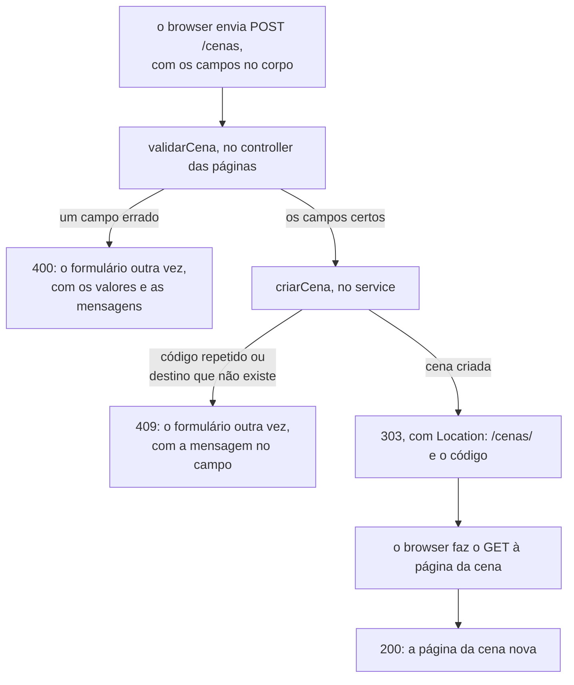

# Laboratório: Formulários e validação

## O que vais construir

Vais fazer o passo 5 de Fechado na escola: o jogo ganha a página "Nova cena", com um formulário que cria uma cena sem a consola. O servidor verifica cada campo e, quando tudo está certo, leva-te à página da cena nova.

```text
fechado-na-escola/
├── contrato-da-api.md                 não muda
├── package.json                       não muda
├── package-lock.json                  não muda
├── views/
│   ├── cena-nova.ejs                  o formulário da cena nova
│   ├── inicio.ejs                     não muda
│   ├── cena.ejs                       não muda
│   ├── erro.ejs                       não muda
│   └── partials/
│       ├── cabecalho.ejs              o menu ganha a ligação "Nova cena"
│       └── rodape.ejs                 não muda
└── src/
    ├── server.js                      lê também o corpo dos formulários
    ├── seed.js                        não muda
    ├── db/
    │   └── mongoose.js                não muda
    ├── models/
    │   └── cena.model.js              não muda
    ├── repositories/
    │   └── cenas.repository.js        não muda
    ├── services/
    │   └── cenas.service.js           não muda, e cria as cenas da API e do formulário
    ├── controllers/
    │   ├── cenas.controller.js        não muda
    │   └── paginas.controller.js      o formulário, a verificação dos campos e a resposta
    └── rotas/
        ├── cenas.rotas.js             não muda
        └── paginas.rotas.js           ganha o formulário e o envio dele
```

1. [Fase 1: O formulário em HTML](#fase-1-o-formulário-em-html)
2. [Fase 2: O corpo do pedido e o middleware que o lê](#fase-2-o-corpo-do-pedido-e-o-middleware-que-o-lê)
3. [Fase 3: O separador Rede mostra os campos enviados](#fase-3-o-separador-rede-mostra-os-campos-enviados)
4. [Fase 4: Validar no servidor](#fase-4-validar-no-servidor)
5. [Fase 5: Cada campo passa a texto antes de tudo](#fase-5-cada-campo-passa-a-texto-antes-de-tudo)
6. [Fase 6: Quando há erros: o formulário outra vez](#fase-6-quando-há-erros-o-formulário-outra-vez)
7. [Fase 7: O formulário volta com os valores e as mensagens](#fase-7-o-formulário-volta-com-os-valores-e-as-mensagens)
8. [Fase 8: Quando corre bem: redirecionar](#fase-8-quando-corre-bem-redirecionar)
9. [Fase 9: Um commit guarda uma fotografia do projeto](#fase-9-um-commit-guarda-uma-fotografia-do-projeto)

## O que precisas

- O projeto do passo 4, com o commit desse passo. Se não o tiveres, copia a pasta `fechado-na-escola-passo-04`, dos exemplos do repositório de Linguagens de Programação ([no GitHub](https://github.com/NunoMACastro/epms-2627-3ig-lp/blob/main/exemplos/acesso-a-dados/fechado-na-escola-passo-04/README.md)), para a tua pasta de trabalho, sem o `README.md`. Faz o `npm install` e o `.env` do "Como correr" dela, sem ligar o jogo. Depois guarda-a no Git: `git init`, `git config user.name "O teu nome"`, `git config user.email "o teu email da escola"`, `git add .` e `git commit -m "Passo 4"`.
- O Node.js 22 ou mais recente, como no passo 4: confirma com `node --version`.
- O teu cluster do Atlas e internet: o jogo só arranca ligado à base de dados.
- O browser, com o separador "Rede" das ferramentas de programador (F12; no Mac, Cmd+Option+I).

## Preparar o projeto

1. Abre a pasta do jogo no Visual Studio Code e, no terminal, confirma que o passo 4 está guardado:

   ```bash
   git status
   git log --oneline
   ```

   O que deves ver: `nothing to commit, working tree clean` (nada para guardar), e o commit do passo 4 no topo da lista. Se o `git status` mostrar ficheiros, faz o commit do passo 4 antes de continuares, como na fase 9 desse passo.

2. Repõe as cenas da história na base de teste, porque as tabelas deste laboratório contam com as onze cenas do seed. No mesmo terminal, corre:

   ```bash
   npm run seed
   ```

   O que deves ver: `Ligada à base de dados fechado-na-escola-teste`, uma linha com as cenas apagadas e `Inseridas 11 cenas`. As cenas que criaste no passo 4, como o arquivo, saem da base. Se aparecer `O seed falhou`, vê [O seed ou o jogo não chegam à base de dados](#o-seed-ou-o-jogo-não-chegam-à-base-de-dados).

3. No mesmo terminal, liga o jogo e deixa-o ligado até ao fim:

   ```bash
   npm run dev
   ```

   O que deves ver: `Ligada à base de dados fechado-na-escola-teste` e `Fechado na escola em http://localhost:3000`. Este é o primeiro terminal, e é nele que aparecem os pedidos e os erros. O jogo reinicia sozinho sempre que guardas um ficheiro `.js` que ele já usa. Uma mudança num `.ejs` vê-se só com recarregar a página.

4. Abre um segundo terminal, para os comandos, no menu "Terminal", com "New Terminal".

5. No browser, abre as ferramentas de programador no separador "Rede" ("Network", com o browser em inglês) e confirma que "Disable cache" (desativar a cache) está marcado, como nos passos anteriores.

Se continuas o laboratório numa aula seguinte, repete os passos 3 a 5, sem o seed, e retoma na fase em que paraste. O seed apagava as cenas que já criaste, e as fases 4 a 7 contam com a cantina da fase 2.

## Fase 1: O formulário em HTML

Fazes a página "Nova cena", com o formulário que cria uma cena. Criar uma cena muda a base de dados, e por isso o formulário envia por `POST`, enquanto as ligações das escolhas continuam a ser pedidos `GET`, porque só mostram. Rever: [Um formulário que muda alguma coisa](../05-formularios-e-validacao.md#um-formulário-que-muda-alguma-coisa) e [O formulário em HTML](../05-formularios-e-validacao.md#o-formulário-em-html).

1. Na pasta `views`, cria o ficheiro `cena-nova.ejs`, com esta primeira versão:

   ```ejs
   <%# A página do formulário de uma cena nova. Recebe o titulo e as cenas, que
       dão as opções do destino da escolha. %>
   <%- include("partials/cabecalho") %>
       <%# Os maxlength são os limites do contrato, em "O corpo de uma cena". %>
       <form method="post" action="/cenas">
         <p>
           <label for="codigo">Código da cena, como sala-13</label>
           <input id="codigo" name="codigo" maxlength="30" required>
         </p>
         <p>
           <label for="titulo">Título</label>
           <input id="titulo" name="titulo" maxlength="60" required>
         </p>
         <p>
           <label for="texto">Texto da cena</label>
           <textarea id="texto" name="texto" rows="5" maxlength="600" required></textarea>
         </p>
         <fieldset>
           <legend>A primeira escolha</legend>
           <p>
             <label for="escolha_texto">Texto da escolha</label>
             <input id="escolha_texto" name="escolha_texto" maxlength="80" required>
           </p>
           <p>
             <label for="escolha_destino">Leva à cena</label>
             <%# O jogador lê o título de cada cena, mas o que segue no pedido é o
                 value da opção: o código da cena, que é o destino da escolha. %>
             <select id="escolha_destino" name="escolha_destino" required>
               <option value="">Escolhe uma cena</option>
               <% for (const cena of cenas) { %>
                 <option value="<%= cena.codigo %>"><%= cena.titulo %> (<%= cena.codigo %>)</option>
               <% } %>
             </select>
           </p>
         </fieldset>
         <button type="submit">Criar a cena</button>
       </form>
   <%- include("partials/rodape") %>
   ```

   Como nos formulários do 11.º ano, o `<textarea>` é uma caixa de várias linhas. O `<fieldset>` junta os dois campos da escolha, com o título que o `<legend>` lhe dá.

2. No `src/controllers/paginas.controller.js`, acrescenta a `listarCenas` ao `import` do service, que fica assim:

   ```js
   import { listarCenas, obterCena, cenaSeguinte } from "../services/cenas.service.js";
   ```

   E no fim do ficheiro acrescenta a função da página do formulário:

   ```js
   /** GET /cenas/nova: o formulário de uma cena nova. */
   export async function mostrarNovaCena(req, res) {
     // As cenas que já existem dão as opções do destino da escolha.
     const cenas = await listarCenas();
     res.render("cena-nova", { titulo: "Nova cena", cenas: cenas });
   }
   ```

   A `listarCenas` é a mesma função do service que a API usa em `GET /api/cenas`.

3. No `src/rotas/paginas.rotas.js`, acrescenta a `mostrarNovaCena` ao `import`, que fica assim:

   ```js
   import { mostrarInicio, mostrarCena, fazerEscolha, mostrarNovaCena } from "../controllers/paginas.controller.js";
   ```

   E entre a rota `"/"` e a rota `"/cenas/:codigo"`, acrescenta:

   ```js
   // O caminho fixo vem antes do caminho com parâmetro. Ao contrário, o "nova"
   // de /cenas/nova encaixava no :codigo, e o pedido ia para a mostrarCena.
   router.get("/cenas/nova", mostrarNovaCena);
   ```

   Guarda os dois ficheiros e confirma que o jogo reiniciou. Se o jogo parar com um erro, vê [O jogo reinicia e para](#o-jogo-reinicia-e-para-com-failed-running-srcserverjs). Rever: [O caminho fixo vem antes do caminho com parâmetro](../03-http-rotas-e-middleware.md#o-caminho-fixo-vem-antes-do-caminho-com-parâmetro).

4. No `views/partials/cabecalho.ejs`, a seguir à ligação "Início", acrescenta a ligação para o formulário:

   ```ejs
         <a href="/cenas/nova">Nova cena</a>
   ```

5. Abre `http://localhost:3000/` e carrega em "Nova cena", no menu. O que deves ver: a página "Nova cena", com os três campos da cena. Por baixo, num grupo com o título "A primeira escolha", estão o texto da escolha e a lista "Leva à cena". A lista tem "Escolhe uma cena" e as onze cenas da história. Carrega na palavra "Título": o cursor vai para o campo do título, porque a etiqueta está ligada a ele. Se aparecer "Cena não encontrada", vê [este problema](#a-página-nova-cena-dá-cena-não-encontrada-com-não-existe-a-cena-nova).

6. Provoca um erro de propósito: no `paginas.rotas.js`, passa a linha `router.get("/cenas/nova", mostrarNovaCena);` para baixo da rota `"/cenas/:codigo"`. Guarda e recarrega a página.

   O que deves ver: a página "Cena não encontrada", com "Não existe a cena nova.", e o código 404 no separador "Rede". O router experimenta as rotas pela ordem do ficheiro, e o `/cenas/:codigo` apanhou o pedido, com `"nova"` no lugar do código. Repõe a linha entre a `"/"` e a `"/cenas/:codigo"`, guarda e recarrega: o formulário volta.

7. Carrega em "Criar a cena" com os campos vazios. O que deves ver: um aviso do browser junto do primeiro campo, e nenhum pedido novo no separador "Rede". É a validação do browser, com o `required`: o pedido nem chegou a sair.

8. Preenche o formulário com a cena da cantina:

   | Campo | Valor |
   | --- | --- |
   | Código da cena | `cantina` |
   | Título | `A cantina` |
   | Texto da cena | `As cadeiras estão em cima das mesas e cheira a sopa de ontem. Ao fundo, a porta da cozinha está fechada com um cadeado.` |
   | Texto da escolha | `Voltar ao corredor` |
   | Leva à cena | O corredor do rés-do-chão (corredor) |

   Carrega em "Criar a cena". O que deves ver: a página "Página não encontrada", e, no separador "Rede", o pedido `cenas`, com o método `POST` e o código 404. Ainda não há nenhuma rota para o `POST /cenas`, e quem responde é o middleware final do passo 3, com a página de erro.

### Paragem 1

A página "Nova cena" abre a partir do menu, com o formulário. O browser não deixa enviar campos vazios, e um formulário preenchido dá "Página não encontrada".

Pensa antes de continuares: se o formulário tivesse `method="get"`, para onde iam os campos, e porque é que isso é mau para uma cena nova? A resposta: iam no endereço, como numa pesquisa, em `/cenas?codigo=cantina&titulo=A+cantina&...`. Esse endereço ficava no histórico e nos favoritos, e, se a rota criasse a cena com um `GET`, cada visita a ele voltava a criá-la. O `GET` serve para ver, e o `POST` para mudar.

## Fase 2: O corpo do pedido e o middleware que o lê

Fazes a rota que recebe o formulário e cria a cena, por agora sem verificar nada. Os campos chegam no corpo do pedido, e quem os lê é o `express.urlencoded`. Rever: [O corpo do pedido e o middleware que o lê](../05-formularios-e-validacao.md#o-corpo-do-pedido-e-o-middleware-que-o-lê).

1. No `paginas.controller.js`, acrescenta a `criarCena` ao `import` do service, que fica assim:

   ```js
   import { listarCenas, obterCena, cenaSeguinte, criarCena } from "../services/cenas.service.js";
   ```

   E no fim do ficheiro acrescenta a função que recebe o formulário:

   ```js
   /** POST /cenas: cria uma cena com os campos do formulário. */
   export async function criarNovaCena(req, res) {
     // Primeira versão, sem verificar nada: os campos seguem como chegam.
     // O formulário cria sempre uma cena que não é final, com uma escolha.
     const dados = {
       codigo: req.body.codigo,
       titulo: req.body.titulo,
       texto: req.body.texto,
       final: false,
       escolhas: [{ texto: req.body.escolha_texto, destino: req.body.escolha_destino }],
     };
     const criacao = await criarCena(dados);
     res.render("cena", { titulo: criacao.cena.titulo, cena: criacao.cena });
   }
   ```

   Cada campo lê-se em `req.body` pelo `name` que tem no formulário. A cena segue para a `criarCena`, a mesma função do service que a API usa no `POST /api/cenas`.

2. No `paginas.rotas.js`, acrescenta a `criarNovaCena` ao `import`, que fica assim:

   ```js
   import { mostrarInicio, mostrarCena, fazerEscolha, mostrarNovaCena, criarNovaCena } from "../controllers/paginas.controller.js";
   ```

   E a seguir à última rota, acrescenta a rota do envio do formulário:

   ```js
   router.post("/cenas", criarNovaCena);
   ```

   Guarda os dois ficheiros e confirma que o jogo reiniciou.

3. Volta ao formulário, com o botão de voltar atrás do browser, e confirma que os campos ainda têm a cena da cantina. Se estiverem vazios, preenche-os outra vez com a tabela da fase 1. Antes de carregares em "Criar a cena", prevê o que vai aparecer. Depois carrega.

   O que deves ver: `{"erro":"Erro interno do servidor"}`, com o código 500. No primeiro terminal, a seguir a `POST /cenas`, aparece `Erro interno: Cannot read properties of undefined (reading 'codigo')`. O `req.body` está `undefined`: o `express.json()` do passo 4 só lê o corpo dos pedidos em JSON, e o formulário envia noutro formato. A rota falhou na primeira linha que lê o `req.body`, e o middleware de erros do passo 4 respondeu, em JSON.

4. No `src/server.js`, logo a seguir à linha `app.use(express.json());`, acrescenta o middleware que lê os formulários:

   ```js
   // Lê o corpo dos formulários das páginas, que chegam em urlencoded, e põe-no
   // em req.body. O express.json() só lê os pedidos em JSON, que são os da API.
   app.use(express.urlencoded({ extended: false }));
   ```

   Fica antes das rotas, como o `express.json()`, para o `req.body` estar pronto quando elas correm. Guarda e confirma que o jogo reiniciou.

5. Volta atrás outra vez, até ao formulário, confirma os campos e carrega em "Criar a cena". O que deves ver: a página "A cantina", com o texto da cena e a escolha "Voltar ao corredor". Na barra de endereço está `/cenas`, e no separador "Rede" o pedido `cenas` tem o método `POST` e o código 200. Se o 500 continuar, vê [este problema](#cannot-read-properties-of-undefined-reading-codigo-ou-o-formulário-diz-que-estão-todos-vazios).

6. Carrega em "Voltar ao corredor": a escolha leva à página do corredor, como as das cenas do seed. Depois abre `http://localhost:3000/api/cenas/cantina`. O que deves ver: a cena da cantina em JSON, com o `_id` que o MongoDB lhe deu. A cena está na base de teste, e a API vê-a como as outras.

### Paragem 2

O formulário cria uma cena na base de teste, e a página dela aparece logo a seguir ao envio.

Pensa antes de continuares: o jogo tem agora dois middleware que leem o corpo dos pedidos. Um pedido da API, em JSON, passa também pelo `express.urlencoded`. O que lhe acontece lá? A resposta: nada. Cada um destes middleware só lê o corpo no seu formato, que o cabeçalho `Content-Type` do pedido diz, e passa os outros pedidos à frente sem lhes tocar.

## Fase 3: O separador Rede mostra os campos enviados

Crias outra cena e vês, no separador "Rede", os campos que o formulário enviou e o formato em que seguiram. É aí que se confirma o nome de cada campo. Rever: [O separador Rede mostra os campos enviados](../05-formularios-e-validacao.md#o-separador-rede-mostra-os-campos-enviados).

1. Carrega em "Nova cena", no menu, e preenche o formulário com a cena do bar:

   | Campo | Valor |
   | --- | --- |
   | Código da cena | `bar-dos-alunos` |
   | Título | `O bar dos alunos` |
   | Texto da cena | `A máquina das bebidas ainda tem a luz acesa, e tens 50 cêntimos no bolso. Dá para uma garrafa de água.` |
   | Texto da escolha | `Voltar ao corredor` |
   | Leva à cena | O corredor do rés-do-chão (corredor) |

   Carrega em "Criar a cena". O que deves ver: a página "O bar dos alunos".

2. No separador "Rede", clica no pedido `cenas` e abre o separador "Payload" ("Carga", no Chrome em português; no Firefox, "Pedido"). Antes de olhares, prevê: que valor seguiu no campo `escolha_destino`?

   O que deves ver: "Form Data", com os cinco campos, cada um com o valor que escreveste. O `escolha_destino` tem `corredor`, e não "O corredor do rés-do-chão (corredor)": segue o `value` da opção, e o texto é só o que se lê na lista.

3. Ainda no "Payload", carrega em "view source" (ver a origem), ao lado de "Form Data". O que deves ver: os campos numa só linha, como `codigo=bar-dos-alunos&titulo=O+bar+dos+alunos&...`, com os espaços trocados por `+` e as letras acentuadas por códigos com `%`. É o corpo tal como seguiu, no formato urlencoded. Depois abre o separador "Headers" e, em "Request Headers" (cabeçalhos do pedido), procura o `Content-Type`: diz `application/x-www-form-urlencoded`.

### Paragem 3

O separador "Rede" mostra, para o envio do formulário, os campos e os valores que seguiram, e o formato do corpo.

Pensa antes de continuares: uma rota lê `req.body.escolha_destino` e recebe `undefined`, embora tenhas escolhido uma cena na lista. Onde procuras primeiro? A resposta: no "Payload" do pedido. Se lá o campo tiver outro nome, como `destino`, o problema está no `name` da lista, no `cena-nova.ejs`, e não na rota.

## Fase 4: Validar no servidor

Experimentas o que a rota faz com o que o browser não deixaria enviar, e com uma cena que já existe. Ao servidor só chega o pedido, e por isso é ele que tem de verificar cada campo. Rever: [Validar no servidor](../05-formularios-e-validacao.md#validar-no-servidor).

1. No `cena-nova.ejs`, acrescenta ao `<form>` o atributo `novalidate`, que desliga a validação do browser:

   ```ejs
       <form method="post" action="/cenas" novalidate>
   ```

   Fica até à fase 8, para poderes enviar ao servidor os campos que o browser recusaria. Guarda.

2. Abre o formulário e preenche-o com a cena da reprografia:

   | Campo | Valor |
   | --- | --- |
   | Código da cena | `reprografia` |
   | Título | `A reprografia` |
   | Texto da cena | `A fotocopiadora pisca a laranja, e há uma pilha de testes de Português em cima da mesa. Melhor não mexer.` |
   | Texto da escolha | `Voltar ao corredor` |
   | Leva à cena | O corredor do rés-do-chão (corredor) |

   Depois, apaga o título, para ficar vazio, e carrega em "Criar a cena". O que deves ver: `{"erro":"O título é obrigatório"}`, com o código 400. O schema da cena, no `cena.model.js`, recusou-a, como no passo 4, e o middleware de erros respondeu em JSON, como responde à API. A cena não foi criada, mas o formulário desapareceu, e quem o preencheu fica a olhar para chavetas.

3. Volta atrás, até ao formulário. Escreve `cantina` no código e `A cantina` no título, e deixa o resto como estava. Carrega em "Criar a cena".

   O que deves ver: `{"erro":"Erro interno do servidor"}`, com o código 500. No primeiro terminal aparece `Erro interno: Cannot read properties of undefined (reading 'titulo')`. A cantina já existe, e o service recusou a cena nova, como faz na API. Devolveu o resultado `"codigo-repetido"`, sem cena, e a rota não olhou para ele: foi buscar o título de uma cena que não veio.

### Paragem 4

O formulário cria uma cena quando tudo está certo. Com o `novalidate`, o título vazio dá um JSON com o código 400, e o código repetido dá um 500.

Pensa antes de continuares: o browser não deixava enviar o título vazio. Porque é que isso não basta? A resposta: qualquer pessoa pode desligar a validação do browser, com o `novalidate` ou nas ferramentas de programador, e qualquer programa pode enviar um `POST /cenas` sem formulário nenhum. O servidor só vê o pedido, sem saber de onde veio. Por isso, é a verificação do servidor que conta.

## Fase 5: Cada campo passa a texto antes de tudo

Escreves a verificação dos cinco campos numa função, a `validarCena`, que começa por passar cada campo a texto, com a `textoDoCampo` do guia. Por agora, os erros aparecem todos juntos na página de erro do passo 3. Rever: [Cada campo passa a texto antes de tudo](../05-formularios-e-validacao.md#cada-campo-passa-a-texto-antes-de-tudo) e [A função que valida a reserva](../05-formularios-e-validacao.md#a-função-que-valida-a-reserva).

1. No `paginas.controller.js`, a seguir à linha do `import`, deixa uma linha em branco e acrescenta a função que passa cada campo a texto:

   ```js
   /**
    * Devolve o texto de um campo do formulário, sem os espaços das pontas.
    * Um campo que não veio, ou que veio repetido (e chega como um array),
    * não é um texto: devolve o texto vazio.
    * @param {unknown} valor o valor tal como chegou em req.body
    * @returns {string}
    */
   function textoDoCampo(valor) {
     if (typeof valor !== "string") {
       return "";
     }
     return valor.trim();
   }
   ```

   É a `textoDoCampo` do guia, letra a letra. O jogo continua a funcionar como estava, porque ninguém a usa ainda.

2. Logo a seguir à `textoDoCampo`, deixa uma linha em branco e acrescenta a função que verifica a cena:

   ```js
   /**
    * Verifica os campos de uma cena nova vindos do formulário.
    * Só lê os cinco campos previstos; qualquer outro campo é ignorado.
    * Devolve os valores, para voltar a mostrar no formulário, e os erros,
    * com uma mensagem por campo. Sem erros, o objeto dos erros fica vazio.
    * Não verifica o código repetido nem o destino que não existe: essas regras
    * precisam da base de dados, e quem as verifica é o service.
    * @param {object|undefined} corpo o req.body do pedido, que pode não existir
    * @returns {object} um objeto com os valores e os erros
    */
   function validarCena(corpo) {
     // Sem corpo lido, todos os campos faltam e recebem os erros já previstos.
     if (!corpo) {
       corpo = {};
     }
     const valores = {
       codigo: textoDoCampo(corpo.codigo),
       titulo: textoDoCampo(corpo.titulo),
       texto: textoDoCampo(corpo.texto),
       escolha_texto: textoDoCampo(corpo.escolha_texto),
       escolha_destino: textoDoCampo(corpo.escolha_destino),
     };
     const erros = {};

     // Os limites são os do contrato. Estão também no schema, no cena.model.js,

     // e nos maxlength do cena-nova.ejs: se um mudar, mudam os três. O schema

     // protege a base, também para a API e para o seed, e esta função dá a

     // mensagem de cada campo a quem preenche.
     if (valores.codigo === "") {
       erros.codigo = "Escreve o código da cena.";
     } else if (valores.codigo.length > 30) {
       erros.codigo = "O código tem, no máximo, 30 carateres.";
     }

     if (valores.titulo === "") {
       erros.titulo = "Escreve o título da cena.";
     } else if (valores.titulo.length > 60) {
       erros.titulo = "O título tem, no máximo, 60 carateres.";
     }

     if (valores.texto === "") {
       erros.texto = "Escreve o texto da cena.";
     } else if (valores.texto.length > 600) {
       erros.texto = "O texto tem, no máximo, 600 carateres.";
     }

     if (valores.escolha_texto === "") {
       erros.escolha_texto = "Escreve o texto da escolha.";
     } else if (valores.escolha_texto.length > 80) {
       erros.escolha_texto = "O texto da escolha tem, no máximo, 80 carateres.";
     }

     if (valores.escolha_destino === "") {
       erros.escolha_destino = "Escolhe a cena para onde a escolha leva.";
     }

     return { valores: valores, erros: erros };
   }
   ```

   A `validarCena` tem a forma da `validarReserva`: lê só os cinco campos. Cada campo de texto tem um bloco igual ao do campo `nome` da reserva, no guia, com o vazio e o limite.

3. Ainda no `paginas.controller.js`, substitui a função `criarNovaCena` inteira, com o comentário por cima, por esta versão:

   ```js
   /** POST /cenas: cria uma cena com os campos do formulário. */
   export async function criarNovaCena(req, res) {
     const resultado = validarCena(req.body);

     // Por agora, com erros, a página de erro, com as mensagens todas juntas.
     if (Object.keys(resultado.erros).length > 0) {
       res.status(400).render("erro", {
         titulo: "A cena não foi criada",
         mensagem: Object.values(resultado.erros).join(" "),
       });
       return;
     }

     // A cena constrói-se campo a campo, só com os valores verificados.
     // O formulário cria sempre uma cena que não é final, com uma escolha.
     const valores = resultado.valores;
     const dados = {
       codigo: valores.codigo,
       titulo: valores.titulo,
       texto: valores.texto,
       final: false,
       escolhas: [{ texto: valores.escolha_texto, destino: valores.escolha_destino }],
     };
     const criacao = await criarCena(dados);
     res.render("cena", { titulo: criacao.cena.titulo, cena: criacao.cena });
   }
   ```

   O `Object.keys(resultado.erros)` dá a lista dos campos com erro, e uma lista vazia quer dizer que não houve erros. O `Object.values` dá as mensagens, como no middleware de erros do passo 4, e o `join(" ")` junta-as num só texto. Os `dados` já não leem o `req.body`: usam os valores que a validação devolveu, sem os espaços das pontas.

   Guarda e confirma que o jogo reiniciou.

4. Abre o formulário e, sem escrever nada, carrega em "Criar a cena". O que deves ver: a página "A cena não foi criada", com o código 400. As cinco mensagens estão seguidas num só parágrafo, de "Escreve o código da cena." a "Escolhe a cena para onde a escolha leva.". O terminal não mostra nenhum erro.

5. Volta atrás e preenche a cena da reprografia, com a tabela da fase 4, mas com três espaços no lugar do título. Carrega em "Criar a cena". O que deves ver: a página "A cena não foi criada", só com "Escreve o título da cena.". A `textoDoCampo` tirou os três espaços, e o título ficou vazio.

6. Experimenta um código maior do que o limite. O `maxlength="30"` não te deixa escrever mais de 30 letras, mesmo com o `novalidate`. Por isso, no `cena-nova.ejs`, apaga por agora o `maxlength="30"` do campo do código e guarda. Depois, abre o formulário, em "Nova cena", no menu, preenche a reprografia, com a tabela da fase 4, e escreve no código `corredor-do-primeiro-andar-ala-norte`, com 36 carateres.

   O que deves ver: a página "A cena não foi criada", só com "O código tem, no máximo, 30 carateres.". Repõe o `maxlength="30"` no campo do código e guarda.

### Paragem 5

Um formulário com campos vazios, só com espaços ou maiores do que o limite dá a página "A cena não foi criada", com o código 400 e as mensagens. Um formulário certo cria a cena. O código repetido continua a dar o 500 da fase 4.

Pensa antes de continuares: um campo que não veio no pedido, um campo vazio e um campo só com espaços dão todos a mesma mensagem. Porquê? A resposta: os três passam pela `textoDoCampo` antes de qualquer verificação, e os três saem de lá como o texto vazio. A pergunta "está preenchido?" fica numa só comparação com `""`.

## Fase 6: Quando há erros: o formulário outra vez

Com erros, a rota passa a responder com o próprio formulário: com o 400, quando um campo está mal, e com o 409, quando o service recusa a cena. Rever: [Quando há erros: o formulário outra vez](../05-formularios-e-validacao.md#quando-há-erros-o-formulário-outra-vez) e, em Linguagens de Programação, [Uma regra que precisa da base fica no service](https://github.com/NunoMACastro/epms-2627-3ig-lp/blob/main/01-acesso-a-dados/05-ligacao-segura-crud-e-regras-de-dominio.md#uma-regra-que-precisa-da-base-fica-no-service).

1. No `cena-nova.ejs`, substitui as três primeiras linhas, do comentário do topo ao `include` do cabeçalho, por estas, com a frase que diz que a cena não foi criada:

   ```ejs
   <%# A página do formulário de uma cena nova. Recebe o titulo, as cenas, que dão
       as opções do destino da escolha, os valores, com o texto de cada campo, e
       os erros, com uma mensagem por campo errado. %>
   <%- include("partials/cabecalho") %>
       <% if (Object.keys(erros).length > 0) { %>
         <p><strong>A cena não foi criada. Corrige os campos assinalados.</strong></p>
       <% } %>
   ```

   O `cena-nova.ejs` passa a usar os `erros`, um objeto com uma mensagem por campo, como o que a `validarCena` devolve. Guarda e abre `http://localhost:3000/cenas/nova`.

   O que deves ver: `{"erro":"Erro interno do servidor"}`, com o código 500. No primeiro terminal aparece `Erro interno:`, seguido do caminho do `cena-nova.ejs`, das linhas à volta do `if`, com `>>` na linha dele, e de `erros is not defined`. A rota do formulário não passa os `erros` ao `cena-nova.ejs`. Desde o passo 4, o middleware de erros responde em JSON a todos os erros, também aos das páginas, e o pormenor fica no terminal.

2. O formulário vai ter de aparecer em três sítios: da primeira vez, com os erros dos campos e com as regras do service. Para não escreveres três vezes a lista das cenas e o `render`, ficam numa função. No `paginas.controller.js`, a seguir à `validarCena`, acrescenta:

   ```js
   /**
    * Responde com a página do formulário de uma cena nova.
    * Pede ao service as cenas da história, que dão as opções do destino da escolha.
    * @param {object} res a resposta do Express
    * @param {number} estado o código de estado da resposta: 200, 400 ou 409
    * @param {object} valores o texto que fica escrito em cada campo
    * @param {object} erros uma mensagem por campo errado, ou {} quando não há erros
    * @returns {Promise<void>} cumprida quando a página foi enviada
    */
   async function mostrarFormulario(res, estado, valores, erros) {
     const cenas = await listarCenas();
     res.status(estado).render("cena-nova", {
       titulo: "Nova cena",
       cenas: cenas,
       valores: valores,
       erros: erros,
     });
   }
   ```

   E substitui a função `mostrarNovaCena` inteira, com o comentário por cima, por esta versão:

   ```js
   /** GET /cenas/nova: o formulário de uma cena nova, com os campos vazios. */
   export async function mostrarNovaCena(req, res) {
     const valores = { codigo: "", titulo: "", texto: "", escolha_texto: "", escolha_destino: "" };
     await mostrarFormulario(res, 200, valores, {});
   }
   ```

   Da primeira vez, cada campo tem o texto vazio, e o objeto dos erros não tem nenhuma mensagem. O `await` espera que a página saia, porque a `mostrarFormulario` espera pela lista das cenas.

3. Substitui a função `criarNovaCena` inteira, com o comentário por cima, por esta versão:

   ```js
   /** POST /cenas: cria uma cena com os campos do formulário. */
   export async function criarNovaCena(req, res) {
     const resultado = validarCena(req.body);

     // Com erros: o formulário outra vez, com o 400, os valores e as mensagens.
     if (Object.keys(resultado.erros).length > 0) {
       await mostrarFormulario(res, 400, resultado.valores, resultado.erros);
       return;
     }

     // A cena constrói-se campo a campo, só com os valores verificados.
     // O formulário cria sempre uma cena que não é final, com uma escolha.
     const valores = resultado.valores;
     const dados = {
       codigo: valores.codigo,
       titulo: valores.titulo,
       texto: valores.texto,
       final: false,
       escolhas: [{ texto: valores.escolha_texto, destino: valores.escolha_destino }],
     };
     const criacao = await criarCena(dados);

     // As regras que precisam da base respondem 409, como na API: o pedido está
     // bem feito, mas choca com o que já está na base.
     if (criacao.resultado === "codigo-repetido") {
       await mostrarFormulario(res, 409, valores, { codigo: "Já existe uma cena com este código. Escolhe outro." });
       return;
     }
     if (criacao.resultado === "destino-nao-existe") {
       await mostrarFormulario(res, 409, valores, { escolha_destino: "Escolhe uma cena da lista." });
       return;
     }

     res.render("cena", { titulo: criacao.cena.titulo, cena: criacao.cena });
   }
   ```

   Com erros nos campos, a página de erro deu lugar ao formulário, e os dois `if` do fim olham para o resultado da `criarCena`, como o controller da API. O `return` a seguir a cada resposta é obrigatório: sem ele, a função continuava e respondia outra vez ao mesmo pedido.

   Guarda e confirma que o jogo reiniciou.

4. Recarrega a página do formulário. O que deves ver: o formulário outra vez, com o código 200, sem a frase do topo. Se o `{"erro":"Erro interno do servidor"}` continuar, vê [este problema](#erros-is-not-defined-valores-is-not-defined-ou-cenas-is-not-defined). Carrega em "Criar a cena" sem escrever nada.

   O que deves ver: o formulário, com o código 400 e a frase "A cena não foi criada. Corrige os campos assinalados." por cima dos campos. Os campos estão vazios, e a lista voltou a "Escolhe uma cena".

5. Preenche a cena da cantina, com a tabela da fase 1, e carrega em "Criar a cena". O que deves ver: o formulário com a mesma frase, agora com o código 409, e os campos outra vez vazios. O terminal não mostra nenhum erro: o código repetido deixou de dar o 500.

### Paragem 6

Com erros, o servidor responde com o formulário: com o 400, quando um campo está mal, e com o 409, quando o service recusa a cena. Mas o formulário não diz que campo está mal, e perde o que escreveste.

Pensa antes de continuares: porque é que o título vazio dá 400 e o código repetido dá 409? A resposta: com o título vazio, o pedido está mal feito, e o 400 diz isso. Com o código repetido, o pedido está bem feito, mas choca com o que já está na base, e o 409 diz isso. O contrato dá o 409 a esta regra na API, e as páginas seguem-no: a mesma regra dá o mesmo código.

## Fase 7: O formulário volta com os valores e as mensagens

O formulário passa a voltar com o que escreveste e com a mensagem de cada campo dentro da sua etiqueta. Os valores entram com `<%=`, porque vêm do pedido, e quem o envia pode lá escrever o que quiser. Rever: [O formulário volta com os valores e as mensagens](../05-formularios-e-validacao.md#o-formulário-volta-com-os-valores-e-as-mensagens).

1. No `cena-nova.ejs`, substitui o formulário inteiro, do `<form>` ao `</form>`, e o comentário dos `maxlength` por cima dele, por esta versão:

   ```ejs
       <%# Os maxlength são os limites do contrato, em "O corpo de uma cena".
           Cada campo traz o valor que a rota lhe passou e, se houver, a mensagem
           do erro dentro da etiqueta, para o leitor de ecrã a ler com o campo. %>
       <form method="post" action="/cenas" novalidate>
         <p>
           <label for="codigo">Código da cena, como sala-13
             <% if (erros.codigo) { %><strong><%= erros.codigo %></strong><% } %>
           </label>
           <input id="codigo" name="codigo" maxlength="30" value="<%= valores.codigo %>" required>
         </p>
         <p>
           <label for="titulo">Título
             <% if (erros.titulo) { %><strong><%= erros.titulo %></strong><% } %>
           </label>
           <input id="titulo" name="titulo" maxlength="60" value="<%= valores.titulo %>" required>
         </p>
         <p>
           <label for="texto">Texto da cena
             <% if (erros.texto) { %><strong><%= erros.texto %></strong><% } %>
           </label>
           <%# O textarea não tem value: o texto escreve-se entre <textarea> e </textarea>. %>
           <textarea id="texto" name="texto" rows="5" maxlength="600" required><%= valores.texto %></textarea>
         </p>
         <fieldset>
           <legend>A primeira escolha</legend>
           <p>
             <label for="escolha_texto">Texto da escolha
               <% if (erros.escolha_texto) { %><strong><%= erros.escolha_texto %></strong><% } %>
             </label>
             <input id="escolha_texto" name="escolha_texto" maxlength="80" value="<%= valores.escolha_texto %>" required>
           </p>
           <p>
             <label for="escolha_destino">Leva à cena
               <% if (erros.escolha_destino) { %><strong><%= erros.escolha_destino %></strong><% } %>
             </label>
             <%# O selected marca a opção que estava escolhida. O código da cena e o
                 valor que veio do pedido são os dois texto, e comparam-se com ===. %>
             <select id="escolha_destino" name="escolha_destino" required>
               <option value="">Escolhe uma cena</option>
               <% for (const cena of cenas) { %>
                 <option value="<%= cena.codigo %>" <% if (cena.codigo === valores.escolha_destino) { %>selected<% } %>><%= cena.titulo %> (<%= cena.codigo %>)</option>
               <% } %>
             </select>
           </p>
         </fieldset>
         <button type="submit">Criar a cena</button>
       </form>
   ```

   O `novalidate` continua no `<form>`, até à fase 8.

2. Guarda, abre o formulário, em "Nova cena", no menu, e preenche a reprografia, com a tabela da fase 4. Apaga o título e carrega em "Criar a cena".

   O que deves ver: o formulário, com o código 400, e "Escreve o título da cena." a seguir à etiqueta "Título". O código, o texto e o texto da escolha têm o que escreveste, e a lista continua no corredor. Se um campo voltar vazio, vê [este problema](#depois-de-um-erro-um-campo-volta-vazio-ou-a-lista-volta-a-escolhe-uma-cena).

3. Escreve `cantina` no código e `A cantina` no título, e carrega em "Criar a cena". O que deves ver: o formulário, com o código 409, e "Já existe uma cena com este código. Escolhe outro." a seguir à etiqueta do código. Os outros campos ficam como estavam.

4. Experimenta o destino que não existe. No `cena-nova.ejs`, a seguir à opção "Escolhe uma cena", acrescenta por agora uma opção para uma cena que não está na base:

   ```ejs
               <option value="cave">A cave (cave)</option>
   ```

   Guarda e volta ao formulário, pela ligação "Nova cena" do menu. Preenche a reprografia, com a tabela da fase 4, mas escolhe "A cave (cave)" na lista. Carrega em "Criar a cena".

   O que deves ver: o formulário, com o código 409, e "Escolhe uma cena da lista." a seguir à etiqueta "Leva à cena". O service procurou a cena `cave` e não a encontrou. No guia, o equipamento que não existia dava 400, porque a lista estava em memória e a validação a via. Aqui, as cenas estão na base, e quem verifica é o service, com o 409 que o contrato dá a esta regra. Apaga a opção da cave e guarda.

5. Experimenta um valor com HTML. Abre o formulário, em "Nova cena", no menu, deixa os outros campos vazios e escreve só no título:

   ```text
   "><b>Olá</b>
   ```

   Carrega em "Criar a cena". O que deves ver: o formulário, com as mensagens dos campos vazios, e o título com `"><b>Olá</b>` escrito tal e qual, sem negrito. No separador "Rede", clica no pedido `cenas`, abre "Response" ("Resposta") e procura `name="titulo"`. Na mesma linha está `value="&#34;&gt;&lt;b&gt;Olá&lt;/b&gt;"`. O `<%=` trocou as aspas e os sinais `<` e `>` por códigos, e as aspas do título já não fecham o atributo antes do tempo.

### Paragem 7

Com erros, o formulário volta com os valores que escreveste e com a mensagem de cada campo errado na sua etiqueta, e o destino continua escolhido.

O ficheiro `views/cena-nova.ejs` completo, como deve estar agora:

```ejs
<%# A página do formulário de uma cena nova. Recebe o titulo, as cenas, que dão
    as opções do destino da escolha, os valores, com o texto de cada campo, e
    os erros, com uma mensagem por campo errado. %>
<%- include("partials/cabecalho") %>
    <% if (Object.keys(erros).length > 0) { %>
      <p><strong>A cena não foi criada. Corrige os campos assinalados.</strong></p>
    <% } %>
    <%# Os maxlength são os limites do contrato, em "O corpo de uma cena".
        Cada campo traz o valor que a rota lhe passou e, se houver, a mensagem
        do erro dentro da etiqueta, para o leitor de ecrã a ler com o campo. %>
    <form method="post" action="/cenas" novalidate>
      <p>
        <label for="codigo">Código da cena, como sala-13
          <% if (erros.codigo) { %><strong><%= erros.codigo %></strong><% } %>
        </label>
        <input id="codigo" name="codigo" maxlength="30" value="<%= valores.codigo %>" required>
      </p>
      <p>
        <label for="titulo">Título
          <% if (erros.titulo) { %><strong><%= erros.titulo %></strong><% } %>
        </label>
        <input id="titulo" name="titulo" maxlength="60" value="<%= valores.titulo %>" required>
      </p>
      <p>
        <label for="texto">Texto da cena
          <% if (erros.texto) { %><strong><%= erros.texto %></strong><% } %>
        </label>
        <%# O textarea não tem value: o texto escreve-se entre <textarea> e </textarea>. %>
        <textarea id="texto" name="texto" rows="5" maxlength="600" required><%= valores.texto %></textarea>
      </p>
      <fieldset>
        <legend>A primeira escolha</legend>
        <p>
          <label for="escolha_texto">Texto da escolha
            <% if (erros.escolha_texto) { %><strong><%= erros.escolha_texto %></strong><% } %>
          </label>
          <input id="escolha_texto" name="escolha_texto" maxlength="80" value="<%= valores.escolha_texto %>" required>
        </p>
        <p>
          <label for="escolha_destino">Leva à cena
            <% if (erros.escolha_destino) { %><strong><%= erros.escolha_destino %></strong><% } %>
          </label>
          <%# O selected marca a opção que estava escolhida. O código da cena e o
              valor que veio do pedido são os dois texto, e comparam-se com ===. %>
          <select id="escolha_destino" name="escolha_destino" required>
            <option value="">Escolhe uma cena</option>
            <% for (const cena of cenas) { %>
              <option value="<%= cena.codigo %>" <% if (cena.codigo === valores.escolha_destino) { %>selected<% } %>><%= cena.titulo %> (<%= cena.codigo %>)</option>
            <% } %>
          </select>
        </p>
      </fieldset>
      <button type="submit">Criar a cena</button>
    </form>
<%- include("partials/rodape") %>
```

A frase do topo e cada mensagem só aparecem quando os `erros` as têm. Os valores entram nos campos sempre, e da primeira vez são o texto vazio que a `mostrarNovaCena` passa.

Pensa antes de continuares: se criasses uma cena com o título `<i>A cave</i>`, como aparecia o título na página dela? A resposta: com o `<i>` e o `</i>` à vista, como texto, sem itálico. O cabeçalho escreve o título, e o `cena.ejs` o texto e as escolhas, sempre com `<%=`, desde a fase 8 do passo 3. Agora que qualquer pessoa pode escrever cenas num formulário, é isso que impede que um `<script>` escrito num texto corra no browser de quem joga.

## Fase 8: Quando corre bem: redirecionar

Quando corre bem, a rota passa a responder com um redirecionamento 303 para a página da cena nova, em vez de responder com a página. Assim, recarregar a página já não volta a enviar o formulário. Rever: [Quando corre bem: redirecionar](../05-formularios-e-validacao.md#quando-corre-bem-redirecionar).

1. Abre o formulário e cria a reprografia, com a tabela da fase 4. O que deves ver: a página "A reprografia", com o endereço `/cenas` na barra.

2. Recarrega a página, com o botão de recarregar do browser (ou F5; no Mac, Cmd+R). O browser pergunta, numa janela, se queres enviar outra vez os dados do formulário: carrega em "Continuar" ("Reenviar", noutros browsers).

   O que deves ver: o formulário, com o código 409 e "Já existe uma cena com este código. Escolhe outro.". A página no ecrã era a resposta a um `POST`, e recarregar repetiu esse `POST`, com o mesmo corpo. A reprografia foi criada pelo primeiro envio, e o segundo esbarrou no código repetido. Se a regra do código repetido não existisse, o jogo tinha agora duas reprografias.

3. No `paginas.controller.js`, no fim da `criarNovaCena`, substitui a linha `res.render("cena", { titulo: criacao.cena.titulo, cena: criacao.cena });` por:

   ```js
     // Redirecionamento 303: o browser faz um GET à página da cena nova.
     // Recarregar essa página já não volta a enviar o formulário.
     res.redirect(303, `/cenas/${criacao.cena.codigo}`);
   ```

   O endereço é o da página da cena, que a rota `"/cenas/:codigo"` já mostra desde o passo 3. Guarda e confirma que o jogo reiniciou.

4. No separador "Rede", marca a opção que mantém a lista entre páginas, "Preserve log" ("Manter registo"), no topo do separador. Depois abre o formulário e cria a sala de música:

   | Campo | Valor |
   | --- | --- |
   | Código da cena | `sala-de-musica` |
   | Título | `A sala de música` |
   | Texto da cena | `Há uma bateria ao canto e uma guitarra sem cordas. Se tocares alguma coisa, ouve-se na escola inteira.` |
   | Texto da escolha | `Voltar ao primeiro andar` |
   | Leva à cena | O primeiro andar (escadas) |

   O que deves ver: a página "A sala de música", com o endereço `/cenas/sala-de-musica` na barra. No separador "Rede", o envio deu dois pedidos. Primeiro, o `cenas`, com o método `POST` e o código 303; logo a seguir, o `sala-de-musica`, com o método `GET` e o código 200. Clica no `cenas` e, em "Headers", procura em "Response Headers" (cabeçalhos da resposta) a linha `Location`: diz `/cenas/sala-de-musica`.

5. Recarrega a página. O que deves ver: a mesma página, sem nenhuma pergunta do browser, e no separador "Rede" um só pedido novo, o `GET` a `sala-de-musica`, com o 200. A página no ecrã é agora a resposta a um `GET`, e recarregá-la repete o `GET`. Se o browser perguntar alguma coisa, vê [este problema](#recarregar-a-página-da-cena-nova-pergunta-se-queres-enviar-outra-vez).

6. Tira o `novalidate` do `<form>` no `cena-nova.ejs`, que volta a ser:

   ```ejs
       <form method="post" action="/cenas">
   ```

   Guarda e abre o formulário, em "Nova cena", no menu. Carrega em "Criar a cena" com os campos vazios: o aviso do browser voltou. Desmarca o "Preserve log", se quiseres.

### Paragem 8

Uma cena criada leva à página dela, por um redirecionamento 303, e recarregar essa página não cria nada. Com erros, o formulário volta com os valores e as mensagens, com o código 400 ou 409.

O ficheiro `src/controllers/paginas.controller.js` completo, como deve estar agora:

```js
// src/controllers/paginas.controller.js: a ponte entre o HTTP e as páginas do jogo.
// Lê e verifica o que vem no pedido, pede as cenas ao mesmo service da API e
// responde com uma página, construída a partir de um modelo da pasta views.
import { listarCenas, obterCena, cenaSeguinte, criarCena } from "../services/cenas.service.js";

/**
 * Devolve o texto de um campo do formulário, sem os espaços das pontas.
 * Um campo que não veio, ou que veio repetido (e chega como um array),
 * não é um texto: devolve o texto vazio.
 * @param {unknown} valor o valor tal como chegou em req.body
 * @returns {string}
 */
function textoDoCampo(valor) {
  if (typeof valor !== "string") {
    return "";
  }
  return valor.trim();
}

/**
 * Verifica os campos de uma cena nova vindos do formulário.
 * Só lê os cinco campos previstos; qualquer outro campo é ignorado.
 * Devolve os valores, para voltar a mostrar no formulário, e os erros,
 * com uma mensagem por campo. Sem erros, o objeto dos erros fica vazio.
 * Não verifica o código repetido nem o destino que não existe: essas regras
 * precisam da base de dados, e quem as verifica é o service.
 * @param {object|undefined} corpo o req.body do pedido, que pode não existir
 * @returns {object} um objeto com os valores e os erros
 */
function validarCena(corpo) {
  // Sem corpo lido, todos os campos faltam e recebem os erros já previstos.
  if (!corpo) {
    corpo = {};
  }
  const valores = {
    codigo: textoDoCampo(corpo.codigo),
    titulo: textoDoCampo(corpo.titulo),
    texto: textoDoCampo(corpo.texto),
    escolha_texto: textoDoCampo(corpo.escolha_texto),
    escolha_destino: textoDoCampo(corpo.escolha_destino),
  };
  const erros = {};

  // Os limites são os do contrato. Estão também no schema, no cena.model.js,

  // e nos maxlength do cena-nova.ejs: se um mudar, mudam os três. O schema

  // protege a base, também para a API e para o seed, e esta função dá a

  // mensagem de cada campo a quem preenche.
  if (valores.codigo === "") {
    erros.codigo = "Escreve o código da cena.";
  } else if (valores.codigo.length > 30) {
    erros.codigo = "O código tem, no máximo, 30 carateres.";
  }

  if (valores.titulo === "") {
    erros.titulo = "Escreve o título da cena.";
  } else if (valores.titulo.length > 60) {
    erros.titulo = "O título tem, no máximo, 60 carateres.";
  }

  if (valores.texto === "") {
    erros.texto = "Escreve o texto da cena.";
  } else if (valores.texto.length > 600) {
    erros.texto = "O texto tem, no máximo, 600 carateres.";
  }

  if (valores.escolha_texto === "") {
    erros.escolha_texto = "Escreve o texto da escolha.";
  } else if (valores.escolha_texto.length > 80) {
    erros.escolha_texto = "O texto da escolha tem, no máximo, 80 carateres.";
  }

  if (valores.escolha_destino === "") {
    erros.escolha_destino = "Escolhe a cena para onde a escolha leva.";
  }

  return { valores: valores, erros: erros };
}

/**
 * Responde com a página do formulário de uma cena nova.
 * Pede ao service as cenas da história, que dão as opções do destino da escolha.
 * @param {object} res a resposta do Express
 * @param {number} estado o código de estado da resposta: 200, 400 ou 409
 * @param {object} valores o texto que fica escrito em cada campo
 * @param {object} erros uma mensagem por campo errado, ou {} quando não há erros
 * @returns {Promise<void>} cumprida quando a página foi enviada
 */
async function mostrarFormulario(res, estado, valores, erros) {
  const cenas = await listarCenas();
  res.status(estado).render("cena-nova", {
    titulo: "Nova cena",
    cenas: cenas,
    valores: valores,
    erros: erros,
  });
}

/** GET /: a página inicial, com a ligação para a primeira cena. */
export function mostrarInicio(req, res) {
  res.render("inicio", { titulo: "Início" });
}

/** GET /cenas/:codigo: a página de uma cena. */
export async function mostrarCena(req, res) {
  const codigo = req.params.codigo;
  const cena = await obterCena(codigo);
  if (cena === null) {
    res.status(404).render("erro", {
      titulo: "Cena não encontrada",
      mensagem: `Não existe a cena ${codigo}.`,
    });
    return;
  }
  res.render("cena", { titulo: cena.titulo, cena: cena });
}

/** GET /cenas/:codigo/escolhas/:numero: a página da cena para onde a escolha leva. */
export async function fazerEscolha(req, res) {
  const codigo = req.params.codigo;
  const numero = Number(req.params.numero); // chega como texto, "2", e passa a número
  if (!Number.isInteger(numero) || numero < 1) {
    res.status(400).render("erro", {
      titulo: "Pedido inválido",
      mensagem: "O número da escolha tem de ser um número inteiro maior do que 0.",
    });
    return;
  }
  const cena = await obterCena(codigo);
  if (cena === null) {
    res.status(404).render("erro", {
      titulo: "Cena não encontrada",
      mensagem: `Não existe a cena ${codigo}.`,
    });
    return;
  }
  const seguinte = await cenaSeguinte(cena, numero);
  if (seguinte === null) {
    res.status(404).render("erro", {
      titulo: "Escolha não encontrada",
      mensagem: `A cena ${codigo} não tem a escolha ${numero}.`,
    });
    return;
  }
  res.render("cena", { titulo: seguinte.titulo, cena: seguinte });
}

/** GET /cenas/nova: o formulário de uma cena nova, com os campos vazios. */
export async function mostrarNovaCena(req, res) {
  const valores = { codigo: "", titulo: "", texto: "", escolha_texto: "", escolha_destino: "" };
  await mostrarFormulario(res, 200, valores, {});
}

/** POST /cenas: cria uma cena com os campos do formulário. */
export async function criarNovaCena(req, res) {
  const resultado = validarCena(req.body);

  // Com erros: o formulário outra vez, com o 400, os valores e as mensagens.
  if (Object.keys(resultado.erros).length > 0) {
    await mostrarFormulario(res, 400, resultado.valores, resultado.erros);
    return;
  }

  // A cena constrói-se campo a campo, só com os valores verificados.
  // O formulário cria sempre uma cena que não é final, com uma escolha.
  const valores = resultado.valores;
  const dados = {
    codigo: valores.codigo,
    titulo: valores.titulo,
    texto: valores.texto,
    final: false,
    escolhas: [{ texto: valores.escolha_texto, destino: valores.escolha_destino }],
  };
  const criacao = await criarCena(dados);

  // As regras que precisam da base respondem 409, como na API: o pedido está
  // bem feito, mas choca com o que já está na base.
  if (criacao.resultado === "codigo-repetido") {
    await mostrarFormulario(res, 409, valores, { codigo: "Já existe uma cena com este código. Escolhe outro." });
    return;
  }
  if (criacao.resultado === "destino-nao-existe") {
    await mostrarFormulario(res, 409, valores, { escolha_destino: "Escolhe uma cena da lista." });
    return;
  }

  // Redirecionamento 303: o browser faz um GET à página da cena nova.
  // Recarregar essa página já não volta a enviar o formulário.
  res.redirect(303, `/cenas/${criacao.cena.codigo}`);
}
```

As três funções do topo não respondem a nenhum pedido: a `textoDoCampo` e a `validarCena` verificam o formulário, e a `mostrarFormulario` responde com ele. As duas últimas são as funções das duas rotas novas, e a `criarNovaCena` só chega ao redirecionamento quando a validação e o service deixaram passar a cena. O caminho de um envio tem três saídas:



Antes de o pedido sair, o browser já verificou os campos, com o `required` e o `maxlength`, mas o servidor volta a verificar tudo. Um campo errado acaba no 400, e uma recusa do service no 409, os dois com o formulário. Só a cena criada leva ao 303 e à página dela.

Pensa antes de continuares: porque é que, quando há erros, a rota não redireciona também para o formulário? A resposta: os valores e as mensagens só existem durante aquele pedido, no `resultado` da validação. Um redirecionamento fazia o browser pedir o formulário com um `GET` novo, que já não os tinha, e o formulário aparecia vazio e sem mensagens.

## Fase 9: Um commit guarda uma fotografia do projeto

Guardas o passo 5 num commit, como guardaste os passos anteriores. Rever: [Um commit guarda uma fotografia do projeto](https://github.com/NunoMACastro/epms-2627-3ig-lp/blob/main/01-acesso-a-dados/03-arquitetura-e-setup-node.md#um-commit-guarda-uma-fotografia-do-projeto).

1. No segundo terminal, corre `git status`, para veres o que mudou desde o commit do passo 4. O que deves ver: em "Changes not staged for commit" (alterações por preparar), como `modified`, o `src/controllers/paginas.controller.js`, o `src/rotas/paginas.rotas.js`, o `src/server.js` e o `views/partials/cabecalho.ejs`. Em "Untracked files" (ficheiros que o Git ainda não segue), o `views/cena-nova.ejs`. O `.env` não aparece, porque o `.gitignore` o deixa de fora.

2. Faz o commit e vê o histórico:

   ```bash
   git add .
   git commit -m "Passo 5: a página Nova cena, com um formulário verificado no servidor"
   git log --oneline
   ```

   O que deves ver: o `git log` mostra o commit deste passo no topo da lista, com os dos passos anteriores por baixo. Se o Git escrever `Please tell me who you are`, ou `Your name and email address were configured automatically`, vê [este problema](#please-tell-me-who-you-are-ou-your-name-and-email-address-were-configured-automatically).

3. Para o jogo: no primeiro terminal, carrega em Ctrl+C. O que deves ver: o terminal volta a aceitar comandos, e `http://localhost:3000/` deixa de responder.

### Paragem 9

O passo 5 está guardado no Git, e o jogo está parado. Os teus ficheiros estão como os da pasta [fechado-na-escola-passo-05](../../exemplos/aplicacoes-em-browser/fechado-na-escola-passo-05/README.md), nos exemplos.

Pensa antes de continuares: a cantina, o bar, a reprografia e a sala de música estão na base de teste, mas não no `seed.js`. O que lhes acontece no próximo `npm run seed`? A resposta: desaparecem. O seed apaga todas as cenas da base de teste e põe lá só as onze da história. As cenas que o formulário cria ficam na base até alguém a reconstruir.

## Se alguma coisa falhar

1. Estás na pasta certa? Os comandos correm-se na pasta do jogo, onde está o `package.json`. O `pwd` mostra a pasta atual (no Windows, na linha de comandos clássica, `cd`, sem mais nada).
2. Guardaste o ficheiro? Uma mudança num `.ejs` vê-se ao recarregar a página, sem reiniciar. Uma mudança num `.js` que o jogo já usa faz o jogo reiniciar sozinho.
3. O jogo arrancou? Depois de guardares um `.js`, o primeiro terminal tem de voltar a mostrar `Fechado na escola em http://localhost:3000`. Se mostrar um erro, vê [O jogo reinicia e para](#o-jogo-reinicia-e-para-com-failed-running-srcserverjs).
4. O browser mostra `{"erro":"Erro interno do servidor"}`? Desde o passo 4, todos os erros acabam no middleware de erros, também os das páginas. A causa está no primeiro terminal, na linha que começa por `Erro interno:`. Procura-a nos títulos abaixo.
5. O que seguiu no pedido não é o que esperavas? Abre o pedido `cenas` no separador "Rede" e vê o "Payload", como na [fase 3](#fase-3-o-separador-rede-mostra-os-campos-enviados).
6. O teu ficheiro está como o do laboratório? A pasta [fechado-na-escola-passo-05](../../exemplos/aplicacoes-em-browser/fechado-na-escola-passo-05/README.md), nos exemplos, tem os ficheiros como ficam no fim do laboratório. O `cena-nova.ejs` fica igual ao dela no fim da fase 8, sem o `novalidate`. Antes disso, compara com o ficheiro completo da paragem 7. O controller fica igual no fim da fase 8.

### O seed ou o jogo não chegam à base de dados

O seed escreve `O seed falhou`, ou o jogo escreve `Não foi possível ligar à base de dados` e não aceita pedidos. Confirma que tens internet, que o `.env` tem a tua cadeia de ligação na linha `MONGODB_URI=` e que o Atlas aceita o endereço IP da rede onde estás. O resto da mensagem diz a causa, e o [laboratório do passo 1](https://github.com/NunoMACastro/epms-2627-3ig-lp/blob/main/01-acesso-a-dados/laboratorios/03-arquitetura-e-setup-node-laboratorio.md#se-alguma-coisa-falhar) tem a solução de cada uma.

### O seed diz que só corre numa base de teste

O nome da base do `.env` não acaba em `-teste`, e o seed não apagou nada. Confirma que a linha do `.env` é `DB_NAME=fechado-na-escola-teste`, sem espaços, e que guardaste o ficheiro.

### O jogo reinicia e para, com "Failed running 'src/server.js'"

Há um erro num ficheiro `.js`, e o `--watch` fica à espera de que o corrijas. Por cima dessa linha, procura a que começa pelo tipo do erro, como `SyntaxError` ou `Error`: diz o que está mal e, muitas vezes, em que ficheiro. Com `does not provide an export named`, uma função está no `import` do router e falta-lhe o `export` no controller, ou o nome está escrito de outra maneira. Corrige e guarda, e o jogo volta a arrancar sozinho.

### A página "Nova cena" dá "Cena não encontrada", com "Não existe a cena nova."

A rota `"/cenas/nova"` está depois da `"/cenas/:codigo"`, no `paginas.rotas.js`, como no erro provocado da fase 1. O `:codigo` aceita qualquer palavra, também `nova`, e a rota que vem primeiro responde. Passa a rota do formulário para cima da `"/cenas/:codigo"`.

### Ao enviar o formulário, aparece "Página não encontrada"

Nenhuma rota respondeu ao envio, e respondeu o middleware final. Vê na barra de endereço para onde foi o pedido. Se lá estiver `/cenas` e o "Rede" mostrar um `POST`, falta no `paginas.rotas.js` o `router.post("/cenas", criarNovaCena)`, ou está escrito `router.get`. Se a barra mostrar os campos, como `/cenas?codigo=...`, falta o `method="post"` no `<form>`, e o browser enviou por `GET`. Se a barra mostrar outro caminho, o `action` do `<form>` não é `/cenas`.

### Cannot read properties of undefined (reading 'codigo'), ou o formulário diz que estão todos vazios

Até à fase 4, o browser mostra `{"erro":"Erro interno do servidor"}`, e o terminal mostra esta linha depois de `Erro interno:`. Desde a fase 5, aparecem as cinco mensagens de campo vazio, mesmo com tudo preenchido. Na fase 5, estão na página "A cena não foi criada"; desde a fase 6, no formulário. A `validarCena` trata um corpo que falta como um formulário vazio. Nos dois casos, o `req.body` está `undefined`, porque nenhum middleware leu o corpo do formulário. Falta o `app.use(express.urlencoded({ extended: false }))` no `server.js`, ou está depois do `app.use("/", paginasRotas)`: só lê o corpo dos pedidos que passam por ele antes de chegarem às rotas. Volta ao passo 4 da [fase 2](#fase-2-o-corpo-do-pedido-e-o-middleware-que-o-lê).

### erros is not defined, valores is not defined ou cenas is not defined

O browser mostra `{"erro":"Erro interno do servidor"}`, e o terminal mostra, depois de `Erro interno:`, o caminho do `cena-nova.ejs`, as linhas à volta da que falhou, com `>>`, e esta mensagem. Uma rota pediu o formulário sem passar ao `cena-nova.ejs` uma variável que ele usa. Na fase 1, confirma o `cenas: cenas` no `res.render` da `mostrarNovaCena`. Desde a fase 6, todas as respostas com o formulário devem passar pela `mostrarFormulario`, que lhe passa as quatro: o `titulo`, as `cenas`, os `valores` e os `erros`.

### Um campo preenchido volta com a mensagem de campo vazio

O formulário diz, por exemplo, "Escreve o texto da escolha.", e escreveste-o. Se a mensagem aparecer nos cinco campos, vê o problema anterior. Se for só num, o valor seguiu com outro nome, e a `validarCena` não o encontrou em `req.body`. Abre o "Payload" do pedido, como na fase 3, e compara o nome do campo com o que a `validarCena` lê, letra a letra. O nome que conta é o do `name`, e não o do `id`.

### Depois de um erro, um campo volta vazio, ou a lista volta a "Escolhe uma cena"

No `cena-nova.ejs`, falta o `value="<%= valores.... %>"` nesse campo, ou o nome não é o que a `validarCena` usa. No texto da cena, o valor vai entre `<textarea ...>` e `</textarea>`, e não num `value`. Na lista, falta o `selected`, ou a comparação não é entre `cena.codigo` e `valores.escolha_destino`.

### Recarregar a página da cena nova pergunta se queres enviar outra vez

A `criarNovaCena` ainda responde com a página da cena, com o `res.render`, e não com o redirecionamento. A página é a resposta a um `POST`, e recarregá-la repete-o. Volta ao passo 3 da [fase 8](#fase-8-quando-corre-bem-redirecionar).

### Cannot set headers after they are sent to the client

Depois de um envio com erros, o formulário aparece com as mensagens. Mas o terminal mostra `Error [ERR_HTTP_HEADERS_SENT]: Cannot set headers after they are sent to the client`, com muitas linhas começadas por `at`. Às vezes, aparece também `Failed running 'src/server.js'`, e o jogo vai abaixo. Por cima, pode aparecer `Erro interno: Cannot read properties of undefined (reading 'codigo')`, quando o `return` falta depois do 409 do código repetido: a causa é o `return`, e não o corpo do pedido. Falta o `return` depois de um `await mostrarFormulario(...)`. A função continua, chega a outra resposta e tenta responder outra vez ao mesmo pedido. Põe o `return` a seguir a cada resposta com o formulário e guarda. Rever: [Depois de um envio com erros, o servidor vai abaixo](../05-formularios-e-validacao.md#depois-de-um-envio-com-erros-o-servidor-vai-abaixo).

### Please tell me who you are, ou Your name and email address were configured automatically

O Git não tem o teu nome nem o teu email nesta pasta. Uma pasta copiada precisa do `git config` de [O que precisas](#o-que-precisas). Corre `git config user.name "O teu nome"` e `git config user.email "o teu email da escola"`. Se o Git recusou o commit, repete-o. Se o fez com o nome da conta do computador, os commits seguintes já levam o teu nome. Não uses o comando com `--global` que o Git sugere.

## Desafios

1. Uma escolha nova numa cena. As cenas que criaste não têm nenhuma escolha que leve até elas. Na página de cada cena que não é final, acrescenta um formulário, por baixo das escolhas, que lhe junta mais uma. Tem o texto e a cena para onde leva, escolhida numa lista. Com erros, a página da cena volta com as mensagens e os valores. Quando corre bem, o browser volta à página da cena, com a escolha nova no fim da lista. Usa-o para levar o corredor à cantina. Pista: o service já tem a função que altera uma cena, e a lista nova das escolhas é a antiga com mais uma.
2. Uma cena final. O formulário da cena nova ganha uma caixa de verificação, "É uma cena final". Uma cena final não tem escolhas: com a caixa marcada, os campos da escolha ficam vazios, e sem ela continuam obrigatórios. Cada caso tem a sua mensagem. Pista: uma caixa de verificação que não está marcada não segue no pedido.

## Antes de terminares

- [ ] A página "Nova cena" abre a partir do menu, e criaste com ela uma cena que jogaste a partir da sua página.
- [ ] Um campo vazio, um texto maior do que o limite, um código repetido e um destino que não existe dão o formulário outra vez, com o 400 ou o 409.
- [ ] Depois de um erro, a mensagem está junto do campo, e os outros campos têm o que escreveste.
- [ ] Depois de criares uma cena, o separador "Rede" mostra o `POST` com o 303 e o `GET` da cena nova, e recarregar não pergunta nada.
- [ ] O `<form>` já não tem o `novalidate`, o campo do código tem outra vez o `maxlength="30"`, e a opção da cave saiu da lista.
- [ ] Todos os valores entram no formulário com `<%=`.
- [ ] O `git log --oneline` mostra o commit deste passo no topo.
- [ ] O jogo está parado.
- [ ] Consegues explicar, por palavras tuas, o caminho de um envio com erros e o de um envio certo. Que funções correram, quem verificou cada campo e o que recebeu o browser?


